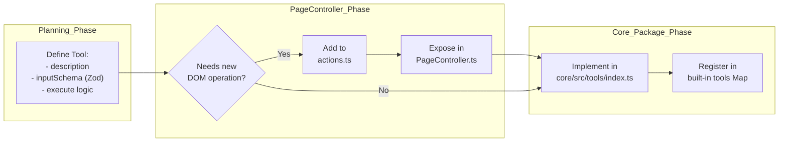
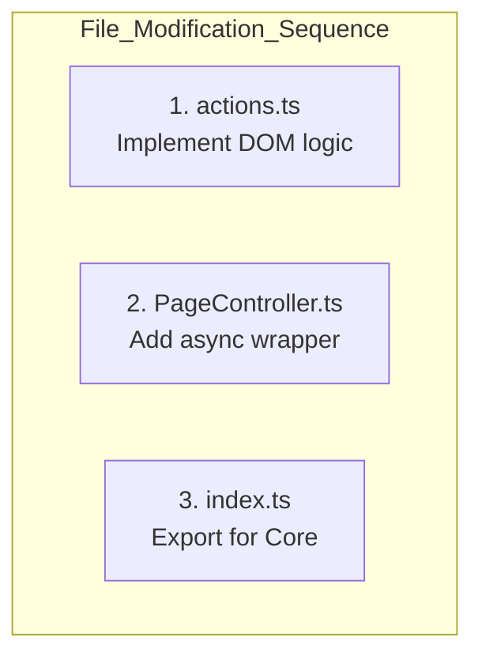

<!-- source: DeepWiki mcp.deepwiki.com · repo alibaba/page-agent · page 13.3 Adding Features · fetched 2026-10-29 -->

# Adding Features

<details>
<summary>Relevant source files</summary>

The following files were used as context for generating this wiki page:

- [.gitignore](.gitignore)
- [AGENTS.md](AGENTS.md)
- [CLAUDE.md](CLAUDE.md)
- [CONTRIBUTING.md](CONTRIBUTING.md)
- [packages/core/src/tools/index.ts](packages/core/src/tools/index.ts)
- [packages/extension/src/agent/TabsController.test.ts](packages/extension/src/agent/TabsController.test.ts)
- [packages/extension/src/agent/tabTools.ts](packages/extension/src/agent/tabTools.ts)
- [packages/extension/vitest.config.js](packages/extension/vitest.config.js)

</details>


## Purpose and Scope

This document provides technical guidelines for adding new features to the PageAgent codebase, specifically focusing on:

- Adding new agent tools that extend the agent's capabilities.
- Adding new PageController actions for DOM manipulation.
- Adding tab-specific tools for the browser extension.
- Maintaining proper module boundaries in the monorepo architecture.

For general development setup and environment configuration, see [Development Setup](#13.1). For testing new features, see [Testing and Quality](#13.4).

**Sources:** [AGENTS.md:115-128](), [CONTRIBUTING.md:5-26]()

## Understanding Module Boundaries

The PageAgent monorepo enforces strict module boundaries to maintain separation of concerns. Understanding these boundaries is essential before adding new features.

### Layered Architecture

```mermaid
graph TB
    subgraph "Entry_Points"
        ["PageAgent"] -- "packages/page-agent/src/PageAgent.ts" --> PA[PageAgent]
        ["Extension"] -- "packages/extension/" --> EXT[Extension]
    end
    
    subgraph "Core_Logic_Layer"
        ["PageAgentCore"] -- "packages/core/src/PageAgentCore.ts" --> CORE[PageAgentCore]
        ["Tools"] -- "packages/core/src/tools/index.ts" --> TOOLS[tools]
    end
    
    subgraph "Intelligence_Layer"
        ["LLM_Client"] -- "packages/llms/src/index.ts" --> LLMS[LLM]
        ["OpenAIClient"] -- "packages/llms/src/OpenAIClient.ts" --> OPENAI[OpenAIClient]
    end
    
    subgraph "Browser_Control_Layer"
        ["PageController"] -- "packages/page-controller/src/PageController.ts" --> PC[PageController]
        ["Actions"] -- "packages/page-controller/src/actions.ts" --> ACTIONS[actions]
        ["DOM_Tree"] -- "packages/page-controller/src/dom/dom_tree/" --> DOM[dom_tree]
        ["SimulatorMask"] -- "packages/page-controller/src/SimulatorMask.ts" --> MASK[SimulatorMask]
    end
    
    subgraph "UI_Layer"
        ["Panel"] -- "packages/ui/" --> UI[Panel]
    end
    
    PA -->|"extends"| CORE
    PA -->|"imports"| UI
    EXT -->|"uses"| CORE
    
    CORE -->|"uses"| LLMS
    CORE -->|"uses"| PC
    CORE -->|"contains"| TOOLS
    
    LLMS -->|"implements"| OPENAI
    
    PC -->|"contains"| ACTIONS
    PC -->|"contains"| DOM
    PC -->|"manages"| MASK
```

**Diagram: Module Dependency Graph with Code Entities**

**Sources:** [AGENTS.md:31-56](), [AGENTS.md:82-113]()

### Module Responsibility Matrix

| Package | Primary Responsibility | Can Import From | Key Files |
|---------|----------------------|-----------------|-----------|
| `@page-agent/page-controller` | DOM operations, visual feedback | None (independent) | [packages/page-controller/src/PageController.ts](), [packages/page-controller/src/actions.ts]() |
| `@page-agent/llms` | LLM client, MacroTool contract | `zod` (peer) | [packages/llms/src/index.ts](), [packages/llms/src/types.ts]() |
| `@page-agent/ui` | Panel components, i18n | None (via adapter) | [packages/ui/]() |
| `@page-agent/core` | Agent orchestration, Re-act loop | `llms`, `page-controller` | [packages/core/src/PageAgentCore.ts](), [packages/core/src/tools/index.ts]() |
| `page-agent` | User-facing entry with UI | `core`, `ui`, `page-controller` | [packages/page-agent/src/PageAgent.ts]() |
| `@page-agent/extension` | Chrome extension | All packages | [packages/extension/]() |

**Sources:** [AGENTS.md:49-56]()

## Adding New Agent Tools

Agent tools extend the capabilities of the `PageAgentCore` Re-act loop. Tools are defined in the `@page-agent/core` package and can perform actions via `PageController` methods.

### Tool Implementation Flow



**Diagram: Tool Addition Workflow**

**Sources:** [AGENTS.md:117-122](), [packages/core/src/PageAgentCore.ts:93-94]()

### Step-by-Step: Adding a New Tool

**1. Determine if New PageController Method is Required**
If your tool needs DOM operations not provided by existing methods, add them first. Existing methods available in `PageController` include:
- `clickElement(index)` [packages/core/src/tools/index.ts:101-101]()
- `inputText(index, text)` [packages/core/src/tools/index.ts:116-116]()
- `scroll(input)` [packages/core/src/tools/index.ts:153-156]()
- `executeJavascript(script, signal)` [packages/core/src/tools/index.ts:193-193]()

**2. Implement Tool Definition**
Add your tool to `packages/core/src/tools/index.ts` using the `tool()` helper [packages/core/src/tools/index.ts:28-30](). Tools must implement the `PageAgentTool` interface, which provides access to the `PageAgentCore` context via `this` [packages/core/src/tools/index.ts:21-26]().

```typescript
tools.set(
	'my_new_tool',
	tool({
		description: 'Description for LLM',
		inputSchema: z.object({ param: z.string() }),
		execute: async function (this: PageAgentCore, input, { signal }) {
			// Call PageController
			const result = await this.pageController.someMethod(input.param);
			return result.message;
		},
	})
)
```

**3. Cooperative Cancellation**
Tools MUST honor the `signal` provided in `ToolContext` to support cancellation [packages/core/src/tools/index.ts:11-16](). Use `waitFor` or pass the signal to async DOM operations [packages/core/src/tools/index.ts:67-67]().

**Sources:** [packages/core/src/tools/index.ts:1-203](), [AGENTS.md:117-122]()

### Adding Extension-Specific Tools
For the browser extension, tools that manage tabs are injected into the agent. These tools are defined in `packages/extension/src/agent/tabTools.ts` and bound to a `TabsController` [packages/extension/src/agent/tabTools.ts:25-25]().

Available extension tools include:
- `open_new_tab`: Opens a URL and sets the new tab as current [packages/extension/src/agent/tabTools.ts:27-43]().
- `switch_to_tab`: Switches focus to an existing tab ID [packages/extension/src/agent/tabTools.ts:45-59]().
- `close_tab`: Closes a specific tab [packages/extension/src/agent/tabTools.ts:61-75]().

**Sources:** [packages/extension/src/agent/tabTools.ts:1-77]()

## Adding PageController Actions

`PageController` actions are low-level DOM operations. These are defined in the `@page-agent/page-controller` package.

### PageController Modification Flow



**Sources:** [AGENTS.md:123-128]()

### Step-by-Step: Adding an Action

1.  **Implement Logic**: Add the implementation in `packages/page-controller/src/actions.ts` [AGENTS.md:125-125]().
2.  **Expose in Class**: Add an async method to `PageController.ts` [AGENTS.md:126-126]().
3.  **Export**: Ensure the method is exported from `packages/page-controller/src/index.ts` [AGENTS.md:127-127]().

**Sources:** [AGENTS.md:106-113](), [AGENTS.md:123-128]()

## Maintaining Module Boundaries

### Communication Standards
All communication between `PageAgent` and `PageController` is async and isolated [AGENTS.md:59-60](). 
- `PageAgent` delegates DOM operations to `PageController` [AGENTS.md:62-66]().
- `PageController` exposes state via async methods like `getSimplifiedHTML()` [AGENTS.md:69-69]() or `getPageInfo()` [AGENTS.md:70-70]().

### Prohibited Dependencies
- **LLMs**: Must have no dependency on `page-agent` [AGENTS.md:53-53]().
- **Page Controller**: Must have no LLM dependency [AGENTS.md:55-55]().
- **Core**: PageAgentCore is headless and must not import from UI packages [AGENTS.md:52-52]().
- **UI**: Must be decoupled from PageAgent via the `PanelAgentAdapter` interface [AGENTS.md:54-54]().

**Sources:** [AGENTS.md:49-56]()

## Development Workflow

### Feature Implementation Checklist
1.  **Explicit Typing**: Use explicit typing for all public APIs [AGENTS.md:146-146]().
2.  **English Only**: All code and comments must be in English [AGENTS.md:149-149]().
3.  **Build Verification**: Run `npm run build:libs` to ensure internal package references are updated [AGENTS.md:23-23]().
4.  **Linting**: Ensure code passes `npm run lint` [AGENTS.md:27-27]().
5.  **Manual Testing**: Test in the demo website or Chrome extension [CONTRIBUTING.md:24-25]().
6.  **No Vibe Coding**: Vibe coding is prohibited for core libs and the extension [CONTRIBUTING.md:29-29]().

**Sources:** [AGENTS.md:144-152](), [CONTRIBUTING.md:18-32]()

---

