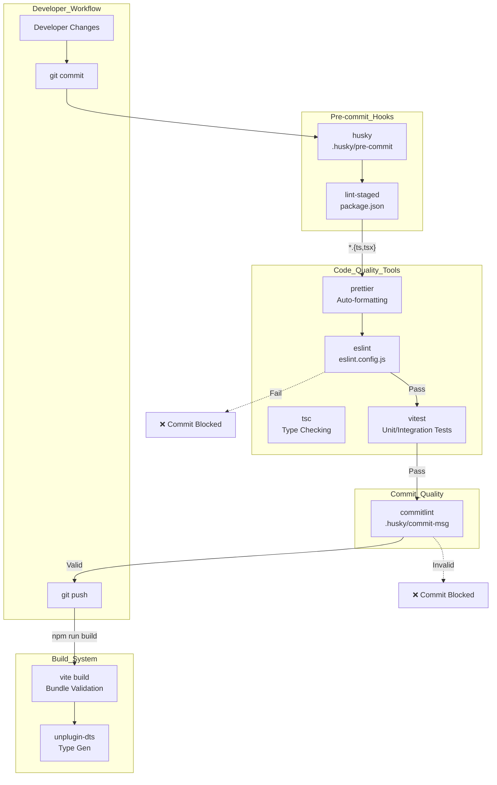
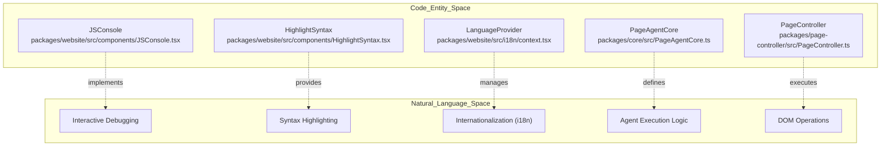

<!-- source: DeepWiki mcp.deepwiki.com · repo alibaba/page-agent · page 13.4 Testing and Quality · fetched 2026-10-29 -->

# Testing and Quality

Relevant source files

The following files were used as context for generating this wiki page:

- [.agents/skills/git-cleanup/SKILL.md](.agents/skills/git-cleanup/SKILL.md)
- [.agents/skills/submit-pr-from-current-changes/SKILL.md](.agents/skills/submit-pr-from-current-changes/SKILL.md)
- [.agents/skills/update-changelog/SKILL.md](.agents/skills/update-changelog/SKILL.md)
- [eslint.config.js](eslint.config.js)
- [packages/core/src/PageAgentCore.test.ts](packages/core/src/PageAgentCore.test.ts)
- [packages/core/vitest.config.js](packages/core/vitest.config.js)
- [packages/llms/src/models.live.test.ts](packages/llms/src/models.live.test.ts)
- [packages/llms/tsconfig.json](packages/llms/tsconfig.json)
- [packages/llms/vitest.config.js](packages/llms/vitest.config.js)
- [packages/page-controller/src/PageController.test.ts](packages/page-controller/src/PageController.test.ts)
- [packages/page-controller/vitest.config.js](packages/page-controller/vitest.config.js)
- [packages/website/src/i18n/context.tsx](packages/website/src/i18n/context.tsx)

This document covers the quality assurance infrastructure, testing methodologies, and development workflows used to maintain code quality in the PageAgent monorepo. The focus is on automated testing via Vitest, static analysis, and CI/CD pipelines.

## Overview

PageAgent employs a multi-layered quality strategy:
- **Unit and Integration Testing**: Automated test suites for core logic and LLM interactions using Vitest.
- **Live Compatibility Testing**: Real-world API verification for multiple LLM providers.
- **Static Analysis**: ESLint with strict TypeScript rules and React-specific plugins.
- **CI Automation**: A centralized script for parallelizing linting, type-checking, and testing.
- **Commit Standards**: Enforced conventional commits and pre-commit hooks.

## Code Quality Infrastructure

### Quality Toolchain Architecture

The following diagram maps the quality enforcement process from local development to the final build artifacts.

**Quality Enforcement Points**:
1.  **Pre-commit**: Husky triggers `lint-staged` [.husky/pre-commit:1]().
2.  **Linting**: ESLint validates TypeScript files using strict rules [eslint.config.js:16-24]().
3.  **Testing**: Vitest runs package-specific test suites (e.g., `packages/core/src/PageAgentCore.test.ts`) [packages/core/vitest.config.js:6]().
4.  **Commit message**: Commitlint validates conventional commit format via a hook [.husky/commit-msg:1]().

Sources: [eslint.config.js:1-62](), [packages/core/vitest.config.js:1-10](), [.husky/pre-commit:1](), [.husky/commit-msg:1]()

### ESLint Configuration

The project uses ESLint Flat Config (`eslint.config.js`) with a focus on strict TypeScript and React rules.

**Core Configuration Strategy**:
The configuration utilizes `typescript-eslint`'s recommended, strict, and stylistic type-checked rulesets [eslint.config.js:19-22](). It also incorporates `eslint-react` for robust UI code validation [eslint.config.js:23]().

**Key Settings**:
- **Parser**: Uses `projectService: true` for optimized TypeScript parsing [eslint.config.js:27]().
- **Global Ignores**: Build artifacts (`dist`, `node_modules`, `.wxt`, `.output`) and standard UI components are excluded from linting [eslint.config.js:8-14]().

**Rule Customization**:
While strict, the project disables several rules to allow for rapid iteration in an AI-driven context. For example, `@typescript-eslint/no-explicit-any` and `@typescript-eslint/no-unsafe-assignment` are set to `off` [eslint.config.js:33-60]().

Sources: [eslint.config.js:1-62]()

## Automated Testing

### Unit and Integration Testing

The codebase uses Vitest for testing. Each package contains its own `vitest.config.js` and test files suffixed with `.test.ts`.

| Test File | Focus Area | Key Mocks/Tools |
| :--- | :--- | :--- |
| `PageAgentCore.test.ts` | Agent lifecycle, tool execution, and task abortion. | `createFetchMock`, `createPageController` [packages/core/src/PageAgentCore.test.ts:33-70]() |
| `PageController.test.ts` | DOM interaction, URL retrieval, and JS execution. | `happy-dom` environment [packages/page-controller/src/PageController.test.ts:5-40]() |
| `models.live.test.ts` | Real-world API compatibility for LLM providers. | `OpenAIClient`, `toOpenRouterModelId` [packages/llms/src/models.live.test.ts:1-30]() |

### Core Agent Testing
The `PageAgentCore` tests verify the Re-act loop behavior, ensuring the agent can run tasks to completion [packages/core/src/PageAgentCore.test.ts:122-131](), handle task failures reported by the LLM [packages/core/src/PageAgentCore.test.ts:133-141](), and correctly abort tasks when `stop()` or `dispose()` is called [packages/core/src/PageAgentCore.test.ts:156-202]().

### Live Compatibility Testing
The `llms` package includes a specialized suite for hitting real provider APIs (e.g., OpenRouter, Aliyun, DeepSeek) [packages/llms/src/models.live.test.ts:1-21]().
- **Purpose**: Verify request formatting and `modelPatch` work across providers [packages/llms/src/models.live.test.ts:4-8]().
- **Execution**: Excluded from standard `npm test` due to cost and speed; run via `npm run test:live` [packages/llms/vitest.config.js:3-4]().
- **Concurrency**: Limited to `maxConcurrency: 2` to avoid rate limits [packages/llms/vitest.config.js:22]().

Sources: [packages/core/src/PageAgentCore.test.ts:1-202](), [packages/llms/src/models.live.test.ts:1-220](), [packages/llms/vitest.config.js:1-27](), [packages/page-controller/src/PageController.test.ts:1-41]()

## CI and Development Workflows

### The CI Script (`scripts/ci.js`)
The project provides a `scripts/ci.js` utility that mirrors the checks performed in GitHub Actions. It executes the following in parallel to minimize developer wait time:
1. **Linting**: `npm run lint` [scripts/ci.js:43]().
2. **Formatting**: `prettier --check .` [scripts/ci.js:44]().
3. **Type-checking**: `npm run typecheck` [scripts/ci.js:45]().
4. **Testing**: `npm test` [scripts/ci.js:46]().

Sources: [scripts/ci.js:1-57]()

### Manual Testing and Verification

PageAgent relies on manual testing workflows using built-in website tools and the Chrome extension.

**Testing Tools in Codebase**:
- **JSConsole**: A debugging console suitable for running code snippets directly in the documentation to verify real-time results [packages/website/src/components/JSConsole.tsx:1-4]().
- **LanguageProvider**: Manages testing across different locales (`en-US` and `zh-CN`) [packages/website/src/i18n/context.tsx:3-9]().
- **PageController**: Facilitates direct DOM testing and JavaScript execution within the browser context [packages/page-controller/src/PageController.test.ts:12-38]().

Sources: [packages/website/src/components/JSConsole.tsx:1-170](), [packages/website/src/i18n/context.tsx:1-35](), [packages/page-controller/src/PageController.test.ts:1-41]()

## Commit and PR Conventions

### Branch and Commit Naming
The project follows Conventional Commits. Branches should be prefixed with `fix/`, `feat/`, `docs/`, `refactor/`, or `chore/` followed by a kebab-case topic [.agents/skills/submit-pr-from-current-changes/SKILL.md:69-74](). Commits must use the `type(scope): subject` format [.agents/skills/submit-pr-from-current-changes/SKILL.md:75-80]().

### Pull Request Standards
When submitting PRs, the following rules apply:
1. **Follow the Template**: Use the full structure from `.github/PULL_REQUEST_TEMPLATE.md` [.agents/skills/submit-pr-from-current-changes/SKILL.md:14]().
2. **Requirements Section**: AI agents must never check "Requirements" checkboxes (e.g., Code of Conduct); these are human-only declarations [.agents/skills/submit-pr-from-current-changes/SKILL.md:15]().
3. **Testing Section**: Only check boxes for tests actually executed in the current session [.agents/skills/submit-pr-from-current-changes/SKILL.md:16]().
4. **Health Checks**: Run `npm run ci` before creating a PR to ensure build, lint, and tests pass [.agents/skills/submit-pr-from-current-changes/SKILL.md:44, 85]().

Sources: [.agents/skills/submit-pr-from-current-changes/SKILL.md:1-97](), [.github/PULL_REQUEST_TEMPLATE.md:1-25]()

---

