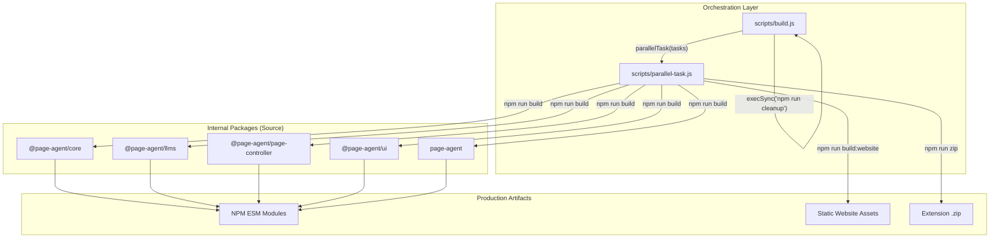
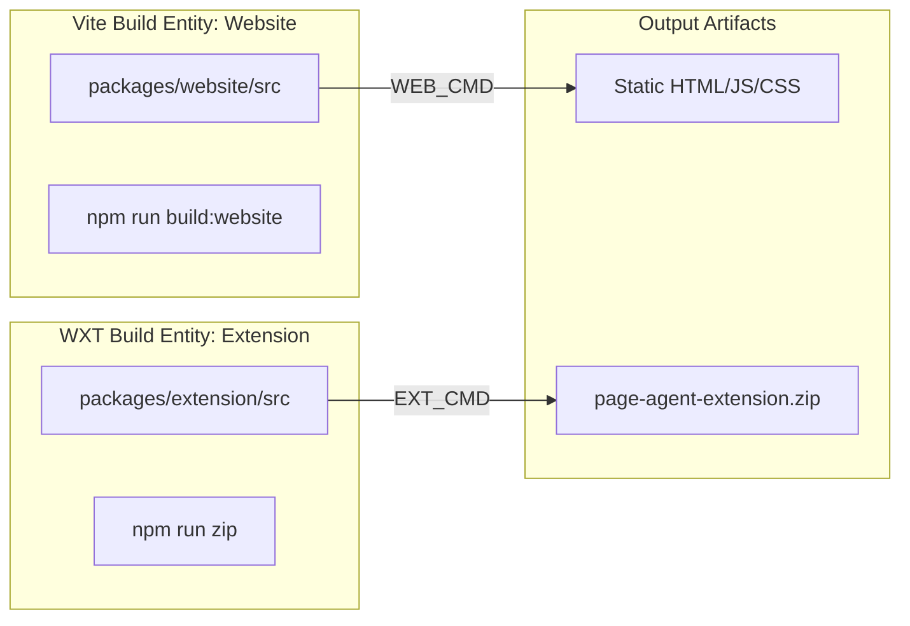

<!-- source: DeepWiki mcp.deepwiki.com · repo alibaba/page-agent · page 14.1 Building for Production · fetched 2026-10-29 -->

# Building for Production

Relevant source files

The following files were used as context for generating this wiki page:

- [packages/core/vite.config.js](packages/core/vite.config.js)
- [packages/llms/vite.config.js](packages/llms/vite.config.js)
- [packages/page-agent/vite.config.js](packages/page-agent/vite.config.js)
- [packages/page-controller/vite.config.js](packages/page-controller/vite.config.js)
- [packages/ui/vite.config.js](packages/ui/vite.config.js)
- [scripts/build-libs.js](scripts/build-libs.js)
- [scripts/build.js](scripts/build.js)
- [scripts/parallel-task.js](scripts/parallel-task.js)

## Purpose and Scope

This document explains the build process for PageAgent's production artifacts, covering the library packages, the documentation website, and the Chrome extension. PageAgent utilizes a monorepo structure with npm workspaces, where packages are compiled independently or bundled together depending on the target distribution channel.

**Sources:** [scripts/build.js:1-10](), [packages/page-agent/vite.config.js:10-11]()

---

## Build Overview

The build system produces three primary categories of output using Vite, WXT (Web Extension Tools), and custom orchestration scripts.

| Output Category | Build Script | Key Technology | Distribution |
| :--- | :--- | :--- | :--- |
| **Library Packages** | `scripts/build-libs.js` | Vite (Library Mode) | NPM Registry |
| **Website & Demo** | `packages/website` | Vite + React | Static Hosting |
| **Chrome Extension** | `packages/extension` | WXT | Chrome Web Store |

### Build Orchestration Flow

The build process is managed by a top-level `scripts/build.js` which executes a cleanup phase followed by a parallelized execution of all workspace build scripts.

**Diagram: Production Build Pipeline**

**Sources:** [scripts/build.js:1-46](), [scripts/parallel-task.js:11-37](), [scripts/build-libs.js:17-25]()

---

## Library Package Compilation

The core libraries are built as ES Modules. The build process is orchestrated by `scripts/build-libs.js`, which identifies workspaces with a `build` script and executes them concurrently using `parallelTask`.

### Parallel Execution Logic
The `parallelTask` function in `scripts/parallel-task.js` manages the execution of multiple shell commands. It provides:
- **Progress Reporting**: A terminal spinner and status indicator showing `done/total` tasks [scripts/parallel-task.js:30-37]().
- **Concurrency**: Tasks run in parallel via `child_process.spawn` [scripts/parallel-task.js:49-53]().
- **Timeout Management**: A default 30s timeout (configurable, default 120s in build scripts) to prevent hanging builds [scripts/parallel-task.js:58-60](), [scripts/build.js:45]().

### Vite Library Configuration
Each package uses a `vite.config.js` optimized for library distribution. Common patterns include:
- **DTS Generation**: `unplugin-dts` is used with `emitDeclarationOnly: true` and `bundleTypes: true` to generate type definitions [packages/core/vite.config.js:14-22](), [packages/page-controller/vite.config.js:16-24]().
- **CSS Injection**: `vite-plugin-css-injected-by-js` ensures that component styles are bundled directly into the JS entry point, simplifying consumer integration [packages/ui/vite.config.js:27](), [packages/page-agent/vite.config.js:25]().
- **Externalization**: To prevent bloat, packages mark internal `@page-agent/*` dependencies and heavy libraries like `zod` as external [packages/page-agent/vite.config.js:36-44](), [packages/llms/vite.config.js:36-38]().

**Sources:** [scripts/parallel-task.js:11-115](), [packages/page-agent/vite.config.js:11-50](), [packages/llms/vite.config.js:12-43]()

---

## Distribution Formats

PageAgent supports multiple distribution formats to cater to different integration needs.

### ES Modules (NPM)
Targeted at developers using modern bundlers (Webpack, Vite, Rollup).
- **Output Directory**: Typically `dist/esm` or `dist/lib` [packages/core/vite.config.js:35](), [packages/llms/vite.config.js:35]().
- **Source Maps**: Enabled for production debugging [packages/page-agent/vite.config.js:46]().
- **Formats**: Configured as `['es']` in Vite [packages/page-controller/vite.config.js:35]().

### Extension and Website Assets
The top-level `scripts/build.js` coordinates the final assembly of the website and the extension.

**Diagram: Website and Extension Build Mapping**

**Sources:** [scripts/build.js:36-43](), [packages/page-agent/vite.config.js:29-35]()

---

## Production Optimizations

Across all build targets, several optimizations are applied:

| Optimization | Implementation | Benefit |
| :--- | :--- | :--- |
| **CSS Inlining** | `cssInjectedByJsPlugin` | Removes the need for users to manually import `.css` files [packages/page-agent/vite.config.js:25](). |
| **DTS Bundling** | `dts({ bundleTypes: true })` | Provides a clean, single-file API definition for consumers [packages/core/vite.config.js:17](). |
| **Environment Locking** | `define: { 'process.env.NODE_ENV': '"production"' }` | Triggers tree-shaking and performance modes in React and other libs [packages/ui/vite.config.js:46](). |
| **Minification Control** | `minify: false` (in libs) | Libraries often disable minification to allow the consumer's final bundler to handle it [packages/llms/vite.config.js:39](). |
| **Warning Suppression** | `onwarn` handler | Specifically ignores `EVAL` warnings in certain modules to keep build logs clean [packages/page-controller/vite.config.js:40-43](). |

**Sources:** [packages/page-agent/vite.config.js:25-50](), [packages/core/vite.config.js:14-52](), [packages/ui/vite.config.js:45-48](), [packages/page-controller/vite.config.js:40-43]()

---

