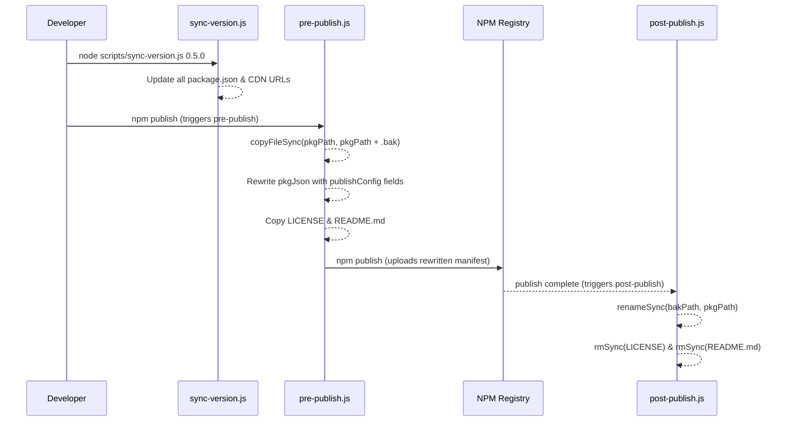

<!-- source: DeepWiki mcp.deepwiki.com · repo alibaba/page-agent · page 14.2 NPM Package Distribution · fetched 2026-10-29 -->

# NPM Package Distribution

<details>
<summary>Relevant source files</summary>

The following files were used as context for generating this wiki page:

- [packages/extension/src/types/globals.d.ts](packages/extension/src/types/globals.d.ts)
- [scripts/post-publish.js](scripts/post-publish.js)
- [scripts/pre-publish.js](scripts/pre-publish.js)
- [scripts/sync-version.js](scripts/sync-version.js)

</details>


## Purpose and Scope

This document covers the NPM package distribution model for PageAgent, including which packages are published to the NPM registry, version management strategy, publishing workflows, and package structure. This page details the implementation of the `sync-version.js` utility and the manifest rewriting logic used during the publishing process to ensure clean, production-ready package metadata.

## Published vs Private Packages

The PageAgent monorepo contains several packages with different distribution targets. The internal dependency resolution is managed by `isInternalPackage` which identifies `page-agent` or `@page-agent/*` scoped packages [scripts/sync-version.js:56-58]().

### Published Packages

| Package Name | Description | Primary Consumers |
|--------------|-------------|-------------------|
| `page-agent` | Main integration package with UI panel | End users, application developers |
| `@page-agent/core` | Headless agent orchestration logic | Extension, advanced integrations |
| `@page-agent/llms` | LLM client with retry logic | Core package, extension |
| `@page-agent/page-controller` | DOM operations and browser state extraction | Core package, extension |
| `@page-agent/ui` | Panel components with i18n support | Main package, extension |
| `@page-agent/mcp` | Model Context Protocol server | Claude Desktop, Cursor, IDEs |

### Private Packages

- `@page-agent/extension` - Chrome extension (distributed via Chrome Web Store)
- `@page-agent/website` - Documentation and demo site (deployed to GitHub Pages)

**Sources:** [scripts/sync-version.js:45-50](), [scripts/sync-version.js:56-58]()

### Package Distribution Architecture

```mermaid
graph TB
    subgraph "Published_to_NPM_Registry"
        [page-agent]
        ["@page-agent/core"]
        ["@page-agent/llms"]
        ["@page-agent/page-controller"]
        ["@page-agent/ui"]
        ["@page-agent/mcp"]
    end
    
    subgraph "Private_Store_Distributed"
        ["@page-agent/extension"]
        ["@page-agent/website"]
    end
    
    subgraph "Release_Flow"
        ["Git Tag v*"] --> ["GitHub Actions Release"]
        ["GitHub Actions Release"] -->|npm_publish| [page-agent]
        ["GitHub Actions Release"] -->|npm_publish| ["@page-agent/core"]
        ["GitHub Actions Release"] -->|npm_publish| ["@page-agent/llms"]
        ["GitHub Actions Release"] -->|npm_publish| ["@page-agent/page-controller"]
        ["GitHub Actions Release"] -->|npm_publish| ["@page-agent/ui"]
        ["GitHub Actions Release"] -->|npm_publish| ["@page-agent/mcp"]
    end
```

**Sources:** [scripts/sync-version.js:45-50]()

## Version Management

The monorepo maintains synchronized versions across all packages using a centralized versioning script to ensure compatibility across the ecosystem.

### Version Synchronization Script

The `scripts/sync-version.js` script automates the process of propagating a version change from the root `package.json` to all sub-packages.

**Key Functions:**
- `isInternalPackage(name)`: Identifies if a dependency is a PageAgent internal package (`page-agent` or `@page-agent/*`) [scripts/sync-version.js:56-58]().
- `updateInternalDeps(deps, newVersion)`: Iterates through a `package.json`'s `dependencies` object and updates internal package versions to match the new release version, while ignoring devDependencies that typically use `"*"` [scripts/sync-version.js:64-74](), [scripts/sync-version.js:89-92]().

**Workflow of sync-version.js:**
1. **Version Resolution:** Reads the target version from CLI arguments or root `package.json` [scripts/sync-version.js:18-24]().
2. **Root Update:** Updates the root `package.json` if a new version argument was provided [scripts/sync-version.js:34-40]().
3. **Package Iteration:** Iterates through the `packages/` directory, updating the `version` field in each sub-package [scripts/sync-version.js:76-87]().
4. **Dependency Sync:** Updates internal cross-dependencies within each package's `dependencies` block [scripts/sync-version.js:90-92]().
5. **CDN URL Updates:** Automatically finds and replaces versioned CDN links (jsDelivr and npmmirror) in `README.md`, `docs/README-zh.md`, and `packages/website/src/constants.ts` [scripts/sync-version.js:107-130]().

**Sources:** [scripts/sync-version.js:1-145]()

### Versioning Logic Flow

```mermaid
graph TD
    ["Developer Run"] --> ["node scripts/sync-version.js 0.5.0"]
    ["node scripts/sync-version.js 0.5.0"] --> ["Update rootPkgPath package.json"]
    
    subgraph "Propagation_Logic"
        ["Update rootPkgPath package.json"] --> ["Iterate packagesDir"]
        ["Iterate packagesDir"] --> ["Update pkgJson version"]
        ["Update pkgJson version"] --> ["updateInternalDeps - Update internal dependencies"]
    end
    
    ["updateInternalDeps - Update internal dependencies"] --> ["Update CDN URLs in README.md and constants.ts"]
    ["Update CDN URLs in README.md and constants.ts"] --> ["Output Git Tag Commands Hint"]
```

**Sources:** [scripts/sync-version.js:34-43](), [scripts/sync-version.js:64-74](), [scripts/sync-version.js:76-105](), [scripts/sync-version.js:107-130]()

## Package Manifest Rewriting

To support dual-distribution (development vs. production) and clean NPM packages, the codebase utilizes pre-publish and post-publish scripts to modify `package.json` temporarily.

### Pre-Publish Logic (`pre-publish.js`)
This script prepares a package for the NPM registry by modifying the `package.json` manifest:
- **Manifest Rewriting:** It promotes fields from `publishConfig` (like `main`, `module`, `types`, `exports`) to the top level of the manifest and then deletes the `publishConfig` object [scripts/pre-publish.js:27-30]().
- **Backup:** A byte-for-byte backup of the original `package.json` is created as `package.json.bak` to allow restoration after publishing [scripts/pre-publish.js:24]().
- **Asset Injection:** Copies the root `LICENSE` to the package directory [scripts/pre-publish.js:36](). For the main `page-agent` package, it also copies the root `README.md` to ensure the NPM page is populated [scripts/pre-publish.js:39-42]().

### Post-Publish Logic (`post-publish.js`)
This script restores the development environment after the `npm publish` command completes:
- **Restoration:** Renames `bakPath` back to `pkgPath` [scripts/post-publish.js:21]().
- **Cleanup:** Removes the copied `LICENSE` and `README.md` files from the package directory to keep the source tree clean [scripts/post-publish.js:24-30]().

**Sources:** [scripts/pre-publish.js:1-43](), [scripts/post-publish.js:1-31]()

## Distribution Lifecycle Diagram



**Sources:** [scripts/sync-version.js:1-145](), [scripts/pre-publish.js:1-43](), [scripts/post-publish.js:1-31]()

## Metadata and Global Constants

During the build process, the version is often injected into the source code to provide runtime version information. In the extension context, a global `__VERSION__` constant is declared in the global namespace [packages/extension/src/types/globals.d.ts:1]().

**Sources:** [packages/extension/src/types/globals.d.ts:1]()

---

