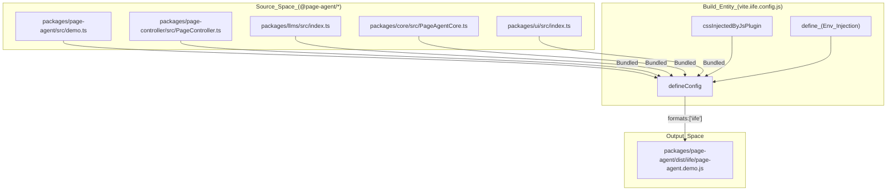
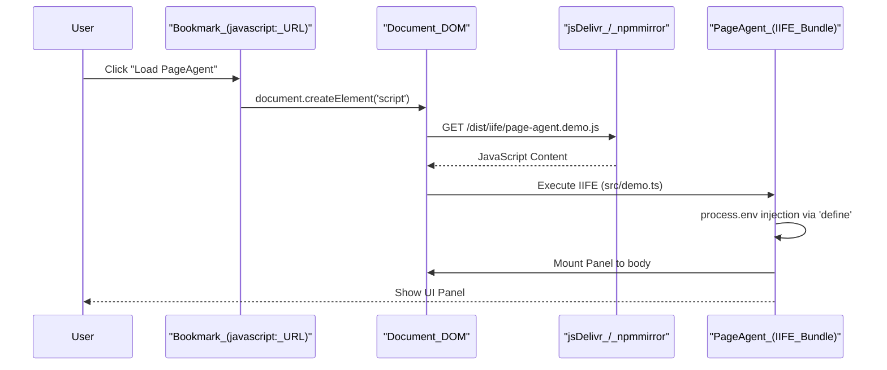

<!-- source: DeepWiki mcp.deepwiki.com · repo alibaba/page-agent · page 14.3 CDN and Bookmarklet · fetched 2026-10-29 -->

# CDN and Bookmarklet

Relevant source files

The following files were used as context for generating this wiki page:

- [README.md](README.md)
- [docs/README-zh.md](docs/README-zh.md)
- [packages/page-agent/vite.iife.config.js](packages/page-agent/vite.iife.config.js)
- [packages/website/src/constants.ts](packages/website/src/constants.ts)
- [packages/website/vite.config.js](packages/website/vite.config.js)

## Purpose and Scope

This document covers the distribution of PageAgent via Content Delivery Networks (CDN) and the IIFE (Immediately Invoked Function Expression) build format. It explains how to integrate PageAgent into web pages without a build step, the configuration of the IIFE build process, and bookmarklet usage patterns for rapid testing on any website.

---

## Overview of Distribution Formats

PageAgent provides two primary distribution formats for browser consumption:

| Format | Use Case | Entry Point | Auto-initialization |
|--------|----------|-------------|---------------------|
| **ESM** | Modern bundlers, NPM install | `src/PageAgent.ts` | No |
| **IIFE Demo** | Quick testing, CDN script tag | `src/demo.ts` | Yes |

The IIFE demo build is specifically designed for zero-configuration testing, automatically initializing PageAgent with a testing LLM endpoint defined in the build environment.

Sources: [README.md:58-61](), [README.md:74-85](), [packages/page-agent/vite.iife.config.js:25-28]()

---

## IIFE Build System

### Build Configuration

The IIFE build is generated using `vite.iife.config.js`. Unlike the standard ESM build, this configuration targets a demo entry point and inlines all dependencies to create a single, self-contained bundle.

**Key Configuration Details:**
- **Entry Point**: Uses `src/demo.ts` as the entry point for the IIFE build, which typically handles auto-mounting [packages/page-agent/vite.iife.config.js:25-25]().
- **CSS Injection**: Uses `vite-plugin-css-injected-by-js` to bundle all styles into the JavaScript file, ensuring the agent UI renders correctly without external CSS links [packages/page-agent/vite.iife.config.js:6-6](), [packages/page-agent/vite.iife.config.js:19-19]().
- **Environment Variables**: Injects `LLM_MODEL_NAME`, `LLM_API_KEY`, and `LLM_BASE_URL` from the root `.env` file at build time using Vite's `define` property [packages/page-agent/vite.iife.config.js:44-48]().
- **Rollup Options**: Silences `EVAL` warnings which often occur when bundling certain LLM or UI dependencies [packages/page-agent/vite.iife.config.js:38-41]().

Sources: [packages/page-agent/vite.iife.config.js:1-49]()

### Code-to-System Mapping: IIFE Build

This diagram shows how the Vite configuration maps source entities into the final IIFE bundle.

**IIFE Mapping Architecture**

Sources: [packages/page-agent/vite.iife.config.js:24-30](), [packages/page-agent/vite.iife.config.js:44-48]()

---

## CDN Distribution

### Available CDN Mirrors

PageAgent IIFE builds are distributed through global and regional CDN mirrors. Users can reference the package published to NPM via these providers.

| Mirror | URL Pattern | Use Case |
|--------|-------------|----------|
| **jsDelivr** | `https://cdn.jsdelivr.net/npm/page-agent@1.12.2/dist/iife/page-agent.demo.js` | Global users |
| **npmmirror** | `https://registry.npmmirror.com/page-agent/1.12.2/files/dist/iife/page-agent.demo.js` | Mainland China (Lower latency) |

The versioned URLs ensure stability for integrations while allowing quick updates through the NPM publishing workflow.

Sources: [README.md:58-64](), [packages/website/src/constants.ts:2-5]()

---

## Bookmarklet Usage

### Concept and Implementation

A bookmarklet is a small snippet of JavaScript stored as a URL in a browser bookmark. When clicked, it injects the PageAgent IIFE script into the current page's DOM.

**Execution Flow:**
1. **Injection**: The bookmarklet creates a `<script>` element.
2. **Loading**: It sets the `src` to the CDN URL (e.g., from jsDelivr).
3. **Initialization**: Upon script load, the IIFE executes. By default, it automatically initializes the agent using the hardcoded demo LLM configuration unless `?autoInit=false` is appended to the URL [README.md:69-69]().

### Data Flow: Bookmarklet Injection

**Bookmarklet Injection Sequence**

Sources: [README.md:58-69](), [packages/page-agent/vite.iife.config.js:25-28](), [packages/page-agent/vite.iife.config.js:44-48]()

---

## Technical Detail: CSS Injection

Because the IIFE build is intended for third-party websites (via bookmarklet or CDN), it cannot rely on external CSS files which might be blocked by Content Security Policy (CSP) or relative path issues.

The `vite-plugin-css-injected-by-js` plugin is used in the build pipeline. It takes the styles defined in the project and wraps them in a JavaScript function that creates a `<style>` tag in the document head at runtime.

**Configuration Site:**
- **IIFE**: [packages/page-agent/vite.iife.config.js:19-19]()

---

## Security and Limitations

### Content Security Policy (CSP)
Many production websites use `script-src` and `connect-src` CSP headers.
- **Script Block**: If a site disallows scripts from `cdn.jsdelivr.net`, the bookmarklet will fail to load.
- **Connect Block**: If a site disallows connections to the LLM `baseURL` (e.g., the demo endpoint at `fcapp.run`), the agent will be able to load its UI but will fail when attempting to communicate with the LLM [packages/website/src/constants.ts:9-9]().

### Environment Variable Exposure
The IIFE demo build contains the `LLM_API_KEY` (if provided) and `LLM_BASE_URL` in plain text within the bundle because they are hardcoded at build time using Vite's `define` feature. 
- **Demo Build**: Intended for public-facing demos with restricted keys or free testing APIs [README.md:67-67](), [packages/website/src/constants.ts:8-10]().
- **Production Integration**: For secure production use, developers should use the NPM installation and provide their own LLM configuration [README.md:74-85]().

Sources: [README.md:67-69](), [packages/page-agent/vite.iife.config.js:44-48](), [packages/website/src/constants.ts:8-10]()

---

