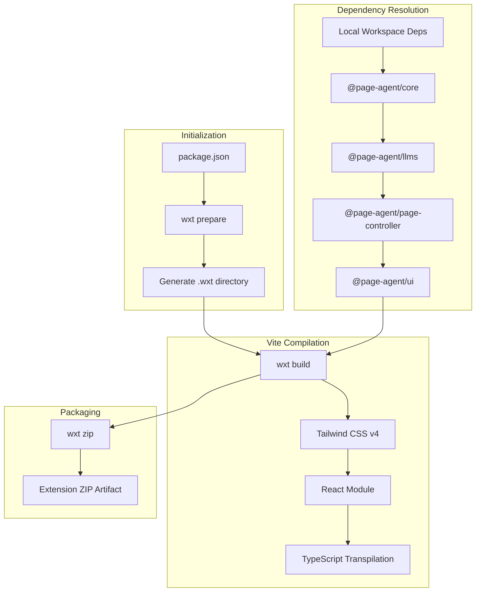
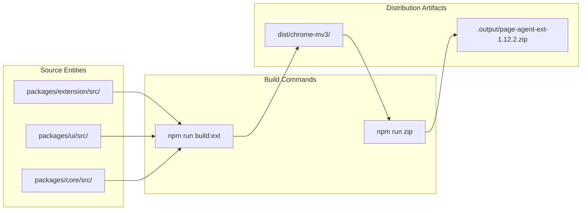

<!-- source: DeepWiki mcp.deepwiki.com · repo alibaba/page-agent · page 14.4 Extension Distribution · fetched 2026-10-29 -->

# Extension Distribution

Relevant source files

The following files were used as context for generating this wiki page:

- [.github/workflows/ci.yml](.github/workflows/ci.yml)
- [.github/workflows/deploy-website.yml](.github/workflows/deploy-website.yml)
- [.github/workflows/main-ci.yml](.github/workflows/main-ci.yml)
- [.github/workflows/release.yml](.github/workflows/release.yml)
- [packages/extension/package.json](packages/extension/package.json)
- [packages/website/package.json](packages/website/package.json)

This document describes the process of building, packaging, and preparing the Chrome extension for distribution to the Chrome Web Store. It covers the WXT-based build system, manifest configuration, artifact generation, and the automated release workflows.

For details on the extension's architecture and functionality, see [Browser Extension](#7). For information about building the NPM packages, see [NPM Package Distribution](#14.2).

---

## Build System Overview

The extension utilizes the **WXT framework** (Web Extension Tools) to build and package the Chrome extension. WXT provides a modern development experience with TypeScript support, React integration, and automatic manifest generation.

### Build Scripts

The extension can be built and managed using the following scripts from the root or the extension workspace:

| Script | Command | Purpose |
|--------|---------|---------|
| `npm run build` | Root workspace | Builds all packages including the extension |
| `npm run build:libs` | Root workspace | Builds core library dependencies required by the extension [ .github/workflows/release.yml:34]() |
| `npm run dev` | Extension package | Starts extension development mode with hot reload [packages/extension/package.json:7]() |
| `npm run build:ext` | Extension package | Compiles the extension for production using `wxt build` [packages/extension/package.json:8]() |
| `npm run zip` | Extension package | Creates the distributable ZIP file using `wxt zip` [packages/extension/package.json:9]() |

**Sources:** [packages/extension/package.json:6-11](), [ .github/workflows/release.yml:33-34]()

---

## Build Pipeline and Data Flow

The extension build process follows a multi-stage pipeline. The configuration in the extension package acts as the central definition for the build behavior and manifest generation.

### Build Sequence Diagram
This diagram maps the build process to the specific configurations and dependencies in the codebase.

**Sources:** [packages/extension/package.json:7-11](), [packages/extension/package.json:42-45]()

---

## Automated Release Workflows

The project uses GitHub Actions to automate the distribution of packages and the demo website.

### Release Workflow (`release.yml`)
When a tag matching `v*` is pushed, the release workflow triggers to publish packages to NPM.

1.  **Environment Setup:** Uses Node.js 24 and updates to the latest npm [ .github/workflows/release.yml:20-28]().
2.  **Dependency Installation:** Runs `npm ci` [ .github/workflows/release.yml:31]().
3.  **Library Build:** Executes `npm run build:libs` to ensure all core logic is compiled [ .github/workflows/release.yml:34]().
4.  **Publishing:** Publishes all public workspaces. If the version contains a hyphen (e.g., `1.12.2-beta.1`), it extracts the tag name for a tagged release [ .github/workflows/release.yml:37-45]().

### Continuous Integration (`ci.yml`)
Ensures build stability on every Pull Request to `main`.

1.  **Validation:** Runs `node scripts/ci.js` which performs linting and build checks [ .github/workflows/ci.yml:27]().
2.  **Node Environment:** Standardized on Node.js 24 [ .github/workflows/ci.yml:18-22]().

### Website Deployment (`deploy-website.yml`)
Automates the deployment of the documentation and demo website to GitHub Pages.

1.  **Build:** Runs `npm run build:website` [ .github/workflows/deploy-website.yml:28]().
2.  **Upload:** Uploads the `./packages/website/dist` folder as an artifact [ .github/workflows/deploy-website.yml:33-36]().
3.  **Deploy:** Deploys the artifact to GitHub Pages [ .github/workflows/deploy-website.yml:38-41]().

**Sources:** [ .github/workflows/release.yml:1-46](), [ .github/workflows/ci.yml:1-30](), [ .github/workflows/deploy-website.yml:1-41]()

---

## Extension Dependencies

The extension package bundles several internal and external libraries to provide full agentic capabilities within the browser.

| Dependency | Role | Code Reference |
| :--- | :--- | :--- |
| `@page-agent/core` | Core Re-act loop and state management | [packages/extension/package.json:42]() |
| `@page-agent/llms` | LLM client and provider integration | [packages/extension/package.json:43]() |
| `@page-agent/page-controller` | DOM extraction and action execution | [packages/extension/package.json:44]() |
| `@page-agent/ui` | React components for the side panel | [packages/extension/package.json:45]() |
| `wxt` | Web Extension build framework | [packages/extension/package.json:39]() |
| `idb` | IndexedDB wrapper for persistent storage | [packages/extension/package.json:27]() |

**Sources:** [packages/extension/package.json:13-51]()

---

## Distribution Artifacts

The final output of the build process is a ZIP file ready for the Chrome Web Store.

### Artifact Mapping: Code to Package
This diagram shows how source entities are mapped to the final distribution artifact via the WXT build system.

**Sources:** [packages/extension/package.json:6-11](), [packages/extension/package.json:42-45]()

### Versioning
The extension version is synchronized across the monorepo. As of the current build, the extension version is `1.12.2` [packages/extension/package.json:4](). This version is used in the manifest and the final ZIP filename during the `wxt zip` process.

**Sources:** [packages/extension/package.json:1-5]()

---

