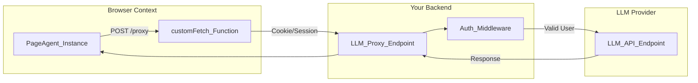
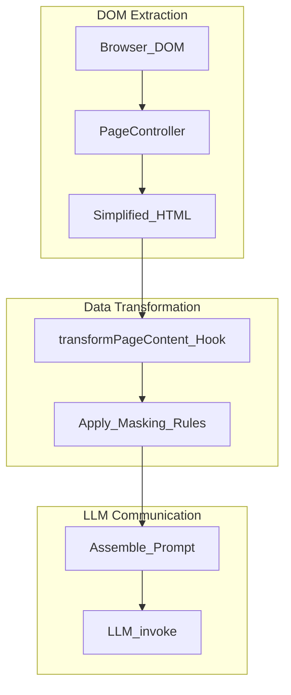
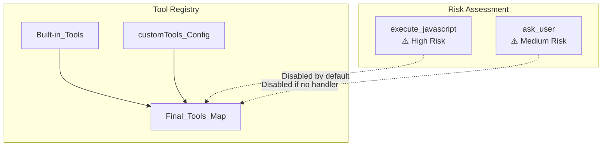

<!-- source: DeepWiki mcp.deepwiki.com · repo alibaba/page-agent · page 15 Security Considerations · fetched 2026-10-29 -->

# Security Considerations

<details>
<summary>Relevant source files</summary>

The following files were used as context for generating this wiki page:

- [docs/SECURITY.md](docs/SECURITY.md)
- [docs/terms-and-privacy.md](docs/terms-and-privacy.md)

</details>


This document covers security features, best practices, and sensitive data handling in PageAgent. It focuses on protecting API credentials, masking sensitive information, restricting risky operations, and securing LLM communications.

For general configuration options, see [Configuration and Customization](#8). For LLM provider setup, see [LLM Provider Setup](#3.3).

---

## Overview of Security Concerns

PageAgent operates in the browser and interacts with LLMs, creating several security surfaces:

| Security Surface | Risk | Mitigation |
|-----------------|------|------------|
| **LLM API Keys** | Exposure in frontend code | Backend proxy with `customFetch` |
| **Sensitive Page Data** | PII sent to LLM | `transformPageContent` masking |
| **Risky Tool Execution** | Arbitrary JavaScript execution | Disable `execute_javascript` tool |
| **Cross-Origin Communication** | Content script isolation | Extension authentication mechanism |
| **User Data Leakage** | History logging raw responses | Careful logging configuration |

**Sources:** [packages/core/src/types.ts:135-148](), [packages/core/src/PageAgentCore.ts:142-144](), [docs/terms-and-privacy.md:9-15]()

---

## API Key Management

### The Security Problem

In client-side JavaScript applications, any API key embedded in the code is visible to users. This creates risks of key exposure and unauthorized usage leading to quota exhaustion. PageAgent follows a **"Bring Your Own Key" (BYOK)** architecture where data transmission occurs directly between the browser and the configured LLM provider [docs/terms-and-privacy.md:9-13]().

### Backend Proxy Pattern

To secure keys, developers should use a backend proxy. The `customFetch` option in `LLMConfig` allows injecting custom authentication logic to talk to your own server instead of the LLM provider directly.

**LLM Proxy Data Flow**



**Configuration with customFetch**

```typescript
const agent = new PageAgent({
  baseURL: '/api/llm-proxy',  // Your backend proxy
  apiKey: 'NA',               // Not needed - auth via cookies
  model: 'qwen-max',
  customFetch: (url, init) => 
    fetch(url, { ...init, credentials: 'include' }),
});
```

The `LLMConfig` interface supports the `customFetch` parameter for this purpose [packages/core/src/types.ts:10-25]().

**Sources:** [docs/terms-and-privacy.md:9-15](), [packages/core/src/types.ts:10-25]()

### Testing vs Production API Usage

PageAgent provides a free testing API (hosted on Alibaba Cloud Function Compute using BaiLian Qwen models) for evaluation purposes [docs/terms-and-privacy.md:21-31](). **This API MUST NOT be used in production**.

```typescript
// ❌ NEVER DO THIS IN PRODUCTION
const agent = new PageAgent({
  baseURL: 'https://page-ag-testing-ohftxirgbn.cn-shanghai.fcapp.run', 
  apiKey: 'NA',
  model: 'qwen-max'
});
```

The testing API terms strictly prohibit inputting Personal Identifiable Information (PII), confidential business data, or financial/medical records [docs/terms-and-privacy.md:27-28](). It is strictly for technical evaluation and R&D [docs/terms-and-privacy.md:23-25]().

For details, see [API Key Management](#15.1).

**Sources:** [docs/terms-and-privacy.md:19-42]()

---

## Sensitive Data Protection

### Data Flow and Masking Points

PageAgent cleans HTML to simplify structure for AI, but this process **does not guarantee removal of sensitive information** (e.g., visible text or form values) [docs/terms-and-privacy.md:58-59]().

**Data Extraction and Transformation Flow**



### transformPageContent Hook

The `transformPageContent` configuration option intercepts page content immediately before LLM transmission [packages/core/src/types.ts:135-148](). It is called during the agent's observation phase in `PageAgentCore` [packages/core/src/PageAgentCore.ts:605-608]().

```typescript
const agent = new PageAgent({
  transformPageContent: async (content) => {
    // Mask phone numbers
    return content.replace(/1[3-9]\d{9}/g, '***********');
  }
});
```

**Sources:** [packages/core/src/PageAgentCore.ts:605-608](), [packages/core/src/types.ts:135-148](), [docs/terms-and-privacy.md:58-63]()

---

## Tool Permission Management

### Risky Tools and Removal Strategy

PageAgent allows restricting the tools available to the LLM to minimize the attack surface.

**Tool Control Mechanisms**



### execute_javascript Tool

The `execute_javascript` tool is **disabled by default** and requires explicit opt-in via `experimentalScriptExecutionTool` [packages/core/src/PageAgentCore.ts:142-144](). Enabling this allows the LLM to run arbitrary code, which can bypass DOM masking and exfiltrate data.

### Removing Built-in Tools

Any tool can be removed by setting it to `null` in `customTools` [packages/core/src/PageAgentCore.ts:132-140]().

```typescript
const agent = new PageAgent({
  customTools: {
    execute_javascript: null, // Ensure it's disabled
    goto: null,               // Prevent navigation to other sites
  }
});
```

For details, see [Tool Permissions](#15.3).

**Sources:** [packages/core/src/PageAgentCore.ts:132-144](), [packages/core/src/PageAgentCore.ts:201-204]()

---

## Extension Security Model

The **Page Agent Ext** performs DOM analysis and automation locally in the browser [docs/terms-and-privacy.md:49-50]().

1.  **Local Storage**: Configuration like API keys and endpoints is stored via `chrome.storage.local` and never synced to external servers [docs/terms-and-privacy.md:65-68]().
2.  **No Analytics**: The extension does not include tracking or analytics code [docs/terms-and-privacy.md:68-69]().
3.  **User Control**: Users choose the LLM provider and can audit the open-source code [docs/terms-and-privacy.md:71-76]().
4.  **Reporting**: Security vulnerabilities should be reported privately via GitHub's vulnerability reporting flow [docs/SECURITY.md:15-21]().

**Sources:** [docs/terms-and-privacy.md:45-76](), [docs/SECURITY.md:15-21]()

---

