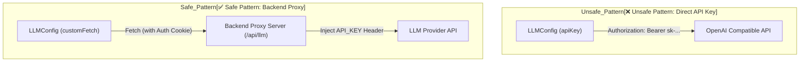
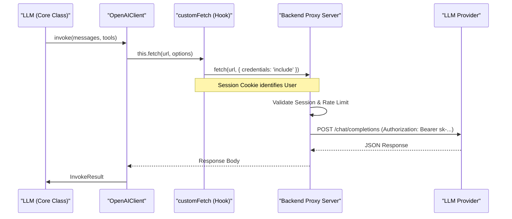

<!-- source: DeepWiki mcp.deepwiki.com · repo alibaba/page-agent · page 15.1 API Key Management · fetched 2026-10-29 -->

# API Key Management

<details>
<summary>Relevant source files</summary>

The following files were used as context for generating this wiki page:

- [packages/llms/src/types.ts](packages/llms/src/types.ts)
- [packages/llms/src/utils.test.ts](packages/llms/src/utils.test.ts)
- [packages/llms/src/utils.ts](packages/llms/src/utils.ts)
- [packages/website/src/pages/docs/features/models/page.tsx](packages/website/src/pages/docs/features/models/page.tsx)

</details>


This document explains secure authentication strategies for LLM API access in PageAgent deployments. It covers the security risks of client-side API key exposure and provides implementation patterns for safe production integration using backend proxies and the `customFetch` hook.

## Purpose and Security Context

PageAgent runs as client-side JavaScript that makes direct API calls to LLM providers. This architectural choice enables zero-backend deployment but introduces security considerations when handling LLM API keys. Since all client-side code is visible to users, any API key embedded in the frontend can be extracted and misused.

**Key Security Principle**: Never expose production LLM API keys in client-side code or source control. For production environments, authentication should be handled via a server-side proxy that injects the secret keys.

Sources: `[packages/llms/src/types.ts:90-125]()`, `[packages/website/src/pages/docs/features/models/page.tsx:209-220]()`

---

## Authentication Flow Architecture

The following diagrams illustrate the transition from unsafe direct access to the recommended secure proxy pattern, mapping natural language concepts to code entities.

### Strategy Comparison: Code Entity Mapping



### Data Flow: Secure Request Handling



Sources: `[packages/llms/src/types.ts:57-64]()`, `[packages/llms/src/types.ts:120-125]()`, `[packages/website/src/pages/docs/features/models/page.tsx:182-205]()`

---

## Authentication Strategies by Use Case

| Use Case | Strategy | API Key Location | Security Level | Implementation |
|----------|----------|------------------|----------------|----------------|
| **Personal Assistant** | Direct API Key | Client-side config | Low | `new PageAgent({ apiKey: 'sk-...' })` |
| **Development** | Env Variables | Vite/Dotenv injection | Medium | `apiKey: process.env.LLM_API_KEY` |
| **Production App** | Backend Proxy | Server-side only | High | `customFetch` + `baseURL` |
| **Free Testing** | Public Proxy | Alibaba Cloud FC | Low (Testing) | `baseURL: 'https://...fcapp.run'` |

Sources: `[packages/website/src/pages/docs/features/models/page.tsx:150-158]()`, `[packages/website/src/pages/docs/features/models/page.tsx:200-205]()`

---

## Production Implementation

### customFetch and Request Transformation

The `LLM` module provides two primary hooks for secure proxying: `customFetch` and `transformRequestBody`. These are defined in the `LLMConfig` interface.

```typescript
// Example configuration for a secure production environment
const config = {
  // Point to your own backend instead of OpenAI/Qwen
  baseURL: 'https://api.yourdomain.com/v1', 
  model: 'qwen3.5-plus',
  // Use customFetch to handle authentication
  customFetch: (url, init) =>
    fetch(url, { 
      ...init, 
      // Ensure session cookies are sent to the proxy
      credentials: 'include',
      headers: {
        ...init?.headers,
        'X-App-ID': 'my-secure-app'
      }
    }),
  // Modify the body before it leaves the client
  transformRequestBody: (body) => {
    // Add custom metadata or provider-specific flags
    return { ...body, user_context: 'internal-id-123' };
  }
};
```

**Key Configuration Properties**:
- **`baseURL`**: The target endpoint for the LLM service.
- **`customFetch`**: Replaces the global `fetch`. Use this to customize headers, credentials, or routing for LLM API requests `[packages/llms/src/types.ts:120-125]()`.
- **`transformRequestBody`**: A function to modify the final request body before sending it to the provider. This is useful for implementing provider-specific tweaks or caching hints `[packages/llms/src/types.ts:104-112]()`.
- **`disableNamedToolChoice`**: A flag to remove the `tool_choice` field, which fixes errors on specific LLMs that don't support object-based tool selection `[packages/llms/src/types.ts:114-118]()`.

Sources: `[packages/llms/src/types.ts:90-125]()`, `[packages/llms/src/utils.ts:39-196]()`

---

## Model-Specific Patches

The system includes a `modelPatch` utility that automatically adjusts request parameters based on the model name and provider to improve reliability and reduce costs.

- **Reasoning/Thinking**: For models like Qwen, DeepSeek, and Claude, the system attempts to disable "thinking" or "reasoning" modes to minimize token usage and latency `[packages/llms/src/utils.ts:47-60]()`, `[packages/llms/src/utils.ts:88-92]()`.
- **Tool Choice Conversion**: For Claude models (non-OpenRouter), it converts OpenAI-style `tool_choice` to Claude's native format (e.g., `any` or `tool`) `[packages/llms/src/utils.ts:93-104]()`.
- **Temperature Adjustments**: Raises temperature for specific smaller models to improve auto-recovery odds if not explicitly set by the user `[packages/llms/src/utils.ts:50-53]()`.

Sources: `[packages/llms/src/utils.ts:39-196]()`, `[packages/llms/src/utils.ts:213-220]()`

---

## Security Best Practices Checklist

1. **Never Hardcode Keys**: Avoid committing strings starting with `sk-` to source control.
2. **Session-Based Proxying**: Use `customFetch` with `credentials: 'include'` to rely on secure, HttpOnly cookies rather than client-accessible tokens `[packages/llms/src/types.ts:120-125]()`.
3. **Model Selection**: Prefer models with strong `ToolCall` capabilities to prevent format errors that might lead to unexpected agent behavior `[packages/website/src/pages/docs/features/models/page.tsx:128-144]()`.
4. **Data Masking**: Use `transformPageContent` hooks (see Section 15.2) to mask PII before content is sent to the proxy or provider.
5. **Rate Limiting**: Implement server-side rate limiting on your proxy to prevent API credit exhaustion.

Sources: `[packages/llms/src/types.ts:90-125]()`, `[packages/website/src/pages/docs/features/models/page.tsx:128-144]()`

---

