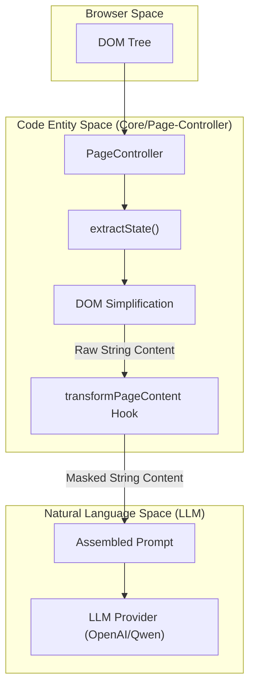
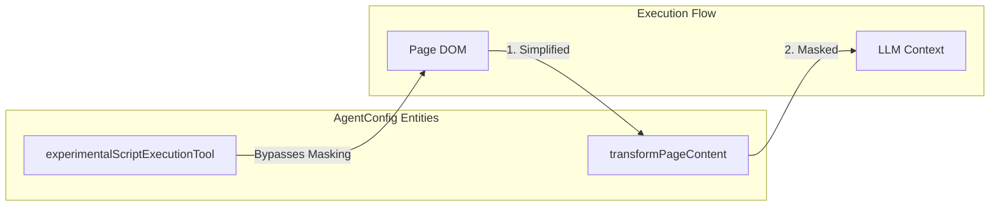

<!-- source: DeepWiki mcp.deepwiki.com · repo alibaba/page-agent · page 15.2 Data Masking · fetched 2026-10-29 -->

# Data Masking

<details>
<summary>Relevant source files</summary>

The following files were used as context for generating this wiki page:

- [packages/core/src/types.ts](packages/core/src/types.ts)
- [packages/ui/src/panel/Panel.ts](packages/ui/src/panel/Panel.ts)
- [packages/ui/src/panel/types.ts](packages/ui/src/panel/types.ts)
- [packages/website/src/pages/docs/features/custom-instructions/page.tsx](packages/website/src/pages/docs/features/custom-instructions/page.tsx)
- [packages/website/src/pages/docs/features/data-masking/page.tsx](packages/website/src/pages/docs/features/data-masking/page.tsx)

</details>


Data masking in PageAgent is a security feature designed to prevent sensitive information from being sent to Large Language Models (LLMs). By using the `transformPageContent` hook, developers can intercept the simplified DOM representation and apply transformations, such as redaction or anonymization, before the data leaves the client environment.

## Overview and Purpose

The primary mechanism for data masking is the `transformPageContent` lifecycle hook defined in the `AgentConfig` interface [packages/core/src/types.ts:135-148](). This hook is executed after the `PageController` has extracted and simplified the DOM tree but before the final prompt is assembled for the LLM.

**Key capabilities:**
*   **Privacy Protection:** Redact PII (Personally Identifiable Information) like phone numbers, emails, and ID cards.
*   **Data Minimization:** Remove unnecessary page sections that might confuse the LLM or exceed token limits.
*   **Content Inspection:** Log or audit the exact content being sent to the LLM for debugging purposes.

### Data Flow and Code Entity Mapping

The following diagram illustrates how page content flows from the browser DOM through the masking layer to the LLM.

**Content Transformation Pipeline**

**Sources:** [packages/core/src/types.ts:135-148](), [packages/website/src/pages/docs/features/data-masking/page.tsx:23-33]()

---

## Implementation

The `transformPageContent` hook is an optional property of the `AgentConfig` [packages/core/src/types.ts:10-161](). It accepts the simplified page content as a string and returns either a string or a Promise resolving to a string.

### Configuration Structure

The hook is integrated into the `PageAgent` (or `PageAgentCore`) constructor:

| Property | Type | Description |
| :--- | :--- | :--- |
| `transformPageContent` | `(content: string) => Promise<string> \| string` | Intercepts and modifies the `BrowserState` text before LLM submission. |

**Sources:** [packages/core/src/types.ts:148-148](), [packages/website/src/pages/docs/features/data-masking/page.tsx:23-33]()

---

## Common Masking Patterns

Developers can use Regular Expressions (RegEx) within the hook to identify and replace sensitive patterns. Below are standard implementations for common data types.

### Recommended Regex Implementations

| Data Type | Pattern Description | Suggested Masking Logic |
| :--- | :--- | :--- |
| **Phone (CN)** | 11 digits starting with 1 | `content.replace(/\b(1[3-9]\d)(\d{4})(\d{4})\b/g, '$1****$3')` |
| **Email** | Standard user@domain format | `content.replace(/\b([a-zA-Z0-9._%+-])[^@]*(@[a-zA-Z0-9.-]+\.[a-zA-Z]{2,})\b/g, '$1***$2')` |
| **ID Card (CN)** | 18-digit resident ID | `content.replace(/\b(\d{6})(19|20\d{2})(0[1-9]|1[0-2])(0[1-9]|[12]\d|3[01])(\d{3}[\dXx])\b/g, '$1********$5')` |
| **Bank Card** | 16 to 19 digit numbers | `content.replace(/\b(\d{4})\d{8,11}(\d{4})\b/g, '$1********$2')` |

### Implementation Example

```typescript
const agent = new PageAgent({
  transformPageContent: async (content) => {
    // 1. Mask Phone Numbers (CN)
    let masked = content.replace(/\b(1[3-9]\d)(\d{4})(\d{4})\b/g, '$1****$3');

    // 2. Mask Emails
    masked = masked.replace(
      /\b([a-zA-Z0-9._%+-])[^@]*(@[a-zA-Z0-9.-]+\.[a-zA-Z]{2,})\b/g,
      '$1***$2'
    );

    // 3. Mask Bank Cards
    masked = masked.replace(/\b(\d{4})\d{8,11}(\d{4})\b/g, '$1********$2');

    return masked;
  }
});
```
**Sources:** [packages/website/src/pages/docs/features/data-masking/page.tsx:46-70](), [packages/core/src/types.ts:142-147]()

---

## Security Considerations and Limitations

While `transformPageContent` is effective for standard text-based interactions, developers should be aware of the following:

1.  **Experimental Script Execution:** If `experimentalScriptExecutionTool` is enabled [packages/core/src/types.ts:120-124](), the agent may generate JavaScript that executes directly in the page context. This code may bypass the masking hook as it interacts with the live DOM rather than the simplified text sent to the LLM [packages/core/src/types.ts:122-123]().
2.  **Visual Feedback:** Masking only affects the data sent to the LLM. It does not automatically mask the UI elements in the browser or the visual highlights generated by the `SimulatorMask` in the `page-controller` [packages/core/src/types.ts:135-137]().
3.  **Prompt Assembly:** Masking occurs before the system instructions and history are appended. The hook specifically transforms the "Observation" part of the Re-act loop [packages/core/src/types.ts:136-137]().

**Entity Interaction Map**

**Sources:** [packages/core/src/types.ts:120-124](), [packages/core/src/types.ts:135-148]()

---

