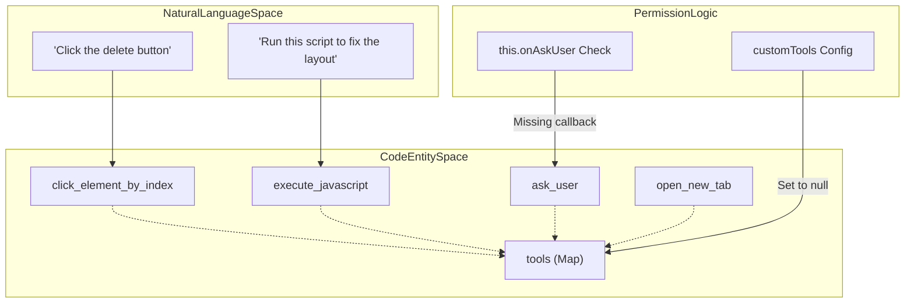
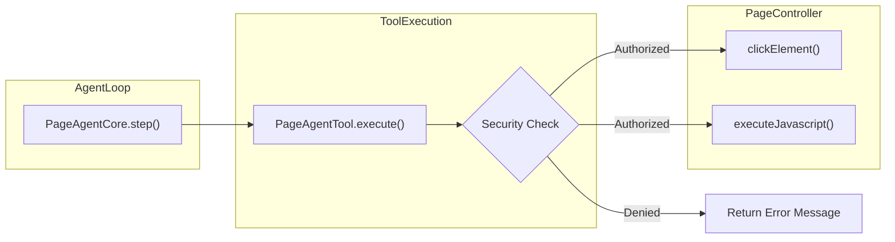

<!-- source: DeepWiki mcp.deepwiki.com · repo alibaba/page-agent · page 15.3 Tool Permissions · fetched 2026-10-29 -->

# Tool Permissions

<details>
<summary>Relevant source files</summary>

The following files were used as context for generating this wiki page:

- [packages/core/src/tools/index.ts](packages/core/src/tools/index.ts)
- [packages/extension/src/agent/TabsController.test.ts](packages/extension/src/agent/TabsController.test.ts)
- [packages/extension/src/agent/tabTools.ts](packages/extension/src/agent/tabTools.ts)
- [packages/extension/vitest.config.js](packages/extension/vitest.config.js)
- [packages/website/src/components/APIReference.tsx](packages/website/src/components/APIReference.tsx)
- [packages/website/src/components/CodeEditor.tsx](packages/website/src/components/CodeEditor.tsx)
- [packages/website/src/pages/docs/advanced/security-permissions/page.tsx](packages/website/src/pages/docs/advanced/security-permissions/page.tsx)
- [packages/website/src/pages/docs/features/third-party-agent/page.tsx](packages/website/src/pages/docs/features/third-party-agent/page.tsx)

</details>


This document explains how to control which tools are available to the PageAgent LLM, including disabling risky operations like JavaScript execution and removing or overriding built-in tools for security and safety.

For information about creating new custom tools, see [9. Custom Tools System](). For general security practices around API keys, see [15.1 API Key Management]().

## Overview

PageAgent provides a set of built-in tools that enable the LLM to interact with web pages. Some tools pose security risks or may not be appropriate for all use cases. The tool permission system allows you to:

- **Disable dangerous tools** like `execute_javascript` that can execute arbitrary code [packages/core/src/tools/index.ts:183-198]().
- **Remove tools** by setting them to `null` in the `customTools` configuration.
- **Override tools** by providing custom implementations with the same name.
- **Conditionally enable tools** based on runtime configuration (e.g., `ask_user` requires an `onAskUser` callback) [packages/core/src/tools/index.ts:76-91]().
- **Control Element Access** via allowlists and blocklists to prevent interaction with sensitive UI components [packages/website/src/pages/docs/advanced/security-permissions/page.tsx:22-47]().

Sources: [packages/core/src/tools/index.ts:1-198](), [packages/website/src/pages/docs/advanced/security-permissions/page.tsx:1-90]()

## Tool Registration and Permission Flow

The tool system maps natural language requests to code-level execution. Permissions are evaluated during the initialization of the `PageAgentCore` and enforced during the execution loop.

Title: Natural Language to Code Entity Mapping


1.  **Initialization**: Default tools are loaded from the `tools` Map [packages/core/src/tools/index.ts:36-38]().
2.  **Configuration Overrides**: The `customTools` configuration allows developers to override or delete tools by passing a `Record<string, Tool | null>`.
3.  **Runtime Validation**: Tools like `ask_user` check for the existence of `this.onAskUser` before proceeding [packages/core/src/tools/index.ts:84-86]().

Sources: [packages/core/src/tools/index.ts:36-198](), [packages/website/src/pages/docs/advanced/security-permissions/page.tsx:50-85](), [packages/extension/src/agent/tabTools.ts:24-26]()

## The execute_javascript Tool

### Security Implications
The `execute_javascript` tool allows the LLM to generate and execute arbitrary JavaScript code on the page [packages/core/src/tools/index.ts:183-198](). 
- **Arbitrary Code Execution**: LLM can execute any JS, potentially bypassing UI restrictions or accessing `localStorage`/`cookies`.
- **Data Exfiltration**: Can access and transmit sensitive page data not visible in the simplified DOM tree.
- **Async Safety**: Requires an `AbortSignal` named `signal` to be honored by the generated script to support cooperative cancellation [packages/core/src/tools/index.ts:187-188]().

### Default Behavior
In the core toolset, it is defined with a warning: "Use with caution!" [packages/core/src/tools/index.ts:186](). To disable it, developers should pass `execute_javascript: null` in the `customTools` configuration of the `PageAgent` constructor.

Sources: [packages/core/src/tools/index.ts:183-198]()

## Element Interaction Constraints

Beyond disabling entire tools, PageAgent supports fine-grained security through element-level constraints. This ensures that even if a tool like `click_element_by_index` is enabled, it cannot be used on sensitive targets [packages/website/src/pages/docs/advanced/security-permissions/page.tsx:22-47]().

| Mechanism | Description | Code Impact |
|-----------|-------------|-------------|
| **Blocklist** | Prevents AI from interacting with sensitive elements like "Delete" or "Payment" buttons [packages/website/src/pages/docs/advanced/security-permissions/page.tsx:28-35](). | Elements are excluded from the `FlatDomTree` during DOM processing. |
| **Allowlist** | Explicitly defines the narrow range of elements the AI is permitted to touch [packages/website/src/pages/docs/advanced/security-permissions/page.tsx:38-45](). | Limits the scope of `PageController` operations. |
| **User Confirmation** | Requires explicit user consent for medium-risk operations [packages/website/src/pages/docs/advanced/security-permissions/page.tsx:75-81](). | Usually implemented via the `ask_user` tool [packages/core/src/tools/index.ts:76-91](). |

Sources: [packages/website/src/pages/docs/advanced/security-permissions/page.tsx:22-85](), [packages/core/src/tools/index.ts:76-91]()

## Overriding Tools for Custom Permissions

Developers can wrap built-in tools with custom logic to enforce specific business rules.

Title: Tool Execution Pipeline with Security Check


### Implementation Example
To restrict clicking, one can override the `click_element_by_index` tool in the configuration:

```javascript
// Example informed by packages/website/src/pages/docs/features/third-party-agent/page.tsx:29-44
const agent = new PageAgent({
  customTools: {
    click_element_by_index: {
      description: 'Click element with security check',
      inputSchema: z.object({ index: z.number().int() }),
      execute: async function(input) {
        // Custom logic to check if index corresponds to a protected element
        // this.pageController is available in the tool execution context
        const isSafe = await this.pageController.checkSafety(input.index);
        if (!isSafe) return "❌ Action denied: Element is protected.";
        
        return await this.pageController.clickElement(input.index);
      }
    }
  }
});
```

Sources: [packages/core/src/tools/index.ts:94-105](), [packages/website/src/pages/docs/features/third-party-agent/page.tsx:29-44]()

## Browser Extension Tab Permissions

When using the browser extension, additional tools are injected via `createTabTools` [packages/extension/src/agent/tabTools.ts:25](). These tools manage cross-tab operations:

- `open_new_tab`: Opens a URL and sets it as current [packages/extension/src/agent/tabTools.ts:27-43]().
- `switch_to_tab`: Switches focus to an existing tab ID [packages/extension/src/agent/tabTools.ts:45-59]().
- `close_tab`: Closes a tab (cannot close the initial tab) [packages/extension/src/agent/tabTools.ts:61-75]().

If your use case should be restricted to a single page, these tools should be omitted or disabled to prevent the agent from navigating away or accessing other tabs. The `TabsController` manages the actual browser state transitions [packages/extension/src/agent/tabTools.ts:12]().

Sources: [packages/extension/src/agent/tabTools.ts:1-77]()

## Best Practices

1.  **Disable JS in Production**: Unless strictly required for interacting with complex components (like canvas or heavy JS editors), disable `execute_javascript` [packages/core/src/tools/index.ts:183-198]().
2.  **Use Instruction Constraints**: Define high-risk operations in system instructions and explicitly forbid them or require user confirmation [packages/website/src/pages/docs/advanced/security-permissions/page.tsx:50-85]().
3.  **Strict Schema Validation**: Always use Zod schemas in `inputSchema` to prevent the LLM from passing unexpected parameters to tools [packages/core/src/tools/index.ts:5](), [packages/core/src/tools/index.ts:24]().
4.  **Callback Enforcement**: Ensure `onAskUser` is only provided if you want the agent to have the ability to pause and query the user [packages/core/src/tools/index.ts:84-86]().

Sources: [packages/core/src/tools/index.ts:1-198](), [packages/website/src/pages/docs/advanced/security-permissions/page.tsx:50-85]()

---

