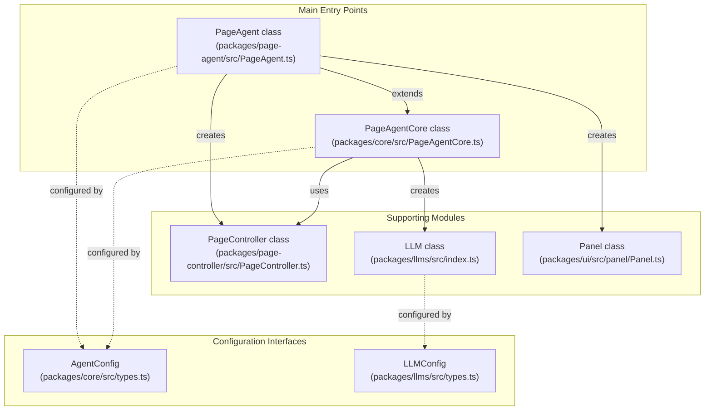
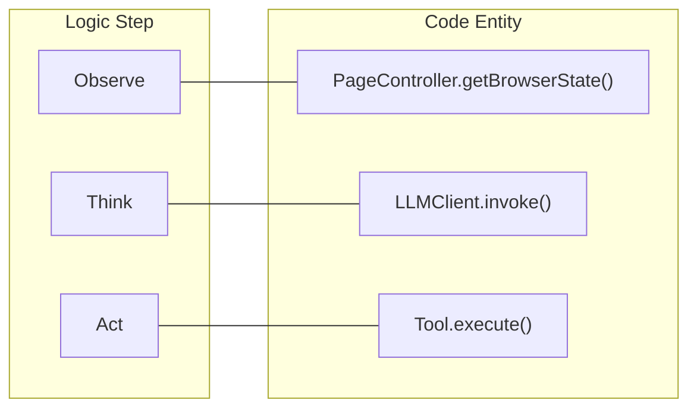
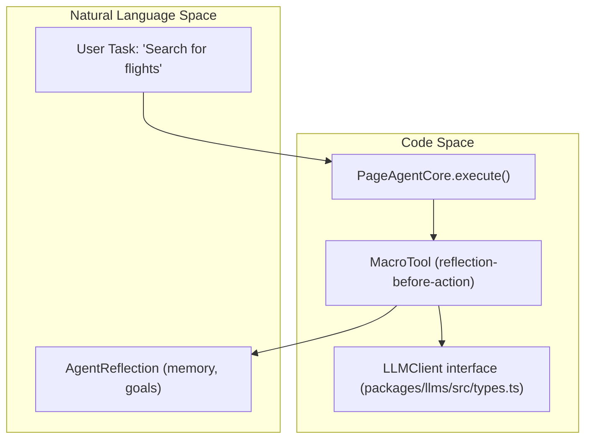

<!-- source: DeepWiki mcp.deepwiki.com · repo alibaba/page-agent · page 16 API Reference · fetched 2026-10-29 -->

# API Reference

Relevant source files

The following files were used as context for generating this wiki page:

- [packages/core/src/types.ts](packages/core/src/types.ts)
- [packages/llms/src/types.ts](packages/llms/src/types.ts)
- [packages/ui/src/panel/Panel.ts](packages/ui/src/panel/Panel.ts)
- [packages/ui/src/panel/types.ts](packages/ui/src/panel/types.ts)

This page provides comprehensive documentation for all public APIs in the PageAgent system. For implementation guides, see [Configuration and Customization](#8). For specific subsystem details, see [PageAgent API](#16.1), [PageAgentCore API](#16.2), [PageController API](#16.3), [LLM Module API](#16.4), [Configuration Types](#16.5), [Tool Types](#16.6), [Extension API (window.PAGE_AGENT_EXT)](#16.7), and [Third-party Agent Integration](#16.8).

## API Overview

The PageAgent API is organized into several primary modules, each with distinct responsibilities ranging from core logic to UI visualization.

### System Component Architecture

**Sources:** [packages/core/src/PageAgentCore.ts:61-146](), [packages/core/src/types.ts:10-161](), [packages/ui/src/panel/Panel.ts:30-95]()

## PageAgent Class

The `PageAgent` class is the primary entry point for in-page agent usage. It extends `PageAgentCore` and adds UI panel integration. For details, see [PageAgent API](#16.1).

### Properties and Methods

| Member | Type | Description |
|----------|------|-------------|
| `panel` | `Panel` | UI panel component for visualization and control [packages/ui/src/panel/Panel.ts:30-31]() |
| `execute(task)` | `Method` | Main method to run a natural language task [packages/ui/src/panel/types.ts:74-74]() |
| `stop()` | `Method` | Stop the current task while keeping the agent instance [packages/ui/src/panel/types.ts:77-77]() |
| `status` | `Property` | Current agent status (idle, running, etc.) [packages/ui/src/panel/types.ts:32-32]() |

**Sources:** [packages/ui/src/panel/Panel.ts:30-65](), [packages/ui/src/panel/types.ts:30-81]()

## PageAgentCore Class

The `PageAgentCore` class implements the core Re-act agent loop without UI dependencies. It handles the state machine, history management, and LLM orchestration. For details, see [PageAgentCore API](#16.2).

### Re-act Agent Loop
The core loop consists of: **Observe** (gather state) -> **Think** (LLM reflection and action planning) -> **Act** (execute tool). This is managed via the `execute` method which processes steps until completion or `maxSteps` is reached [packages/core/src/types.ts:13-17](), [packages/core/src/types.ts:163-185]().

### Event System
`PageAgentCore` implements `PanelAgentAdapter` (extending `EventTarget`) and emits events for lifecycle monitoring:
- `statuschange`: Agent status transitions [packages/ui/src/panel/types.ts:25-25]().
- `historychange`: Persistent history events updated [packages/ui/src/panel/types.ts:26-26]().
- `activity`: Transient UI feedback (thinking, executing) [packages/ui/src/panel/types.ts:27-27]().
- `dispose`: Agent cleanup [packages/ui/src/panel/types.ts:28-28]().

### Core Logic to Code Mapping

**Sources:** [packages/ui/src/panel/types.ts:12-29](), [packages/llms/src/types.ts:57-64](), [packages/llms/src/types.ts:28-33]()

## PageController Class

The `PageController` class manages all DOM operations and browser state extraction. It provides the interface between the agent and the webpage. For details, see [PageController API](#16.3).

### Key Responsibilities
- **State Extraction**: Generates the simplified page content used for LLM context.
- **Action Execution**: Performs clicks, typing, and scrolling on elements.
- **Visual Feedback**: Manages element highlighting and masks via the UI layer.

**Sources:** [packages/core/src/types.ts:135-149](), [packages/ui/src/panel/Panel.ts:150-153]()

## LLM Module

The LLM module provides the interface for communicating with language model APIs, supporting OpenAI-compatible endpoints with model-specific patching. For details, see [LLM Module API](#16.4).

### LLM Invocation Flow

**Sources:** [packages/llms/src/types.ts:57-64](), [packages/core/src/types.ts:163-185]()

## Configuration and Tools

### Configuration Types
PageAgent uses several configuration interfaces to control LLM settings, agent behavior, and DOM extraction rules. Key types include `AgentConfig` and `LLMConfig`. For details, see [Configuration Types](#16.5).

### Tool System
The tool system defines how the agent interacts with the page. Developers can add `customTools` via the `AgentConfig`.
- **Tool Interface**: Includes description, input schema (Zod), and execute function [packages/llms/src/types.ts:28-33]().
- **MacroTool**: Enforces the "reflection-before-action" model by wrapping actions with reasoning metadata [packages/core/src/types.ts:178-185]().

**Sources:** [packages/core/src/types.ts:10-161](), [packages/llms/src/types.ts:88-125]()

## Extension API

The Chrome extension exposes a public API via `window.PAGE_AGENT_EXT` for external control of the browser. For details, see [Extension API (window.PAGE_AGENT_EXT)](#16.7).

### Public Interface
- `execute(config)`: Starts a task with specific configuration.
- `stop()`: Aborts the current execution.
- `onStatusChange`: Callback for monitoring status updates.
- `onActivity`: Callback for real-time feedback.

**Sources:** [packages/ui/src/panel/types.ts:30-81]()

---

