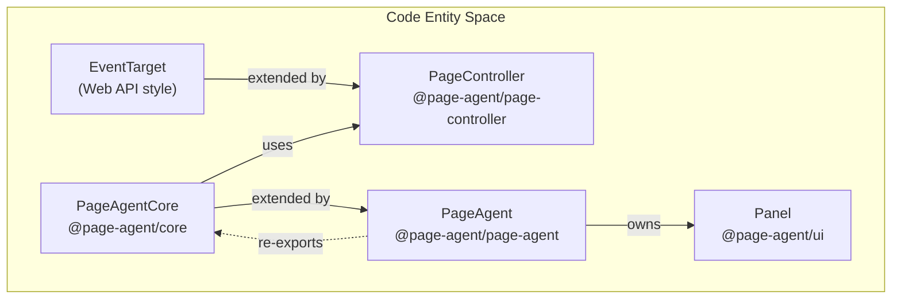
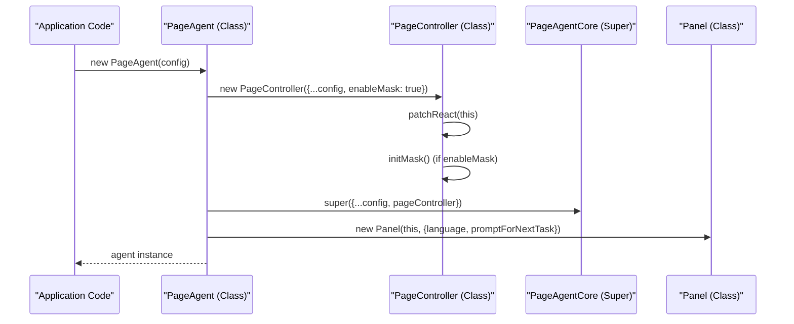
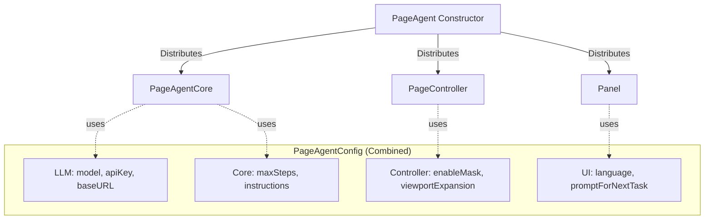

<!-- source: DeepWiki mcp.deepwiki.com · repo alibaba/page-agent · page 16.1 PageAgent API · fetched 2026-10-29 -->

# PageAgent API

<details>
<summary>Relevant source files</summary>

The following files were used as context for generating this wiki page:

- [packages/llms/package.json](packages/llms/package.json)
- [packages/page-agent/package.json](packages/page-agent/package.json)
- [packages/page-agent/src/PageAgent.ts](packages/page-agent/src/PageAgent.ts)
- [packages/page-controller/src/PageController.ts](packages/page-controller/src/PageController.ts)
- [packages/page-controller/src/actions.ts](packages/page-controller/src/actions.ts)
- [packages/page-controller/src/utils/index.ts](packages/page-controller/src/utils/index.ts)

</details>


This document provides the complete API reference for the `PageAgent` class, which is the primary entry point for integrating PageAgent into web applications. The `PageAgent` class extends `PageAgentCore` and adds UI panel integration for visual feedback and human-in-the-loop capabilities.

For the underlying core agent logic and methods, see [PageAgentCore API](#16.2). For browser control operations, see [PageController API](#16.3). For LLM configuration, see [LLM Module API](#16.4).

## Class Hierarchy

The `PageAgent` class provides a user-friendly wrapper around the core agent functionality, combining the agent logic with a DOM controller and a React-based UI panel. It is the primary export of the `page-agent` package.

**Class Inheritance and Ownership**


**Sources:** [packages/page-agent/src/PageAgent.ts:5-13](), [packages/page-agent/src/PageAgent.ts:24-27](), [packages/page-controller/src/PageController.ts:58-58]()

## Constructor

### Signature

```typescript
constructor(config: PageAgentConfig)
```

Creates a new `PageAgent` instance with an integrated UI panel and page controller.

### Parameters

The constructor accepts a single `PageAgentConfig` object. This type is an intersection of `AgentConfig`, `PageControllerConfig`, and `PanelConfig` (omitting `language` from the latter as it is shared).

| Parameter | Type | Required | Default | Description |
|-----------|------|----------|---------|-------------|
| `model` | `string` | Yes | - | LLM model identifier (e.g., `'gpt-4o'`) |
| `baseURL` | `string` | Yes | - | OpenAI-compatible API endpoint URL |
| `apiKey` | `string` | Yes | - | API authentication key |
| `language` | `'en-US' \| 'zh-CN'` | No | `'en-US'` | UI language for panel and messages |
| `maxSteps` | `number` | No | `40` | Maximum number of agent execution steps |
| `enableMask` | `boolean` | No | `true` | Enable visual overlay showing agent actions |
| `promptForNextTask`| `boolean` | No | - | Whether to show a prompt for the next task in the UI |

**Sources:** [packages/page-agent/src/PageAgent.ts:11-28](), [packages/page-controller/src/PageController.ts:26-29]()

### Initialization Flow

The constructor coordinates the instantiation of the controller and the UI panel. It defaults `enableMask` to `true` if not provided. The `PageController` initialization includes patching React and setting up the `SimulatorMask`.

**Instantiation Sequence**


**Sources:** [packages/page-agent/src/PageAgent.ts:16-28](), [packages/page-controller/src/PageController.ts:89-97]()

## Properties

### panel

```typescript
panel: Panel
```

The integrated UI panel component from the `@page-agent/ui` package. It manages the React-based overlay that displays the agent's "thinking" process, history, and current status.

**Sources:** [packages/page-agent/src/PageAgent.ts:14](), [packages/page-agent/src/PageAgent.ts:24-27]()

## Methods

The `PageAgent` class inherits all methods from `PageAgentCore`. 

### execute()

```typescript
async execute(task: string): Promise<ExecutionResult>
```

Starts the agent loop to perform a natural language task on the current page. This triggers the Observe-Think-Act cycle.

**Parameters:**
- `task`: The natural language instruction (e.g., "Find the cheapest laptop and add it to cart").

**Returns:**
- A promise resolving to an `ExecutionResult` containing `success`, `history`, and any `data` returned by the `done` tool.

**Sources:** [packages/page-agent/src/PageAgent.ts:9](), [packages/page-agent/src/PageAgent.ts:13]()

### stop()

```typescript
stop(): void
```

Immediately interrupts the agent's execution loop.

### dispose()

```typescript
dispose(): void
```

Cleans up the agent, destroys the UI panel, and removes DOM observers/masks created by the `PageController`.

**Sources:** [packages/page-agent/src/PageAgent.ts:9]()

## Events

`PageAgent` instances emit events via the `EventEmitter` pattern (inherited from `PageAgentCore`).

| Event | Payload | Description |
|-------|---------|-------------|
| `statuschange` | `AgentStatus` | Emitted when the agent moves between `idle`, `running`, `paused`, or `error`. |
| `historychange` | `HistoricalEvent[]` | Emitted whenever a new step (thought or action) is added to the log. |
| `activity` | `ActivityEvent` | Emitted for granular updates (e.g., "Scrolling to element"). |

**Sources:** [packages/page-agent/src/PageAgent.ts:9]()

## Usage Patterns

### Basic Implementation

```typescript
import { PageAgent } from 'page-agent';

const agent = new PageAgent({
  model: 'gpt-4o',
  apiKey: 'sk-...',
  baseURL: 'https://api.openai.com/v1',
  language: 'en-US',
  enableMask: true
});

// The panel is automatically created but hidden by default
agent.panel.show();

// Run a task
const result = await agent.execute('Search for PageAgent on GitHub');
console.log('Task finished:', result.success);
```

**Sources:** [packages/page-agent/src/PageAgent.ts:13-29]()

### Configuration Intersection

The `PageAgentConfig` type ensures that settings for the underlying controller (like `viewportExpansion`) and the core agent (like `maxSteps`) can be passed in a single object.

**Configuration Mapping**


**Sources:** [packages/page-agent/src/PageAgent.ts:11-28](), [packages/page-controller/src/PageController.ts:26-29]()

---

