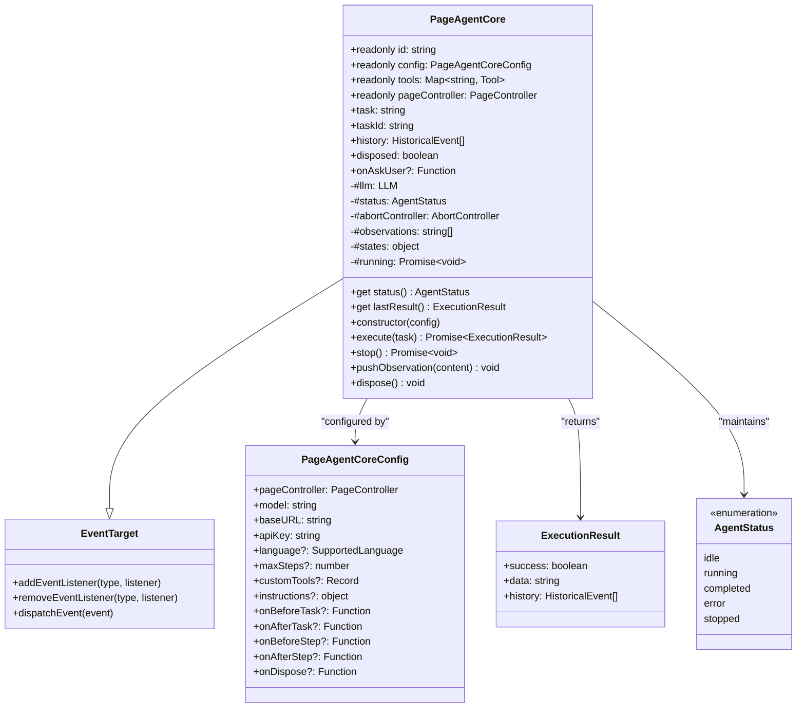
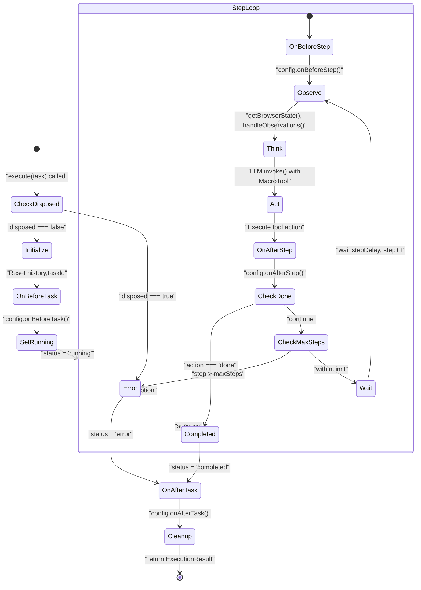
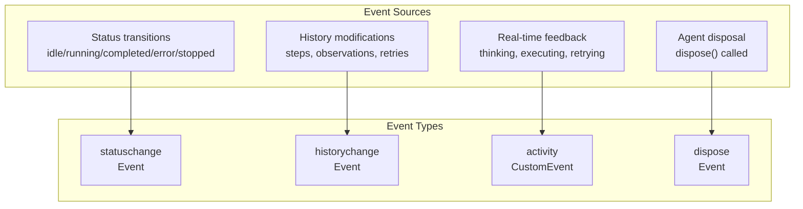

<!-- source: DeepWiki mcp.deepwiki.com · repo alibaba/page-agent · page 16.2 PageAgentCore API · fetched 2026-10-29 -->

# PageAgentCore API

Relevant source files

The following files were used as context for generating this wiki page:

- [packages/core/src/PageAgentCore.ts](packages/core/src/PageAgentCore.ts)
- [packages/core/src/types.ts](packages/core/src/types.ts)
- [packages/core/src/utils/index.ts](packages/core/src/utils/index.ts)
- [packages/ui/src/panel/Panel.ts](packages/ui/src/panel/Panel.ts)
- [packages/ui/src/panel/types.ts](packages/ui/src/panel/types.ts)

This page provides a comprehensive API reference for the `PageAgentCore` class, the foundation of PageAgent's agent orchestration system. `PageAgentCore` implements the Re-act (observe-think-act) loop, manages agent state and history, and coordinates between LLM invocation and DOM actions.

For architectural concepts and implementation details, see [4.1 PageAgentCore and Re-act Loop](). For the higher-level `PageAgent` wrapper class that includes UI integration, see [4.5 PageAgent Integration Class](). For configuration options, see [8.1 Agent Configuration]().

## Class Overview

`PageAgentCore` is a base class that extends `EventTarget` to provide event-driven agent orchestration. It manages the complete lifecycle of task execution, from initialization through iterative step execution to completion or error states.

**Class Diagram: PageAgentCore Structure**

Sources: [packages/core/src/PageAgentCore.ts:61-106](), [packages/core/src/types.ts:10-161](), [packages/core/src/types.ts:263-284]()

## Constructor

### `new PageAgentCore(config: PageAgentCoreConfig)`

Creates a new PageAgentCore instance with the specified configuration.

**Parameters:**

| Parameter | Type | Description |
|-----------|------|-------------|
| `config` | `PageAgentCoreConfig` | Combined agent and LLM configuration including required `pageController` |

**Configuration Properties:**

See [8.1 Agent Configuration]() and [6.1 LLM Client Architecture]() for complete configuration options. Key properties include:

- `pageController: PageController` - **Required**. PageController instance for DOM operations [packages/core/src/PageAgentCore.ts:29,66]().
- `model: string` - LLM model identifier (e.g., `'gpt-4o'`).
- `baseURL: string` - LLM API endpoint.
- `apiKey: string` - LLM authentication key.
- `maxSteps?: number` - Maximum steps per task (default: `40`) [packages/core/src/PageAgentCore.ts:111]().
- `customTools?: Record<string, PageAgentTool | null>` - Custom or override tools [packages/core/src/PageAgentCore.ts:134-142]().

**Constructor Behavior:**

1. Initializes `LLM` client with configuration [packages/core/src/PageAgentCore.ts:113]().
2. Creates `tools` map from built-in tools [packages/core/src/PageAgentCore.ts:114]().
3. Registers `LLM` retry event listener to emit activity and update history [packages/core/src/PageAgentCore.ts:117-132]().
4. Applies `customTools` (add, override, or remove) [packages/core/src/PageAgentCore.ts:134-142]().
5. Conditionally removes `execute_javascript` tool if not enabled via `experimentalScriptExecutionTool` [packages/core/src/PageAgentCore.ts:144-146]().

Sources: [packages/core/src/PageAgentCore.ts:108-147](), [packages/core/src/types.ts:10-161]()

## Properties

### Readonly Properties

#### `id: string`

Unique identifier for this agent instance, generated using `uid()` utility [packages/core/src/PageAgentCore.ts:62]().

#### `config: PageAgentCoreConfig & { maxSteps: number }`

Agent configuration object with normalized `maxSteps` property [packages/core/src/PageAgentCore.ts:63,111]().

#### `tools: Map<string, Tool>`

Map of available tools. Initialized from built-in tools, modified by `customTools` configuration [packages/core/src/PageAgentCore.ts:64,114]().

#### `pageController: PageController`

PageController instance for DOM operations and browser state extraction [packages/core/src/PageAgentCore.ts:66,115]().

### Mutable Properties

#### `task: string`

Current task description provided to `execute()`. Reset on each run [packages/core/src/PageAgentCore.ts:68,216]().

#### `taskId: string`

Unique identifier for the current task execution, regenerated on each `execute()` call [packages/core/src/PageAgentCore.ts:69,217]().

#### `history: HistoricalEvent[]`

Array of historical events forming the agent's memory. Reset at the start of each task. Events include:
- `step` - Agent steps with reflection and action [packages/core/src/types.ts:198-218]().
- `observation` - System observations (navigation, warnings) [packages/core/src/types.ts:223-226]().
- `retry` - LLM retry attempts [packages/core/src/PageAgentCore.ts:125-130]().
- `error` - Fatal or LLM errors [packages/core/src/PageAgentCore.ts:120-124]().

Sources: [packages/core/src/PageAgentCore.ts:71,219](), [packages/core/src/types.ts:257-259]()

#### `disposed: boolean`

Indicates whether `dispose()` has been called. Once disposed, the agent cannot be reused [packages/core/src/PageAgentCore.ts:73,212]().

#### `onAskUser?: (question: string, options?: { signal: AbortSignal }) => Promise<string>`

Optional callback for the `ask_user` tool. If not set, the `ask_user` tool is automatically disabled [packages/core/src/PageAgentCore.ts:81]().

### Getter Properties

#### `status: AgentStatus`

Current agent execution status. Returns `'idle'`, `'running'`, `'completed'`, `'error'`, or `'stopped'` [packages/core/src/PageAgentCore.ts:150-152](), [packages/core/src/types.ts:263]().

#### `lastResult: ExecutionResult | null`

Result of the most recent run, or `null` before the first run completes [packages/core/src/PageAgentCore.ts:155-157]().

Sources: [packages/core/src/types.ts:279-284]()

## Methods

### `execute(task: string): Promise<ExecutionResult>`

Executes a task using the Re-act loop until completion, failure, or max steps reached.

**Execution Flow:**

**Behavior Details:**

1. **Pre-execution checks**: Throws if disposed, already running, or task is empty [packages/core/src/PageAgentCore.ts:212-214]().
2. **Initialization**: Resets history, observations, and internal states; creates a new `AbortController` [packages/core/src/PageAgentCore.ts:219-223]().
3. **Step iteration**: Iterates through Observe, Think, and Act phases until the `done` tool is called or a limit is hit.
4. **Termination**: Updates `lastResult` and status, then calls `onAfterTask` hook [packages/core/src/PageAgentCore.ts:156,201-204]().

Sources: [packages/core/src/PageAgentCore.ts:210-348](), [packages/core/src/types.ts:279-283]()

### `stop(): Promise<void>`

Stops the current task execution and waits for the run to settle.

**Behavior:**
1. Aborts the internal `AbortController` signal, which propagates to LLM fetch and tools [packages/core/src/PageAgentCore.ts:202,86-91]().
2. Awaits the `#running` promise to ensure lifecycle hooks complete [packages/core/src/PageAgentCore.ts:203,95]().

Sources: [packages/core/src/PageAgentCore.ts:200-204]()

### `pushObservation(content: string): void`

Adds a system observation to the agent's memory. Observations are persistent events included in LLM context across steps.

**Behavior:**
- Adds observation to internal buffer [packages/core/src/PageAgentCore.ts:193]().
- Buffer is flushed to `history` array during the next step's observation phase.

Sources: [packages/core/src/PageAgentCore.ts:192-194]()

### `dispose(): void`

Permanently disposes the agent and triggers the `onDispose` hook and `dispose` event. Once disposed, the agent cannot be reused [packages/core/src/PageAgentCore.ts:73,212]().

## Event System

PageAgentCore extends `EventTarget` and emits events for monitoring and UI integration.

**Event System Diagram:**

### Event: `statuschange`
Emitted when `status` property changes [packages/core/src/PageAgentCore.ts:160-162]().

### Event: `historychange`
Emitted when the `history` array is modified [packages/core/src/PageAgentCore.ts:165-168]().

### Event: `activity`
Emitted for transient, real-time UI feedback via `CustomEvent`. The detail contains `AgentActivity` (e.g., `thinking`, `executing`, `retrying`) [packages/core/src/PageAgentCore.ts:174-176]().

Sources: [packages/core/src/PageAgentCore.ts:44-60,159-177](), [packages/ui/src/panel/types.ts:12-17]()

## Internal Architecture

### Re-act Agent Loop

PageAgentCore implements a standard Re-act loop (Observe-Think-Act).

1. **Observe**: Gathers information about the environment using `pageController.getBrowserState()` [packages/core/src/PageAgentCore.ts:37]().
2. **Think**: Calls the LLM to perform reflection (evaluating history, planning) and decide on an action [packages/core/src/PageAgentCore.ts:38-40]().
3. **Act**: Executes the tool action selected by the LLM [packages/core/src/PageAgentCore.ts:41]().

Sources: [packages/core/src/PageAgentCore.ts:31-43]()

### Information Streams

PageAgentCore manages two distinct information streams:

1. **History Events** (`history` array): Persistent memory included in LLM context. Includes steps, observations, and LLM errors [packages/core/src/PageAgentCore.ts:51-54]().
2. **Activity Events**: Transient UI feedback not included in LLM context. Includes `thinking`, `executing`, and `retrying` states [packages/core/src/PageAgentCore.ts:56-59]().

Sources: [packages/core/src/PageAgentCore.ts:50-60]()

---

