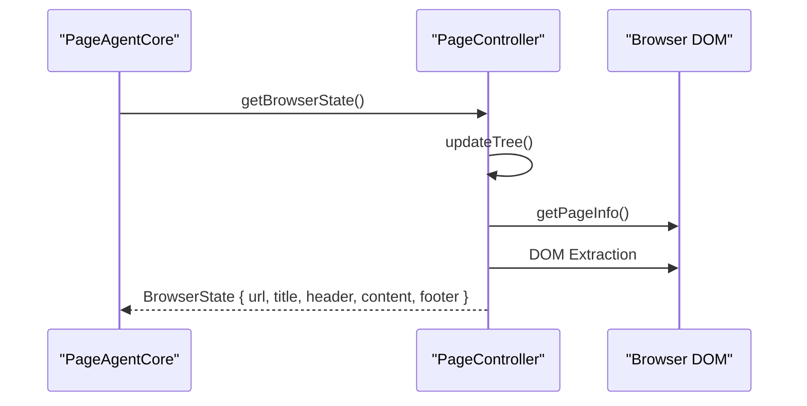

<!-- source: DeepWiki mcp.deepwiki.com · repo alibaba/page-agent · page 16.3 PageController API · fetched 2026-10-29 -->

# PageController API

<details>
<summary>Relevant source files</summary>

The following files were used as context for generating this wiki page:

- [packages/page-agent/src/PageAgent.ts](packages/page-agent/src/PageAgent.ts)
- [packages/page-controller/package.json](packages/page-controller/package.json)
- [packages/page-controller/src/PageController.ts](packages/page-controller/src/PageController.ts)
- [packages/page-controller/src/actions.ts](packages/page-controller/src/actions.ts)
- [packages/page-controller/src/utils/index.ts](packages/page-controller/src/utils/index.ts)
- [packages/ui/package.json](packages/ui/package.json)

</details>


This page provides comprehensive API documentation for the `PageController` class, which manages DOM operations and browser state extraction in the PageAgent system. The PageController serves as the browser control layer, providing async methods for reading page state, executing DOM actions, and managing visual feedback.

For information about how PageController integrates with the agent execution loop, see [PageAgentCore API](). For configuration options, see [PageController Configuration](). For details on the DOM tree processing system, see [DOM Tree Processing]().

## Class Overview

The `PageController` class is the primary interface for all DOM interactions in the PageAgent system. It maintains an internal representation of the page's interactive elements and provides deterministic, index-based element operations.

### Code Entity Space Mapping

The following diagram maps high-level PageController responsibilities to specific code entities within the `@page-agent/page-controller` package.

Title: PageController Code Architecture

```mermaid
graph TB
    subgraph "PageController Class [PageController.ts]"
        PC["PageController<br/>extends EventTarget"]
        CONFIG["config: PageControllerConfig"]
        TREE["flatTree: FlatDomTree | null"]
        SELECTOR["selectorMap: Map<number, InteractiveElementDomNode>"]
        TEXT["elementTextMap: Map<number, string>"]
        HTML["simplifiedHTML: string"]
        MASK["mask: SimulatorMask | null"]
    end
    
    subgraph "State Query Methods [PageController.ts]"
        GET_URL["getCurrentUrl()"]
        GET_TIME["getLastUpdateTime()"]
        GET_STATE["getBrowserState()"]
    end
    
    subgraph "DOM Operations [dom/index.ts]"
        UPDATE["updateTree()"]
        CLEAN["cleanUpHighlights()"]
    end
    
    subgraph "Action Executors [actions.ts]"
        CLICK["clickElement(index)"]
        INPUT["inputText(index, text)"]
        SELECT["selectOption(index, option)"]
        SCROLL["scroll(options)"]
        SCROLL_H["scrollHorizontally(options)"]
    end
    
    subgraph "Mask Operations [mask/SimulatorMask.ts]"
        SHOW["showMask()"]
        HIDE["hideMask()"]
    end
    
    PC --> CONFIG
    PC --> TREE
    PC --> SELECTOR
    PC --> TEXT
    PC --> HTML
    PC --> MASK
    
    GET_URL -.->|reads| PC
    GET_TIME -.->|reads| PC
    GET_STATE -.->|calls| UPDATE
    
    UPDATE -.->|updates| TREE
    UPDATE -.->|updates| SELECTOR
    UPDATE -.->|updates| TEXT
    UPDATE -.->|updates| HTML
    
    CLICK -.->|uses| SELECTOR
    INPUT -.->|uses| SELECTOR
    SELECT -.->|uses| SELECTOR
    SCROLL -.->|uses| SELECTOR
    SCROLL_H -.->|uses| SELECTOR
    
    SHOW -.->|controls| MASK
    HIDE -.->|controls| MASK
    
    CLEAN -.->|cleans| DOM["DOM Highlights"]
```

**Sources:** [packages/page-controller/src/PageController.ts:58-88](), [packages/page-controller/src/actions.ts:23-42](), [packages/page-controller/src/PageController.ts:129-165]()

## Constructor

```typescript
constructor(config: PageControllerConfig = {})
```

Creates a new `PageController` instance. It initializes configuration, applies React-specific patches for event handling via `patchReact(this)`, and optionally initializes the visual mask if `enableMask` is true.

**Sources:** [packages/page-controller/src/PageController.ts:89-97]()

### Parameters

| Parameter | Type | Required | Description |
|-----------|------|----------|-------------|
| `config` | `PageControllerConfig` | No | Configuration object (defaults to `{}`) |

### PageControllerConfig Interface

The `PageControllerConfig` interface extends `DomConfig` and provides options for controlling DOM extraction and visual feedback.

**Sources:** [packages/page-controller/src/PageController.ts:26-29]()

| Property | Type | Default | Description |
|----------|------|---------|-------------|
| `enableMask` | `boolean` | `false` | Enable visual mask overlay during operations |
| `viewportExpansion` | `number` | `-1` | Viewport expansion for DOM extraction (`-1` = full page, `0` = viewport only) |
| `interactiveBlacklist` | `(Element \| (() => Element))[]` | `[]` | Elements to exclude from interactive detection |
| `interactiveWhitelist` | `(Element \| (() => Element))[]` | `[]` | Elements to force include as interactive |
| `includeAttributes` | `string[]` | `[]` | Additional HTML attributes to include in simplified HTML |
| `keepSemanticTags` | `boolean` | `false` | Preserve semantic landmark tags (nav, footer, etc.) even if not interactive |

**Sources:** [packages/page-controller/src/PageController.ts:26-29](), [packages/page-controller/src/PageController.ts:89-97]()

## State Query Methods

These methods retrieve information about the current page state without modifying the DOM.

### getCurrentUrl()

```typescript
async getCurrentUrl(): Promise<string>
```

Returns the current page URL using `window.location.href`.

**Sources:** [packages/page-controller/src/PageController.ts:114-116]()

### getLastUpdateTime()

```typescript
async getLastUpdateTime(): Promise<number>
```

Returns the timestamp (`Date.now()`) of the last `updateTree()` call.

**Sources:** [packages/page-controller/src/PageController.ts:121-123]()

### getBrowserState()

```typescript
async getBrowserState(): Promise<BrowserState>
```

Returns a structured representation of the browser state optimized for LLM consumption. This is the primary method used by the agent to observe the page. It automatically calls `updateTree()` to ensure the state is current and aggregates viewport information using `getPageInfo()`.

**Returns:** `Promise<BrowserState>` - Structured browser state object.

#### BrowserState Interface

```typescript
export interface BrowserState {
	url: string
	title: string
	header: string
	content: string
	footer: string
}
```

| Property | Type | Description |
|----------|------|-------------|
| `url` | `string` | Current page URL |
| `title` | `string` | Document title |
| `header` | `string` | Page info + scroll position hint (e.g., "Page info: 1920x1080px viewport...") |
| `content` | `string` | Simplified HTML of interactive elements with numeric indices |
| `footer` | `string` | Page footer hint (e.g., "... 300 pixels below ..." or "[End of page]") |

**Sources:** [packages/page-controller/src/PageController.ts:34-43](), [packages/page-controller/src/PageController.ts:129-165]()

## DOM Tree Operations

These methods manage the internal DOM tree representation and element indexing.

### updateTree()

```typescript
async updateTree(): Promise<string>
```

Updates the internal DOM tree representation and returns the simplified HTML. This is the core method that:

1. Dispatches `beforeUpdate` event.
2. Temporarily bypasses the mask for DOM extraction.
3. Cleans up old highlights.
4. Extracts a flat DOM tree.
5. Generates simplified HTML.
6. Builds the `selectorMap` (index → element mapping) and `elementTextMap`.
7. Marks the tree as indexed (enables element actions).
8. Restores mask blocking and dispatches `afterUpdate`.

**Sources:** [packages/page-controller/src/PageController.ts:174-219]()

### cleanUpHighlights()

```typescript
async cleanUpHighlights(): Promise<void>
```

Removes all element highlights from the page.

**Sources:** [packages/page-controller/src/PageController.ts:224-227]()

## Element Action Methods

All element action methods return an `ActionResult` object:

```typescript
interface ActionResult {
	success: boolean
	message: string
}
```

**Sources:** [packages/page-controller/src/PageController.ts:45-48]()

### clickElement()

```typescript
async clickElement(index: number): Promise<ActionResult>
```

Clicks an element by its numeric index. The internal implementation in `actions.ts` follows the W3C Pointer Events + UI Events spec order: `pointerover` → `mouseover` → `pointerdown` → `mousedown` → `focus` → `pointerup` → `mouseup` → `click`. It also performs hit-testing to target the innermost element at the click coordinates.

**Sources:** [packages/page-controller/src/PageController.ts:241-269](), [packages/page-controller/src/actions.ts:64-126]()

### inputText()

```typescript
async inputText(index: number, text: string): Promise<ActionResult>
```

Inputs text into an element by its numeric index. It supports `input`, `textarea`, and `contenteditable` elements. For `contenteditable`, it uses a fallback strategy: Plan A (Synthetic InputEvents) followed by Plan B (`execCommand`) if Plan A fails to update the DOM.

**Sources:** [packages/page-controller/src/PageController.ts:271-291](), [packages/page-controller/src/actions.ts:131-215]()

### selectOption()

```typescript
async selectOption(index: number, optionText: string): Promise<ActionResult>
```

Selects a dropdown option by matching the option text. It handles standard `<select>` elements and synthetic dropdowns by clicking the element and then locating the option.

**Sources:** [packages/page-controller/src/PageController.ts:293-313](), [packages/page-controller/src/actions.ts:240-302]()

### scroll() / scrollHorizontally()

```typescript
async scroll(options: { down: boolean, numPages: number, pixels?: number, index?: number }): Promise<ActionResult>
async scrollHorizontally(options: { right: boolean, pixels: number, index?: number }): Promise<ActionResult>
```

Scrolls the window or a specific element (if `index` is provided). Vertical scrolling can be defined in `numPages` (viewport height multiplier) or raw `pixels`.

**Sources:** [packages/page-controller/src/PageController.ts:315-376]()

## Natural Language to Code Entity Space

This table bridges common automation concepts to the specific internal methods and utilities used by the `PageController`.

| Natural Language Concept | Code Entity (Function/Class) | File Path |
| :--- | :--- | :--- |
| **Element Indexing** | `getSelectorMap` | [packages/page-controller/src/PageController.ts:203]() |
| **Simplified HTML** | `flatTreeToString` | [packages/page-controller/src/PageController.ts:196]() |
| **Coordinate Translation** | `getIframeOffset` | [packages/page-controller/src/utils/index.ts:28]() |
| **Synthetic Clicking** | `clickElement` (Action) | [packages/page-controller/src/actions.ts:64]() |
| **React Value Setting** | `getNativeValueSetter` | [packages/page-controller/src/utils/index.ts:39]() |
| **Visual Blocking** | `SimulatorMask` | [packages/page-controller/src/PageController.ts:106]() |

## Data Flow: State Retrieval

The following diagram illustrates the data flow when the Agent requests the current page state.

Title: Page State Observation Data Flow

**Sources:** [packages/page-controller/src/PageController.ts:129-165](), [packages/page-controller/src/PageController.ts:174-219]()

## Mask and Pointer System

The `PageController` manages a visual overlay called the `SimulatorMask`. This system serves two purposes:
1. **Interaction Blocking**: Prevents users from clicking elements while the agent is acting.
2. **Visual Feedback**: Shows a synthetic pointer moving to elements and clicking them.

### Pointer Events
The `PageController` dispatches custom events that the `SimulatorMask` (or external listeners) handle:
- `PageAgent::MovePointerTo`: Moves the red dot to `(x, y)` coordinates, adjusted for iframes via `getIframeOffset`.
- `PageAgent::ClickPointer`: Triggers the click animation on the red dot.
- `PageAgent::EnablePassThrough`: Temporarily allows hit-testing through the mask.

**Sources:** [packages/page-controller/src/utils/index.ts:58-80](), [packages/page-controller/src/PageController.ts:393-410]()

## Lifecycle and Disposal

### dispose()

```typescript
dispose(): void
```

Cleans up all resources, including removing the `SimulatorMask` from the DOM, clearing the `selectorMap`, and removing all element highlights.

**Sources:** [packages/page-controller/src/PageController.ts:413-424]()

---

