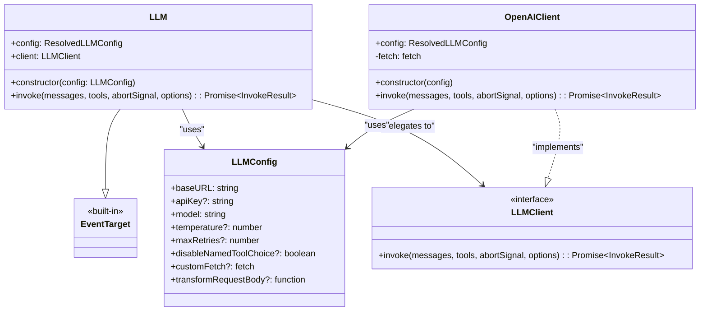
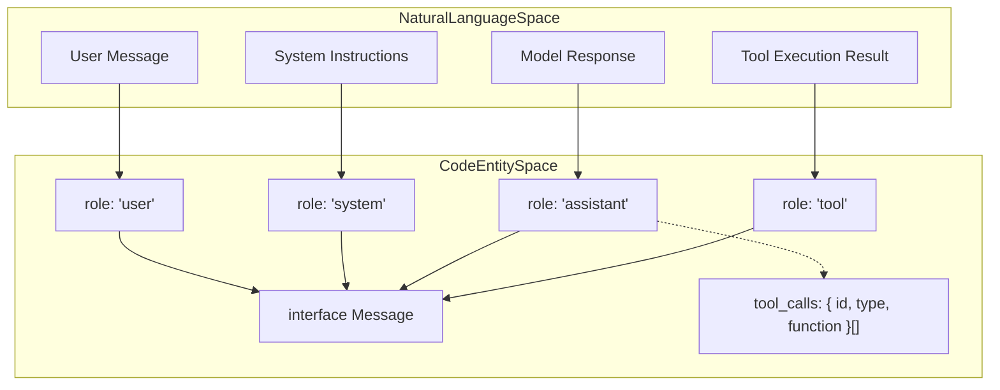
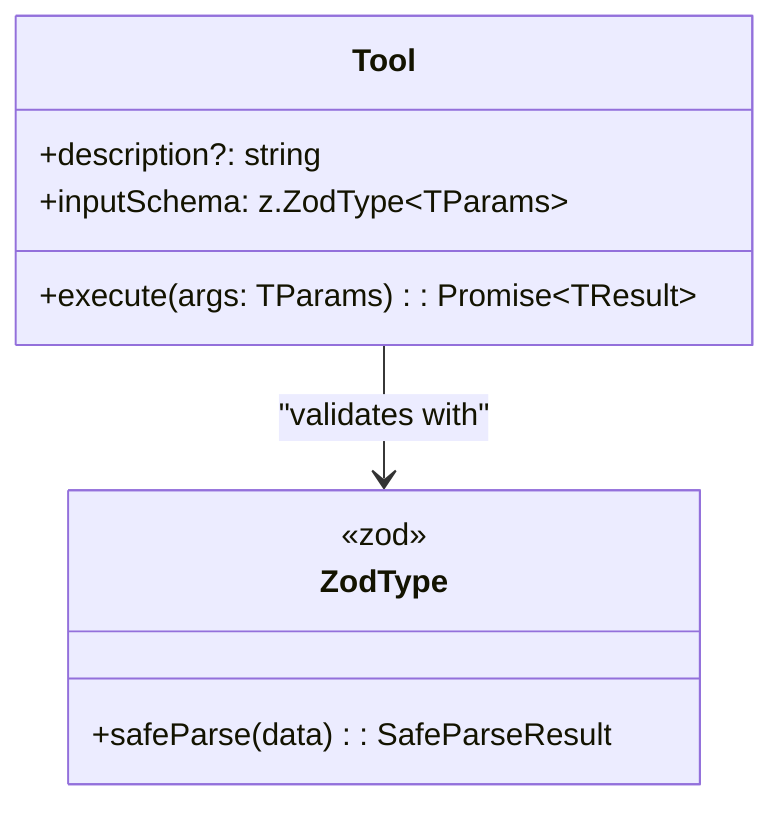

<!-- source: DeepWiki mcp.deepwiki.com · repo alibaba/page-agent · page 16.4 LLM Module API · fetched 2026-10-29 -->

# LLM Module API

<details>
<summary>Relevant source files</summary>

The following files were used as context for generating this wiki page:

- [packages/core/src/utils/autoFixer.ts](packages/core/src/utils/autoFixer.ts)
- [packages/llms/src/OpenAIClient.ts](packages/llms/src/OpenAIClient.ts)
- [packages/llms/src/errors.ts](packages/llms/src/errors.ts)
- [packages/llms/src/index.ts](packages/llms/src/index.ts)
- [packages/llms/src/types.ts](packages/llms/src/types.ts)

</details>


The LLM Module API (`@page-agent/llms`) provides the interface for interacting with Large Language Models in PageAgent. This module abstracts LLM provider differences, handles retry logic, validates tool calls using Zod schemas, and provides a unified interface for OpenAI-compatible APIs.

This page documents the public API of the LLM module. For configuration guidance and usage examples, see [LLM Configuration](#8.2). For integration with the agent system, see [LLM Client Architecture](#6.1).

---

## Core Classes and Interfaces

### LLM Class

The `LLM` class is the primary entry point for LLM interactions. It manages configuration, client instantiation, and retry logic. It extends `EventTarget` to provide hooks for monitoring retries.

**Code Entity Space Diagram**

Sources: [packages/llms/src/index.ts:19-53](), [packages/llms/src/OpenAIClient.ts:20-34](), [packages/llms/src/types.ts:57-64](), [packages/llms/src/types.ts:90-125]()

**Constructor**

The constructor accepts an `LLMConfig` object and parses it using `parseLLMConfig()` [packages/llms/src/index.ts:23-29]():
- Validates required fields (`baseURL`, `model`). Throws an error if missing [packages/llms/src/index.ts:85-90]().
- Sets default `maxRetries` to `2` [packages/llms/src/index.ts:104]().
- Sets `disableNamedToolChoice` to `false` by default [packages/llms/src/index.ts:106]().
- Binds `customFetch` or uses global `fetch` [packages/llms/src/index.ts:107]().
- Instantiates an `OpenAIClient` as the default client implementation [packages/llms/src/index.ts:28]().

**invoke() Method**

Signature: [packages/llms/src/index.ts:36-52]()
```typescript
async invoke(
    messages: Message[],
    tools: Record<string, Tool>,
    abortSignal: AbortSignal,
    options?: InvokeOptions
): Promise<InvokeResult>
```

This method:
1. Wraps the execution in `withRetry()` [packages/llms/src/index.ts:42]().
2. Delegates the actual API call to `this.client.invoke()` [packages/llms/src/index.ts:42]().
3. Dispatches `retry` events via the `EventTarget` API when a retryable failure occurs [packages/llms/src/index.ts:44-50]().

**Events**

The `LLM` class emits:
- `retry`: Fired when an attempt fails with a retryable error. Detail: `{ attempt: number, maxAttempts: number, lastError: Error }` [packages/llms/src/index.ts:46-49]().

Sources: [packages/llms/src/index.ts:19-53](), [packages/llms/src/index.ts:83-109]()

---

### LLMConfig Interface

The configuration object for LLM instances.

| Field | Type | Required | Default | Description |
|-------|------|----------|---------|-------------|
| `baseURL` | `string` | Yes | - | LLM API endpoint (e.g., `https://api.openai.com/v1`) |
| `model` | `string` | Yes | - | Model identifier (e.g., `gpt-4o`, `qwen-plus`) |
| `apiKey` | `string` | No | `""` | Authentication key for the LLM provider |
| `temperature` | `number` | No | - | Sampling temperature. (Note: deprecated in favor of `transformRequestBody`) [packages/llms/src/index.ts:92-97]() |
| `maxRetries` | `number` | No | `2` | Maximum retry attempts for retryable errors [packages/llms/src/index.ts:104]() |
| `transformRequestBody` | `function` | No | `(req) => req` | Hook to modify the request body before sending [packages/llms/src/index.ts:105]() |
| `disableNamedToolChoice` | `boolean` | No | `false` | If true, removes `tool_choice` field to fix issues with some LLMs [packages/llms/src/index.ts:106]() |
| `customFetch` | `typeof fetch` | No | `fetch` | Custom fetch function for proxying or auth customization [packages/llms/src/index.ts:107]() |

**customFetch Usage**

The `customFetch` option allows interception of LLM API requests. The response must follow the OpenAI API format. It is bound to `globalThis` during configuration parsing [packages/llms/src/index.ts:107]().

Sources: [packages/llms/src/index.ts:83-109](), [packages/llms/src/types.ts:90-125]()

---

### Message Format

Messages follow the OpenAI standard format for multi-turn conversations and tool interactions.

**Natural Language to Code Entity Space**


**Message Structure**

The `Message` interface supports standard roles and `tool_calls` for assistant responses, as well as `tool_call_id` for tool execution results [packages/llms/src/types.ts:9-22]().

Sources: [packages/llms/src/types.ts:9-22]()

---

### Tool Interface

Tools are defined using Zod schemas for type-safe parameter validation and automated JSON schema generation.



**Tool Conversion to OpenAI Format**

The `zodToOpenAITool()` utility converts the Zod schema to an OpenAI compliant JSON schema for the model's tool definition [packages/llms/src/OpenAIClient.ts:38]().

Sources: [packages/llms/src/types.ts:28-33](), [packages/llms/src/OpenAIClient.ts:38]()

---

## Invocation API

### InvokeOptions

Optional parameters to control the behavior of a single `invoke()` call.

| Field | Type | Description |
|-------|------|-------------|
| `toolChoiceName` | `string?` | Force the LLM to call a specific tool by name [packages/llms/src/types.ts:44]() |
| `normalizeResponse` | `Function?` | A function to fix response format errors from the model before parsing [packages/llms/src/types.ts:50]() |

Sources: [packages/llms/src/types.ts:38-51]()

---

### InvokeResult

The structured result returned after a successful tool call and execution.

| Field | Type | Description |
|-------|------|-------------|
| `toolCall.name` | `string` | Name of the tool called by the LLM [packages/llms/src/types.ts:72]() |
| `toolCall.args` | `any` | Parsed and validated arguments passed to the tool [packages/llms/src/types.ts:73]() |
| `toolResult` | `TResult` | The actual result returned by the tool's `execute` function [packages/llms/src/types.ts:75]() |
| `usage` | `object` | Token usage statistics (prompt, completion, total, cached, reasoning) [packages/llms/src/types.ts:76-82]() |

Sources: [packages/llms/src/types.ts:69-85](), [packages/llms/src/OpenAIClient.ts:252-263]()

---

## Error Handling

### InvokeError Class

The `InvokeError` class [packages/llms/src/errors.ts:39-56]() provides structured information about why an LLM call failed.

**Retry Logic**

The `withRetry` helper [packages/llms/src/index.ts:58-81]() uses the `retryable` property of `InvokeError` to determine if it should attempt the call again.
- **Retryable**: Network errors, Rate limits (429), Server errors (5xx), Model failing to call a tool, Invalid tool arguments (model hallucination), and Tool execution errors [packages/llms/src/errors.ts:27-37]().
- **Non-Retryable**: Configuration errors, Authentication errors (401/403), Context length exceeded, and Content filtering [packages/llms/src/errors.ts:18-23]().

### InvokeErrorType Enum

| Type | Category | Source |
|------|----------|--------|
| `NETWORK_ERROR` | Retryable | `fetch` failure [packages/llms/src/OpenAIClient.ts:88]() |
| `RATE_LIMIT` | Retryable | HTTP 429 [packages/llms/src/OpenAIClient.ts:108]() |
| `SERVER_ERROR` | Retryable | HTTP 5xx [packages/llms/src/OpenAIClient.ts:115]() |
| `NO_TOOL_CALL` | Retryable | Model returned no tool calls [packages/llms/src/OpenAIClient.ts:183]() |
| `INVALID_TOOL_ARGS` | Retryable | JSON parse or Zod validation failure [packages/llms/src/OpenAIClient.ts:217, 228]() |
| `AUTH_ERROR` | Non-Retryable | HTTP 401/403 [packages/llms/src/OpenAIClient.ts:101]() |
| `CONTEXT_LENGTH` | Non-Retryable | `finish_reason: length` [packages/llms/src/OpenAIClient.ts:154]() |

Sources: [packages/llms/src/errors.ts:5-23](), [packages/llms/src/OpenAIClient.ts:62-248]()

---

## Client Implementations

### OpenAIClient

The `OpenAIClient` [packages/llms/src/OpenAIClient.ts:20]() is the core implementation for OpenAI-compatible Chat Completion APIs.

**Data Flow in OpenAIClient.invoke():**

1. **Tool Conversion**: Converts `tools` record to OpenAI tool format [packages/llms/src/OpenAIClient.ts:38]().
2. **Tool Choice**: Configures `tool_choice` if `options.toolChoiceName` is provided [packages/llms/src/OpenAIClient.ts:42-45]().
3. **Model Patching**: Applies `modelPatch()` to the request body for provider-specific fixes [packages/llms/src/OpenAIClient.ts:59]().
4. **Body Transformation**: Executes `transformRequestBody` hook [packages/llms/src/OpenAIClient.ts:63]().
5. **Network Call**: Executes request via `fetch` [packages/llms/src/OpenAIClient.ts:76-84]().
6. **Response Validation**: Checks HTTP status, `finish_reason`, and existence of tool calls [packages/llms/src/OpenAIClient.ts:92-174]().
7. **Normalization**: Applies `normalizeResponse` (from `autoFixer.ts`) if provided to fix common hallucination patterns [packages/llms/src/OpenAIClient.ts:177]().
8. **Argument Validation**: Parses JSON arguments and validates against the tool's `inputSchema` [packages/llms/src/OpenAIClient.ts:212-234]().
9. **Tool Execution**: Runs the tool's `execute` logic [packages/llms/src/OpenAIClient.ts:240]().

Sources: [packages/llms/src/OpenAIClient.ts:29-265](), [packages/core/src/utils/autoFixer.ts:21-121]()

---

