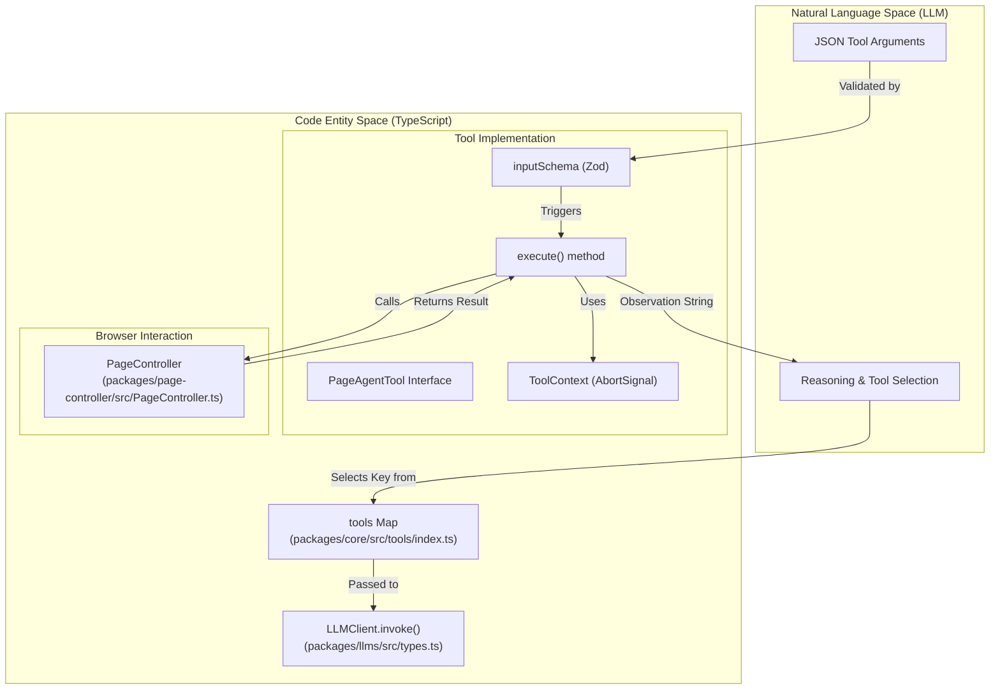
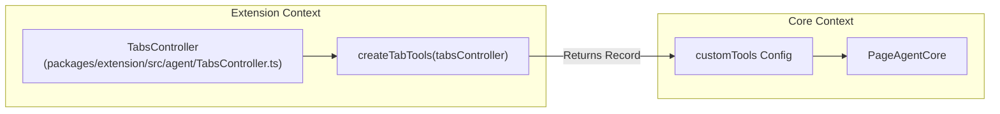

<!-- source: DeepWiki mcp.deepwiki.com · repo alibaba/page-agent · page 16.6 Tool Types · fetched 2026-10-29 -->

# Tool Types

<details>
<summary>Relevant source files</summary>

The following files were used as context for generating this wiki page:

- [packages/core/src/tools/index.ts](packages/core/src/tools/index.ts)
- [packages/extension/src/agent/TabsController.test.ts](packages/extension/src/agent/TabsController.test.ts)
- [packages/extension/src/agent/tabTools.ts](packages/extension/src/agent/tabTools.ts)
- [packages/extension/vitest.config.js](packages/extension/vitest.config.js)
- [packages/llms/src/types.ts](packages/llms/src/types.ts)

</details>


## Overview

This document provides technical documentation for the tool system in PageAgent. Tools are the functional units that allow the LLM to interact with the browser, manage state, and communicate with the user. The system uses [Zod](https://zod.dev/) for schema validation and automatic JSON Schema generation for LLM tool calling.

The architecture is split into two layers: the **LLM Layer** (`@page-agent/llms`), which defines generic, model-agnostic tool interfaces, and the **Core Layer** (`@page-agent/core`), which defines specialized tools that have access to the agent's runtime context and cooperative cancellation signals.

---

## Tool Interface

PageAgent uses two primary interfaces for tools depending on the level of abstraction.

### Generic Tool Interface (LLM Layer)
The base `Tool` interface is defined in the LLM package. It is designed to be LLM-agnostic and uses Zod for input validation.

```typescript
export interface Tool<TParams = any, TResult = any> {
	// name: string
	description?: string
	inputSchema: z.ZodType<TParams>
	execute: (args: TParams) => Promise<TResult>
}
```
**Sources:** [packages/llms/src/types.ts:28-33]()

### PageAgentTool Interface (Core Layer)
The `PageAgentTool` interface extends the generic concept by binding the `execute` function to the `PageAgentCore` instance using a `this` parameter. It also introduces a `ToolContext` which includes an `AbortSignal` to support cooperative cancellation of long-running tasks.

```typescript
export interface ToolContext {
	signal: AbortSignal
}

export interface PageAgentTool<TParams = any> {
	// name: string
	description: string
	inputSchema: z.ZodType<TParams>
	execute: (this: PageAgentCore, args: TParams, ctx: ToolContext) => Promise<string>
}
```
**Sources:** [packages/core/src/tools/index.ts:14-26]()

### Tool Helper Function
The `tool` helper function is a utility for creating type-safe tool definitions with proper TypeScript inference for the `TParams` generic.
```typescript
export function tool<TParams>(options: PageAgentTool<TParams>): PageAgentTool<TParams> {
	return options
}
```
**Sources:** [packages/core/src/tools/index.ts:28-30]()

---

## Tool Registry and Data Flow

PageAgent maintains a registry of tools in a `Map`. During the agent's reasoning phase, these are transformed into the format required by the LLM provider (e.g., OpenAI Tool format).

### Natural Language to Code Entity Mapping

The following diagram shows how high-level agent concepts map to specific code entities in the tool system, bridging the gap between the LLM's natural language reasoning and the execution of TypeScript code.

**Tool System Entity Mapping**



**Sources:** [packages/core/src/tools/index.ts:36](), [packages/llms/src/types.ts:57-64](), [packages/core/src/tools/index.ts:100-104]()

---

## Built-in Tool Types

The core package defines several essential tools for browser automation. These tools typically wrap methods found in the `PageController`.

### DOM Interaction Tools
| Tool Name | Description | Source |
| :--- | :--- | :--- |
| `click_element_by_index` | Clicks an element based on its numeric index in the simplified DOM tree. | [packages/core/src/tools/index.ts:94-105]() |
| `input_text` | Focuses and types text into an interactive element. | [packages/core/src/tools/index.ts:107-120]() |
| `select_dropdown_option` | Selects an option from a `<select>` element by text. | [packages/core/src/tools/index.ts:123-136]() |
| `scroll` | Performs vertical or container-based scrolling. Supports `num_pages` or `pixels`. | [packages/core/src/tools/index.ts:141-160]() |
| `scroll_horizontally` | Performs horizontal scrolling on a document or container. | [packages/core/src/tools/index.ts:165-180]() |

### Logic and Control Tools
| Tool Name | Description | Source |
| :--- | :--- | :--- |
| `done` | Signals task completion. Includes a final response `text` and `success` status. | [packages/core/src/tools/index.ts:38-52]() |
| `wait` | Pauses execution. It intelligently subtracts time since the last page update from the requested time. | [packages/core/src/tools/index.ts:54-73]() |
| `ask_user` | Interrupts the agent to request clarification from the human user via `onAskUser`. | [packages/core/src/tools/index.ts:75-91]() |
| `execute_javascript` | Runs arbitrary JS in the page context. Must honor the `signal` for cancellation. | [packages/core/src/tools/index.ts:183-198]() |

---

## Extension-Specific Tool Types (Tab Management)

When running within the Chrome Extension, the agent gains access to "Tab Tools" via the `TabsController`. These allow for multi-page automation by injecting these tools into the `PageAgentCore` `customTools` configuration.

### Tab Tool Architecture



**Sources:** [packages/extension/src/agent/tabTools.ts:25-77]()

### Available Tab Tools
| Tool Name | Description | Input Schema |
| :--- | :--- | :--- |
| `open_new_tab` | Opens a URL in a new tab and sets it as active. | `{ url: string }` |
| `switch_to_tab` | Switches focus to an existing tab by its ID. | `{ tab_id: number }` |
| `close_tab` | Closes a specific tab by ID. | `{ tab_id: number }` |

**Sources:** [packages/extension/src/agent/tabTools.ts:27-75]()

---

## Tool Invocation and Types

The LLM integration uses a standardized `Message` format and `InvokeResult` to manage tool communication.

### Message Format
The system follows the OpenAI standard for messages, including `tool_calls` and `tool_call_id` for managing the conversation state.
```typescript
export interface Message {
	role: 'system' | 'user' | 'assistant' | 'tool'
	content?: string | null
	tool_calls?: {
		id: string
		type: 'function'
		function: {
			name: string
			arguments: string // JSON string
		}
	}[]
	tool_call_id?: string
	name?: string
}
```
**Sources:** [packages/llms/src/types.ts:9-22]()

### Invoke Result
Every tool execution returns an `InvokeResult`, which encapsulates the tool call details, the execution result, and token usage statistics.
```typescript
export interface InvokeResult<TResult = unknown> {
	toolCall: {
		name: string
		args: any
	}
	toolResult: TResult
	usage: {
		promptTokens: number
		completionTokens: number
		totalTokens: number
		cachedTokens?: number
		reasoningTokens?: number
	}
}
```
**Sources:** [packages/llms/src/types.ts:69-85]()

---

