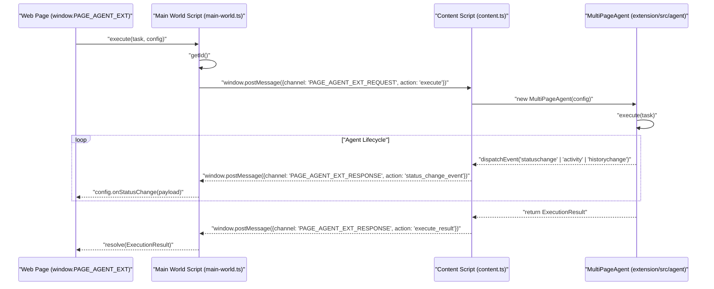

<!-- source: DeepWiki mcp.deepwiki.com · repo alibaba/page-agent · page 16.7 Extension API (window.PAGE_AGENT_EXT) · fetched 2026-10-29 -->

# Extension API (window.PAGE_AGENT_EXT)

<details>
<summary>Relevant source files</summary>

The following files were used as context for generating this wiki page:

- [packages/extension/PRIVACY.md](packages/extension/PRIVACY.md)
- [packages/extension/docs/extension_api.md](packages/extension/docs/extension_api.md)
- [packages/extension/src/agent/constants.ts](packages/extension/src/agent/constants.ts)
- [packages/extension/src/agent/useAgent.ts](packages/extension/src/agent/useAgent.ts)
- [packages/extension/src/entrypoints/main-world.ts](packages/extension/src/entrypoints/main-world.ts)
- [packages/page-agent/src/demo.ts](packages/page-agent/src/demo.ts)
- [packages/website/src/pages/docs/features/chrome-extension/page.tsx](packages/website/src/pages/docs/features/chrome-extension/page.tsx)
- [tsconfig.base.json](tsconfig.base.json)

</details>


The `window.PAGE_AGENT_EXT` API is a public interface exposed by the PageAgent Chrome extension to web pages. It allows third-party web applications to leverage the agent's multi-page automation capabilities, browser-level control, and LLM integration directly from client-side JavaScript, provided the user has authorized the connection via a security token [packages/extension/docs/extension_api.md:1-4]().

## Overview and Security Model

The extension API bridges the gap between the isolated world of a web page and the privileged environment of a browser extension. Because the extension possesses broad permissions (e.g., cross-tab navigation, DOM access across origins), access is strictly gated by a token-based authorization system [packages/extension/docs/extension_api.md:27-31]().

### Authorization Flow
1.  **Token Retrieval**: The user retrieves a unique `PageAgentExtUserAuthToken` from the extension's side panel [packages/website/src/pages/docs/features/chrome-extension/page.tsx:134-145]().
2.  **Token Storage**: The web application must store this token in its local storage: `localStorage.setItem('PageAgentExtUserAuthToken', '...')` [packages/extension/docs/extension_api.md:39-39]().
3.  **Verification**: The extension's content script compares the `localStorage` token with the one stored in `chrome.storage.local` (Implementation detail in content script).
4.  **Injection**: If tokens match, the extension injects `main-world.js`, which populates the `window.PAGE_AGENT_EXT` object [packages/extension/src/entrypoints/main-world.ts:125-130]().

### Data Flow: Page to Extension
The following diagram illustrates the communication bridge between the Web Page (Main World) and the Extension context.

**API Communication Bridge**

Sources: [packages/extension/src/entrypoints/main-world.ts:37-110](), [packages/extension/src/agent/useAgent.ts:80-99]()

---

## Global API Reference

### `window.PAGE_AGENT_EXT_VERSION`
A string representing the current version of the extension, used for capability checks before using the main API [packages/extension/src/entrypoints/main-world.ts:125-125]().

### `window.PAGE_AGENT_EXT`
The main namespace for interacting with the agent.

#### `execute(task: string, config: ExecuteConfig): Promise<ExecutionResult>`
Initiates a new automation task. 

*   **task**: A natural language description of the goal. Must be a non-empty string [packages/extension/src/entrypoints/main-world.ts:37-39]().
*   **config**: An `ExecuteConfig` object containing LLM credentials and lifecycle callbacks [packages/extension/src/entrypoints/main-world.ts:40-42]().

#### `stop(): void`
Immediately halts the current agent task by sending a `stop` action message to the extension context [packages/extension/src/entrypoints/main-world.ts:112-123]().

---

## Data Structures

### ExecuteConfig
This interface defines the operational parameters for the agent session.

| Property | Type | Description |
| :--- | :--- | :--- |
| `baseURL` | `string` | The API endpoint for the LLM provider [packages/extension/src/entrypoints/main-world.ts:6-6](). |
| `model` | `string` | The specific model identifier to use [packages/extension/src/entrypoints/main-world.ts:7-7](). |
| `apiKey` | `string` | (Optional) API key for the LLM provider [packages/extension/src/entrypoints/main-world.ts:8-8](). |
| `systemInstruction`| `string` | Global instructions for the agent persona [packages/extension/src/entrypoints/main-world.ts:14-14](). |
| `includeInitialTab`| `boolean` | If `true`, the agent controls the initiating tab. Defaults to `true` [packages/extension/src/entrypoints/main-world.ts:18-20](). |
| `experimentalIncludeAllTabs` | `boolean` | If `true`, allows control over all unpinned tabs in the window [packages/extension/src/entrypoints/main-world.ts:23-23](). |

Sources: [packages/extension/src/entrypoints/main-world.ts:5-28]()

### Event Callbacks
The `ExecuteConfig` supports three primary event listeners for real-time feedback:

1.  **`onStatusChange(status: AgentStatus)`**: Triggered on status transitions (e.g., `idle`, `running`, `completed`, `error`, `stopped`) [packages/extension/src/entrypoints/main-world.ts:25-25](), [packages/extension/docs/extension_api.md:138-138]().
2.  **`onActivity(activity: AgentActivity)`**: Granular updates on current actions (e.g., `thinking`, `executing`, `executed`, `retrying`) [packages/extension/src/entrypoints/main-world.ts:26-26](), [packages/extension/docs/extension_api.md:144-150]().
3.  **`onHistoryUpdate(history: HistoricalEvent[])`**: Returns the full step history, including reflections and tool outputs [packages/extension/src/entrypoints/main-world.ts:27-27](), [packages/extension/docs/extension_api.md:155-161]().

---

## Implementation Details

### Multi-Page Coordination
When `execute` is called via the API, the extension environment instantiates a `MultiPageAgent`. This agent extends the core capabilities to handle multiple browser tabs and cross-tab navigation [packages/website/src/pages/docs/features/chrome-extension/page.tsx:31-37]().

### Code Entity Mapping
The following diagram maps the API concepts to specific classes and files within the extension package.

**Entity Mapping: API to Implementation**
```mermaid
classDiagram
    class "window.PAGE_AGENT_EXT" {
        <<Interface>>
        +execute(task, config)
        +stop()
    }

    class MainWorldScript {
        <<file: main-world.ts>>
        +getId()
        +execute()
        +stop()
    }

    class MultiPageAgent {
        <<file: MultiPageAgent.ts>>
        +execute(task)
        +status: AgentStatus
        +history: HistoricalEvent[]
    }

    class useAgentHook {
        <<file: useAgent.ts>>
        +status: AgentStatus
        +activity: AgentActivity
        +execute(task)
        +configure(config)
    }

    "window.PAGE_AGENT_EXT" ..> MainWorldScript : "Exposed by"
    MainWorldScript --|> MultiPageAgent : "Triggers via postMessage"
    useAgentHook *-- MultiPageAgent : "React Wrapper for UI"
```
Sources: [packages/extension/src/entrypoints/main-world.ts:30-131](), [packages/extension/src/agent/useAgent.ts:43-161]()

### Execution Logic
The `main-world.ts` script generates a unique ID for every request using `getId()` [packages/extension/src/entrypoints/main-world.ts:32-35](). This ID is used to filter incoming `MessageEvent` responses from the content script to ensure the correct promise is resolved [packages/extension/src/entrypoints/main-world.ts:53-53]().

When a task completes, the extension sends an `execute_result` action. The `main-world.ts` listener then removes itself and resolves or rejects the original promise [packages/extension/src/entrypoints/main-world.ts:72-83]().

### React Integration (Internal)
For extension-internal UIs (like the side panel), the `useAgent` hook provides a React-friendly wrapper. It synchronizes `chrome.storage.local` configurations—including `llmConfig`, `language`, and `advancedConfig`—and manages the `MultiPageAgent` lifecycle [packages/extension/src/agent/useAgent.ts:52-68](), [packages/extension/src/agent/useAgent.ts:70-107]().

Sources:
- `packages/extension/src/entrypoints/main-world.ts` [packages/extension/src/entrypoints/main-world.ts:1-131]()
- `packages/extension/src/agent/useAgent.ts` [packages/extension/src/agent/useAgent.ts:1-161]()
- `packages/extension/docs/extension_api.md` [packages/extension/docs/extension_api.md:1-229]()
- `packages/extension/src/agent/constants.ts` [packages/extension/src/agent/constants.ts:1-30]()
- `packages/website/src/pages/docs/features/chrome-extension/page.tsx` [packages/website/src/pages/docs/features/chrome-extension/page.tsx:1-170]()

---

