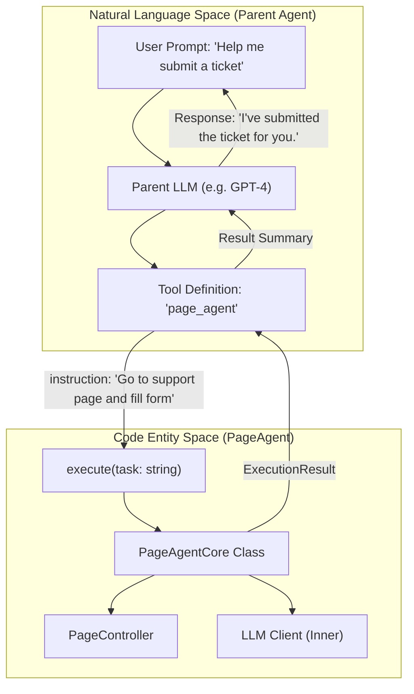
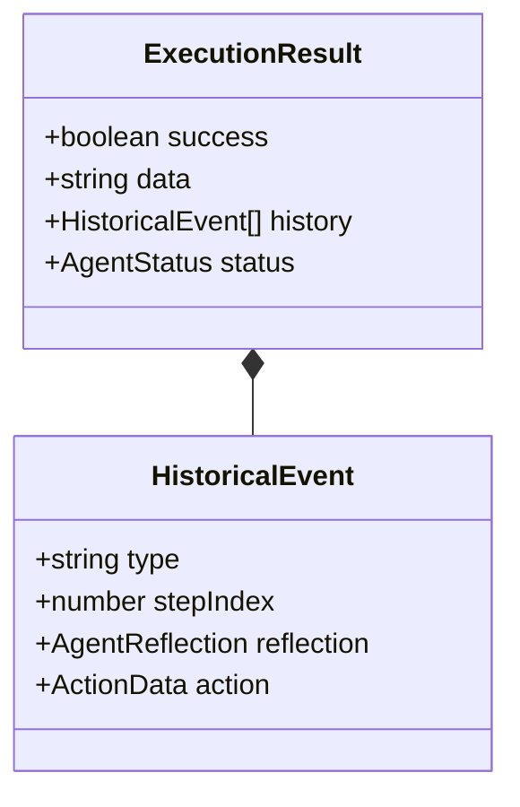
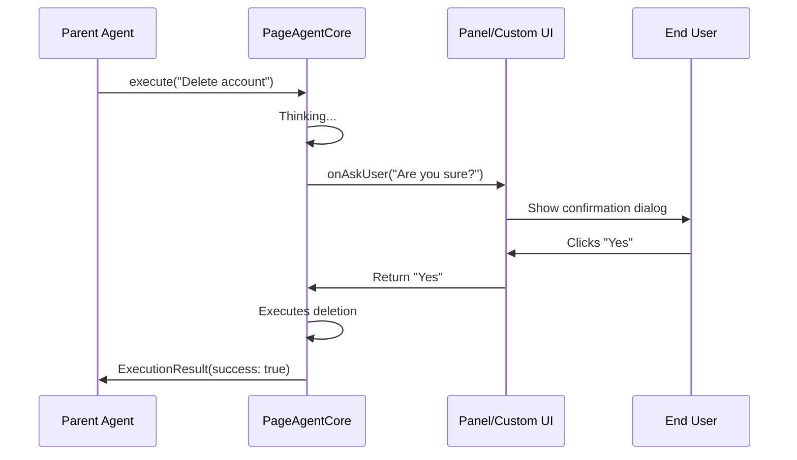

<!-- source: DeepWiki mcp.deepwiki.com · repo alibaba/page-agent · page 16.8 Third-party Agent Integration · fetched 2026-10-29 -->

# Third-party Agent Integration

<details>
<summary>Relevant source files</summary>

The following files were used as context for generating this wiki page:

- [packages/core/src/types.ts](packages/core/src/types.ts)
- [packages/ui/src/panel/Panel.ts](packages/ui/src/panel/Panel.ts)
- [packages/ui/src/panel/types.ts](packages/ui/src/panel/types.ts)
- [packages/website/src/components/APIReference.tsx](packages/website/src/components/APIReference.tsx)
- [packages/website/src/components/CodeEditor.tsx](packages/website/src/components/CodeEditor.tsx)
- [packages/website/src/pages/docs/advanced/security-permissions/page.tsx](packages/website/src/pages/docs/advanced/security-permissions/page.tsx)
- [packages/website/src/pages/docs/features/third-party-agent/page.tsx](packages/website/src/pages/docs/features/third-party-agent/page.tsx)

</details>


PageAgent is designed to be highly composable, allowing it to serve as the "eyes and hands" for external AI agent systems. By treating PageAgent as a tool within a larger function-calling ecosystem, developers can enable customer service bots, business process assistants, and DevOps tools to interact directly with web interfaces.

## Integration Pattern: Function Calling

The primary method for integrating PageAgent into a third-party system is the **Function Calling** pattern. In this model, the parent agent (e.g., a GPT-4 or Claude-based assistant) decides when it needs to perform a browser action and calls the PageAgent's `execute` method as a tool.

### Conceptual Data Flow

The following diagram illustrates how a parent agent orchestrates PageAgent via the `PageAgentCore` or `PageAgent` classes.

**Parent Agent to PageAgent Tool Bridge**



Sources: [packages/website/src/pages/docs/features/third-party-agent/page.tsx:29-44](), [packages/core/src/types.ts:261-285]()

## Implementation Detail

To integrate PageAgent as a tool, you define a function that wraps the `PageAgent.execute` call. The parent agent should be provided with a schema describing this tool.

### Tool Definition Example

```javascript
const pageAgentTool = {
  name: "page_agent",
  description: "Execute web page operations using natural language instructions.",
  parameters: {
    type: "object",
    properties: {
      instruction: { 
        type: "string", 
        description: "The specific task for the browser agent to perform on the current page." 
      }
    },
    required: ["instruction"]
  },
  execute: async (params) => {
    // pageAgent is an instance of PageAgent or PageAgentCore
    const result = await pageAgent.execute(params.instruction);
    return { 
      success: result.success, 
      data: result.data, // Final answer from the agent
      steps: result.history.length 
    };
  }
}
```

Sources: [packages/website/src/pages/docs/features/third-party-agent/page.tsx:29-44](), [packages/core/src/types.ts:103-105]()

## Use Cases

Integrating PageAgent into specialized assistants unlocks several business-critical scenarios:

| Use Case | Description | Example Instruction |
| :--- | :--- | :--- |
| **Smart Customer Service** | Bots directly operate internal systems to resolve user issues without human intervention. | "Help the user submit a technical support ticket with the details provided." |
| **Business Process Assistant** | Guides employees through complex SaaS workflows or performs data entry. | "Complete the customer onboarding form using the data from this CSV." |
| **Personal Productivity** | Automates tasks across different websites. | "Check my flight status on the airline website and update my calendar." |
| **DevOps Automation** | Operates cloud consoles or admin panels via natural language. | "Go to the AWS console and restart the staging EC2 instance." |

Sources: [packages/website/src/pages/docs/features/third-party-agent/page.tsx:55-95]()

## Execution Result Structure

When the `execute` method finishes, it returns an `ExecutionResult` object. Third-party systems should parse this result to determine the next steps in their own logic.

### Data Model: ExecutionResult

The `ExecutionResult` represents the terminal state of a PageAgent task.



| Field | Type | Description |
| :--- | :--- | :--- |
| `success` | `boolean` | Whether the agent successfully reached the `done` tool or completed the objective. |
| `data` | `string` | The final output or answer provided by the agent (usually from the `done` tool's input). |
| `history` | `HistoricalEvent[]` | A complete log of every step, reflection, and DOM action taken during the task. |
| `status` | `AgentStatus` | The final status of the agent (e.g., `completed`, `error`, `stopped`). |

Sources: [packages/core/src/types.ts:261-285](), [packages/ui/src/panel/types.ts:32-60]()

## Advanced Integration: Human-in-the-Loop

For high-risk operations, third-party agents can leverage the `ask_user` tool via the `onAskUser` hook. This allows the PageAgent to pause and request confirmation or additional info, which the parent agent can then relay to the end user.

**Interaction Flow with UI Adapter**



Sources: [packages/ui/src/panel/Panel.ts:176-213](), [packages/ui/src/panel/types.ts:66-71]()

---

