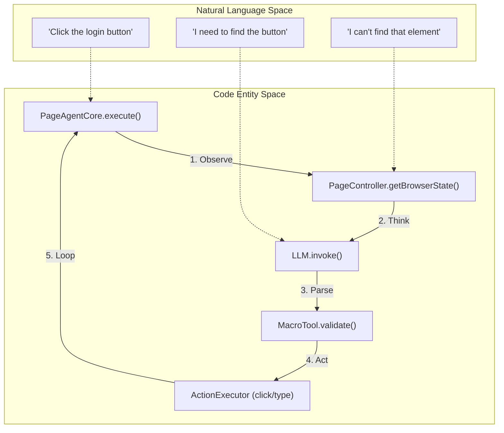
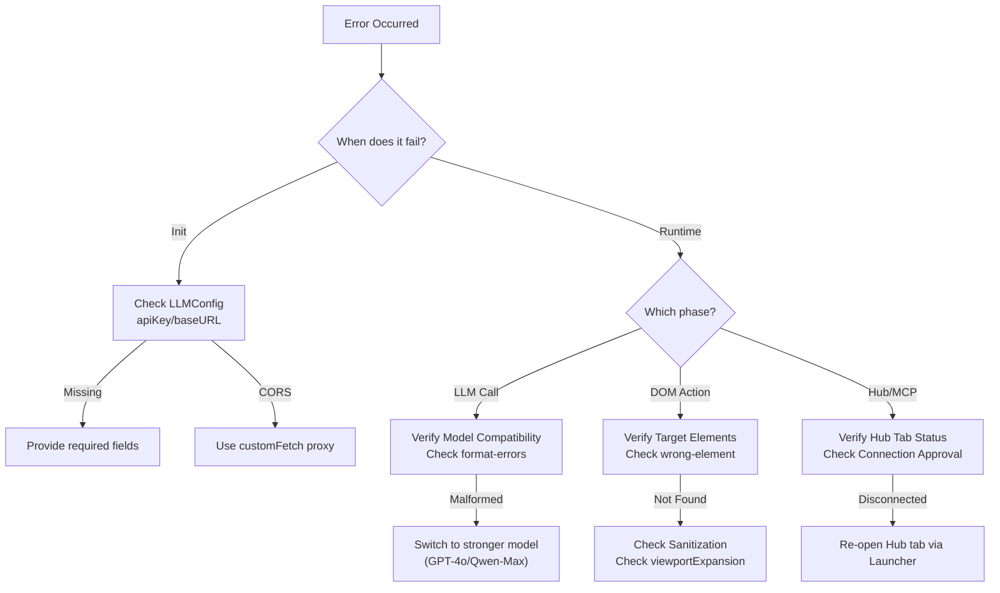

<!-- source: DeepWiki mcp.deepwiki.com · repo alibaba/page-agent · page 17 Troubleshooting · fetched 2026-10-29 -->

# Troubleshooting

Relevant source files

The following files were used as context for generating this wiki page:

- [packages/website/src/components/LanguageSwitcher.tsx](packages/website/src/components/LanguageSwitcher.tsx)
- [packages/website/src/components/ThemeSwitcher.tsx](packages/website/src/components/ThemeSwitcher.tsx)
- [packages/website/src/pages/docs/features/mcp-server/page.tsx](packages/website/src/pages/docs/features/mcp-server/page.tsx)
- [packages/website/src/pages/docs/introduction/troubleshooting/page.tsx](packages/website/src/pages/docs/introduction/troubleshooting/page.tsx)

This page provides guidance for diagnosing and resolving common issues when using PageAgent. It covers general troubleshooting strategies, error categorization, and debugging workflows. For specific problem areas, see [Common Issues](#17.1), [LLM Configuration Issues](#17.2), and [Extension Issues](#17.3).

## Purpose and Scope

This document helps developers identify and resolve errors that occur during PageAgent integration and operation. It focuses on the core NPM package deployment model and runtime errors. For build-time and development issues, see [Development Guide](#13). For security-related configuration, see [Security Considerations](#15).

## Error Flow Architecture

Understanding where errors can occur in the system helps narrow down the root cause. The following diagram maps natural language failures to the specific code entities responsible for those phases.

### Agent Execution Pipeline

**Sources:** [packages/website/src/pages/docs/introduction/troubleshooting/page.tsx:21-61](), [packages/website/src/pages/docs/features/mcp-server/page.tsx:53-67]()

## Error Categories

PageAgent errors fall into several main categories, each with distinct symptoms and resolution strategies:

| Category | Typical Symptoms | Primary Location | Logged Where |
|----------|------------------|------------------|--------------|
| **Configuration Errors** | Agent fails to initialize; missing required fields | `new PageAgent()` | Console error on init |
| **LLM Connection Errors** | Network timeouts; 401/403 responses; CORS errors | `LLM.invoke()` | LLM retry logic output |
| **LLM Response Errors** | Invalid JSON; schema validation failures; wrong tool format | `MacroTool` parsing | `activity` event (error) |
| **DOM Operation Errors** | Element not found; action failed; navigation timeout | `PageController` | `historychange` status |
| **Extension Context Errors** | Message passing failures; permission denied | `MultiPageAgent` | Extension background console |
| **MCP/Hub Errors** | Hub tab not opening; connection rejected | `Hub` / `@page-agent/mcp` | MCP Server stdio |

**Sources:** [packages/website/src/pages/docs/introduction/troubleshooting/page.tsx:20-61](), [packages/website/src/pages/docs/features/mcp-server/page.tsx:19-31]()

## Diagnostic Strategy

Follow this decision tree to quickly identify the problem area:

**Sources:** [packages/website/src/pages/docs/introduction/troubleshooting/page.tsx:67-187](), [packages/website/src/pages/docs/features/mcp-server/page.tsx:61-66]()

## Common Error Patterns

### 1. Model Response Format Errors
**Symptom:** The model returns plain text or malformed JSON instead of structured tool calls [packages/website/src/pages/docs/introduction/troubleshooting/page.tsx:21-27]().
**Resolution:** Ensure the model supports tool calling. If using a proxy, verify the `tools` field isn't being stripped or modified [packages/website/src/pages/docs/introduction/troubleshooting/page.tsx:85-98]().
**Sources:** [packages/website/src/pages/docs/introduction/troubleshooting/page.tsx:21-30](), [packages/website/src/pages/docs/introduction/troubleshooting/page.tsx:85-98]()

### 2. Low Success Rate / "Hallucinations"
**Symptom:** The agent understands the task but interacts with the wrong elements or fails complex workflows [packages/website/src/pages/docs/introduction/troubleshooting/page.tsx:31-37]().
**Resolution:** Start with simpler instructions, provide more context via `instructions` configuration to inject background descriptions, or switch to a more capable model [packages/website/src/pages/docs/introduction/troubleshooting/page.tsx:143-175]().
**Sources:** [packages/website/src/pages/docs/introduction/troubleshooting/page.tsx:31-40](), [packages/website/src/pages/docs/introduction/troubleshooting/page.tsx:168-175]()

### 3. Element Detection Failures
**Symptom:** The agent repeatedly retries but interacts with the wrong element or fails to locate the correct one [packages/website/src/pages/docs/introduction/troubleshooting/page.tsx:41-47]().
**Resolution:** Check if the element is visual-only (Canvas/Image) or requires complex interaction. Inspect the sanitized HTML in dev tools to confirm interactive elements are preserved [packages/website/src/pages/docs/introduction/troubleshooting/page.tsx:177-183]().
**Sources:** [packages/website/src/pages/docs/introduction/troubleshooting/page.tsx:41-50](), [packages/website/src/pages/docs/introduction/troubleshooting/page.tsx:177-183]()

### 4. API Request Errors (HTTP 400)
**Symptom:** HTTP 400 Bad Request or similar errors when calling the LLM API [packages/website/src/pages/docs/introduction/troubleshooting/page.tsx:52-57]().
**Resolution:** Verify the `LLM_MODEL_NAME`, `LLM_API_KEY`, and `LLM_BASE_URL` match the provider's requirements [packages/website/src/pages/docs/features/mcp-server/page.tsx:34-46]().
**Sources:** [packages/website/src/pages/docs/introduction/troubleshooting/page.tsx:52-60](), [packages/website/src/pages/docs/features/mcp-server/page.tsx:34-46]()

## Debugging Techniques

### Monitoring Activity
Track real-time status updates through the UI or event listeners. If using the extension, the Hub serves as the central communication entry point for external callers [packages/website/src/pages/docs/features/mcp-server/page.tsx:53-60]().

### Inspecting Sanitized HTML
Use developer tools to examine the output of the DOM processing logic. This confirms whether key information and interactive elements are correctly extracted for the LLM [packages/website/src/pages/docs/introduction/troubleshooting/page.tsx:177-183]().

### Hub and MCP Connection
When using the MCP server, ensure the Hub tab is active in Chrome. The launcher page must be approved by the user to establish the bridge between the local agent client and the browser extension [packages/website/src/pages/docs/features/mcp-server/page.tsx:19-31](), [packages/website/src/pages/docs/features/mcp-server/page.tsx:61-66]().

---

## Child Pages
- **[Common Issues](#17.1)** — Diagnostic steps for task success and element interaction.
- **[LLM Configuration Issues](#17.2)** — Troubleshooting connectivity, CORS, and model-specific formatting.
- **[Extension Issues](#17.3)** — Debugging the Chrome extension, Hub communication, and MCP integration.

---

