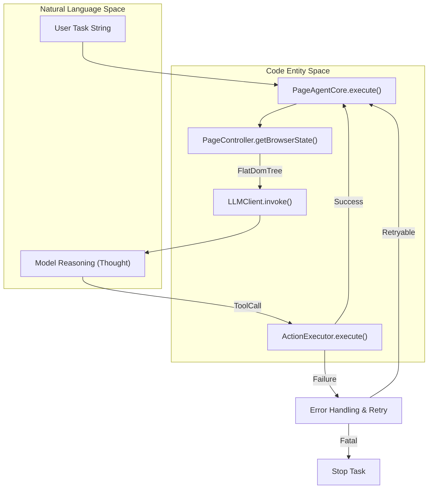
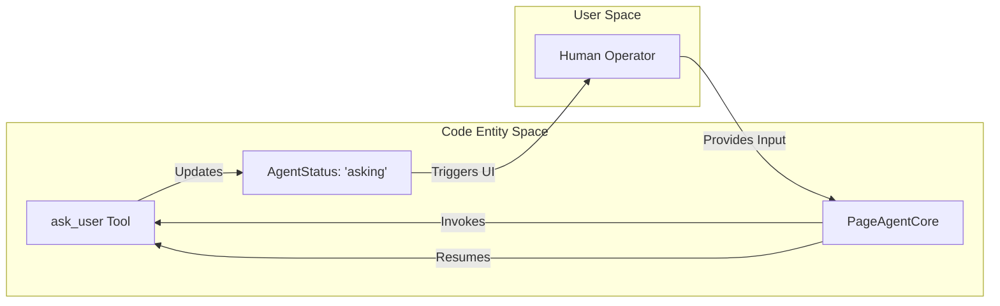

<!-- source: DeepWiki mcp.deepwiki.com · repo alibaba/page-agent · page 17.1 Common Issues · fetched 2026-10-29 -->

# Common Issues

Relevant source files

The following files were used as context for generating this wiki page:

- [packages/website/src/components/LanguageSwitcher.tsx](packages/website/src/components/LanguageSwitcher.tsx)
- [packages/website/src/components/ThemeSwitcher.tsx](packages/website/src/components/ThemeSwitcher.tsx)
- [packages/website/src/pages/docs/features/mcp-server/page.tsx](packages/website/src/pages/docs/features/mcp-server/page.tsx)
- [packages/website/src/pages/docs/introduction/troubleshooting/page.tsx](packages/website/src/pages/docs/introduction/troubleshooting/page.tsx)

This page documents frequently encountered issues when using PageAgent and their solutions. It covers general problems related to installation, agent execution, DOM interaction, and model performance.

## Model Response and Task Success Issues

The most common issues relate to the interaction between the LLM and the page content. These often manifest as the agent failing to find elements or returning malformed actions.

### Model Response Format Errors
**Symptom**: The model returns malformed tool calls, plain text, or unexpected JSON instead of structured actions [packages/website/src/pages/docs/introduction/troubleshooting/page.tsx:25-26]().

**Solutions**:
1.  **Verify Model Compatibility**: Not all models support the complex tool definitions used by PageAgent. Ensure you are using a tested model [packages/website/src/pages/docs/introduction/troubleshooting/page.tsx:71-83]().
2.  **Check API Gateways**: If using a proxy (like OneAPI or NewAPI), ensure the `tools` parameter is forwarded intact. Some proxies strip or modify structured output fields [packages/website/src/pages/docs/introduction/troubleshooting/page.tsx:86-97]().

### Low Task Success Rate
**Symptom**: The agent understands the task but fails to complete it or produces incorrect results [packages/website/src/pages/docs/introduction/troubleshooting/page.tsx:35-36]().

**Diagnostic Funnel**:
1.  **Start Simple**: Test with a single-step instruction (e.g., "Click the login button"). If this fails, the issue is likely environmental rather than model intelligence [packages/website/src/pages/docs/introduction/troubleshooting/page.tsx:145-150]().
2.  **Try Stronger Models**: Switch to the most capable model available to isolate intelligence limitations [packages/website/src/pages/docs/introduction/troubleshooting/page.tsx:153-158]().
3.  **Provide Context**: Use the `instructions` configuration to inject site-specific terminology or background info [packages/website/src/pages/docs/introduction/troubleshooting/page.tsx:169-174]().
4.  **Inspect Sanitized HTML**: Check the output of the DOM cleaning process in the developer console to ensure critical elements aren't being stripped [packages/website/src/pages/docs/introduction/troubleshooting/page.tsx:177-182]().

### Element Interaction Failures
**Symptom**: The agent retries but interacts with the wrong element or fails to locate the target [packages/website/src/pages/docs/introduction/troubleshooting/page.tsx:45-46]().

**Common Causes**:
*   **Non-Semantic HTML**: Sites lacking proper accessibility tags (`aria-label`, `role`) make it hard for the agent to identify elements [packages/website/src/pages/docs/introduction/troubleshooting/page.tsx:193-198]().
*   **Complex Elements**: Elements like Canvas, or those requiring drag-and-drop, are currently outside the agent's core capabilities [packages/website/src/pages/docs/introduction/troubleshooting/page.tsx:201-206]().
*   **Shadow DOM**: Elements hidden inside Shadow Roots may not be captured by standard traversal [packages/website/src/pages/docs/introduction/troubleshooting/page.tsx:209-214]().

**Sources**: [packages/website/src/pages/docs/introduction/troubleshooting/page.tsx:20-61](), [packages/website/src/pages/docs/introduction/troubleshooting/page.tsx:67-215]()

---

## Installation and Integration Issues

### API Request Errors
**Symptom**: HTTP 400 Bad Request or similar errors when calling the LLM API [packages/website/src/pages/docs/introduction/troubleshooting/page.tsx:54-55]().

**Solution**:
*   **Verify Base URL**: Ensure `LLM_BASE_URL` ends correctly (usually `/v1`) [packages/website/src/pages/docs/features/mcp-server/page.tsx:40]().
*   **Check Model Name**: Ensure the model string exactly matches the provider's requirement (e.g., `gpt-4o` vs `gpt-4o-2024-05-13`) [packages/website/src/pages/docs/features/mcp-server/page.tsx:42]().

---

## Agent Execution and Runtime Issues

### Task Execution Flow
The following diagram illustrates the internal logic of `PageAgentCore` and where common failures occur.

**Agent Execution Logic and Failure Points**

**Sources**: [packages/website/src/pages/docs/introduction/troubleshooting/page.tsx:177-182](), [packages/website/src/pages/docs/introduction/troubleshooting/page.tsx:54-61]()

---

## UI and Panel Issues

### Language and Theme
**Problem**: The UI appears in the wrong language or theme.

**Solution**:
*   **Language**: Use the `LanguageSwitcher` in the website or the `language` config in the agent (defaults to `en-US` or `zh-CN`) [packages/website/src/components/LanguageSwitcher.tsx:10-13]().
*   **Theme**: The UI supports `light` and `dark` modes, typically persisting via `localStorage` [packages/website/src/components/ThemeSwitcher.tsx:9-14]().

### Human-in-the-Loop Interruption
**Symptom**: The agent stops and asks for user input.
**Explanation**: This is a feature. When the agent encounters ambiguity, it triggers a request for user assistance [packages/website/src/pages/docs/introduction/troubleshooting/page.tsx:45-46]().

**Human-in-the-Loop Interaction Flow**

**Sources**: [packages/website/src/pages/docs/introduction/troubleshooting/page.tsx:45-50](), [packages/website/src/pages/docs/features/mcp-server/page.tsx:28-30]()

---

## Extension and MCP Issues

### MCP Connection Failures
**Problem**: Local agent (Claude Desktop, etc.) cannot connect to the browser.

**Checklist**:
1.  **Extension Installed**: Ensure `Page Agent Ext` is installed in Chrome [packages/website/src/pages/docs/features/mcp-server/page.tsx:22]().
2.  **Hub Approval**: When the MCP server starts, you must approve the Hub connection in the browser [packages/website/src/pages/docs/features/mcp-server/page.tsx:26]().
3.  **Environment Variables**: Verify `LLM_BASE_URL`, `LLM_API_KEY`, and `LLM_MODEL_NAME` are correctly set in your MCP config [packages/website/src/pages/docs/features/mcp-server/page.tsx:39-43]().

### The Hub Tab
**Problem**: The Hub tab keeps opening or closing.
**Explanation**: The Hub is the communication bridge between the MCP server and the extension [packages/website/src/pages/docs/features/mcp-server/page.tsx:57-60](). If the MCP server starts, it will trigger the opening of the Hub via a launcher page [packages/website/src/pages/docs/features/mcp-server/page.tsx:61-65]().

**Sources**: [packages/website/src/pages/docs/features/mcp-server/page.tsx:5-68]()

---

## Performance and Latency

### Optimization
Use `instructions` to provide background context or key terminology to help the agent understand the page faster without exhaustive DOM exploration [packages/website/src/pages/docs/introduction/troubleshooting/page.tsx:169-174]().

**Sources**: [packages/website/src/pages/docs/introduction/troubleshooting/page.tsx:169-174]()

---

