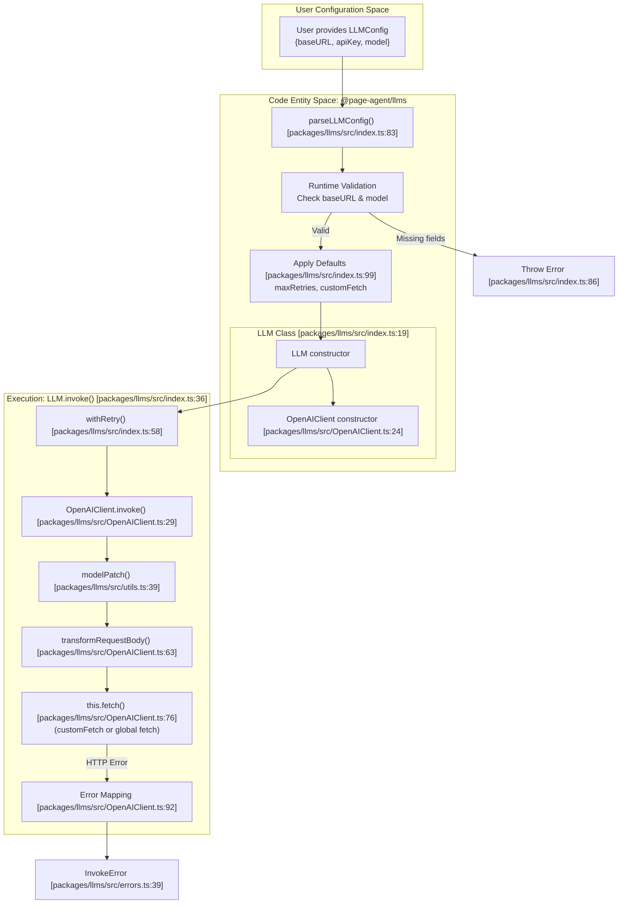
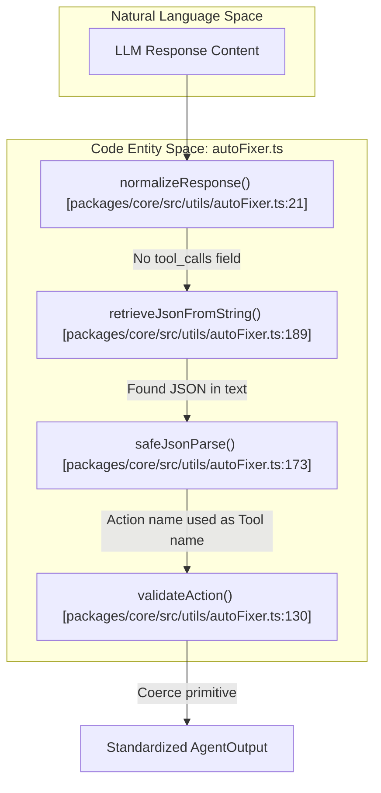

<!-- source: DeepWiki mcp.deepwiki.com · repo alibaba/page-agent · page 17.2 LLM Configuration Issues · fetched 2026-10-29 -->

# LLM Configuration Issues

<details>
<summary>Relevant source files</summary>

The following files were used as context for generating this wiki page:

- [packages/core/src/utils/autoFixer.ts](packages/core/src/utils/autoFixer.ts)
- [packages/llms/src/OpenAIClient.ts](packages/llms/src/OpenAIClient.ts)
- [packages/llms/src/errors.ts](packages/llms/src/errors.ts)
- [packages/llms/src/index.ts](packages/llms/src/index.ts)
- [packages/llms/src/utils.test.ts](packages/llms/src/utils.test.ts)
- [packages/llms/src/utils.ts](packages/llms/src/utils.ts)
- [packages/website/src/pages/docs/features/models/page.tsx](packages/website/src/pages/docs/features/models/page.tsx)

</details>


This page addresses common problems encountered when configuring and connecting to Large Language Models (LLMs). It covers configuration validation, authentication errors, network issues, model compatibility problems, and debugging strategies for the PageAgent integration.

For general LLM configuration options, see [LLM Configuration](#8.2). For supported models and providers, see [LLM Integration Layer](#6). For extension-specific issues, see [Extension Issues](#17.3).

## Configuration Flow and Validation

The LLM configuration process follows a strict validation pipeline in the `LLM` class and `OpenAIClient` to catch setup errors early.

Title: LLM Configuration and Request Pipeline


**Sources:** [packages/llms/src/index.ts:19-53](), [packages/llms/src/index.ts:83-109](), [packages/llms/src/OpenAIClient.ts:20-27](), [packages/llms/src/OpenAIClient.ts:29-84]()

## Configuration Validation Errors

### Missing Required Configuration

The `parseLLMConfig` function enforces that `baseURL` and `model` are present at runtime, even if TypeScript types are satisfied.

**Error Message:**
```
[PageAgent] LLM configuration required. Please provide: baseURL, model. 
See: https://alibaba.github.io/page-agent/docs/features/models
```

**Causes:**
- Missing `baseURL` or `model` in the `LLMConfig` object passed to the constructor [packages/llms/src/index.ts:85-90]().

**Solutions:**

| Field | Example Valid Value | Common Mistakes |
|-------|-------------------|-----------------|
| `baseURL` | `https://api.openai.com/v1` | Missing `/v1` suffix or protocol |
| `apiKey` | `sk-xxxx` | Using an empty string for cloud providers [packages/llms/src/index.ts:102]() |
| `model` | `gpt-4o`, `qwen3.5-plus` | Typo in model name or using an unsupported model |

**Sources:** [packages/llms/src/index.ts:83-109](), [packages/website/src/pages/docs/features/models/page.tsx:150-157]()

## Model Specific Patches and Compatibility

PageAgent applies automated patches to incoming request bodies via `modelPatch` to reconcile differences between vendors and ensure the best agent performance.

### Logic for Model Patching
The system normalizes model names (e.g., `gpt-5.2` to `gpt52` [packages/llms/src/utils.ts:213-220]()) and applies provider-specific logic to optimize tool calls and reasoning.

| Model Prefix | Primary Patch Action | Reason |
|--------------|----------------------|--------|
| `qwen` | `enable_thinking = false` | Disable reasoning for better tool focus [packages/llms/src/utils.ts:47-54]() |
| `deepseek` | `thinking: { type: 'disabled' }`, `delete body.tool_choice` | DeepSeek specific parameter constraints [packages/llms/src/utils.ts:56-60]() |
| `gpt-5.x` | `reasoning_effort` mapping | Maps effort levels to "none", "minimal", or "low" [packages/llms/src/utils.ts:62-86]() |
| `claude` | `tool_choice` conversion | Maps OpenAI `required` to Claude `{ type: 'any' }` [packages/llms/src/utils.ts:88-104]() |
| `gemini` | `reasoning_effort` mapping | Sets "low" or "minimal" based on version [packages/llms/src/utils.ts:116-130]() |
| `kimi` | `delete body.parallel_tool_calls` | Kimi K3 rejects parallel tool calls while thinking [packages/llms/src/utils.ts:153-164]() |
| `minimax` | `delete body.parallel_tool_calls` | MiniMax does not support parallel tool calls [packages/llms/src/utils.ts:166-175]() |

**Sources:** [packages/llms/src/utils.ts:39-196](), [packages/llms/src/utils.ts:213-220]()

## Model Response and Format Issues

Models frequently return malformed tool calls or plain text instead of structured actions. PageAgent uses an `autoFixer` to normalize these responses.

Title: Response Normalization Logic


### Common Symptoms and Fixes

1.  **Format Errors:** The model returns plain text or unexpected JSON.
    -   **Fix:** PageAgent attempts to extract JSON from `message.content` if `tool_calls` is missing [packages/core/src/utils/autoFixer.ts:44-48]().
2.  **Tool Call Wrapping:** Some models wrap arguments in double JSON strings or return the action name as the function name instead of using the `AgentOutput` wrapper [packages/core/src/utils/autoFixer.ts:38-41]().
    -   **Fix:** `normalizeResponse` automatically unwraps these levels [packages/core/src/utils/autoFixer.ts:82-86]().
3.  **Primitive Inputs:** A model might return `{"click_element_by_index": 5}` instead of `{"click_element_by_index": {"index": 5}}`.
    -   **Fix:** `validateAction` coerces these primitive values into the required object structure [packages/core/src/utils/autoFixer.ts:149-157]().

**Sources:** [packages/core/src/utils/autoFixer.ts:21-121](), [packages/core/src/utils/autoFixer.ts:130-168]()

## API Request Errors

Errors during the fetch phase are categorized into `InvokeError` types to determine if a retry should occur.

### AUTH_ERROR (401/403)
**Retryable:** `false` [packages/llms/src/errors.ts:52]().
-   **Cause:** Invalid `apiKey` or insufficient permissions [packages/llms/src/OpenAIClient.ts:101-107]().

### RATE_LIMIT (429)
**Retryable:** `true` [packages/llms/src/errors.ts:52]().
-   **Cause:** Exceeded API quota or request frequency limits [packages/llms/src/OpenAIClient.ts:108-114]().

### NETWORK_ERROR
**Retryable:** `true` [packages/llms/src/errors.ts:52]().
-   **Cause:** DNS failure, timeout, or CORS issues [packages/llms/src/OpenAIClient.ts:85-89]().

### CONTEXT_LENGTH (Finish Reason: length)
**Retryable:** `false` [packages/llms/src/errors.ts:52]().
-   **Cause:** The prompt (DOM + History) exceeded the model's token limit [packages/llms/src/OpenAIClient.ts:153-159]().

**Sources:** [packages/llms/src/errors.ts:5-37](), [packages/llms/src/errors.ts:39-56](), [packages/llms/src/OpenAIClient.ts:92-127]()

## Retry and Recovery Strategy

PageAgent implements an automatic retry mechanism for transient errors defined in `RETRYABLE_TYPES`.

-   **Max Retries:** Defaults to `2` [packages/llms/src/index.ts:104]().
-   **Delay:** 100ms between attempts [packages/llms/src/index.ts:78]().
-   **Retry Logic:** Transient failures like `INVALID_TOOL_ARGS` or `NO_TOOL_CALL` trigger a retry to give the model another chance to produce valid output [packages/llms/src/errors.ts:27-37]().
-   **Named Tool Choice:** If a provider fails with "Invalid tool_choice type", set `disableNamedToolChoice: true` in `LLMConfig` to revert to simple "required" mode [packages/llms/src/index.ts:106]().

**Sources:** [packages/llms/src/index.ts:58-81](), [packages/llms/src/index.ts:99-109](), [packages/llms/src/errors.ts:27-37]()

---

