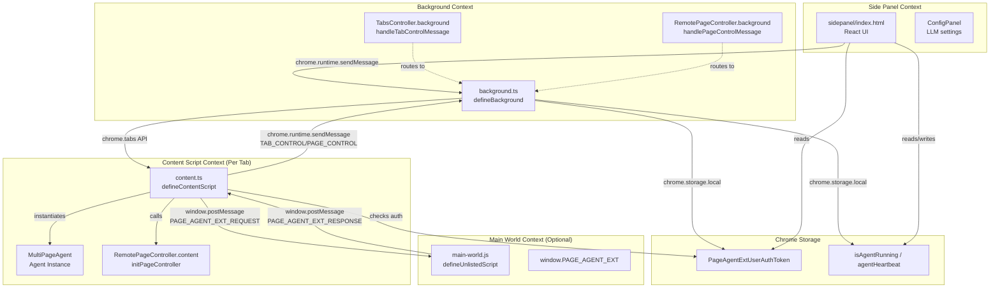
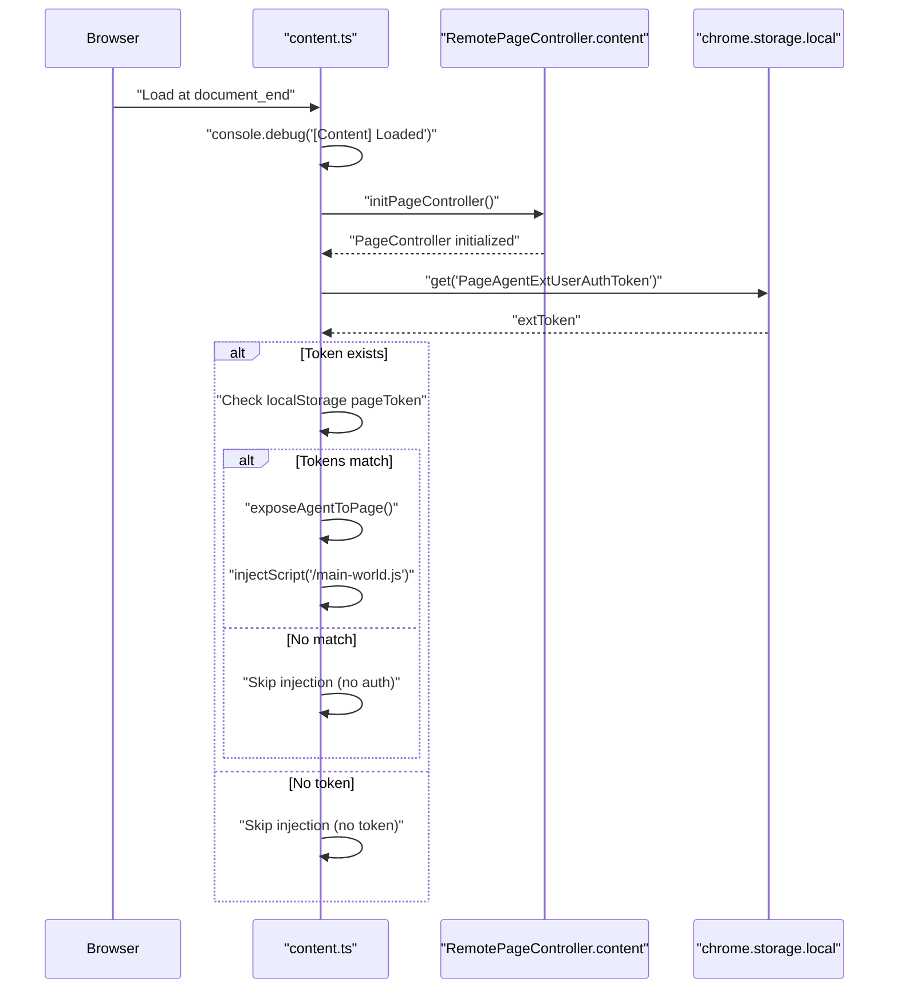
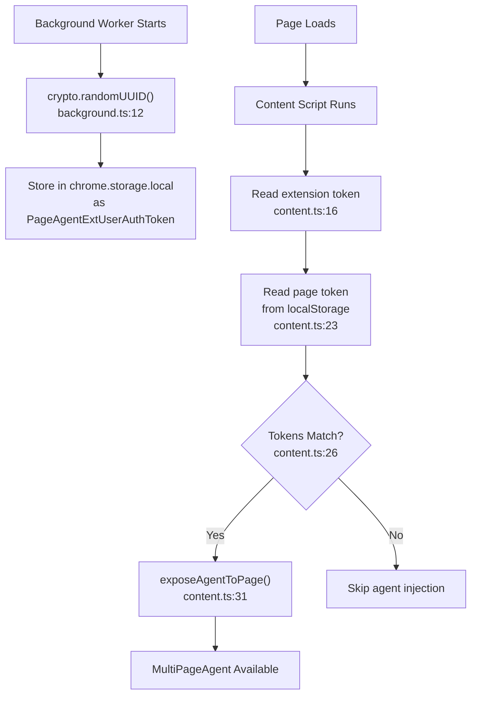
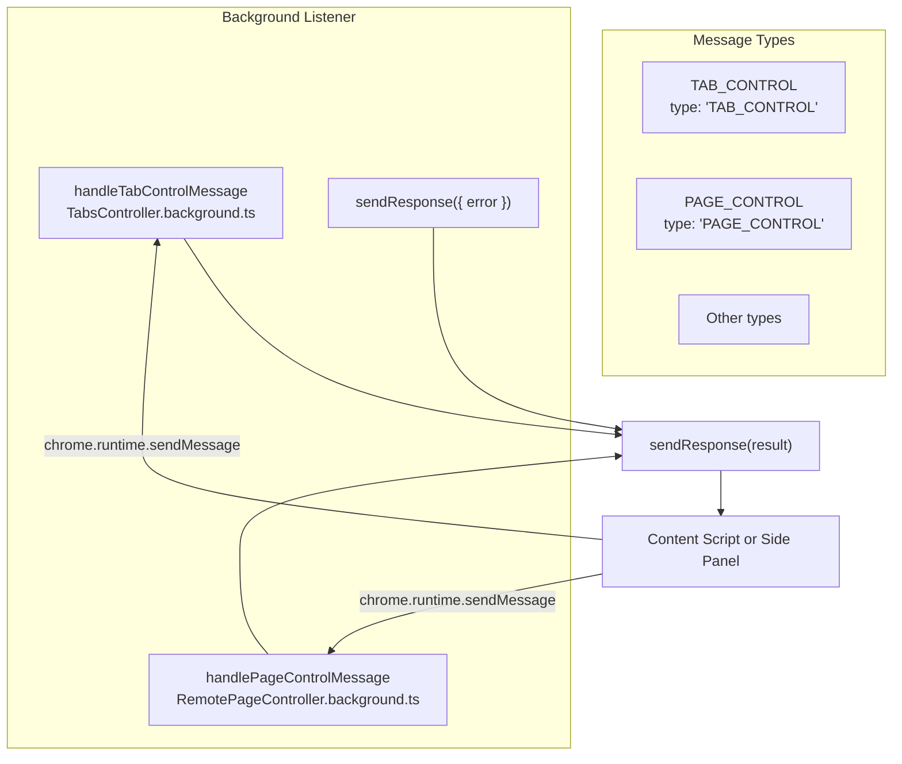

<!-- source: DeepWiki mcp.deepwiki.com · repo alibaba/page-agent · page 17.3 Extension Issues · fetched 2026-10-29 -->

# Extension Issues

<details>
<summary>Relevant source files</summary>

The following files were used as context for generating this wiki page:

- [packages/extension/docs/extension_api.md](packages/extension/docs/extension_api.md)
- [packages/extension/src/entrypoints/background.ts](packages/extension/src/entrypoints/background.ts)
- [packages/extension/src/entrypoints/content.ts](packages/extension/src/entrypoints/content.ts)
- [packages/extension/src/entrypoints/main-world.ts](packages/extension/src/entrypoints/main-world.ts)
- [packages/extension/wxt.config.js](packages/extension/wxt.config.js)
- [packages/website/src/pages/docs/features/chrome-extension/page.tsx](packages/website/src/pages/docs/features/chrome-extension/page.tsx)
- [tsconfig.base.json](tsconfig.base.json)

</details>


This page documents common issues encountered when using the PageAgent Chrome Extension and their solutions. The extension architecture involves multiple execution contexts (background service worker, content scripts, and side panel) that must coordinate through message passing, which introduces unique debugging challenges not present in the NPM package deployment model.

For general troubleshooting guidance, see [Common Issues](#17.1). For LLM-specific problems, see [LLM Configuration Issues](#17.2). For understanding the extension's overall architecture, see [Extension Architecture](#7.1).

## Extension Context Architecture

Understanding the extension's multi-context architecture is essential for diagnosing issues. The following diagram shows how the different execution contexts communicate:

**Extension Execution Contexts and Communication Channels**


Sources: [packages/extension/src/entrypoints/content.ts:7-37](), [packages/extension/src/entrypoints/background.ts:18-27](), [packages/extension/src/entrypoints/main-world.ts:30-131]()

## Installation and Permissions Issues

### Extension Not Installing

**Symptom**: Extension fails to install from Chrome Web Store or when loaded unpacked.

**Common Causes**:
1. **Missing manifest permissions**: The extension requires specific permissions like `tabs`, `tabGroups`, `sidePanel`, and `storage` [packages/extension/wxt.config.js:48]().
2. **Chrome version incompatibility**: The extension uses Manifest V3. Verify Chrome version is 88+.
3. **Build errors**: Check that the extension was built correctly using `npm run build` in the extension package.

**Solutions**:
- For unpacked loading, ensure you're loading from `.output/chrome-mv3` directory after building.
- Check Chrome's extension page (`chrome://extensions`) for specific error messages.

### Permission Warnings

**Symptom**: Chrome displays "This extension can read and change all your data on all websites" warning.

**Explanation**: This is expected behavior. The extension requires content script matches for `<all_urls>` [packages/extension/src/entrypoints/content.ts:8]() and host permissions for `<all_urls>` [packages/extension/wxt.config.js:49]() because:
- Content scripts must inject into any website the user wants to automate.
- `RemotePageController` needs DOM access across all pages.
- `MultiPageAgent` coordinates actions across multiple tabs/domains.

Sources: [packages/extension/src/entrypoints/content.ts:7-13](), [packages/extension/wxt.config.js:42-68]()

## Content Script Injection Issues

### Content Script Not Loading

**Symptom**: Extension icon shows but agent doesn't respond; console shows no `[Content] Loaded on ...` message.

**Debugging Steps**:

1. **Check matches pattern**: Content script is configured to load on all URLs via `matches: ['<all_urls>']` [packages/extension/src/entrypoints/content.ts:8]().
2. **Verify runAt timing**: Script runs at `document_end` [packages/extension/src/entrypoints/content.ts:9]().
3. **Inspect content script console**:
   - Right-click page → Inspect.
   - Console dropdown → Select correct content script context.
   - Look for `[Content] Loaded on {url}` message [packages/extension/src/entrypoints/content.ts:12]().

**Content Script Loading Flow**


Sources: [packages/extension/src/entrypoints/content.ts:7-37]()

### Main World Script Not Injecting

**Symptom**: Content script loads but `window.PAGE_AGENT_EXT` is undefined in page context.

**Root Cause**: Authentication token mismatch or script injection failure.

**Verification**:
1. Verify token matching logic:
   - Extension token stored in `chrome.storage.local` [packages/extension/src/entrypoints/content.ts:19]().
   - Page token stored in `localStorage` [packages/extension/src/entrypoints/content.ts:23]().
   - Both must match exactly [packages/extension/src/entrypoints/content.ts:26]().
2. Ensure `main-world.js` is correctly injected via `injectScript` [packages/extension/src/entrypoints/content.ts:33]().

**Solution**:
```javascript
// In page context (DevTools console on main world)
localStorage.setItem('PageAgentExtUserAuthToken', 'token-from-extension')
```

Sources: [packages/extension/src/entrypoints/content.ts:15-36](), [packages/extension/docs/extension_api.md:38-40]()

## Authentication and Token Issues

### Token Mismatch Preventing Agent Exposure

**Symptom**: Content script loads but agent never initializes. No `[PageAgentExt]: Auth tokens match` message in console.

**Authentication Flow**:


Sources: [packages/extension/src/entrypoints/content.ts:15-36](), [packages/extension/src/entrypoints/background.ts:7-14](), [packages/extension/docs/extension_api.md:23-41]()

## Cross-Context Communication Issues

### Message Passing Failures

**Symptom**: Side panel or content script sends messages but receives no response, or gets "Unknown message type" error.

**Message Routing Architecture**:


Sources: [packages/extension/src/entrypoints/background.ts:18-27]()

### Window PostMessage Issues (Content ↔ Main World)

**Symptom**: Content script doesn't receive messages from main world script, or vice versa.

**Communication Protocol**:

| Direction | Channel Name | Actions |
|-----------|-------------|---------|
| Main → Content | `PAGE_AGENT_EXT_REQUEST` | `execute`, `stop` [packages/extension/src/entrypoints/main-world.ts:89-122]() |
| Content → Main | `PAGE_AGENT_EXT_RESPONSE` | `execute_result`, `status_change_event`, `activity_event`, `history_change_event` [packages/extension/src/entrypoints/content.ts:61-144]() |

**Common Issues**:
1. **Wrong channel name**: Check for typos in `channel` field [packages/extension/src/entrypoints/content.ts:53]().
2. **Data not an object**: Listener checks `typeof data !== 'object'` [packages/extension/src/entrypoints/content.ts:52]().
3. **Agent already running**: Content script enforces singleton check and returns an error if a task is already active [packages/extension/src/entrypoints/content.ts:60-71]().

Sources: [packages/extension/src/entrypoints/content.ts:48-163](), [packages/extension/src/entrypoints/main-world.ts:89-122]()

## External Connection Issues

### Hub Tab Not Opening

**Symptom**: External tools (like MCP server) cannot connect to the extension.

**Debugging**:
1. **Check externally_connectable**: Ensure the launcher page URL matches the manifest pattern `http://localhost/*` [packages/extension/wxt.config.js:65-67]().
2. **Background Listener**: Verify the `OPEN_HUB` message is being received by the background script [packages/extension/src/entrypoints/background.ts:31-39]().
3. **Hub URL**: The background script attempts to open `hub.html` with a `ws` port parameter [packages/extension/src/entrypoints/background.ts:46-59]().

Sources: [packages/extension/src/entrypoints/background.ts:31-59](), [packages/extension/wxt.config.js:65-67]()

## Debugging Strategies

### Extension Console Access

| Context | How to Access | Use Case |
|---------|--------------|----------|
| Background Worker | `chrome://extensions` → "Service worker" link | View message proxying and Hub tab creation logs [packages/extension/src/entrypoints/background.ts:5]() |
| Content Script | Page DevTools → Console dropdown → Select content script frame | View `[Content]` and `MultiPageAgent` lifecycle logs [packages/extension/src/entrypoints/content.ts:12]() |
| Side Panel | Open side panel → Right-click → Inspect | Debug panel UI and LLM settings |
| Main World | Page DevTools → Console (default) | Check `window.PAGE_AGENT_EXT` availability [packages/extension/src/entrypoints/main-world.ts:126-130]() |

### Singleton Management
The `content.ts` script maintains a singleton `multiPageAgent` instance [packages/extension/src/entrypoints/content.ts:46](). If the agent behaves unexpectedly, check if `multiPageAgent.dispose()` was called correctly before creating a new instance [packages/extension/src/entrypoints/content.ts:78]().

Sources: [packages/extension/src/entrypoints/content.ts:46-83]()

---

