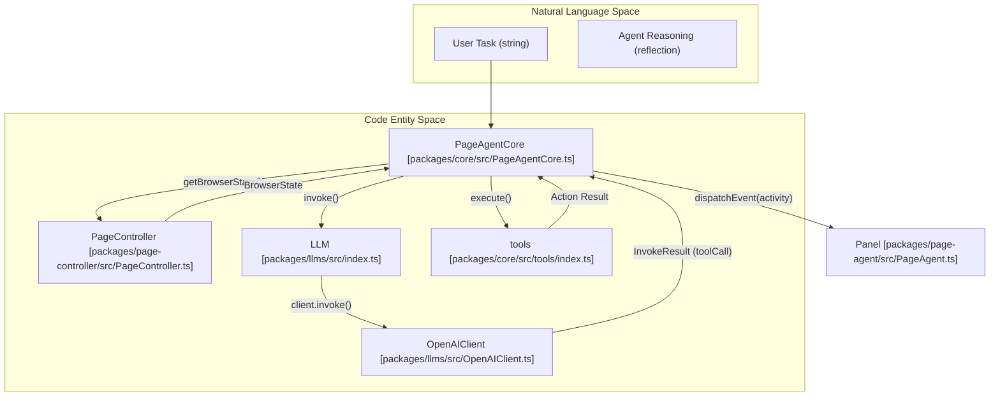
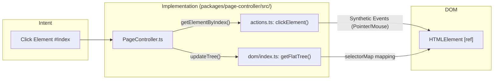

<!-- source: DeepWiki mcp.deepwiki.com · repo alibaba/page-agent · page 18 Glossary · fetched 2026-10-29 -->

# Glossary

Relevant source files

The following files were used as context for generating this wiki page:

- [.gitignore](.gitignore)
- [AGENTS.md](AGENTS.md)
- [CLAUDE.md](CLAUDE.md)
- [CONTRIBUTING.md](CONTRIBUTING.md)
- [packages/core/src/PageAgentCore.ts](packages/core/src/PageAgentCore.ts)
- [packages/core/src/utils/autoFixer.ts](packages/core/src/utils/autoFixer.ts)
- [packages/core/src/utils/index.ts](packages/core/src/utils/index.ts)
- [packages/extension/src/agent/MultiPageAgent.ts](packages/extension/src/agent/MultiPageAgent.ts)
- [packages/extension/src/agent/RemotePageController.ts](packages/extension/src/agent/RemotePageController.ts)
- [packages/llms/src/OpenAIClient.ts](packages/llms/src/OpenAIClient.ts)
- [packages/llms/src/errors.ts](packages/llms/src/errors.ts)
- [packages/llms/src/index.ts](packages/llms/src/index.ts)
- [packages/mcp/package.json](packages/mcp/package.json)
- [packages/page-agent/src/PageAgent.ts](packages/page-agent/src/PageAgent.ts)
- [packages/page-controller/src/PageController.ts](packages/page-controller/src/PageController.ts)
- [packages/page-controller/src/actions.ts](packages/page-controller/src/actions.ts)
- [packages/page-controller/src/utils/index.ts](packages/page-controller/src/utils/index.ts)

This glossary defines technical terms, jargon, and abbreviations specific to the PageAgent codebase. It is intended to help onboarding engineers navigate the system's architecture and implementation details.

## Core Concepts

### Re-act Loop
The fundamental execution cycle of the agent. It follows an **Observe-Think-Act** pattern where the agent perceives the page, decides on an action via an LLM, and executes that action on the DOM.

*   **Observe**: The `PageController` extracts the current `BrowserState` via `getBrowserState` [packages/page-controller/src/PageController.ts:129-165]().
*   **Think**: The `LLM` client processes the state, history, and task to generate a tool call [packages/core/src/PageAgentCore.ts:249-251]().
*   **Act**: The `PageAgentCore` executes the tool, updating the `history` and `activity` streams [packages/core/src/PageAgentCore.ts:316-324]().

**Sources:** [packages/core/src/PageAgentCore.ts:35-42]()

### MacroTool
A specific tool pattern used in PageAgent where the LLM is asked to "reflect" before acting. Instead of calling a simple `click` tool, the LLM provides a `MacroToolInput` which contains both a `reflection` (reasoning) and the actual `action` to take. This enforces a "reflection-before-action" mental model [packages/core/src/PageAgentCore.ts:21-23]().

### BrowserState
A structured object representing the current state of the web page as seen by the agent. It includes the URL, page title, a header with viewport/scroll info, and a simplified text-based representation of the DOM tree (`content`) [packages/page-controller/src/PageController.ts:34-43]().

### InteractiveElementDomNode
A specialized node type in the flattened DOM tree that represents an element the agent can interact with (e.g., buttons, inputs, links). Each node is assigned a unique `highlightIndex` used by the LLM to target actions [packages/page-controller/src/dom/dom_tree/type.ts]().

---

## Technical Terms & Abbreviations

| Term | Definition | Code Pointer |
| :--- | :--- | :--- |
| **FlatDomTree** | A simplified, linear representation of the DOM tree used to reduce token count for LLM processing. | [packages/page-controller/src/PageController.ts:62-62]() |
| **SimulatorMask** | A UI overlay that visually indicates the agent's focus and prevents user interference during automated steps. | [packages/page-controller/src/PageController.ts:86-87]() |
| **MCP** | Model Context Protocol. A standard for connecting AI models to external tools (like the PageAgent extension) and data sources. | [packages/mcp/package.json:12-12]() |
| **Model Patch** | Logic to adjust LLM parameters (temperature, tool_choice format) based on the specific provider (OpenAI, Claude, Qwen, etc.). | [packages/llms/src/utils.ts:39-191]() |
| **Tool Choice** | The mechanism by which the agent forces the LLM to select a specific tool, often handled by `options.toolChoiceName`. | [packages/llms/src/OpenAIClient.ts:42-45]() |
| **RemotePageController** | A proxy controller used in the extension to delegate DOM actions from the agent context to the content script. | [packages/extension/src/agent/RemotePageController.ts:26-26]() |
| **Heartbeat** | A mechanism in the extension to track agent activity and clean up status in storage if the side-panel is closed. | [packages/extension/src/agent/MultiPageAgent.ts:52-52]() |

---

## System Architecture Mapping

The following diagrams bridge the gap between high-level concepts and the actual class/file entities in the codebase.

### Agent Execution Data Flow
This diagram shows how data flows through the core entities during a single step of the Re-act loop, mapping Natural Language intents to Code Entities.

**Sources:** [packages/core/src/PageAgentCore.ts:61-66](), [packages/core/src/PageAgentCore.ts:242-251](), [packages/llms/src/index.ts:19-53](), [packages/llms/src/OpenAIClient.ts:20-34]()

### Browser Interaction Layer
This diagram details how the `PageController` translates LLM intents into physical DOM manipulations.

**Sources:** [packages/page-controller/src/PageController.ts:174-219](), [packages/page-controller/src/actions.ts:64-126](), [packages/page-controller/src/PageController.ts:68-68]()

---

## Detailed Glossary Entries

### `PageAgentCore`
The central orchestrator that manages the agent's lifecycle, history, and state. It is decoupled from the UI and can be used in headless environments. It manages the `history` (persistent memory) and `activity` (transient UI feedback) streams [packages/core/src/PageAgentCore.ts:61-61]().

### `PageController`
The bridge between the agent and the browser's DOM. It handles element highlighting, coordinate calculation for clicks, and DOM tree simplification. It uses a `selectorMap` to link numeric IDs back to actual `HTMLElement` references [packages/page-controller/src/PageController.ts:68-68]().

### `LLM` (Client)
A wrapper around LLM providers that handles prompt assembly, token management, and structured output parsing. It defaults to `OpenAIClient` but supports multiple providers through `modelPatch` utilities [packages/llms/src/index.ts:19-29]().

### `TabsController`
A class within the extension package that manages browser tabs, tab groups, and cross-tab navigation for the `MultiPageAgent` [packages/extension/src/agent/TabsController.ts:38-38](). It communicates with the background service worker to perform Chrome API operations [packages/extension/src/agent/TabsController.background.ts:47-51]().

### `ask_user` Tool
A specific interaction point where the agent pauses execution to request information or confirmation from the human user. It relies on the `onAskUser` callback provided during initialization [packages/core/src/PageAgentCore.ts:81-81]().

### `modelPatch`
A utility function that reconciles differences in parameter schemas between various LLM providers (e.g., disabling "thinking" modes for Qwen or DeepSeek, or converting `tool_choice` formats for Claude) [packages/llms/src/utils.ts:39-43]().

### `RemotePageController`
Used in the browser extension to bridge the agent (running in a side panel or background) with the actual web page (content script). It uses `chrome.runtime.sendMessage` to trigger actions like `click_element` or `update_tree` on a specific `targetTabId` [packages/extension/src/agent/RemotePageController.ts:26-36]().

---

**Sources:**
- [packages/core/src/PageAgentCore.ts:61-146]() (Core class definition)
- [packages/page-controller/src/PageController.ts:58-166]() (PageController implementation)
- [packages/llms/src/index.ts:19-53]() (LLM layer definition)
- [packages/llms/src/utils.ts:39-191]() (Model patching logic)
- [packages/extension/src/agent/RemotePageController.ts:26-165]() (Remote Page Control)
- [packages/extension/src/agent/MultiPageAgent.ts:24-100]() (MultiPageAgent implementation)
- [packages/page-controller/src/actions.ts:64-126]() (DOM interaction logic)