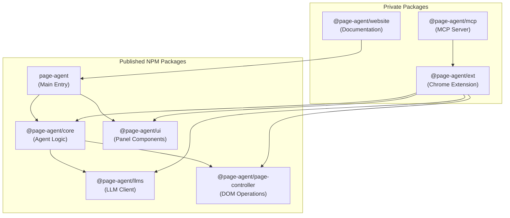
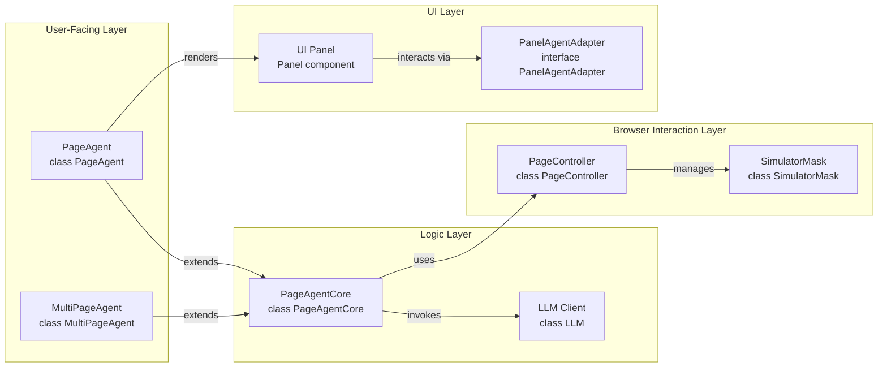

<!-- source: DeepWiki mcp.deepwiki.com · repo alibaba/page-agent · page 2 Monorepo Structure · fetched 2026-10-29 -->

# Monorepo Structure

<details>
<summary>Relevant source files</summary>

The following files were used as context for generating this wiki page:

- [.gitignore](.gitignore)
- [AGENTS.md](AGENTS.md)
- [CLAUDE.md](CLAUDE.md)
- [CONTRIBUTING.md](CONTRIBUTING.md)
- [package-lock.json](package-lock.json)
- [package.json](package.json)

</details>


This document describes the monorepo organization of the PageAgent codebase, including workspace configuration, package dependencies, build system setup, and version management. For information about building and publishing these packages, see [Version Management and Publishing](#2.3). For details on development workflows and environment setup, see [Development Guide](#13).

## Overview

The PageAgent repository uses a **native npm workspaces** monorepo structure with TypeScript project references and Vite for bundling. This approach avoids additional monorepo tooling dependencies while maintaining clear module boundaries and efficient builds.

The monorepo contains eight packages organized into two distribution categories:
- **Published NPM Packages**: Packages distributed via npm for programmatic use (e.g., `core`, `llms`, `page-agent`).
- **Private Packages**: Packages for the Chrome extension, MCP server, and documentation website.

**Key Design Principles**:
- **Source-first development**: Library `package.json` exports point to `src/*.ts` during development for hot-reloading without pre-building [AGENTS.md:32-34]().
- **Topological Ordering**: Workspaces are listed in order of dependency to ensure correct resolution during `npm install` [package.json:6-15](), [AGENTS.md:47-48]().
- **Decoupled Architecture**: UI is decoupled from the agent via the `PanelAgentAdapter` interface, and `PageController` remains independent of LLM logic [AGENTS.md:49-56]().

Sources: [package.json:6-15](), [package-lock.json:11-20](), [AGENTS.md:32-56]()

## Workspace Configuration

### Root Package Definition

The root `package.json` defines the workspace structure with packages listed in topological dependency order:

```json
"workspaces": [
    "packages/page-controller",
    "packages/ui",
    "packages/llms",
    "packages/core",
    "packages/page-agent",
    "packages/mcp",
    "packages/extension",
    "packages/website"
]
```

**Node Version Requirements**: The repository requires Node.js `^22.22.1 || >=24` and npm `^11.6.3` as specified in the engines field [package.json:24-27]().

Sources: [package.json:6-15](), [package.json:24-27](), [package-lock.json:47-50]()

### Workspace Scripts

The root package provides unified build and development commands using `npm workspaces` flags or custom Node.js scripts:

| Script | Command | Description |
|--------|---------|-------------|
| `start` | `npm run dev --workspace=@page-agent/website` | Start documentation dev server [package.json:29]() |
| `dev:ext` | `npm run dev -w @page-agent/ext` | Start extension dev mode [package.json:30]() |
| `dev:demo` | `npm run dev:demo --workspace=page-agent` | Serve IIFE demo with auto-rebuild [package.json:31]() |
| `build` | `node scripts/build.js` | Full build pipeline (cleanup + parallel build) [package.json:32]() |
| `build:libs` | `node scripts/build-libs.js` | Build all library packages in parallel [package.json:33]() |
| `build:website` | `npm run build:website --workspace=@page-agent/website` | Build documentation site [package.json:34]() |
| `build:ext` | `npm run zip -w @page-agent/ext` | Build and package extension [package.json:35]() |
| `cleanup` | `rm -rf packages/*/dist && rm -rf packages/*/.output` | Clean build artifacts [package.json:43]() |

Sources: [package.json:28-45](), [AGENTS.md:18-28]()

## Package Organization

For a detailed breakdown of each package's role and dependencies, see [Package Organization](#2.1).

### Package Dependency Graph



Sources: [package.json:6-15](), [AGENTS.md:37-45](), [AGENTS.md:49-56]()

### Module Boundaries

The following diagram maps high-level system components to their corresponding code entities within the monorepo structure.



**System-to-Code Mapping**:
- **PageAgent**: The main entry class located in `packages/page-agent/src/PageAgent.ts` [AGENTS.md:86]().
- **PageAgentCore**: The headless core logic in `packages/core/src/PageAgentCore.ts` [AGENTS.md:93]().
- **PageController**: Handles DOM extraction and synthetic events in `packages/page-controller/src/PageController.ts` [AGENTS.md:110]().
- **LLM**: The client for AI communication in `packages/llms/src/index.ts` [AGENTS.md:102]().

Sources: [AGENTS.md:49-56](), [AGENTS.md:82-113]()

## Build System and Workspaces

The repository uses **Vite** for all package builds. For details on configuration and scripts, see [Build System and Workspaces](#2.2).

### Build Pipeline

The full build pipeline defined in `scripts/build.js` executes the following sequence:
1. **Cleanup**: Runs `npm run cleanup` at the root to remove `dist` and `.output` directories [package.json:43]().
2. **Parallel Build**: Executes builds across all workspaces. Library packages use `scripts/build-libs.js` to build `@page-agent/core`, `@page-agent/llms`, etc., in parallel [package.json:33]().

Sources: [package.json:32-35](), [package.json:43](), [AGENTS.md:22-23]()

## Version Management and Publishing

Core library packages maintain synchronized versions while private packages may follow independent release cycles. For details on the publishing workflow, see [Version Management and Publishing](#2.3).

### Synchronized Versioning

The `sync-version.js` script (triggered via `npm run version`) maintains version consistency across the monorepo [package.json:36](). It ensures that when the root version (currently `1.12.2`) is updated, all internal cross-package dependencies in the workspace are updated to match the new version string [package.json:4]().

Sources: [package.json:4](), [package.json:36]()

---

