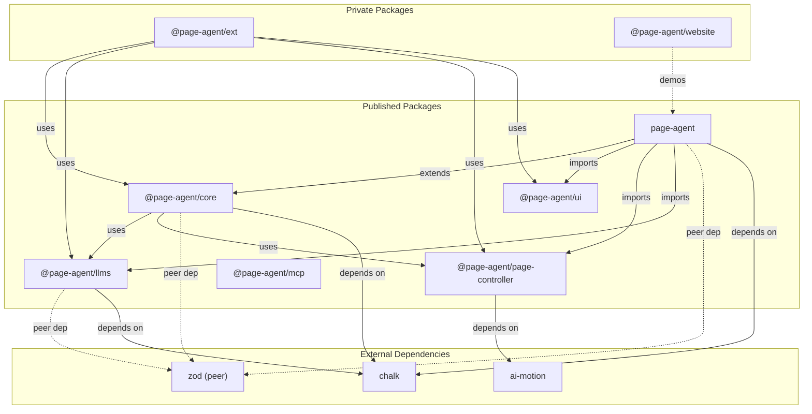
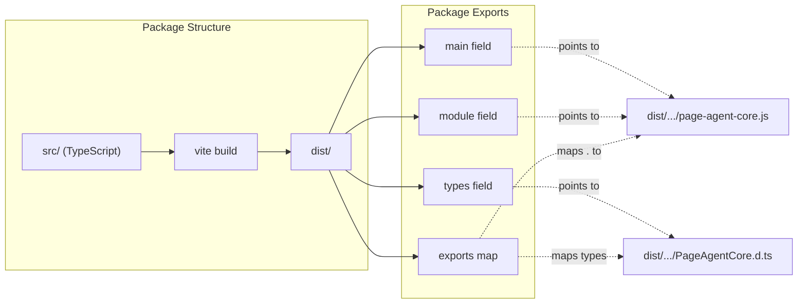
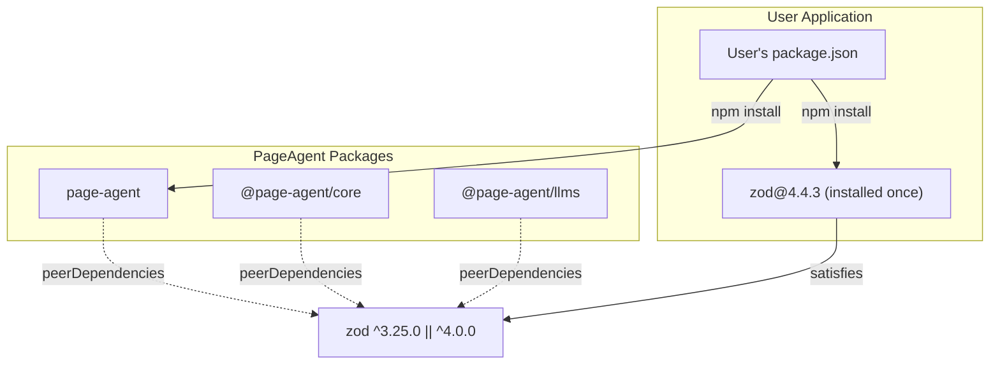

<!-- source: DeepWiki mcp.deepwiki.com · repo alibaba/page-agent · page 2.1 Package Organization · fetched 2026-10-29 -->

# Package Organization

<details>
<summary>Relevant source files</summary>

The following files were used as context for generating this wiki page:

- [package-lock.json](package-lock.json)
- [package.json](package.json)
- [packages/core/package.json](packages/core/package.json)
- [packages/llms/package.json](packages/llms/package.json)
- [packages/page-agent/package.json](packages/page-agent/package.json)
- [packages/page-controller/package.json](packages/page-controller/package.json)
- [packages/ui/package.json](packages/ui/package.json)

</details>


This document describes the structure and organization of packages within the PageAgent monorepo. It covers the roles of each package, their dependencies, and how they are distributed.

## Overview

The PageAgent monorepo contains eight packages organized under the `packages/` directory. Six packages are published to NPM as public libraries (including the MCP server), while two are private packages for the Chrome extension and documentation website. All packages use npm workspaces for dependency management and share common development tooling.

**Sources:** [package.json:6-15](), [package-lock.json:11-20]()

## Package Directory Structure

The monorepo follows a flat package structure under the `packages/` directory:

```
packages/
├── page-controller/    # @page-agent/page-controller (published)
├── ui/                 # @page-agent/ui (published)
├── llms/               # @page-agent/llms (published)
├── core/               # @page-agent/core (published)
├── page-agent/         # page-agent (published)
├── mcp/                # @page-agent/mcp (published)
├── extension/          # @page-agent/ext (private)
└── website/            # @page-agent/website (private)
```

**Sources:** [package.json:6-15](), [package-lock.json:11-20]()

## Published NPM Packages

The following table lists all packages distributed via NPM:

| Package Name | Version | Description | Entry Point |
|-------------|---------|-------------|-------------|
| `page-agent` | 1.12.2 | Main integration package extending `PageAgentCore` with UI panel | [packages/page-agent/src/PageAgent.ts]() |
| `@page-agent/core` | 1.12.2 | Headless agent orchestration and Re-act loop | [packages/core/src/PageAgentCore.ts]() |
| `@page-agent/llms` | 1.12.2 | LLM client with reflection-before-action mental model | [packages/llms/src/index.ts]() |
| `@page-agent/page-controller` | 1.12.2 | DOM operations and browser state extraction | [packages/page-controller/src/PageController.ts]() |
| `@page-agent/ui` | 1.12.2 | Panel components and i18n support | [packages/ui/src/index.ts]() |
| `@page-agent/mcp` | 1.12.2 | MCP server for controlling the browser via extension | [packages/mcp/package.json:2]() |

All published packages include `files` configuration specifying the `dist/` directory for distribution.

**Sources:** [packages/page-agent/package.json:1-28](), [packages/core/package.json:1-28](), [packages/llms/package.json:1-26](), [packages/page-controller/package.json:1-27](), [packages/ui/package.json:1-27]()

### page-agent (Main Package)

The top-level `page-agent` package serves as the primary entry point for users. It extends `PageAgentCore` with integrated UI panel functionality.

**Key characteristics:**
- **Package name:** `page-agent` (no scope) [packages/page-agent/package.json:2]()
- **Main dependency:** Extends `@page-agent/core` [packages/page-agent/package.json:57]()
- **Additional dependencies:** `@page-agent/llms`, `@page-agent/page-controller`, `@page-agent/ui` [packages/page-agent/package.json:58-60]()
- **Exports:** ESM format at `dist/esm/page-agent.js` [packages/page-agent/package.json:21]()
- **Special builds:** Includes IIFE build for CDN usage via `vite.iife.config.js` [packages/page-agent/package.json:51]()

**Sources:** [packages/page-agent/package.json:1-69]()

### @page-agent/core

The core package implements the headless agent orchestration layer, including the Re-act loop, tool system, and prompt assembly.

**Key characteristics:**
- **Role:** Agent orchestration engine
- **Dependencies:** `@page-agent/llms`, `@page-agent/page-controller` [packages/core/package.json:58-59]()
- **Exports:** ESM format at `dist/esm/page-agent-core.js` [packages/core/package.json:21]()
- **Usage:** Can be used independently for headless automation

**Sources:** [packages/core/package.json:1-66]()

### @page-agent/llms

The LLM package provides OpenAI-compatible client implementations with model-specific patches and retry logic.

**Key characteristics:**
- **Role:** LLM communication layer
- **External dependencies:** None (peer dependency on `zod` only) [packages/llms/package.json:51-54]()
- **Exports:** ESM format at `dist/lib/page-agent-llms.js` [packages/llms/package.json:20]()
- **Features:** Error categorization, retry mechanism, tool call validation

**Sources:** [packages/llms/package.json:1-58]()

### @page-agent/page-controller

The page-controller package handles all DOM interactions and browser state extraction.

**Key characteristics:**
- **Role:** Browser control and DOM manipulation
- **External dependencies:** `ai-motion` (for smooth pointer movements) [packages/page-controller/package.json:50]()
- **Exports:** ESM format at `dist/lib/page-controller.js` [packages/page-controller/package.json:20]()
- **Features:** FlatDomTree extraction, synthetic event generation, element highlighting

**Sources:** [packages/page-controller/package.json:1-51]()

### @page-agent/ui

The UI package contains the Panel component and i18n resources.

**Key characteristics:**
- **Role:** User interface components
- **Exports:** ESM format at `dist/lib/page-agent-ui.js` [packages/ui/package.json:20]()
- **Languages:** Supports `en-US` and `zh-CN`

**Sources:** [packages/ui/package.json:1-48]()

### @page-agent/mcp

The MCP package enables AI agent clients (like Claude Desktop or Cursor) to control the browser via the Model Context Protocol.

**Key characteristics:**
- **Role:** MCP Server implementation
- **Integration:** Bridges external LLM clients to the browser environment via a WebSocket/HTTP bridge to the extension Hub.

**Sources:** [package.json:12]()

## Private Packages

Two packages are marked as `"private": true` or are not published to NPM:

| Package Name | Version | Purpose |
|-------------|---------|---------|
| `@page-agent/ext` | 1.12.2 | Chrome extension for multi-page agent capabilities |
| `@page-agent/website` | 1.12.2 | Documentation site and interactive demos |

**Sources:** [package.json:13-14]()

### @page-agent/ext (Extension)

The extension package implements `MultiPageAgent` for cross-tab coordination using Chrome APIs.

**Key characteristics:**
- **Dev Script:** `npm run dev:ext` [package.json:30]()
- **Build Script:** `npm run build:ext` [package.json:35]()
- **Role:** Provides a persistent environment for the agent, cross-tab control, and a "Hub" for external connections (like MCP).

**Sources:** [package.json:30, 35]()

### @page-agent/website

The website package is a React SPA built with Vite, containing documentation and demos.

**Key characteristics:**
- **Start Script:** `npm run start` (aliased to website dev) [package.json:29]()
- **Build output:** Static HTML/JS/CSS for GitHub Pages [package.json:23, 34]()
- **Purpose:** Demonstrates `page-agent` usage via CDN script

**Sources:** [package.json:23, 29, 34]()

## Package Dependency Graph

The following diagram illustrates the dependency relationships between packages:

**Package Dependency Structure**



**Sources:** [packages/page-agent/package.json:56-62](), [packages/core/package.json:57-60](), [packages/page-controller/package.json:49-51]()

## Export Configurations

Each published package uses standard ESM exports with TypeScript definitions. The export structure follows a consistent pattern:

**Standard Export Pattern**



**Sources:** [packages/core/package.json:6-24](), [packages/llms/package.json:5-23](), [packages/page-controller/package.json:5-23](), [packages/ui/package.json:5-23]()

### Export Field Mapping

All packages define four export-related fields in their `package.json`:

| Field | Purpose | Example Value |
|-------|---------|---------------|
| `main` | CommonJS/legacy entry | `./src/PageController.ts` (dev) / `./dist/lib/page-controller.js` (pub) |
| `module` | ESM entry point | `./dist/lib/page-controller.js` |
| `types` | TypeScript definitions | `./dist/lib/PageController.d.ts` |
| `exports["."]` | Modern resolution map | `{ "types": "...", "import": "..." }` |

The `exports` field provides granular control over package entry points and is the preferred resolution mechanism for modern tools.

**Sources:** [packages/page-controller/package.json:5-24](), [packages/ui/package.json:5-24]()

## Peer Dependencies and Version Constraints

All packages that use Zod for schema validation declare it as a peer dependency rather than a direct dependency:

**Peer Dependency Pattern**



**Sources:** [packages/page-agent/package.json:63-65](), [packages/core/package.json:61-63](), [packages/llms/package.json:54-56]()

### Peer Dependency Rationale

The peer dependency pattern ensures:

1. **Single Zod instance:** Prevents multiple Zod versions in the dependency tree.
2. **Schema compatibility:** All packages share the same Zod schemas and validators.
3. **Bundle size reduction:** Users install Zod once, not per package.
4. **Version flexibility:** Supports both Zod v3 and v4.

The constraint `"^3.25.0 || ^4.0.0"` allows users to choose their Zod version while maintaining compatibility.

**Sources:** [packages/llms/package.json:54-56](), [packages/core/package.json:61-63]()

## Version Synchronization

All packages in the monorepo share the same version number (1.12.2). This synchronization is managed by the `scripts/sync-version.js` script.

**Version Distribution:**

| Package Type | Version | Sync Strategy |
|-------------|---------|---------------|
| Published NPM packages | 1.12.2 | Synchronized via `npm run version` |
| Extension | 1.12.2 | Synchronized via `npm run version` |
| Website | 1.12.2 | Synchronized via `npm run version` |

**Sources:** [package.json:4, 36](), [packages/core/package.json:4](), [packages/page-agent/package.json:4]()

## Development Dependencies

Shared development dependencies are defined at the root level and include:

- **Build tools:** Vite, TypeScript, unplugin-dts [package.json:65, 67-68]()
- **Code quality:** ESLint, Prettier, Husky, lint-staged [package.json:59, 62-64]()
- **Commit standards:** Commitlint with conventional config [package.json:47-48]()
- **UI libraries:** React, Tailwind (shared across website and extension) [package.json:52, 55]()

Individual packages declare only their runtime dependencies, leveraging the workspace hoisting for development tooling.

**Sources:** [package.json:46-71]()

---

