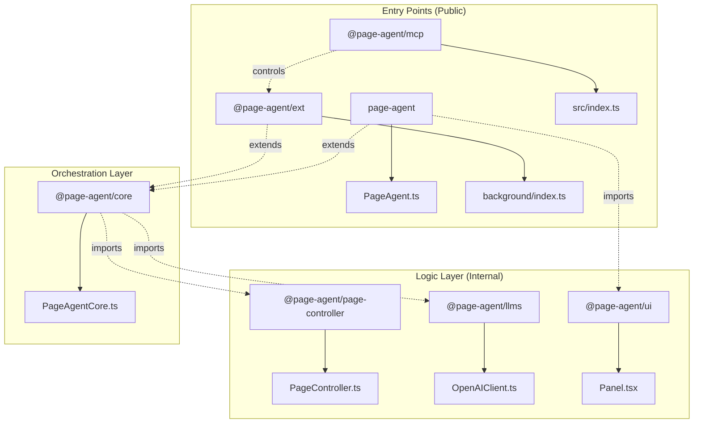
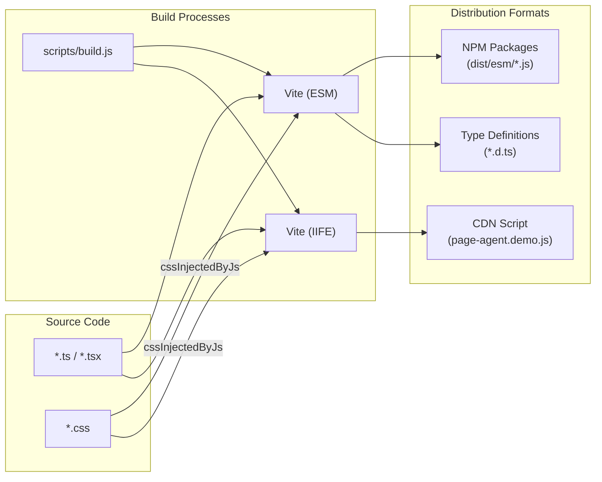

<!-- source: DeepWiki mcp.deepwiki.com · repo alibaba/page-agent · page 2.2 Build System and Workspaces · fetched 2026-10-29 -->

# Build System and Workspaces

<details>
<summary>Relevant source files</summary>

The following files were used as context for generating this wiki page:

- [package-lock.json](package-lock.json)
- [package.json](package.json)
- [packages/core/vite.config.js](packages/core/vite.config.js)
- [packages/llms/vite.config.js](packages/llms/vite.config.js)
- [packages/page-agent/vite.config.js](packages/page-agent/vite.config.js)
- [packages/page-agent/vite.iife.config.js](packages/page-agent/vite.iife.config.js)
- [packages/page-controller/vite.config.js](packages/page-controller/vite.config.js)
- [packages/ui/vite.config.js](packages/ui/vite.config.js)
- [packages/website/vite.config.js](packages/website/vite.config.js)
- [scripts/build-libs.js](scripts/build-libs.js)
- [scripts/build.js](scripts/build.js)
- [scripts/parallel-task.js](scripts/parallel-task.js)

</details>


This document explains the monorepo build system used by PageAgent, including npm workspaces configuration, TypeScript project references, Vite bundling setup, and the relationship between development and production build workflows.

## NPM Workspaces Setup

PageAgent uses npm workspaces to manage a monorepo containing internal and public packages. The workspace configuration is defined in the root `package.json` [package.json:6-15](). The monorepo structure allows for shared logic while maintaining clear boundaries between DOM manipulation, LLM interaction, and UI components.

**Workspace Dependency Resolution**

The following diagram maps the natural language names of system components to their corresponding code entities and package boundaries.

**System Component to Code Entity Mapping**

Sources: [packages/page-agent/vite.config.js:28-35](), [packages/core/vite.config.js:28-35](), [packages/page-controller/vite.config.js:30-37](), [packages/llms/vite.config.js:28-35](), [package.json:6-15]()

### Build Automation Scripts

The project utilizes specialized Node.js scripts to manage complex build pipelines across workspaces.

*   **`scripts/build.js`**: Executes the full pipeline including cleanup, parallel library builds, website generation, and extension zipping [scripts/build.js:8-10](). It uses `npm run cleanup` before starting parallel tasks [scripts/build.js:24]().
*   **`scripts/build-libs.js`**: Specifically targets library packages. It reads the root `package.json` workspaces, filters for those with a `build` script, and runs them concurrently using `parallelTask` [scripts/build-libs.js:15-25]().
*   **`scripts/parallel-task.js`**: A utility that uses `child_process.spawn` to run multiple shell commands in parallel with a custom progress reporter and a default 30s timeout per task [scripts/parallel-task.js:11-45]().

Sources: [scripts/build.js:1-46](), [scripts/build-libs.js:1-26](), [scripts/parallel-task.js:1-116]()

## TypeScript Project References

The monorepo uses TypeScript project references to enable incremental compilation and enforce module boundaries.

**Unified Typechecking**
The project uses `npm run typecheck` which executes `tsc` against specific configurations like `tsconfig.typecheck.json` and the extension-specific `tsconfig.json` [package.json:38]().

**Key Compiler Options**:
*   `composite: true`: Enabled within the `dts` plugin configuration to support project references and incremental builds [packages/page-agent/vite.config.js:19]().
*   `emitDeclarationOnly: true`: Used during library builds to generate types without transpiling JS (which Vite handles) [packages/page-agent/vite.config.js:21]().
*   `declaration: true`: Ensures `.d.ts` files are generated alongside the build [packages/page-agent/vite.config.js:22]().

Sources: [package.json:38](), [packages/page-agent/vite.config.js:14-23]()

## Vite Configuration

Library packages (Core, LLMs, Page-Controller, UI, Page-Agent) use Vite for bundling.

### Standard ESM Build
The primary build target for NPM distribution is ES Modules. The configurations typically exclude internal `@page-agent/` packages from the bundle via regex in `rollupOptions.external` to allow consumers to manage dependencies [packages/page-agent/vite.config.js:37-43]().

Key plugins include:
*   **`unplugin-dts`**: Configured to include source files and bundle types while excluding test files [packages/page-agent/vite.config.js:14-24]().
*   **`vite-plugin-css-injected-by-js`**: Inlines CSS into the JS bundle, ensuring that styles for the agent UI are loaded automatically without requiring a separate CSS import from the user [packages/page-agent/vite.config.js:25]().

```javascript
// Example from packages/page-agent/vite.config.js
export default defineConfig({
	plugins: [
		dts({ include: ['src/**/*.ts'], bundleTypes: true }),
		cssInjectedByJsPlugin({ relativeCSSInjection: true }),
	],
	build: {
		lib: {
			entry: resolve(__dirname, 'src/PageAgent.ts'),
			formats: ['es'],
		},
		outDir: resolve(__dirname, 'dist', 'esm'),
		rollupOptions: {
			external: ['chalk', 'zod', /^@page-agent\//],
		},
	}
})
```
Sources: [packages/page-agent/vite.config.js:11-52](), [packages/core/vite.config.js:11-52](), [packages/page-controller/vite.config.js:13-52](), [packages/llms/vite.config.js:12-45](), [packages/ui/vite.config.js:13-48]()

### IIFE Build for CDN/Bookmarklets
The `page-agent` package provides a secondary configuration `vite.iife.config.js` to generate a standalone "demo" script [packages/page-agent/vite.iife.config.js:13]().

**Key IIFE Build Logic**:
1. **Bundling**: Unlike the ESM build, it does not mark internal packages as external, bundling everything into one file for browser use [packages/page-agent/vite.iife.config.js:14-15]().
2. **Environment Inlining**: Variables like `LLM_MODEL_NAME`, `LLM_API_KEY`, and `LLM_BASE_URL` are loaded from the root `.env` and injected via the `define` object [packages/page-agent/vite.iife.config.js:11, 44-48]().
3. **Format**: Uses the `iife` format with a global name `PageAgent` and an entry point at `src/demo.ts` [packages/page-agent/vite.iife.config.js:24-28]().

Sources: [packages/page-agent/vite.iife.config.js:1-50]()

### Website SPA Routing
The `packages/website` configuration includes a custom `spaRoutes` plugin. This plugin copies `index.html` to various subdirectories (e.g., `docs/introduction/overview`) to support direct access on static hosts like GitHub Pages [packages/website/vite.config.js:19-53](). It also generates a `sitemap.xml` for all defined routes [packages/website/vite.config.js:55-66]().

Sources: [packages/website/vite.config.js:19-69]()

## Build Pipeline and Data Flow

The following diagram illustrates how source code flows through the build system to produce different distribution formats.

**Build Pipeline and Output Flow**

Sources: [packages/page-agent/vite.config.js:14-25](), [packages/page-agent/vite.iife.config.js:23-30](), [scripts/build.js:26-45](), [packages/website/vite.config.js:75]()

---

