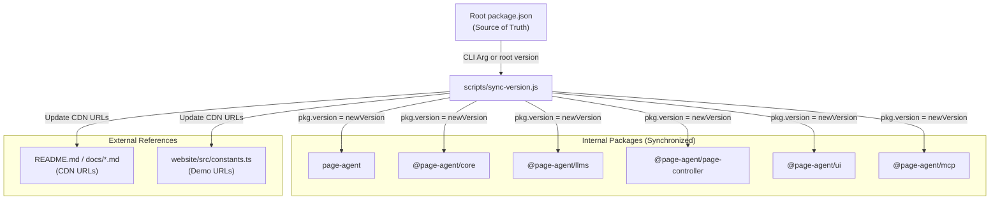
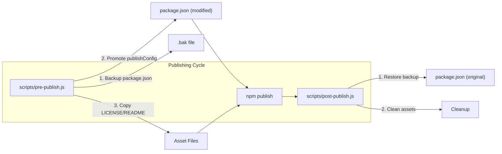

<!-- source: DeepWiki mcp.deepwiki.com · repo alibaba/page-agent · page 2.3 Version Management and Publishing · fetched 2026-10-29 -->

# Version Management and Publishing

Relevant source files

The following files were used as context for generating this wiki page:

- [packages/extension/package.json](packages/extension/package.json)
- [packages/extension/src/types/globals.d.ts](packages/extension/src/types/globals.d.ts)
- [packages/website/package.json](packages/website/package.json)
- [scripts/post-publish.js](scripts/post-publish.js)
- [scripts/pre-publish.js](scripts/pre-publish.js)
- [scripts/sync-version.js](scripts/sync-version.js)

This document describes the versioning strategy, version synchronization mechanisms, and publishing workflow for the PageAgent monorepo. It covers how versions are kept in sync across published packages, the automated scripts that manage versioning, and the processes for distributing packages to NPM and CDNs.

---

## Versioning Strategy

The PageAgent monorepo employs a **synchronized versioning strategy** where all published packages share the same version number. This approach simplifies dependency management and ensures version compatibility across the package ecosystem.

### Published vs Private Packages

| Package | Name | Published to NPM | Distribution |
|---------|------|------------------|--------------|
| `page-agent` | `page-agent` | ✅ Yes | NPM / CDN (IIFE) |
| `core` | `@page-agent/core` | ✅ Yes | NPM |
| `llms` | `@page-agent/llms` | ✅ Yes | NPM |
| `page-controller` | `@page-agent/page-controller` | ✅ Yes | NPM |
| `ui` | `@page-agent/ui` | ✅ Yes | NPM |
| `mcp` | `@page-agent/mcp` | ✅ Yes | NPM |
| `website` | `@page-agent/website` | ❌ No (Private) | GitHub Pages [packages/website/package.json:3-4]() |
| `extension` | `@page-agent/ext` | ❌ No (Private) | Chrome Web Store [packages/extension/package.json:3-4]() |

**Sources:** [packages/website/package.json:2-4](), [packages/extension/package.json:2-4](), [scripts/sync-version.js:45-50](), [scripts/sync-version.js:56-58]()

---

## Version Synchronization Mechanism

### Synchronized Package Versions

The root `package.json` serves as the single source of truth for the version number. The `sync-version.js` script propagates this version to all internal packages and updates inter-package dependency constraints.

**Version Propagation Flow**

**Sources:** [scripts/sync-version.js:1-132]()

### The sync-version.js Script

Located at `scripts/sync-version.js`, this script performs the following operations:

1.  **Version Determination**: Reads the version from the root `package.json` or accepts a new version as a command-line argument [scripts/sync-version.js:20-24]().
2.  **Package Traversal**: Iterates through all directories in the `packages/` folder [scripts/sync-version.js:46-49]().
3.  **Internal Dependency Update**: Updates `dependencies` in each `package.json` if they refer to an internal package (e.g., `@page-agent/core`). It uses the `isInternalPackage` helper to identify these [scripts/sync-version.js:56-74](). Note that `devDependencies` are generally kept as `*` or managed separately, while production `dependencies` are strictly pinned to the new version [scripts/sync-version.js:89-92]().
4.  **CDN URL Replacement**: Replaces hardcoded CDN URLs in documentation (`README.md`, `docs/README-zh.md`) and source code (`packages/website/src/constants.ts`) to point to the new version on `jsdelivr` and `npmmirror` [scripts/sync-version.js:107-130]().

**Sources:** [scripts/sync-version.js:1-145]()

---

## Publishing Workflow

The publishing process is automated via scripts that ensure manifest integrity and proper asset distribution.

### Manifest Pre-processing and Restoration

To maintain a clean development environment while providing optimized NPM manifests, PageAgent uses pre- and post-publish hooks.

**NPM Publishing Lifecycle**

*   **`pre-publish.js`**: Backs up the original `package.json` [scripts/pre-publish.js:24-25](), promotes fields from `publishConfig` to the top level [scripts/pre-publish.js:27-30](), and copies the project `LICENSE` (and `README.md` for the main `page-agent` package) into the package directory [scripts/pre-publish.js:35-42]().
*   **`post-publish.js`**: Restores the original `package.json` from the backup [scripts/post-publish.js:21-22]() and removes the temporary license and readme files [scripts/post-publish.js:24-30]().

**Sources:** [scripts/pre-publish.js:1-43](), [scripts/post-publish.js:1-31]()

---

## Distribution Channels

### NPM Packages
The primary distribution channel for developers. Packages are published under the `@page-agent/` scope (except the main `page-agent` wrapper). Internal dependencies are synchronized to ensure that, for example, `@page-agent/ext` version `1.12.2` depends specifically on `@page-agent/core` version `1.12.2` [packages/extension/package.json:42-45]().

### CDN (IIFE)
The `page-agent` package includes an IIFE (Immediately Invoked Function Expression) build intended for direct browser use via script tags.
*   **Primary CDN**: `https://cdn.jsdelivr.net/npm/page-agent@{version}/dist/iife/page-agent.demo.js` [scripts/sync-version.js:108-109]()
*   **Mirror (China)**: `https://registry.npmmirror.com/page-agent/{version}/files/dist/iife/page-agent.demo.js` [scripts/sync-version.js:110-111]()

### Chrome Extension
The extension identifies its version at runtime using a global constant `__VERSION__` [packages/extension/src/types/globals.d.ts:1](). It is built using `wxt` [packages/extension/package.json:7-9]() and distributed as a ZIP file for store upload.

**Sources:** [packages/extension/package.json:7-9](), [packages/extension/package.json:42-45](), [scripts/sync-version.js:108-111](), [packages/extension/src/types/globals.d.ts:1]()

---

