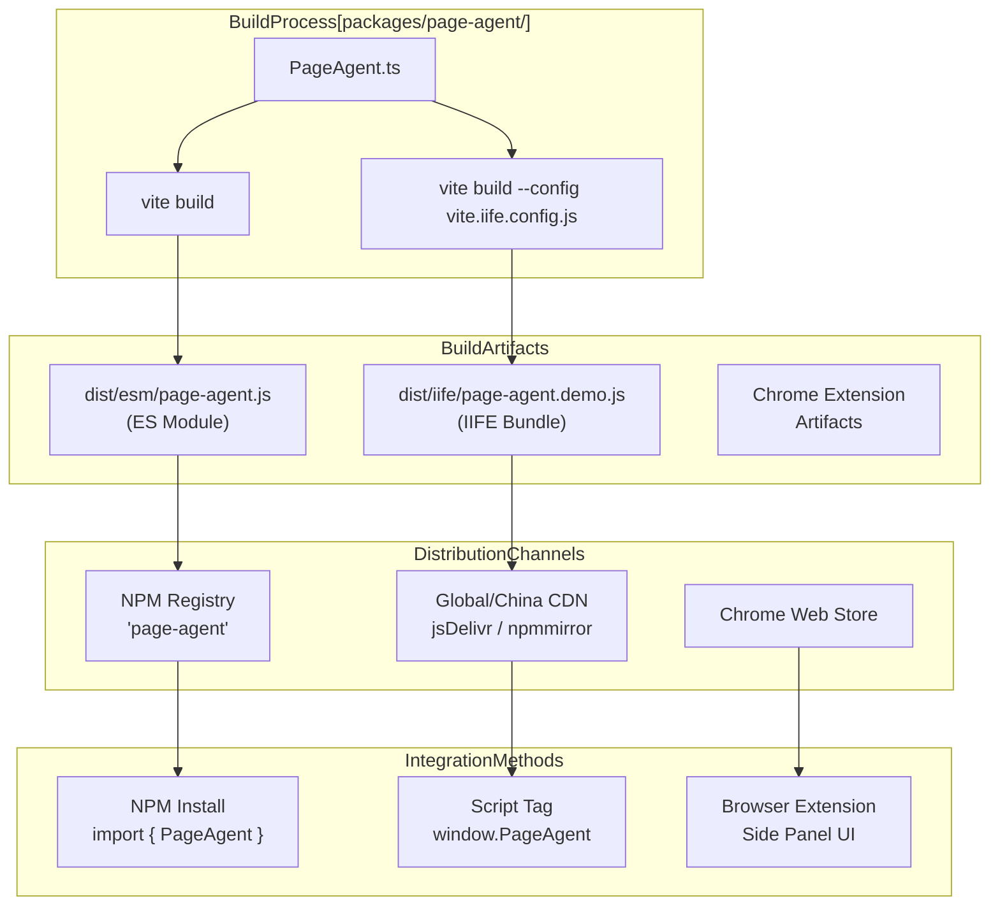
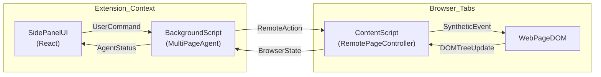

<!-- source: DeepWiki mcp.deepwiki.com · repo alibaba/page-agent · page 3.1 Installation Methods · fetched 2026-10-29 -->

# Installation Methods

<details>
<summary>Relevant source files</summary>

The following files were used as context for generating this wiki page:

- [README.md](README.md)
- [docs/README-zh.md](docs/README-zh.md)
- [packages/website/src/constants.ts](packages/website/src/constants.ts)
- [packages/website/src/pages/docs/advanced/custom-ui/page.tsx](packages/website/src/pages/docs/advanced/custom-ui/page.tsx)
- [packages/website/src/pages/docs/advanced/page-agent/page.tsx](packages/website/src/pages/docs/advanced/page-agent/page.tsx)
- [packages/website/src/pages/docs/features/custom-tools/page.tsx](packages/website/src/pages/docs/features/custom-tools/page.tsx)
- [packages/website/src/pages/docs/introduction/limitations/page.tsx](packages/website/src/pages/docs/introduction/limitations/page.tsx)
- [packages/website/src/pages/docs/introduction/overview/page.tsx](packages/website/src/pages/docs/introduction/overview/page.tsx)
- [packages/website/src/pages/docs/introduction/quick-start/page.tsx](packages/website/src/pages/docs/introduction/quick-start/page.tsx)

</details>


This document provides detailed technical information about the three primary methods for integrating PageAgent into web environments: the CDN script tag (for quick demos), the NPM package (for production integration), and the Chrome extension (for cross-tab automation).

---

## Distribution Architecture

PageAgent is organized as a monorepo, producing different artifacts for various integration patterns. The core logic resides in `page-agent`, which depends on internal packages like `@page-agent/core`, `@page-agent/llms`, and `@page-agent/page-controller` [packages/page-agent/package.json:57-60]().

TITLE: Distribution and Build Data Flow


**Sources:** [packages/page-agent/package.json:49-62](), [README.md:67-71](), [packages/website/src/constants.ts:1-5]()

---

## Method 1: CDN Script Integration (Demo)

### Overview
The CDN method loads PageAgent as an IIFE (Immediately Invoked Function Expression) bundle. It is designed for rapid prototyping and trying the library without a local build environment [README.md:53-55]().

### Implementation
Add the script tag to your HTML. The demo bundle is pre-configured to use a free testing LLM API [README.md:64-64](). The latest version is `1.12.2` [packages/website/src/constants.ts:3-5]().

```html
<!-- Global Mirror (jsDelivr) -->
<script 
    src="https://cdn.jsdelivr.net/npm/page-agent@1.12.2/dist/iife/page-agent.demo.js" 
    crossorigin="anonymous"
></script>

<!-- China Mirror (npmmirror) -->
<script 
    src="https://registry.npmmirror.com/page-agent/1.12.2/files/dist/iife/page-agent.demo.js" 
    crossorigin="anonymous"
></script>
```

### Initialization Control
By default, the demo script automatically initializes a demo agent. To load the script without automatic creation, append `?autoInit=false` to the script source URL [README.md:69-69](). You can also pass a language parameter like `?lang=zh-CN` to set the default UI language [packages/website/src/pages/docs/introduction/quick-start/page.tsx:14-14]().

```javascript
// Manual instantiation when autoInit=false
const agent = new window.PageAgent({
    model: 'qwen3.5-plus',
    baseURL: 'https://dashscope.aliyuncs.com/compatible-mode/v1',
    apiKey: 'YOUR_API_KEY',
    language: 'en-US'
});
```

**Sources:** [README.md:57-71](), [packages/website/src/constants.ts:2-5](), [packages/website/src/pages/docs/introduction/quick-start/page.tsx:13-15]()

---

## Method 2: NPM Package (Recommended)

### Overview
The recommended method for production applications. It provides full TypeScript definitions and allows for integration into modern build pipelines [packages/page-agent/package.json:6-13]().

### Installation
```bash
npm install page-agent
```

### Integration Code
The `PageAgent` class serves as the primary entry point, integrating the core agent logic with the UI panel [README.md:78-89](). It automatically creates a `PageController` for DOM extraction and element actions [packages/website/src/pages/docs/advanced/page-agent/page.tsx:32-34]().

```typescript
import { PageAgent } from 'page-agent'

const agent = new PageAgent({
    model: 'qwen3.5-plus',
    baseURL: 'https://dashscope.aliyuncs.com/compatible-mode/v1',
    apiKey: 'YOUR_API_KEY',
    language: 'en-US',
})

// Execute a task programmatically
await agent.execute('Click the login button')
```

### Package Metadata
| Property | Value |
|----------|-------|
| **Main Entry** | `./src/PageAgent.ts` (source) / `./dist/esm/page-agent.js` (published) |
| **Peer Dependencies** | `zod` (^3.25.0 \|\| ^4.0.0) |
| **Internal Deps** | `@page-agent/core`, `@page-agent/llms`, `@page-agent/page-controller`, `@page-agent/ui` |

**Sources:** [packages/page-agent/package.json:1-25](), [packages/page-agent/package.json:56-65](), [README.md:72-89](), [packages/website/src/pages/docs/advanced/page-agent/page.tsx:16-17]()

---

## Method 3: Chrome Extension

### Overview
The Chrome extension extends PageAgent's reach across multiple browser tabs [README.md:40-40](). It provides a side panel UI and handles cross-context communication that isn't possible with a single-page script [README.md:48-48]().

### Multi-Context Architecture
The extension splits the agent logic across different execution environments. It uses a `MultiPageAgent` for cross-tab operations and a `RemotePageController` for DOM manipulation in individual tabs [packages/website/src/pages/docs/introduction/limitations/page.tsx:29-30]().

TITLE: Extension Execution Contexts and Data Flow


### Key Differences
1.  **Scope**: Unlike the script/NPM version which is limited to the current page, the extension can manage multiple tabs and perform cross-tab navigation, such as opening, switching, or closing tabs [packages/website/src/pages/docs/introduction/limitations/page.tsx:68-79]().
2.  **Deployment**: Distributed via the Chrome Web Store [README.md:14-14]().
3.  **Permissions**: Uses standard browser extension APIs for DOM access and tab management, removing the need for site-specific script injection by developers [packages/website/src/pages/docs/introduction/limitations/page.tsx:57-59]().

**Sources:** [README.md:14-14](), [README.md:40-48](), [packages/website/src/pages/docs/introduction/limitations/page.tsx:23-82]()

---

## Comparison of Methods

| Feature | CDN (Demo) | NPM Package | Chrome Extension |
| :--- | :--- | :--- | :--- |
| **Target Audience** | Quick Evaluators | Product Developers | End Users / Power Users |
| **Primary Artifact** | `page-agent.demo.js` | `page-agent` package | Chrome Web Store CRX |
| **Automation Scope** | Single Page | Single Page (SPA) | Multi-Tab / Browser-wide |
| **UI Integration** | Built-in Panel | Customizable Panel | Browser Side Panel |
| **Installation** | `<script>` tag | `npm install` | Extension Store |

**Sources:** [README.md:53-89](), [packages/page-agent/package.json:1-5](), [packages/website/src/pages/docs/introduction/limitations/page.tsx:32-82]()

---

