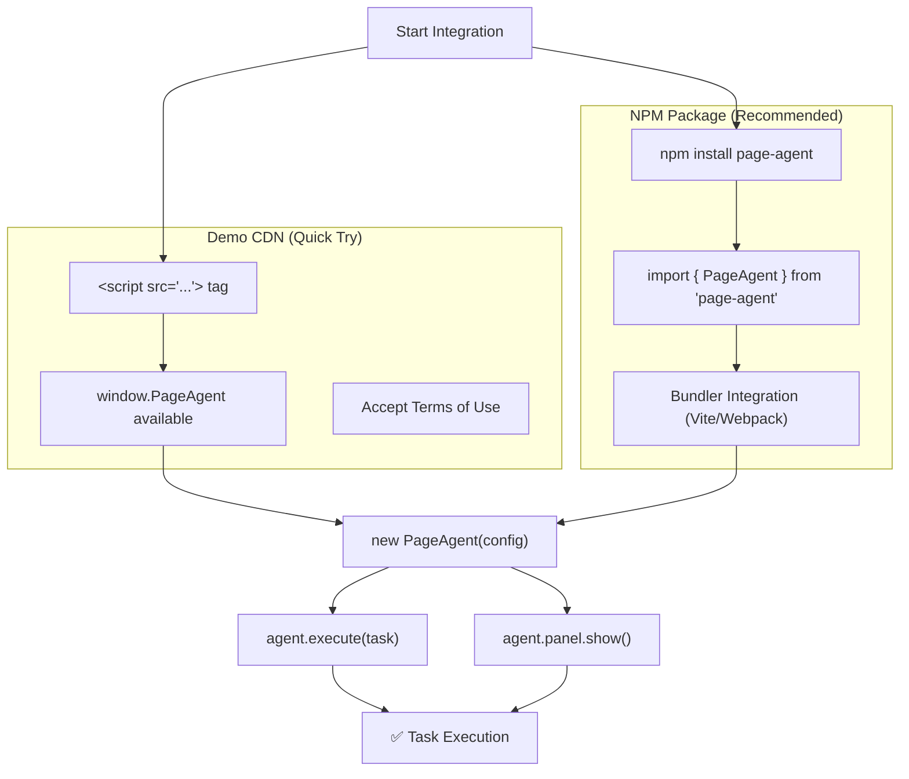
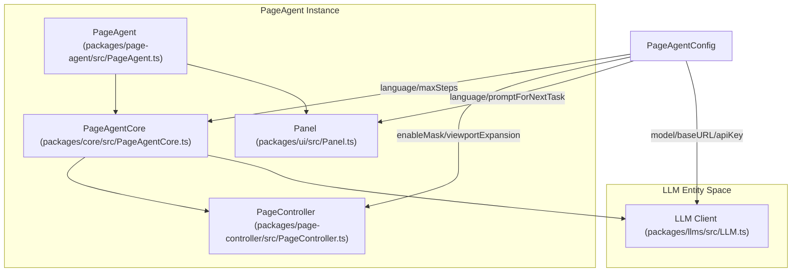
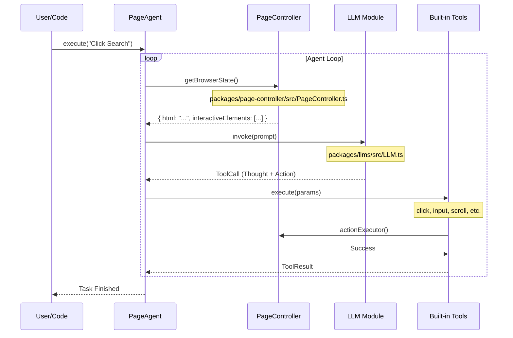

<!-- source: DeepWiki mcp.deepwiki.com · repo alibaba/page-agent · page 3.2 Quick Start Guide · fetched 2026-10-29 -->

# Quick Start Guide

<details>
<summary>Relevant source files</summary>

The following files were used as context for generating this wiki page:

- [README.md](README.md)
- [docs/README-zh.md](docs/README-zh.md)
- [packages/extension/PRIVACY.md](packages/extension/PRIVACY.md)
- [packages/extension/src/agent/constants.ts](packages/extension/src/agent/constants.ts)
- [packages/extension/src/agent/useAgent.ts](packages/extension/src/agent/useAgent.ts)
- [packages/page-agent/src/demo.ts](packages/page-agent/src/demo.ts)
- [packages/website/src/constants.ts](packages/website/src/constants.ts)
- [packages/website/src/pages/docs/advanced/custom-ui/page.tsx](packages/website/src/pages/docs/advanced/custom-ui/page.tsx)
- [packages/website/src/pages/docs/advanced/page-agent/page.tsx](packages/website/src/pages/docs/advanced/page-agent/page.tsx)
- [packages/website/src/pages/docs/features/custom-tools/page.tsx](packages/website/src/pages/docs/features/custom-tools/page.tsx)
- [packages/website/src/pages/docs/introduction/limitations/page.tsx](packages/website/src/pages/docs/introduction/limitations/page.tsx)
- [packages/website/src/pages/docs/introduction/overview/page.tsx](packages/website/src/pages/docs/introduction/overview/page.tsx)
- [packages/website/src/pages/docs/introduction/quick-start/page.tsx](packages/website/src/pages/docs/introduction/quick-start/page.tsx)

</details>


## Purpose and Scope

This guide provides a step-by-step walkthrough for integrating `page-agent` into your web application. It covers installation via CDN or NPM, initialization with LLM configurations, and executing your first natural language task. 

PageAgent is a purely web-based GUI Agent that understands web pages via DOM structure rather than visual screenshots [packages/website/src/pages/docs/introduction/limitations/page.tsx:136-143](). It is designed to be integrated in minutes, providing a GUI agent that can manipulate the DOM based on natural language instructions [packages/website/src/pages/docs/introduction/quick-start/page.tsx:11-15]().

---

## Integration Path Overview

PageAgent offers two primary integration methods depending on your environment:



**Sources:** [packages/website/src/pages/docs/introduction/quick-start/page.tsx:21-125]()

---

## Installation Steps

### Method 1: Demo CDN (Quick Try)

For rapid prototyping or testing, you can include the PageAgent script directly in your HTML. This version uses a free testing LLM API provided by the project [packages/website/src/pages/docs/introduction/quick-start/page.tsx:23-56]().

**Global Mirror:**
```html
<script src="https://cdn.jsdelivr.net/npm/page-agent@1.12.2/dist/iife/page-agent.demo.js" crossorigin="anonymous"></script>
```

**China Mirror:**
```html
<script src="https://registry.npmmirror.com/page-agent/1.12.2/files/dist/iife/page-agent.demo.js" crossorigin="anonymous"></script>
```

**Note:** By default, the demo script automatically initializes using `DEMO_MODEL` (`qwen3.5-plus`) and a pre-configured `DEMO_BASE_URL` [packages/page-agent/src/demo.ts:20-22](). To prevent this and initialize manually via `new window.PageAgent(...)`, append `?autoInit=false` to the script URL [README.md:67-69](), [packages/page-agent/src/demo.ts:8-13]().

**Sources:** [packages/website/src/pages/docs/introduction/quick-start/page.tsx:57-85](), [README.md:53-71](), [packages/website/src/constants.ts:2-5](), [packages/page-agent/src/demo.ts:1-55]()

### Method 2: NPM Install (Recommended)

For production applications, install the package via your preferred package manager to get full TypeScript support and build-time optimizations [packages/website/src/pages/docs/introduction/quick-start/page.tsx:84-94]().

```bash
npm install page-agent
```

---

## Initialization and Configuration

Once installed, you must initialize a `PageAgent` instance. This requires providing LLM credentials (endpoint, model, and API key) and optional settings like language [packages/website/src/pages/docs/introduction/quick-start/page.tsx:96-109]().

```javascript
import { PageAgent } from 'page-agent'

const agent = new PageAgent({
  model: 'qwen3.5-plus', // Model name
  baseURL: 'https://dashscope.aliyuncs.com/compatible-mode/v1', // API Endpoint
  apiKey: 'YOUR_API_KEY', // Your provider API key
  language: 'en-US' // 'zh-CN' or 'en-US'
})
```

### Configuration to Code Entity Mapping

The following diagram shows how the `PageAgentConfig` maps to internal system components during instantiation in the `PageAgent` constructor:



**Sources:** [packages/website/src/pages/docs/introduction/quick-start/page.tsx:101-114](), [packages/website/src/pages/docs/advanced/page-agent/page.tsx:75-85](), [packages/website/src/pages/docs/advanced/custom-ui/page.tsx:19-43]()

---

## Executing Your First Task

There are two ways to interact with the agent: programmatically via code, or interactively via the built-in UI panel [packages/website/src/pages/docs/introduction/quick-start/page.tsx:111-125]().

### 1. Programmatic Execution
Use the `execute` method to send a natural language string directly to the agent. This returns a promise that resolves with a result object containing success status, data, and history [packages/website/src/pages/docs/advanced/page-agent/page.tsx:66-72]().

```javascript
const result = await agent.execute('Click submit button, then fill username as John');
console.log(result.success); // true or false
```

### 2. Interactive Panel
Display the built-in sidebar/dialog that allows users to type instructions, view the agent's "thought" process, and see execution history [packages/website/src/pages/docs/advanced/page-agent/page.tsx:142-164]().

```javascript
agent.panel.show();
```

---

## Task Execution Flow

When `agent.execute()` is called, the system enters a Re-act (Reasoning and Acting) loop. This diagram maps the logical flow to specific code modules:



**Sources:** [packages/website/src/pages/docs/introduction/quick-start/page.tsx:117-130](), [packages/website/src/pages/docs/advanced/page-agent/page.tsx:12-18](), [packages/website/src/pages/docs/advanced/custom-ui/page.tsx:45-120]()

---

## Verifying the Setup

To ensure your integration is working correctly, check the following:

1.  **Global Availability:** If using CDN, `window.PageAgent` should be defined [packages/page-agent/src/demo.ts:16]().
2.  **Panel Initialization:** Calling `agent.panel.show()` should inject the UI element into the DOM [packages/website/src/pages/docs/advanced/page-agent/page.tsx:142-153]().
3.  **Network Activity:** When calling `execute()`, check the browser Network tab for outgoing requests to your configured `baseURL`.
4.  **Interaction Limits:** Ensure the task does not involve unsupported interactions like hover or drag-and-drop [packages/website/src/pages/docs/introduction/limitations/page.tsx:111-133]().

**Sources:** [packages/website/src/pages/docs/introduction/quick-start/page.tsx:117-130](), [packages/website/src/pages/docs/introduction/limitations/page.tsx:86-133](), [packages/page-agent/src/demo.ts:15-18]()

---

