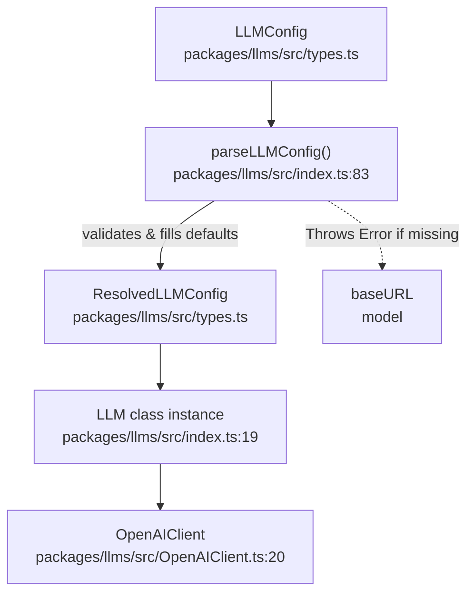
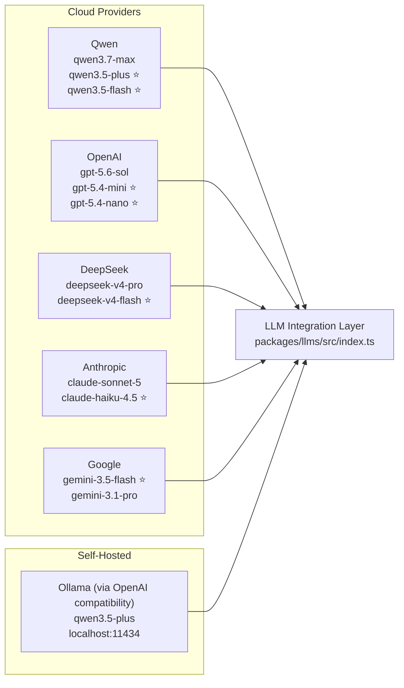
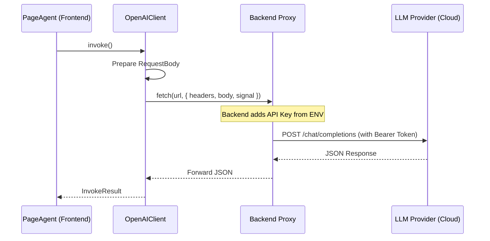

<!-- source: DeepWiki mcp.deepwiki.com · repo alibaba/page-agent · page 3.3 LLM Provider Setup · fetched 2026-10-29 -->

# LLM Provider Setup

<details>
<summary>Relevant source files</summary>

The following files were used as context for generating this wiki page:

- [packages/llms/src/types.ts](packages/llms/src/types.ts)
- [packages/llms/src/utils.test.ts](packages/llms/src/utils.test.ts)
- [packages/llms/src/utils.ts](packages/llms/src/utils.ts)
- [packages/website/src/pages/docs/features/models/page.tsx](packages/website/src/pages/docs/features/models/page.tsx)

</details>


This document explains how to configure LLM (Large Language Model) providers for PageAgent. It covers the `LLMConfig` interface, supported providers, model-specific patches, authentication patterns, and testing endpoints.

For general agent configuration options, see [Agent Configuration](#8.1). For detailed LLM integration architecture, see [LLM Integration Layer](#6).

## Configuration Interface

PageAgent requires three mandatory configuration parameters to connect to an LLM provider: `baseURL`, `apiKey`, and `model`. These are validated by the `parseLLMConfig` function which throws an error if any are missing [packages/llms/src/index.ts:85-90]().

Title: LLM Configuration Validation Flow


**Sources:** [packages/llms/src/types.ts:90-125](), [packages/llms/src/index.ts:19-29](), [packages/llms/src/index.ts:83-109]()

### LLMConfig Interface Structure

| Field | Type | Required | Default | Description |
|-------|------|----------|---------|-------------|
| `baseURL` | `string` | Yes | - | LLM API endpoint URL [packages/llms/src/types.ts:91]() |
| `apiKey` | `string` | No | `""` | Authentication key [packages/llms/src/types.ts:93]() |
| `model` | `string` | Yes | - | Model identifier [packages/llms/src/types.ts:92]() |
| `temperature` | `number` | No | - | Sampling temperature (Deprecated) [packages/llms/src/types.ts:96-99]() |
| `maxRetries` | `number` | No | `2` | Maximum retry attempts [packages/llms/src/types.ts:101]() |
| `customFetch` | `function` | No | `fetch` | Custom fetch implementation [packages/llms/src/types.ts:124]() |
| `disableNamedToolChoice` | `boolean` | No | `false` | Remove named `tool_choice` logic [packages/llms/src/types.ts:117]() |
| `transformRequestBody` | `function` | No | `identity` | Transform request body before sending [packages/llms/src/types.ts:109]() |

**Sources:** [packages/llms/src/types.ts:90-125](), [packages/llms/src/index.ts:83-109]()

## Supported Providers and Models

PageAgent supports any OpenAI-compatible API endpoint with tool calling capabilities [packages/website/src/pages/docs/features/models/page.tsx:96-97]().

### Tested Model Matrix

Title: Supported Model Ecosystem


**Baseline models** (marked ⭐) have been tested extensively and provide strong tool-calling capabilities with reliable performance [packages/website/src/pages/docs/features/models/page.tsx:8-16]().

**Sources:** [packages/website/src/pages/docs/features/models/page.tsx:19-73]()

### Model Requirements

- **Tool Call Support:** Recommended: Fast, lightweight models with strong ToolCall capabilities [packages/website/src/pages/docs/features/models/page.tsx:130-131]().
- **Format Compliance:** Models with weaker ToolCall capabilities may return incorrect formats. Common errors usually auto-recover [packages/website/src/pages/docs/features/models/page.tsx:135-136]().
- **Complexity:** Small models or those unable to handle complex tool definitions typically perform poorly [packages/website/src/pages/docs/features/models/page.tsx:140-141]().

## Provider Configuration Examples

### OpenAI-Compatible Services (e.g., Alibaba Bailian)

```javascript
const pageAgent = new PageAgent({
  baseURL: 'https://dashscope.aliyuncs.com/compatible-mode/v1',
  apiKey: 'your-api-key',
  model: 'qwen3.5-plus'
});
```

**Sources:** [packages/website/src/pages/docs/features/models/page.tsx:151-155]()

## Model-Specific Patches

The `modelPatch` function in `packages/llms/src/utils.ts` reconciles differences in parameter schemas across different providers to improve agent reliability [packages/llms/src/utils.ts:27-38]().

- **Qwen:** Disables thinking (`enable_thinking = false`) and raises temperature to 1.0 for non-max/plus models to improve auto-recovery odds [packages/llms/src/utils.ts:47-54]().
- **DeepSeek:** Disables thinking (`thinking = { type: 'disabled' }`) and removes `tool_choice` [packages/llms/src/utils.ts:56-60]().
- **GPT-5 series:** Adjusts `reasoning_effort` (none/minimal) and sets `verbosity` to low for GPT-5.6 models [packages/llms/src/utils.ts:62-86]().
- **Claude:** Disables thinking and converts OpenAI-style `tool_choice` to Claude-specific format (`any` or `tool` type) unless using OpenRouter [packages/llms/src/utils.ts:88-114]().
- **Gemini:** Sets `reasoning_effort` to `low` or `minimal` for Flash and Lite models [packages/llms/src/utils.ts:116-130]().
- **Kimi:** Kimi K3 models receive a specific patch to use `required` tool choice and disable parallel tool calls while thinking [packages/llms/src/utils.ts:153-164]().

**Sources:** [packages/llms/src/utils.ts:39-196]()

## Auto-Fixer and Normalization

The `normalizeResponse` function in `autoFixer.ts` handles common LLM format errors, such as JSON returned in content instead of `tool_calls` [packages/core/src/utils/autoFixer.ts:44-47](). It also coerces primitive inputs for single-field tools (e.g., `{"click_element_by_index": 2}` → `{"click_element_by_index": {"index": 2}}`) [packages/core/src/utils/autoFixer.ts:149-157]().

**Sources:** [packages/core/src/utils/autoFixer.ts:21-121]()

## Authentication and Security

### Production Authentication Pattern

For production web applications, it is recommended to implement a backend proxy to protect API keys.

Title: Authentication via customFetch Proxy


**Sources:** [packages/llms/src/OpenAIClient.ts:76-84](), [packages/llms/src/types.ts:124]()

## Error Handling and Retries

The `LLM` class uses `withRetry` to handle transient failures [packages/llms/src/index.ts:42]().

- **Retryable Errors:** `NETWORK_ERROR`, `RATE_LIMIT` (429), `SERVER_ERROR` (5xx), `NO_TOOL_CALL`, `INVALID_TOOL_ARGS`, `TOOL_EXECUTION_ERROR`, `INVALID_RESPONSE`, `INVALID_SCHEMA` [packages/llms/src/errors.ts:7-14]().
- **Non-Retryable Errors:** `CONFIG_ERROR`, `AUTH_ERROR` (401/403), `CONTEXT_LENGTH`, `CONTENT_FILTER` [packages/llms/src/errors.ts:19-22]().
- **Retry Logic:** Max retries default to 2. Retries occur only for errors marked as `retryable` [packages/llms/src/index.ts:71-73]().

**Sources:** [packages/llms/src/index.ts:58-81](), [packages/llms/src/errors.ts:5-56]()

## Free Testing API

A free testing endpoint is provided for technical evaluation and testing.

- **Base URL:** `https://page-ag-testing-ohftxirgbn.cn-shanghai.fcapp.run`
- **Models:** `qwen3.5-plus`, `qwen3.5-flash`

⚠️ **Warning:** Strictly for technical evaluation and R&D. Data is processed via servers in Mainland China. Do not input any PII or sensitive data [packages/website/src/pages/docs/features/models/page.tsx:167-171]().

**Sources:** [packages/website/src/pages/docs/features/models/page.tsx:201-204]()

---

