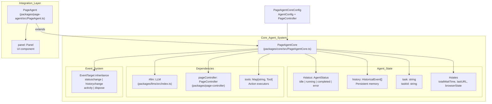
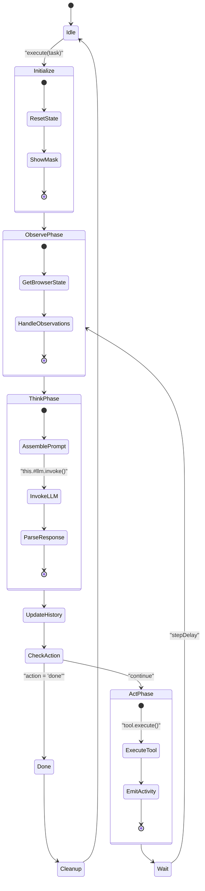
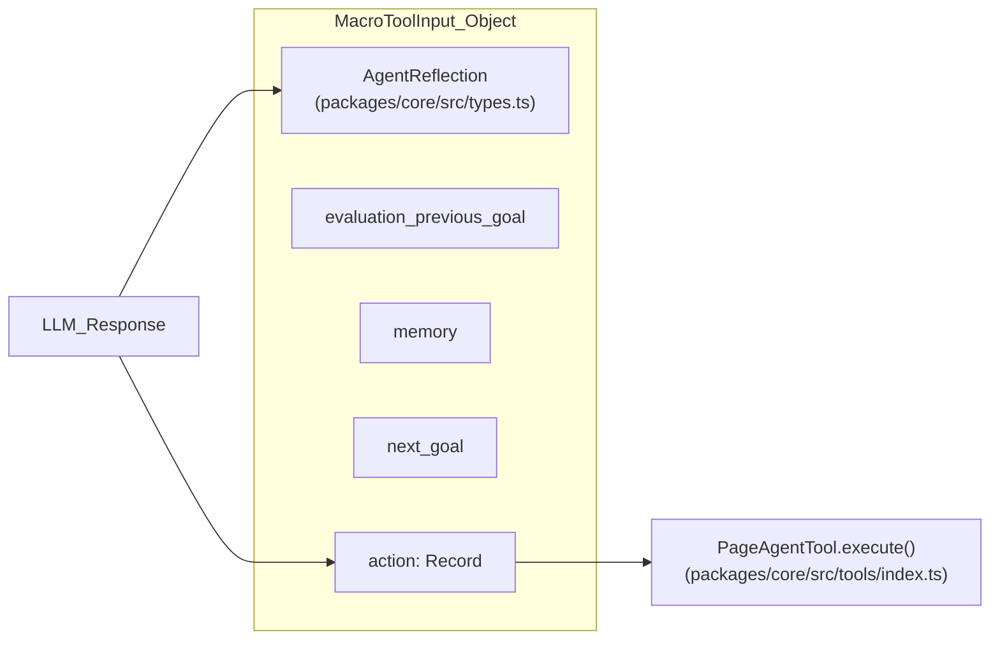
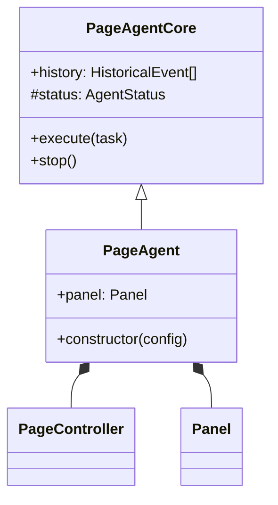

<!-- source: DeepWiki mcp.deepwiki.com · repo alibaba/page-agent · page 4 Core Agent System · fetched 2026-10-29 -->

# Core Agent System

Relevant source files

The following files were used as context for generating this wiki page:

- [packages/core/package.json](packages/core/package.json)
- [packages/core/src/PageAgentCore.ts](packages/core/src/PageAgentCore.ts)
- [packages/core/src/utils/index.ts](packages/core/src/utils/index.ts)

This document describes the core orchestration layer of PageAgent, centered around the `PageAgentCore` class. This system implements the Re-act agent loop (observe-think-act), manages agent state and history, enforces reflection-before-action through the MacroTool pattern, and provides an event system for UI integration.

For details on specific components, see the following child pages:
- [PageAgentCore and Re-act Loop](#4.1) — Detailed execution flow and lifecycle management.
- [Agent State and History](#4.2) — Status transitions, historical events, and memory.
- [Tool System and MacroTool](#4.3) — Reflection-before-action pattern and tool registration.
- [Prompt Assembly and Context](#4.4) — System prompts, instructions, and browser state formatting.
- [PageAgent Integration Class](#4.5) — The UI-integrated wrapper class.

## Architecture Overview

The Core Agent System consists of two primary classes: `PageAgentCore` (the headless agent orchestrator) and `PageAgent` (the UI-integrated wrapper).

### Core System Architecture

**Sources:** [packages/core/src/PageAgentCore.ts:61-146](), [packages/core/src/PageAgentCore.ts:29-30]()

`PageAgentCore` is the headless orchestration engine defined in `packages/core`. It extends `EventTarget` to provide a standard event API for monitoring agent execution [packages/core/src/PageAgentCore.ts:61](). The class manages the agent lifecycle, state, tool orchestration, and LLM communication via the `LLM` client [packages/core/src/PageAgentCore.ts:113]().

`PageAgent` (defined in `packages/page-agent`) extends `PageAgentCore` and adds the `Panel` UI component for human-in-the-loop interaction.

## Re-act Agent Loop

The core execution model follows the Re-act (Reasoning + Acting) pattern, where each step consists of three phases: observe, think, and act [packages/core/src/PageAgentCore.ts:35-42]().

### Execution Flow

**Sources:** [packages/core/src/PageAgentCore.ts:210-348]()

The loop continues until the agent completes the task via the `done` tool or reaches the `maxSteps` limit, which defaults to 40 [packages/core/src/PageAgentCore.ts:111](). For details, see [PageAgentCore and Re-act Loop](#4.1).

## Agent State and History

The agent maintains multiple state tracking systems. The `#status` property tracks the lifecycle state (idle, running, completed, error, stopped) and triggers `statuschange` events [packages/core/src/PageAgentCore.ts:150-184]().

### Historical Events vs. Activity

| System | Storage | Purpose | LLM Context |
| :--- | :--- | :--- | :--- |
| **History** | `history` array | Persistent memory | Included in future steps |
| **Activity** | Transient Events | Real-time UI feedback | NOT included in context |

**Sources:** [packages/core/src/PageAgentCore.ts:50-60](), [packages/core/src/PageAgentCore.ts:70-71]()

The `history` array stores `HistoricalEvent` objects, including steps, observations, retries, and errors [packages/core/src/PageAgentCore.ts:70-71](). Activity events are transient and used for UI updates like "thinking" or "executing" [packages/core/src/PageAgentCore.ts:174-176](). For details, see [Agent State and History](#4.2).

## Tool System and MacroTool

PageAgent uses a "MacroTool" pattern to enforce a reflection-before-action mental model.

### Reflection-to-Code Mapping

**Sources:** [packages/core/src/PageAgentCore.ts:359-377](), [packages/core/src/tools/index.ts:26]()

Every LLM response must include reflection fields (`evaluation_previous_goal`, `memory`, `next_goal`) before the actual action is executed [packages/core/src/PageAgentCore.ts:359-377](). Tools are managed in a `Map` and can be customized or overridden via `config.customTools` [packages/core/src/PageAgentCore.ts:134-142](). For details, see [Tool System and MacroTool](#4.3).

## Prompt Assembly and Context

Prompts are assembled from multiple sources to provide the LLM with full context of the current task and environment.

- **System Prompt**: Loaded from `system_prompt.md` [packages/core/src/PageAgentCore.ts:11]().
- **Instructions**: Includes global `system` instructions and dynamic `getPageInstructions` callback.
- **Browser State**: The current `BrowserState` provided by the `PageController` [packages/core/src/PageAgentCore.ts:105]().

The agent also supports a `transformPageContent` hook to mask sensitive data before it is sent to the LLM. For details, see [Prompt Assembly and Context](#4.4).

## PageAgent Integration Class

The `PageAgent` class is the standard integration point. It automatically initializes the core logic and the interactive UI panel.

**Sources:** [packages/core/src/PageAgentCore.ts:61-146](), [packages/core/src/PageAgentCore.ts:29-30]()

This class simplifies deployment by bundling the core logic with the interactive UI panel. For details, see [PageAgent Integration Class](#4.5).

---

