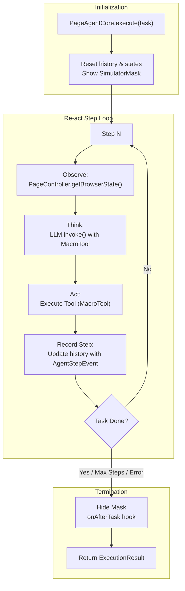
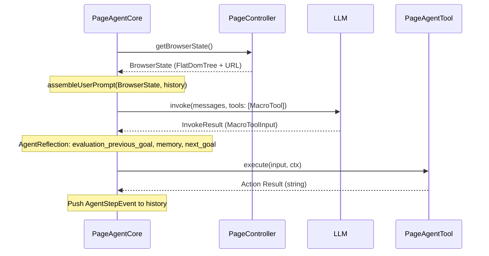

<!-- source: DeepWiki mcp.deepwiki.com · repo alibaba/page-agent · page 4.1 PageAgentCore and Re-act Loop · fetched 2026-10-29 -->

# PageAgentCore and Re-act Loop

<details>
<summary>Relevant source files</summary>

The following files were used as context for generating this wiki page:

- [packages/core/src/PageAgentCore.ts](packages/core/src/PageAgentCore.ts)
- [packages/core/src/utils/index.ts](packages/core/src/utils/index.ts)
- [packages/website/src/pages/docs/advanced/page-agent-core/page.tsx](packages/website/src/pages/docs/advanced/page-agent-core/page.tsx)

</details>


## Purpose and Scope

This document describes the implementation of the core autonomous agent logic within `PageAgentCore`. It details the Re-act (Reasoning and Acting) loop that drives the agent's behavior, the step-by-step execution flow, and the lifecycle management of a browser automation task.

The `PageAgentCore` class serves as the headless engine for the agent, managing the state machine, LLM interactions, and tool executions. It is designed to be decoupled from the UI, allowing it to run in headless environments or within custom interface implementations.

Sources: [packages/core/src/PageAgentCore.ts:61-95](), [packages/core/src/PageAgentCore.ts:210-225](), [packages/website/src/pages/docs/advanced/page-agent-core/page.tsx:15-19]()

---

## Re-act Loop Architecture

The agent operates on a cyclic "Observe-Think-Act" pattern. Each iteration is a "step," and the agent continues looping until the task is finished, an error occurs, or the maximum step limit is reached.

### Core Loop Flow



Sources: [packages/core/src/PageAgentCore.ts:31-43](), [packages/core/src/PageAgentCore.ts:210-330]()

---

## Step Execution Details

Each step in the `while(true)` loop within the `execute` method performs the following operations:

### 1. Observation Phase
The agent gathers the current environment context.
- **Browser State**: Calls `pageController.getBrowserState()` to get the simplified DOM tree, URL, and interactive elements [packages/core/src/PageAgentCore.ts:242-243]().
- **Contextual Data**: Optionally fetches `llms.txt` from the site origin if `experimentalLlmsTxt` is enabled [packages/core/src/PageAgentCore.ts:246-250]().
- **Data Masking**: If `transformPageContent` is provided in the `AgentConfig`, the simplified HTML is passed through it to mask sensitive data before reaching the LLM [packages/core/src/PageAgentCore.ts:253-255]().

### 2. Thinking Phase (LLM Invocation)
The agent constructs a prompt and calls the LLM.
- **Prompt Assembly**: Combines the `SYSTEM_PROMPT`, task description, historical events, and current `BrowserState` [packages/core/src/PageAgentCore.ts:271-279]().
- **Tool Definition**: Provides the `MacroTool` schema to the LLM. The `MacroTool` is a wrapper that forces the LLM to provide "Reflection" (evaluation, memory, next goal) before the "Action" [packages/core/src/PageAgentCore.ts:16-22]().
- **Invocation**: Calls `llm.invoke()` with an `AbortSignal` from the internal `#abortController` to allow task cancellation [packages/core/src/PageAgentCore.ts:281-285]().

### 3. Action Phase
The agent executes the tool selected by the LLM.
- **MacroTool Execution**: The `MacroTool` extracts the specific tool name and arguments from the LLM's response and executes the corresponding function from the `this.tools` map [packages/core/src/PageAgentCore.ts:287-293]().
- **State Updates**: If the action involves waiting or navigation, internal states like `totalWaitTime` and `lastURL` are updated [packages/core/src/PageAgentCore.ts:310-316]().

Sources: [packages/core/src/PageAgentCore.ts:242-316](), [packages/core/src/PageAgentCore.ts:91-91]()

---

## Data Flow: Observation to Action

This diagram bridges the gap between the high-level concepts and the specific code entities involved in a single execution step.



Sources: [packages/core/src/PageAgentCore.ts:242-243](), [packages/core/src/PageAgentCore.ts:281-285](), [packages/core/src/PageAgentCore.ts:310-316](), [packages/core/src/PageAgentCore.ts:26-27]()

---

## Lifecycle Management and Hooks

`PageAgentCore` provides several lifecycle hooks and event emitters to allow external monitoring and intervention.

### Event System
The class extends `EventTarget` and emits the following:
- `statuschange`: Triggered when the agent transitions between `idle`, `running`, `completed`, or `error` [packages/core/src/PageAgentCore.ts:160-162]().
- `historychange`: Triggered whenever a new `HistoricalEvent` (step, observation, retry, or error) is added to the memory [packages/core/src/PageAgentCore.ts:165-168]().
- `activity`: Emits transient `AgentActivity` (e.g., `thinking`, `executing`, `retrying`) for real-time UI updates [packages/core/src/PageAgentCore.ts:174-176]().

### Configuration Hooks
Users can provide async callbacks in `AgentConfig` to tap into the execution flow:

| Hook | Timing | Parameters |
| :--- | :--- | :--- |
| `onBeforeTask` | Before the loop starts | `agent: PageAgentCore` |
| `onBeforeStep` | At the start of every iteration | `agent, stepCount` |
| `onAfterStep` | After tool execution and history update | `agent, history` |
| `onAfterTask` | After loop termination (success or fail) | `agent, result` |
| `onDispose` | When `dispose()` is called | `agent, reason` |

Sources: [packages/core/src/PageAgentCore.ts:227-233](), [packages/website/src/pages/docs/advanced/page-agent-core/page.tsx:203-230]()

---

## Termination and Results

The loop terminates under four conditions, resulting in an `ExecutionResult`:

1.  **Success**: The LLM calls the `done` tool with `success: true` [packages/core/src/PageAgentCore.ts:333-339]().
2.  **Failure**: The LLM calls the `done` tool with `success: false` [packages/core/src/PageAgentCore.ts:333-339]().
3.  **Step Limit**: The `step` counter exceeds `config.maxSteps` (default 40) [packages/core/src/PageAgentCore.ts:111-111](), [packages/core/src/PageAgentCore.ts:324-331]().
4.  **Abort**: The `stop()` method is called, triggering the `#abortController` [packages/core/src/PageAgentCore.ts:200-204]().

### ExecutionResult Structure
The `ExecutionResult` [packages/core/src/PageAgentCore.ts:19-19]() returned by `execute()` contains the final outcome and the full trace.

```typescript
export interface ExecutionResult {
    success: boolean;    // Final outcome
    data: string;       // Message from the 'done' tool or error message
    history: HistoricalEvent[]; // Full trace of the task
}
```

Sources: [packages/core/src/PageAgentCore.ts:333-356](), [packages/core/src/PageAgentCore.ts:111-111]()

---

