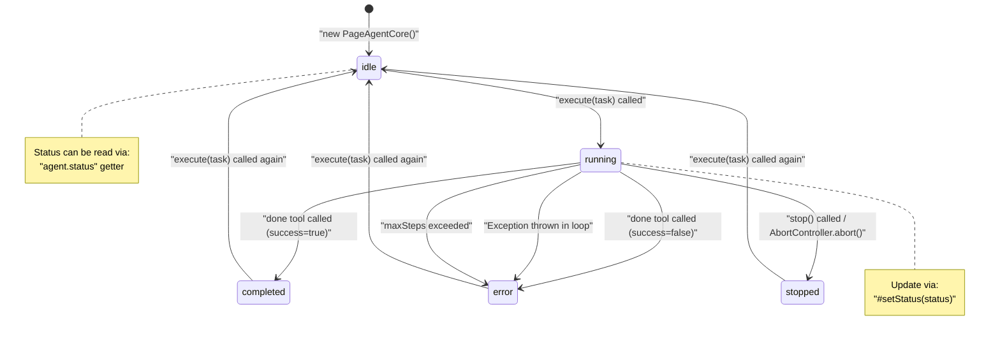
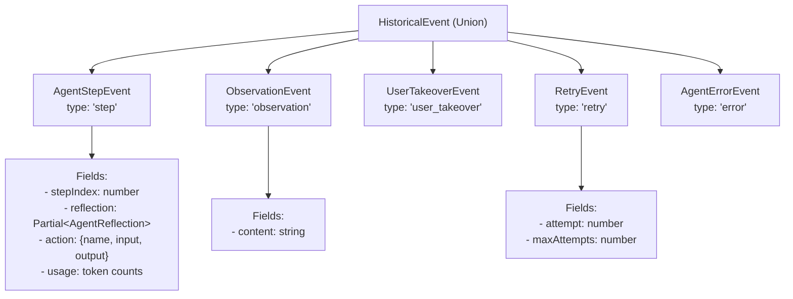
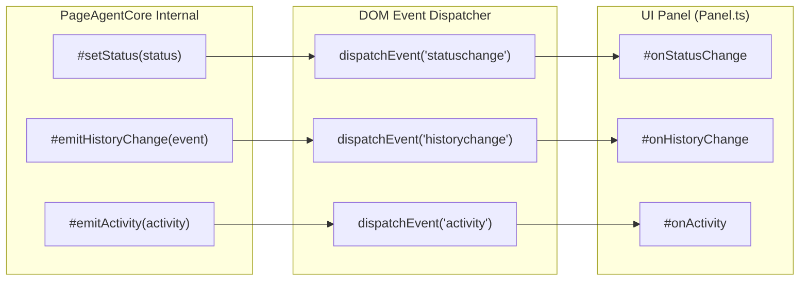

<!-- source: DeepWiki mcp.deepwiki.com · repo alibaba/page-agent · page 4.2 Agent State and History · fetched 2026-10-29 -->

# Agent State and History

<details>
<summary>Relevant source files</summary>

The following files were used as context for generating this wiki page:

- [packages/core/src/PageAgentCore.ts](packages/core/src/PageAgentCore.ts)
- [packages/core/src/types.ts](packages/core/src/types.ts)
- [packages/core/src/utils/index.ts](packages/core/src/utils/index.ts)
- [packages/ui/src/panel/Panel.ts](packages/ui/src/panel/Panel.ts)
- [packages/ui/src/panel/types.ts](packages/ui/src/panel/types.ts)

</details>


## Purpose and Scope

This document describes the state management and memory systems within `PageAgentCore`. It covers the agent's status lifecycle, historical event tracking, activity reporting, and memory system. The agent uses a dual-stream information architecture: a persistent **History** stream for long-term reasoning and a transient **Activity** stream for real-time UI feedback.

For information about the execution flow, see [packages/core/src/PageAgentCore.ts:35-42](). For details on how history is assembled into LLM prompts, see [packages/core/src/PageAgentCore.ts:50-55]().

## Agent Status Lifecycle

The agent maintains an internal status that reflects its current execution state. The `AgentStatus` type defines five possible states:

```typescript
export type AgentStatus = 'idle' | 'running' | 'completed' | 'error' | 'stopped'
```
[packages/core/src/types.ts:263-263]()

**Status State Machine**

The following diagram maps the logical status transitions to the code methods and triggers that drive them.



**Status Management Implementation**

The status is stored as a private field and exposed through a public getter. Changes to the status trigger a `statuschange` event.

- **Private Field**: `#status: AgentStatus = 'idle'` [packages/core/src/PageAgentCore.ts:83-83]()
- **Public Getter**: `get status(): AgentStatus` [packages/core/src/PageAgentCore.ts:150-152]()
- **Update Method**: `#setStatus(status: AgentStatus)` [packages/core/src/PageAgentCore.ts:179-184]()
- **Reset Point**: Status is set to `running` at the beginning of the `execute` method [packages/core/src/PageAgentCore.ts:241]().

**Sources:** [packages/core/src/PageAgentCore.ts:83-241](), [packages/core/src/types.ts:263-263]()

## Historical Events System

The agent maintains a persistent `history` array that serves as the agent's memory across execution steps. This history is included in LLM prompts, enabling the agent to maintain context and learn from previous successes or failures.

### HistoricalEvent Types

The `HistoricalEvent` union type encompasses several distinct event categories:

| Event Type | Purpose | Included in LLM Context | Trigger |
|------------|---------|-------------------------|---------|
| `AgentStepEvent` | Records a completed step with reflection and action | **Yes** | After each LLM tool call execution |
| `ObservationEvent` | System-generated messages (navigation, custom notes) | **Yes** | Navigation detection or `pushObservation()` |
| `UserTakeoverEvent` | User manually controlled the page | **Yes** | When the controller detects external interaction |
| `RetryEvent` | LLM call retry attempt | **Yes** | LLM client retry logic [packages/core/src/PageAgentCore.ts:117-132]() |
| `AgentErrorEvent` | Fatal errors from LLM or execution | **Yes** | LLM errors or execution exceptions |

**Event Type Hierarchy**



**Sources:** [packages/core/src/types.ts:198-258](), [packages/core/src/PageAgentCore.ts:117-132]()

### AgentStepEvent and Reflection

The `AgentStepEvent` is the primary record of agent behavior. It incorporates the **AgentReflection** model, which enforces a "reflection-before-action" pattern.

```typescript
export interface AgentReflection {
	evaluation_previous_goal: string // How well did the previous action work?
	memory: string                   // Key info to remember for the future
	next_goal: string                // What is the immediate next goal?
}
```
[packages/core/src/types.ts:171-175]()

This reflection is generated by the LLM as part of the `MacroToolInput` [packages/core/src/types.ts:183-185]() and is stored in the `history` to provide a "chain of thought" for subsequent steps.

**Sources:** [packages/core/src/types.ts:171-175](), [packages/core/src/types.ts:183-218]()

### History Management

- **Initialization**: The history is cleared (`this.history = []`) every time `execute()` is called [packages/core/src/PageAgentCore.ts:219-219]().
- **Persistence**: Unlike the activity stream, the `history` array is persistent for the duration of a task and is the source of truth for the context sent to the LLM [packages/core/src/PageAgentCore.ts:50-53]().
- **Emission**: Any change to history triggers `#emitHistoryChange()`, which dispatches a `historychange` event [packages/core/src/PageAgentCore.ts:165-168]().

**Sources:** [packages/core/src/PageAgentCore.ts:50-219]()

## Event System Architecture

`PageAgentCore` extends `EventTarget` [packages/core/src/PageAgentCore.ts:61-61]() to provide a standard event-driven API. This allows UI components (like the `@page-agent/ui` Panel) to stay synchronized with the agent's internal state.

**Event Emission Flow**



**Sources:** [packages/core/src/PageAgentCore.ts:61-184](), [packages/ui/src/panel/Panel.ts:51-53]()

## Activity Tracking

Activities represent transient, real-time feedback. While **History** is what the agent *remembers*, **Activity** is what the agent is *doing right now*. Activities are never included in the LLM context [packages/core/src/PageAgentCore.ts:56-59]().

### AgentActivity Type

Activities are emitted via `CustomEvent` with a `detail` property of type `AgentActivity` [packages/core/src/PageAgentCore.ts:174-176]().

```typescript
export type AgentActivity =
	| { type: 'thinking' }
	| { type: 'executing'; tool: string; input: unknown }
	| { type: 'executed'; tool: string; input: unknown; output: string; duration: number }
	| { type: 'retrying'; attempt: number; maxAttempts: number }
	| { type: 'error'; message: string }
```
[packages/ui/src/panel/types.ts:12-17]()

**Activity Lifecycle**

1. **Thinking**: Emitted before the LLM is invoked [packages/ui/src/panel/Panel.ts:145-148]().
2. **Executing**: Emitted after the LLM returns a tool call but before the tool finishes execution [packages/ui/src/panel/Panel.ts:150-153]().
3. **Executed**: Emitted after the tool completes, including the duration and output [packages/ui/src/panel/Panel.ts:155-157]().
4. **Retrying**: Emitted when the `LLM` class triggers a retry due to network or validation errors [packages/core/src/PageAgentCore.ts:117-132]().

**Sources:** [packages/ui/src/panel/types.ts:12-17](), [packages/core/src/PageAgentCore.ts:117-132](), [packages/ui/src/panel/Panel.ts:145-157]()

## Observations and Memory

Observations are system-generated context injected into the history. They allow the agent to "notice" things that aren't strictly DOM elements, such as navigation events or resource limits.

### Observation Mechanism

Observations are buffered in a private `#observations` array [packages/core/src/PageAgentCore.ts:92-92]() and flushed to the persistent `history` at the start of each step.

- **`pushObservation(content)`**: Public method to add a system message to the next step's context [packages/core/src/PageAgentCore.ts:192-194]().
- **Automatic Observations**:
    - **Navigation**: The agent tracks `lastURL` in its internal `#states`. If a navigation occurs, an observation is generated [packages/core/src/PageAgentCore.ts:103-103]().
    - **External Interaction**: If the agent detects user interaction on the page, it can push a `user_takeover` event into history [packages/core/src/types.ts:231-233]().

### Memory and Prompts

The history is formatted into the prompt to provide the agent with its "past self". The `AgentStepEvent` entries provide the reflection (`evaluation_previous_goal`, `memory`, `next_goal`) which acts as a summary of progress [packages/core/src/types.ts:171-175]().

**Sources:** [packages/core/src/PageAgentCore.ts:92-194](), [packages/core/src/types.ts:171-233]()

## Human-in-the-Loop: ask_user

The state system handles human intervention via the `onAskUser` callback. When the `ask_user` tool is called, the agent enters a waiting state that is managed through the `Panel` UI.

- **`onAskUser`**: A callback property on `PageAgentCore` that implementations (like the UI Panel) must define [packages/core/src/PageAgentCore.ts:81-81]().
- **UI Integration**: The `Panel` class sets this callback to display a question card and an input area [packages/ui/src/panel/Panel.ts:71-71]().
- **Abort Logic**: If the task is stopped or the agent is disposed while waiting for a user answer, the `AbortSignal` is triggered to reject the pending promise and clean up the UI [packages/ui/src/panel/Panel.ts:201-211]().

**Sources:** [packages/core/src/PageAgentCore.ts:81-81](), [packages/ui/src/panel/Panel.ts:71-211]()

---

