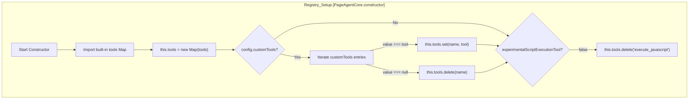
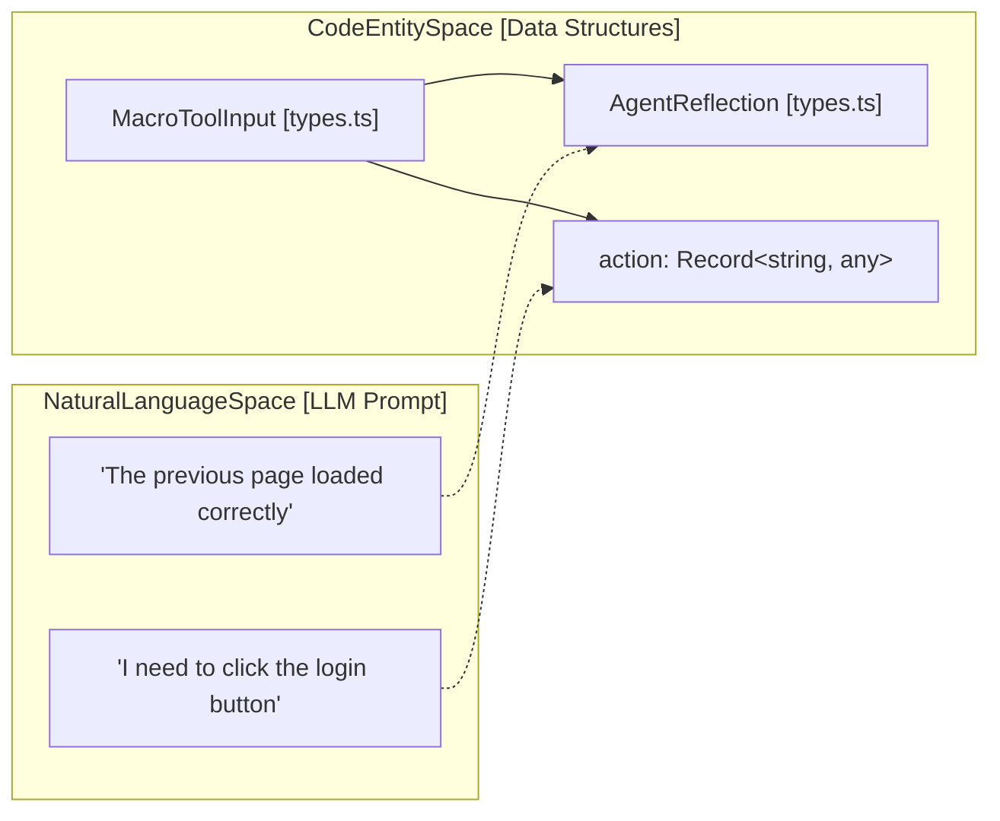
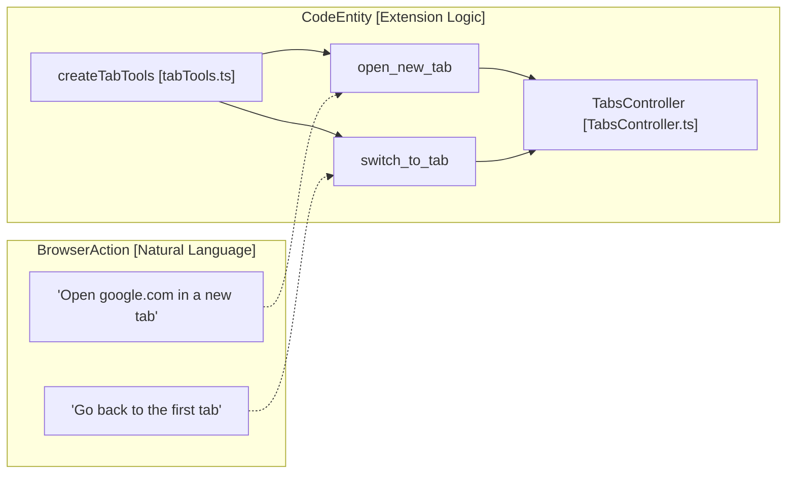
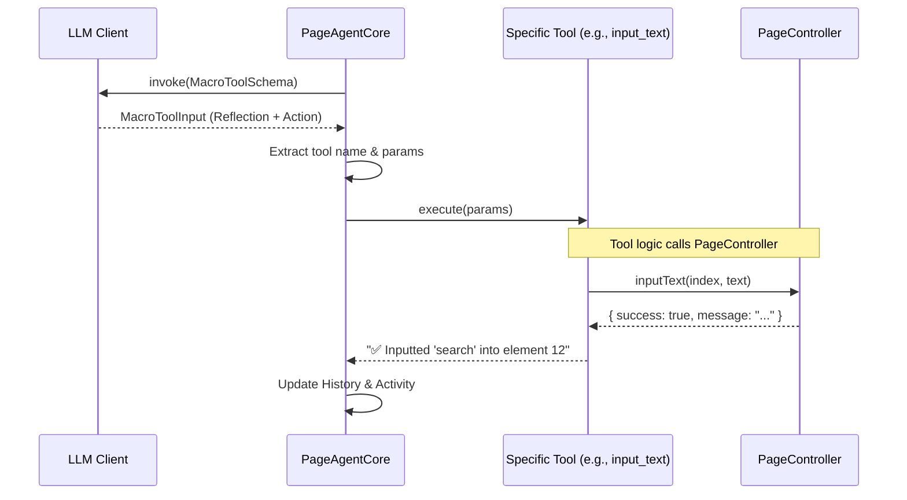

<!-- source: DeepWiki mcp.deepwiki.com · repo alibaba/page-agent · page 4.3 Tool System and MacroTool · fetched 2026-10-29 -->

# Tool System and MacroTool

<details>
<summary>Relevant source files</summary>

The following files were used as context for generating this wiki page:

- [packages/core/src/PageAgentCore.ts](packages/core/src/PageAgentCore.ts)
- [packages/core/src/tools/index.ts](packages/core/src/tools/index.ts)
- [packages/core/src/utils/index.ts](packages/core/src/utils/index.ts)
- [packages/extension/src/agent/TabsController.test.ts](packages/extension/src/agent/TabsController.test.ts)
- [packages/extension/src/agent/tabTools.ts](packages/extension/src/agent/tabTools.ts)
- [packages/extension/vitest.config.js](packages/extension/vitest.config.js)

</details>


## Purpose and Scope

This document describes the tool system architecture in PageAgent, specifically focusing on the `PageAgentCore` implementation. It details how tools are defined, the "reflection-before-action" pattern enforced by the `MacroTool`, and the mechanism for extending the agent with custom capabilities.

## Tool Architecture Overview

### Tool Interface

Tools in PageAgent follow a standard interface defined as `PageAgentTool`. This interface ensures that every tool provides a clear description for the LLM, a structured input schema for validation, and an execution function. Tools must honor the `AbortSignal` provided in the `ToolContext` to support cooperative cancellation.

| Property | Type | Description |
| :--- | :--- | :--- |
| `description` | `string` | Natural language description used by the LLM to understand when and how to use the tool. |
| `inputSchema` | `zod.ZodType` | A Zod schema (v4) that defines and validates the arguments passed to the tool. |
| `execute` | `Function` | An async function that performs the action. It is called with the `PageAgentCore` instance as its `this` context and a `ToolContext`. |

Sources: [packages/core/src/tools/index.ts:14-26](), [packages/core/src/PageAgentCore.ts:6-9]()

### The Tool Registry

The `PageAgentCore` maintains a local registry of tools in a `Map`. During initialization, it loads a set of built-in tools and then applies any user-defined `customTools` provided in the configuration.

**Tool Initialization Flow**



Sources: [packages/core/src/PageAgentCore.ts:114-147](), [packages/core/src/tools/index.ts:36]()

## MacroTool: Reflection-Before-Action

PageAgent employs a "MacroTool" pattern. Instead of providing the LLM with a flat list of individual tools, it wraps available tools into a structure that forces the model to perform a "reflection" step before selecting an action. This is defined by the `MacroToolInput` interface.

### The Reflection Model

Every step requires the LLM to populate the `AgentReflection` state, which acts as the agent's internal monologue and short-term memory:
- `evaluation_previous_goal`: An assessment of whether the previous action achieved its intended result.
- `memory`: Critical information the agent needs to remember for future steps (e.g., a value found on a previous page).
- `next_goal`: The immediate objective for the action about to be taken.

Sources: [packages/core/src/types.ts:171-175]()

### MacroTool Data Flow

The `MacroToolInput` combines this reflection with exactly one tool call (the `action`). This ensures that the agent's reasoning is captured alongside its interaction with the page.

**Natural Language to Code Entity Mapping**



Sources: [packages/core/src/types.ts:183-185](), [packages/core/src/PageAgentCore.ts:38-41]()

## Built-in Tools Reference

The core package provides a suite of tools for DOM interaction and agent control. Most of these tools delegate execution to the `PageController`.

| Tool Name | Description | Key Parameters |
| :--- | :--- | :--- |
| `click_element_by_index` | Clicks a specific element found in the simplified DOM tree. | `index` (number) |
| `input_text` | Focuses and types text into an interactive input element. | `index`, `text` |
| `select_dropdown_option` | Selects an option from a `<select>` element by its text. | `index`, `text` |
| `scroll` | Vertical scrolling of the document or specific containers. | `down`, `num_pages`, `index` |
| `scroll_horizontally` | Horizontal scrolling for wide elements or tables. | `right`, `pixels`, `index` |
| `wait` | Pauses execution. It attempts to subtract LLM latency from the wait duration. | `seconds` |
| `ask_user` | Requests clarification from the user via the `onAskUser` callback. | `question` |
| `done` | Signals task completion and provides the final response. | `text`, `success` |
| `execute_javascript` | Runs raw JS on the page (requires `experimentalScriptExecutionTool`). | `script` |

Sources: [packages/core/src/tools/index.ts:38-198](), [packages/core/src/PageAgentCore.ts:61-67]()

### Extension Tools (Tab Management)

When running within the Chrome Extension context, the `MultiPageAgent` injects additional tools via `createTabTools` to handle browser-level operations across multiple tabs. These tools are bound to a `TabsController` instance.

| Tool Name | Description | Key Parameters |
| :--- | :--- | :--- |
| `open_new_tab` | Opens a URL in a new browser tab and sets it as active. | `url` (string) |
| `switch_to_tab` | Changes the active tab context by ID. | `tab_id` (number) |
| `close_tab` | Closes a specific tab. | `tab_id` (number) |

**Tab Management Mapping**



Sources: [packages/extension/src/agent/tabTools.ts:24-74](), [packages/extension/src/agent/TabsController.ts:1-20]()

## Tool Execution Lifecycle

When the `PageAgentCore` loop reaches the "Act" phase, it processes the tool selected by the LLM:

1. **Extraction**: The core identifies the tool name and arguments from the `MacroToolInput.action`.
2. **Context Binding**: The tool's `execute` function is invoked. Built-in tools use `this: PageAgentCore` to access the `pageController` or internal state.
3. **Observation Tracking**: The string returned by `execute` is treated as the "observation" for that step and added to the history.
4. **Internal State Updates**:
    - The `wait` tool calculates `actualWaitTime` by comparing the requested time against `pageController.getLastUpdateTime()`.
    - The `ask_user` tool triggers the `onAskUser` callback if defined.

**Execution Sequence**



Sources: [packages/core/src/PageAgentCore.ts:31-43](), [packages/core/src/tools/index.ts:54-72](), [packages/core/src/tools/index.ts:115-119]()

## Custom Tools and Overrides

Developers can extend the agent's capabilities via the `customTools` property in `AgentConfig`.

- **Addition**: Provide a new key and a `PageAgentTool` implementation.
- **Override**: Provide an implementation using an existing tool name (e.g., `ask_user`) to change how the agent interacts with the user.
- **Removal**: Set a tool name to `null` to disable it (e.g., disabling `ask_user` for fully autonomous mode).

```typescript
// Example: Removing a tool
const config = {
  customTools: {
    ask_user: null 
  }
}
```

Sources: [packages/core/src/types.ts:25-49](), [packages/core/src/PageAgentCore.ts:134-142]()

---

