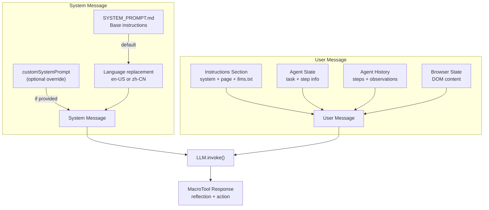
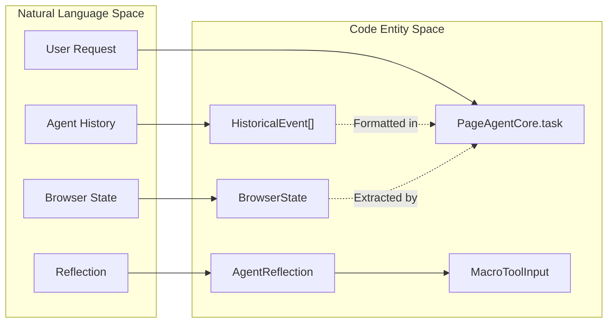
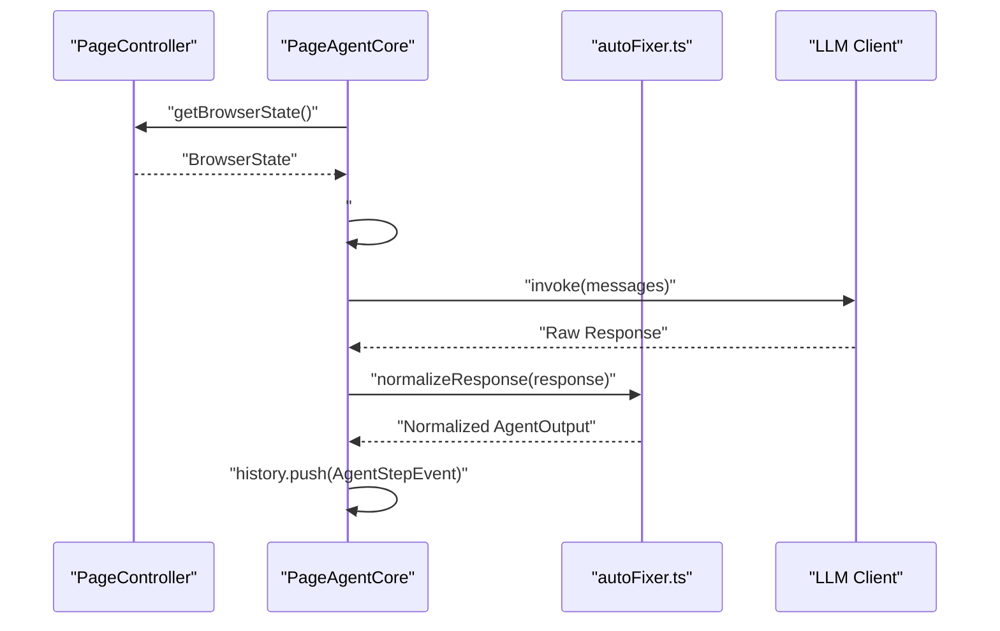

<!-- source: DeepWiki mcp.deepwiki.com · repo alibaba/page-agent · page 4.4 Prompt Assembly and Context · fetched 2026-10-29 -->

# Prompt Assembly and Context

Relevant source files

The following files were used as context for generating this wiki page:

- [.vscode/cspell.json](.vscode/cspell.json)
- [.vscode/settings.json](.vscode/settings.json)
- [packages/core/src/PageAgentCore.ts](packages/core/src/PageAgentCore.ts)
- [packages/core/src/prompts/system_prompt.md](packages/core/src/prompts/system_prompt.md)
- [packages/core/src/utils/index.ts](packages/core/src/utils/index.ts)
- [packages/extension/src/agent/system_prompt.md](packages/extension/src/agent/system_prompt.md)
- [packages/website/index.html](packages/website/index.html)

This document explains how `PageAgentCore` assembles prompts for LLM invocation and manages context across execution steps. The prompt structure enforces the reflection-before-action pattern and provides the agent with comprehensive awareness of its task, history, and current browser state.

For information about the Re-act loop that invokes these prompts, see [4.1 PageAgentCore and Re-act Loop](). For details on how the LLM processes these prompts, see [6. Core LLM Integration Layer](). For browser state extraction, see [5. Page Controller System]().

## Prompt Structure Overview

Every LLM invocation receives two messages: a **system prompt** and a **user prompt**. The system prompt defines the agent's identity and capabilities, while the user prompt provides task-specific context that accumulates across steps.

### Prompt Assembly Architecture

**Sources:** [packages/core/src/PageAgentCore.ts:447-459](), [packages/core/src/PageAgentCore.ts:549-556]()

## System Prompt Construction

The system prompt is generated by the `#getSystemPrompt()` method and defines the agent's core behavior and capabilities.

### Default System Prompt
The base system prompt is loaded from `packages/core/src/prompts/system_prompt.md` at build time [packages/core/src/PageAgentCore.ts:11-11](). This markdown file contains:
- Agent identity and role (e.g., "AI agent designed to automate browser tasks") [packages/core/src/prompts/system_prompt.md:1-1]().
- Input format descriptions (`<agent_history>`, `<agent_state>`, `<browser_state>`) [packages/core/src/prompts/system_prompt.md:17-22]().
- Rules for browser interaction and navigation [packages/core/src/prompts/system_prompt.md:65-85]().
- Reasoning patterns and the reflection-before-action model [packages/core/src/prompts/system_prompt.md:113-122]().

### Language Configuration
The system prompt dynamically replaces the default working language based on the configured `language` option in `AgentConfig`:

| Configuration | Replacement |
|---------------|-------------|
| `language: 'en-US'` | `Default working language: **English**` |
| `language: 'zh-CN'` | `Default working language: **中文**` |

**Sources:** [packages/core/src/PageAgentCore.ts:447-459](), [packages/core/src/prompts/system_prompt.md:12-15]()

### Custom System Prompt Override
Users can completely override the default system prompt using the `customSystemPrompt` configuration option. When provided, this bypasses the default prompt entirely [packages/core/src/PageAgentCore.ts:449-451]().

## User Prompt Assembly

The user prompt is assembled by `#assembleUserPrompt()` and contains all task-specific, step-specific, and page-specific context. It is regenerated at every step to reflect the latest state [packages/core/src/PageAgentCore.ts:549-556]().

### Instructions Section
The instructions section is generated by `#getInstructions()` and aggregates guidance from multiple sources [packages/core/src/PageAgentCore.ts:461-503]():

1.  **System Instructions**: Global instructions configured via `instructions.system`.
2.  **Page Instructions**: Dynamic instructions specific to the current URL, provided by the `instructions.getPageInstructions` callback.
3.  **llms.txt Integration**: When `experimentalLlmsTxt: true` is enabled, the agent fetches `/llms.txt` from the current origin. The fetch is performed by `fetchLlmsTxt()` and is cached per origin [packages/core/src/utils/index.ts:83-115]().

### Agent State Section
The agent state section provides the core task context and step metadata [packages/core/src/PageAgentCore.ts:558-573]():
- **User Request**: The original task description passed to `execute(task)` [packages/core/src/PageAgentCore.ts:216-216]().
- **Step Information**: Current execution metadata, including `stepIndex` and `maxSteps` [packages/core/src/PageAgentCore.ts:566-571]().

### Agent History Section
The history section provides the agent with memory of previous steps and system observations [packages/core/src/PageAgentCore.ts:575-601]().

#### Event Inclusion Logic
| Event Type | Included in Prompt? | Format |
|------------|---------------------|--------|
| `step` | Yes | `<step_{n}>` containing reflection and action results [packages/core/src/PageAgentCore.ts:511-534]() |
| `observation` | Yes | `<sys>` tag [packages/core/src/PageAgentCore.ts:536-538]() |
| `user_takeover` | Yes | `<sys>` tag indicating user manual control [packages/core/src/PageAgentCore.ts:540-542]() |
| `retry` | No | Excluded from context, used for UI only [packages/core/src/PageAgentCore.ts:544-544]() |
| `error` | No | Excluded from context, used for UI only [packages/core/src/PageAgentCore.ts:544-544]() |

### Browser State Section
The browser state section contains the current DOM representation extracted by `PageController` [packages/core/src/PageAgentCore.ts:603-614]().

#### Content Transformation
Before the browser state is added to the prompt, it passes through an optional `transformPageContent()` hook. This allows masking sensitive data or modifying the page representation after DOM extraction but before LLM invocation [packages/core/src/PageAgentCore.ts:605-608]().

## Context Accumulation and Normalization

The prompt assembly relies on `normalizeResponse` from `autoFixer.ts` to ensure that the LLM's output conforms to the expected structure before it is saved into history and used for future context [packages/core/src/utils/autoFixer.ts:21-121]().

### Natural Language to Code Entity Space

This diagram bridges the conceptual prompt components (Natural Language Space) to the actual classes and variables in the codebase (Code Entity Space).

**Sources:** [packages/core/src/PageAgentCore.ts:68-71](), [packages/core/src/PageAgentCore.ts:603-614](), [packages/core/src/PageAgentCore.ts:511-534]()

### Step Context Flow

**Sources:** [packages/core/src/PageAgentCore.ts:243-294](), [packages/core/src/utils/autoFixer.ts:21-121]()

## Key Implementation Details

### Observation Handling
Observations are generated by `#handleObservations()` and include:
- **Navigation**: Detection of URL changes [packages/core/src/PageAgentCore.ts:420-424]().
- **Wait Time**: Warning if the agent has spent too much time waiting [packages/core/src/PageAgentCore.ts:426-430]().
- **Step Limits**: Alert when the agent is approaching `maxSteps` [packages/core/src/PageAgentCore.ts:432-436]().

### Token and Format Normalization
The `normalizeResponse` function handles common LLM format errors, such as:
- Returning JSON in `message.content` instead of `tool_calls` [packages/core/src/utils/autoFixer.ts:44-76]().
- Incorrectly wrapping tool arguments [packages/core/src/utils/autoFixer.ts:82-86]().
- Missing the `action` field (fallbacks to `wait`) [packages/core/src/utils/autoFixer.ts:94-97]().

**Sources:** [packages/core/src/PageAgentCore.ts:411-445](), [packages/core/src/utils/autoFixer.ts:3-121]()

---

