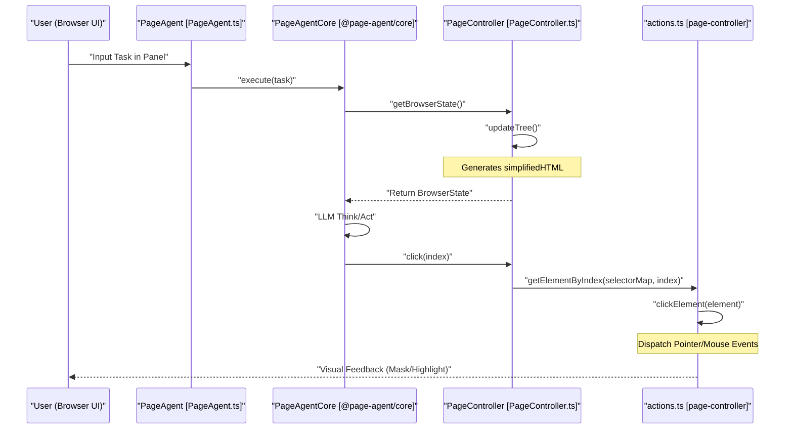
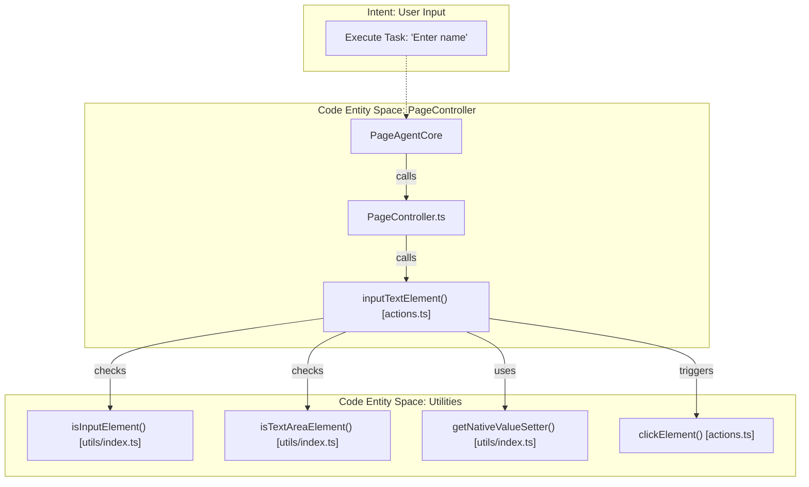

<!-- source: DeepWiki mcp.deepwiki.com · repo alibaba/page-agent · page 4.5 PageAgent Integration Class · fetched 2026-10-29 -->

# PageAgent Integration Class

<details>
<summary>Relevant source files</summary>

The following files were used as context for generating this wiki page:

- [packages/llms/package.json](packages/llms/package.json)
- [packages/page-agent/package.json](packages/page-agent/package.json)
- [packages/page-agent/src/PageAgent.ts](packages/page-agent/src/PageAgent.ts)
- [packages/page-controller/src/PageController.ts](packages/page-controller/src/PageController.ts)
- [packages/page-controller/src/actions.ts](packages/page-controller/src/actions.ts)
- [packages/page-controller/src/utils/index.ts](packages/page-controller/src/utils/index.ts)

</details>


The `PageAgent` class is the primary integration wrapper that combines the core agent logic from `PageAgentCore` with a built-in UI panel and automated `PageController` management. It is designed for "out-of-the-box" usage where a visible interaction panel and automatic DOM handling are required.

---

## Overview

While `PageAgentCore` provides the headless Re-act loop and tool execution logic, `PageAgent` extends this functionality by automatically instantiating a `PageController` for DOM operations and a `Panel` for user interaction. This class serves as the main entry point for the `page-agent` package, bundling multiple sub-packages into a single usable entity.

**Sources:** [packages/page-agent/src/PageAgent.ts:13-13](), [packages/page-agent/package.json:29-29]()

---

## Class Architecture

The `PageAgent` class acts as a coordinator between three major modules:
1. **Core Logic**: Inherited from `PageAgentCore` (from `@page-agent/core`).
2. **DOM Interaction**: Managed via an internal `PageController` (from `@page-agent/page-controller`).
3. **User Interface**: Managed via an internal `Panel` (from `@page-agent/ui`).

### Entity Relationship Diagram

```mermaid
classDiagram
    class PageAgent {
        +Panel panel
        +constructor(config: PageAgentConfig)
    }
    
    class PageAgentCore {
        +PageController pageController
        +execute(task: string)
        +stop()
        +dispose()
    }
    
    class PageController {
        -FlatDomTree flatTree
        -Map selectorMap
        +getBrowserState()
        +updateTree()
    }
    
    class Panel {
        +constructor(agent, config)
    }

    PageAgent --|> PageAgentCore : "extends [PageAgent.ts:13]"
    PageAgent *-- "Panel" : "composes [PageAgent.ts:14]"
    PageAgentCore *-- "PageController" : "uses [PageAgent.ts:22]"
```

**Sources:** [packages/page-agent/src/PageAgent.ts:13-29](), [packages/page-controller/src/PageController.ts:58-86]()

---

## Configuration

`PageAgent` uses a composite configuration type `PageAgentConfig` which merges settings from all underlying systems to provide a unified initialization interface.

| Config Source | Description |
| :--- | :--- |
| `AgentConfig` | LLM settings (`model`, `apiKey`, `baseURL`), `maxSteps`, and `language`. |
| `PageControllerConfig` | DOM settings like `enableMask` and `viewportExpansion`. |
| `PanelConfig` | UI settings like `promptForNextTask` (excluding redundant `language`). |

**Sources:** [packages/page-agent/src/PageAgent.ts:11-11](), [packages/page-controller/src/PageController.ts:26-29]()

---

## Implementation Details

### Constructor Logic
When initialized, the `PageAgent` performs the following sequence:
1. **PageController Setup**: It creates a new `PageController` instance. It defaults `enableMask` to `true` [packages/page-agent/src/PageAgent.ts:19-19](), which triggers the initialization of the `SimulatorMask` to block manual user interference during automation [packages/page-controller/src/PageController.ts:96-96]().
2. **Super Initialization**: It calls the `PageAgentCore` constructor, injecting the `pageController` into the core logic [packages/page-agent/src/PageAgent.ts:22-22]().
3. **UI Initialization**: It instantiates the `Panel`, passing `this` (the agent instance) so the UI can subscribe to agent lifecycle events [packages/page-agent/src/PageAgent.ts:24-27]().

```typescript
// packages/page-agent/src/PageAgent.ts:16-28
constructor(config: PageAgentConfig) {
    const pageController = new PageController({
        ...config,
        enableMask: config.enableMask ?? true,
    })

    super({ ...config, pageController })

    this.panel = new Panel(this, {
        language: config.language,
        promptForNextTask: config.promptForNextTask,
    })
}
```

### UI Integration (The Panel)
The `panel` property allows developers to programmatically access the agent's UI overlay. The `Panel` class from `@page-agent/ui` is specifically designed to consume the state and events from a `PageAgentCore` (or its derivative).

**Sources:** [packages/page-agent/src/PageAgent.ts:14-14](), [packages/page-agent/src/PageAgent.ts:24-27]()

---

## Comparison: PageAgent vs. PageAgentCore

Choosing between the integration class and the core class depends on the deployment environment and UI requirements.

| Feature | `PageAgent` | `PageAgentCore` |
| :--- | :--- | :--- |
| **UI Panel** | Built-in (`Panel` class) | None (must build custom UI) |
| **PageController** | Automatically instantiated | Must be provided in constructor |
| **Target Use Case** | Browser-side Copilots, Bookmarklets | Headless tests, Custom Agent Apps |
| **Package** | `page-agent` | `@page-agent/core` |

**Sources:** [packages/page-agent/src/PageAgent.ts:13-29](), [packages/page-agent/package.json:56-60]()

---

## Data Flow: Natural Language to Code Execution

This diagram illustrates how a natural language request flows through the `PageAgent` integration into the specific code entities of the sub-packages.

### Task Execution Flow



**Sources:** [packages/page-agent/src/PageAgent.ts:13-29](), [packages/page-controller/src/PageController.ts:129-165](), [packages/page-controller/src/actions.ts:64-126]()

### Input and Selection Logic

The following diagram bridges the high-level intent of "filling a form" to the internal utility functions that handle specific HTML element types.



**Sources:** [packages/page-controller/src/actions.ts:131-213](), [packages/page-controller/src/utils/index.ts:9-15](), [packages/page-controller/src/utils/index.ts:39-43]()

---

