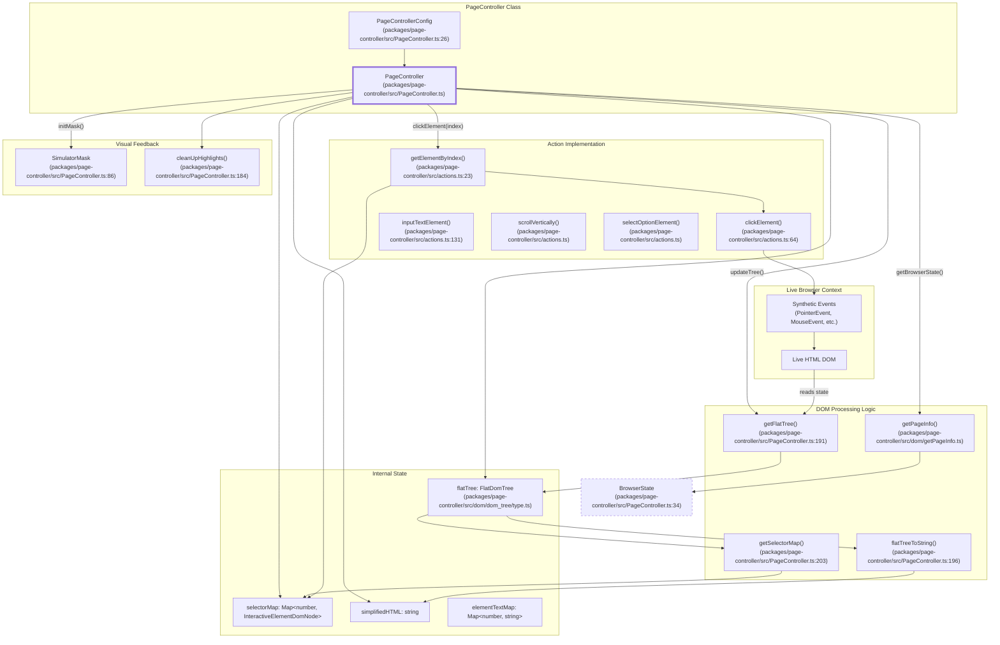
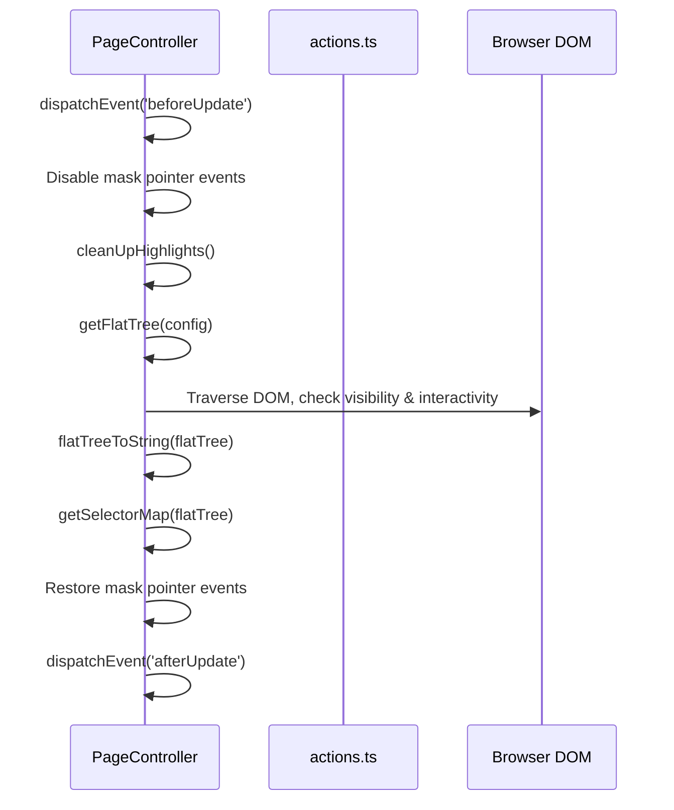
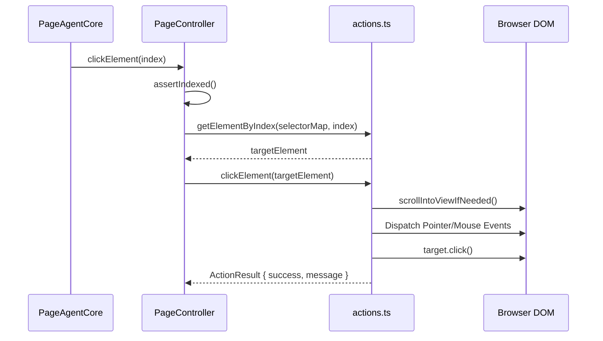

<!-- source: DeepWiki mcp.deepwiki.com · repo alibaba/page-agent · page 5 Page Controller System · fetched 2026-10-29 -->

# Page Controller System

<details>
<summary>Relevant source files</summary>

The following files were used as context for generating this wiki page:

- [packages/page-agent/src/PageAgent.ts](packages/page-agent/src/PageAgent.ts)
- [packages/page-controller/package.json](packages/page-controller/package.json)
- [packages/page-controller/src/PageController.ts](packages/page-controller/src/PageController.ts)
- [packages/page-controller/src/actions.ts](packages/page-controller/src/actions.ts)
- [packages/page-controller/src/utils/index.ts](packages/page-controller/src/utils/index.ts)
- [packages/ui/package.json](packages/ui/package.json)

</details>


The Page Controller System is the DOM interaction layer of PageAgent, responsible for extracting page state, managing element interactions, and providing visual feedback during automation. This package (`@page-agent/page-controller`) operates independently of LLM logic and is designed to be testable in isolation [packages/page-controller/src/PageController.ts:5-8]().

For information about how the core agent uses PageController, see [Core Agent System](#4). For details on custom tool integration with PageController actions, see [Custom Tools System](#9).

## Purpose and Scope

The PageController package provides:
- **DOM State Extraction**: Converts the live DOM into a structured `FlatDomTree` representation [packages/page-controller/src/PageController.ts:191-194]().
- **Simplified HTML Generation**: Produces LLM-consumable HTML with indexed interactive elements [packages/page-controller/src/PageController.ts:196-200]().
- **Action Execution**: Performs browser actions (click, input, scroll) via synthetic events and high-level interaction helpers [packages/page-controller/src/PageController.ts:9-16]().
- **Visual Feedback**: Highlights elements and overlays a blocking mask during automation [packages/page-controller/src/PageController.ts:85-87]().
- **Browser State API**: Generates structured `BrowserState` objects for agent consumption [packages/page-controller/src/PageController.ts:34-43]().

This document covers the overall architecture and data flow. For implementation details, see:
- [PageController Architecture](#5.1) — Class structure, lifecycle, and initialization.
- [DOM Tree Processing](#5.2) — `FlatDomTree` structure and simplified HTML generation logic.
- [Action Executors](#5.3) — DOM action methods and event synthesis.
- [Visual Feedback System](#5.4) — Element highlighting and `SimulatorMask` overlay.

## System Architecture

The following diagram maps high-level system components to their corresponding code entities within the `page-controller` package.

**PageController Data Flow and Code Mapping**



Sources: [packages/page-controller/src/PageController.ts:1-220](), [packages/page-controller/src/actions.ts:1-131]()

## Core Data Structures

### FlatDomTree

The `FlatDomTree` is the internal representation of the DOM, extracted by the `getFlatTree` function [packages/page-controller/src/PageController.ts:191](). It provides a flattened structure where nodes are indexed and categorized by type.

**FlatDomTree Node Characteristics**

| Property | TextDomNode | ElementDomNode | InteractiveElementDomNode |
|----------|-------------|----------------|---------------------------|
| `type` | `'TEXT_NODE'` | - | - |
| `tagName` | - | ✓ | ✓ |
| `text` | ✓ | - | - |
| `children` | - | ✓ | ✓ |
| `isVisible` | ✓ | ✓ | ✓ |
| `isInteractive` | - | `false` | `true` |
| `highlightIndex` | - | optional | required |
| `ref` | - | - | ✓ (HTMLElement) |

Sources: [packages/page-controller/src/dom/dom_tree/type.ts:1-52](), [packages/page-controller/src/PageController.ts:18-22]()

### BrowserState

The `BrowserState` interface is the structured output consumed by the LLM. It packages page metadata with the simplified HTML string [packages/page-controller/src/PageController.ts:34-43]().

```typescript
export interface BrowserState {
  url: string
  title: string
  header: string    // Viewport info + scroll position hints
  content: string   // Simplified HTML of interactive elements
  footer: string    // Scroll position hints (e.g., "[End of page]")
}
```

Sources: [packages/page-controller/src/PageController.ts:34-43](), [packages/page-controller/src/PageController.ts:129-165]()

## Key Workflows

### 1. DOM Tree Update Workflow

The `updateTree()` method is the primary mechanism for refreshing the page state. It triggers DOM extraction, element indexing, and simplified HTML generation while managing the visual mask state [packages/page-controller/src/PageController.ts:174-219]().



Sources: [packages/page-controller/src/PageController.ts:174-219](), [packages/page-controller/src/actions.ts:1-16]()

### 2. Action Execution Workflow

Actions like `clickElement` or `inputText` use the `selectorMap` to resolve numeric indices back to live `HTMLElement` references before invoking synthetic interaction logic [packages/page-controller/src/actions.ts:23-42]().



Sources: [packages/page-controller/src/PageController.ts:235-260](), [packages/page-controller/src/actions.ts:23-126]()

## Configuration Options

The `PageController` is configured via `PageControllerConfig`, which controls DOM extraction behavior and visual feedback [packages/page-controller/src/PageController.ts:26-29]().

| Option | Type | Default | Description |
|--------|------|---------|-------------|
| `enableMask` | `boolean` | `false` | Enable visual mask overlay to block user interaction [packages/page-controller/src/PageController.ts:28](). |
| `viewportExpansion` | `number` | `-1` | Pixels to expand extraction beyond viewport. `-1` means full page [packages/page-controller/src/PageController.ts:133-147](). |
| `interactiveBlacklist` | `string[]` | `[]` | Selectors to exclude from interactive detection [packages/page-controller/src/PageController.ts:186-189](). |
| `includeAttributes` | `string[]` | [...] | Extra HTML attributes to include in simplified HTML [packages/page-controller/src/PageController.ts:198](). |
| `keepSemanticTags` | `boolean` | `false` | Preserve tags like `nav`, `header` even if not interactive [packages/page-controller/src/PageController.ts:199](). |

Sources: [packages/page-controller/src/PageController.ts:26-29](), [packages/page-controller/src/PageController.ts:180-200]()

## Remote Control Support

The Page Controller System is designed to support remote execution, particularly for the Chrome Extension. The `PageController` instance in the content script provides the actual implementation, while the agent (potentially in a background script) triggers these actions via a proxy mechanism. The `PageController` class itself uses `EventTarget` to allow external listeners to react to lifecycle events like `beforeUpdate` and `afterUpdate` [packages/page-controller/src/PageController.ts:58-97]().

Sources: [packages/page-controller/src/PageController.ts:58-97](), [packages/page-agent/src/PageAgent.ts:13-29]()

---

