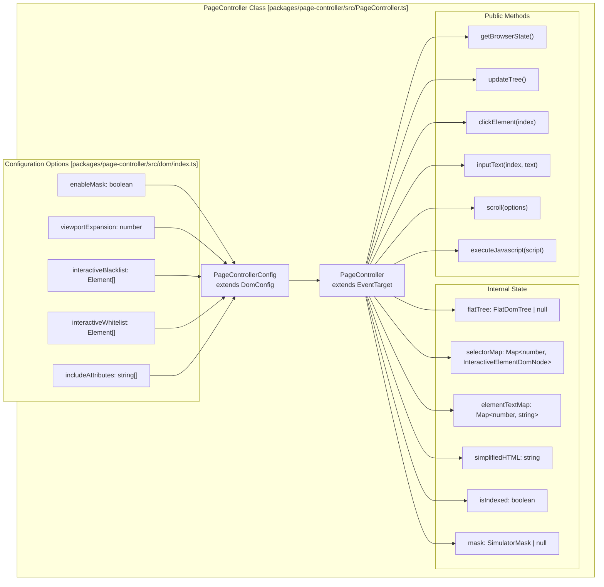
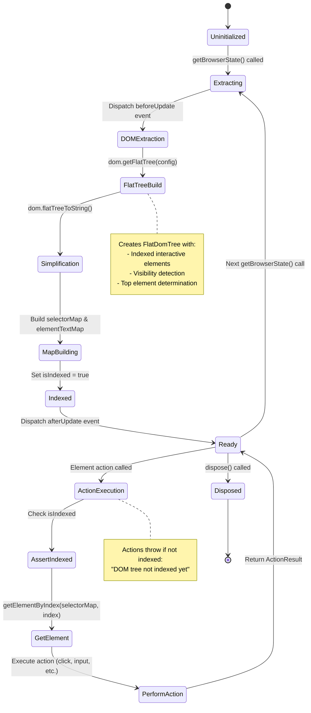
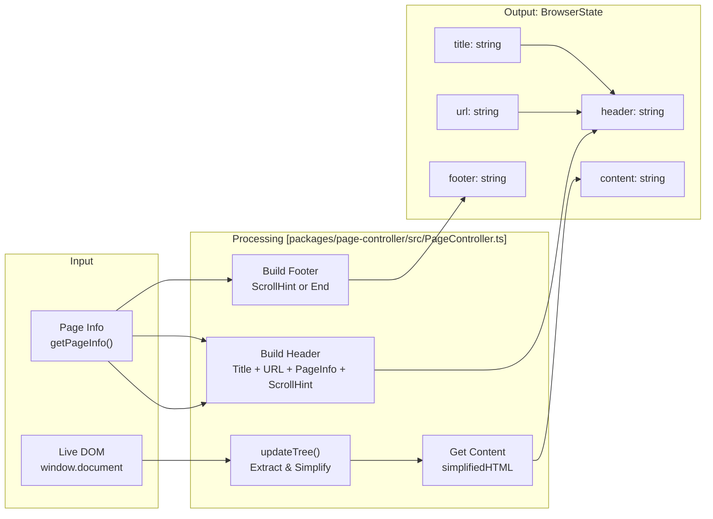
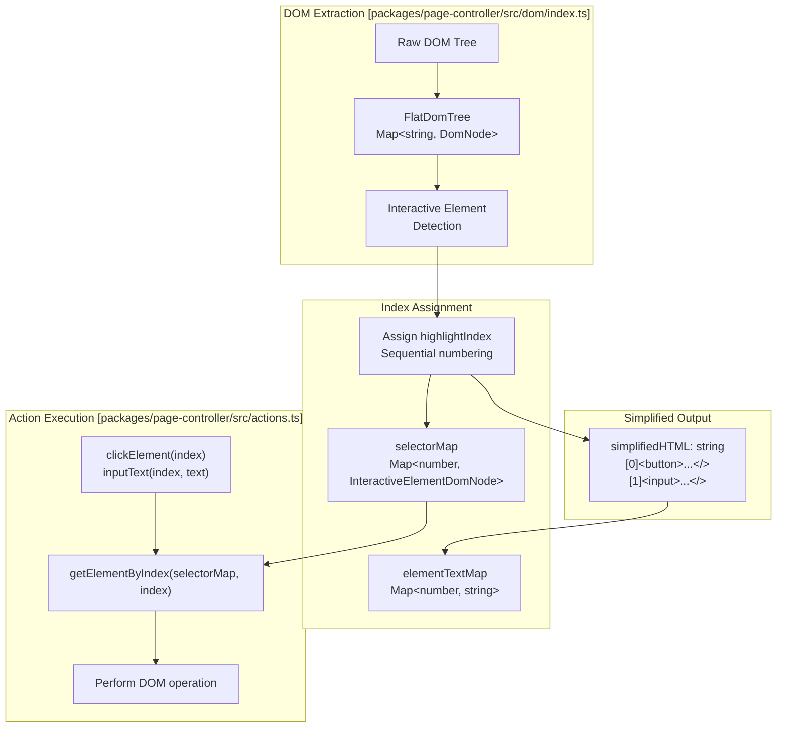
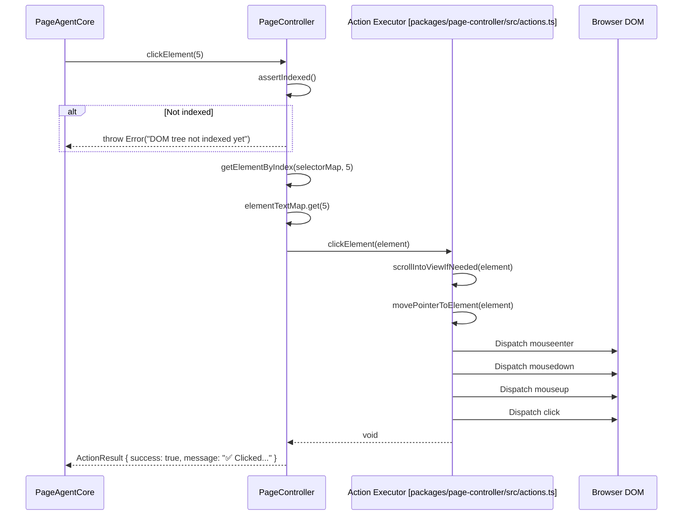
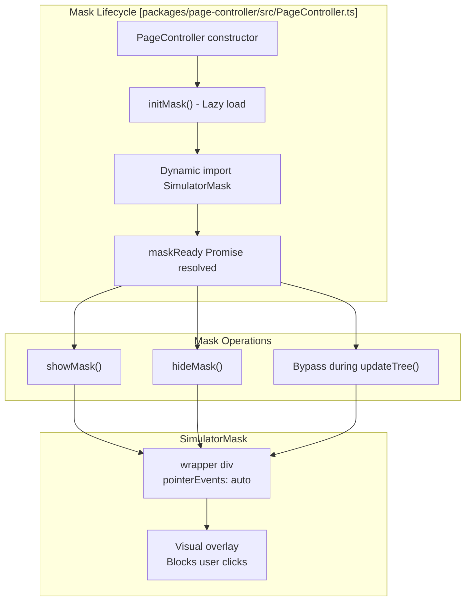

<!-- source: DeepWiki mcp.deepwiki.com · repo alibaba/page-agent · page 5.1 PageController Architecture · fetched 2026-10-29 -->

# PageController Architecture

<details>
<summary>Relevant source files</summary>

The following files were used as context for generating this wiki page:

- [packages/extension/src/agent/RemotePageController.content.ts](packages/extension/src/agent/RemotePageController.content.ts)
- [packages/page-agent/src/PageAgent.ts](packages/page-agent/src/PageAgent.ts)
- [packages/page-controller/src/PageController.ts](packages/page-controller/src/PageController.ts)
- [packages/page-controller/src/actions.ts](packages/page-controller/src/actions.ts)
- [packages/page-controller/src/dom/index.ts](packages/page-controller/src/dom/index.ts)
- [packages/page-controller/src/utils/index.ts](packages/page-controller/src/utils/index.ts)
- [packages/website/src/pages/docs/advanced/page-controller/page.tsx](packages/website/src/pages/docs/advanced/page-controller/page.tsx)

</details>


The PageController is the DOM interaction layer of the PageAgent system. It provides a clean abstraction for extracting browser state, indexing interactive elements, and executing DOM actions. This document explains the PageController's architecture, state management, and integration points with the core agent system.

For information about the action executors (click, scroll, input methods), see [5.3 Action Executors](). For visual feedback implementation details, see [5.4 Visual Feedback System](). For DOM tree processing internals, see [5.2 DOM Tree Processing]().

## Purpose and Responsibilities

The `PageController` class serves three primary functions:

1.  **State Extraction**: Converts the live DOM into a structured `BrowserState` object that LLMs can understand [packages/page-controller/src/PageController.ts:34-43]().
2.  **Element Indexing**: Maintains a mapping between numeric indices and interactive elements for deterministic action targeting [packages/page-controller/src/PageController.ts:68-71]().
3.  **Action Execution**: Provides async methods for clicking, typing, scrolling, and other DOM manipulations [packages/page-controller/src/PageController.ts:9-16]().

The PageController is designed to be independent of LLM logic and can be tested in isolation. All public methods are async to support potential remote calling scenarios, such as browser extension content script communication [packages/page-controller/src/PageController.ts:5-8]().

**Sources**: [packages/page-controller/src/PageController.ts:1-72]()

## Class Structure and Configuration

Title: PageController Entity Architecture


**Sources**: [packages/page-controller/src/PageController.ts:26-96](), [packages/page-controller/src/dom/index.ts:24-37]()

### Configuration Interface

The `PageControllerConfig` interface extends `DomConfig` and controls DOM extraction behavior:

| Property | Type | Default | Description |
| :--- | :--- | :--- | :--- |
| `enableMask` | `boolean` | `false` | Enable visual overlay to block user interaction [packages/page-controller/src/PageController.ts:28]() |
| `viewportExpansion` | `number` | `-1` | `-1` = full page, `0` = viewport only, `N` = expand by N pixels [packages/page-controller/src/dom/index.ts:18-22]() |
| `interactiveBlacklist` | `Element[]` | `[]` | Elements to exclude from interactive detection [packages/page-controller/src/dom/index.ts:26]() |
| `interactiveWhitelist` | `Element[]` | `[]` | Elements to force include as interactive [packages/page-controller/src/dom/index.ts:27]() |
| `includeAttributes` | `string[]` | See defaults | HTML attributes to include in simplified output [packages/page-controller/src/dom/index.ts:28]() |
| `highlightOpacity` | `number` | `0.0` | Opacity of element highlight overlays [packages/page-controller/src/dom/index.ts:29]() |
| `highlightLabelOpacity` | `number` | `0.1` | Opacity of index labels [packages/page-controller/src/dom/index.ts:30]() |

**Sources**: [packages/page-controller/src/PageController.ts:26-29](), [packages/page-controller/src/dom/index.ts:18-37]()

## State Management Workflow

The PageController maintains internal state that represents the current DOM structure. The state is updated on-demand and cached until the next update.

Title: PageController State Lifecycle


**Sources**: [packages/page-controller/src/PageController.ts:129-165](), [packages/page-controller/src/PageController.ts:174-219](), [packages/page-controller/src/PageController.ts:235-239]()

### State Update Process

The `updateTree()` method is the core state synchronization mechanism:

1.  **Dispatch `beforeUpdate` event**: Notify listeners that extraction is starting [packages/page-controller/src/PageController.ts:175]().
2.  **Bypass mask**: Temporarily set `pointerEvents = 'none'` to allow DOM access [packages/page-controller/src/PageController.ts:180-182]().
3.  **Clean highlights**: Remove any existing element overlays from previous updates [packages/page-controller/src/PageController.ts:184]().
4.  **Extract DOM**: Call `dom.getFlatTree()` to build the flat tree structure [packages/page-controller/src/PageController.ts:191-194]().
5.  **Generate simplified HTML**: Convert tree to string representation via `dom.flatTreeToString()` [packages/page-controller/src/PageController.ts:196-200]().
6.  **Build maps**: Create `selectorMap` (index → element) and `elementTextMap` (index → description) [packages/page-controller/src/PageController.ts:202-206]().
7.  **Mark indexed**: Set `isIndexed = true` to allow element actions [packages/page-controller/src/PageController.ts:209]().
8.  **Restore mask**: Re-enable mask blocking with `pointerEvents = 'auto'` [packages/page-controller/src/PageController.ts:212-214]().
9.  **Dispatch `afterUpdate` event**: Notify listeners that extraction completed [packages/page-controller/src/PageController.ts:216]().

**Sources**: [packages/page-controller/src/PageController.ts:174-219]()

## BrowserState Generation

The `getBrowserState()` method packages the DOM state into a structured format optimized for LLM consumption. It automatically triggers `updateTree()` to ensure freshness [packages/page-controller/src/PageController.ts:135]().

Title: BrowserState Construction Data Flow


### BrowserState Structure

```typescript
export interface BrowserState {
	url: string
	title: string
	header: string
	content: string
	footer: string
}
```

**Example header format**:
```
Current Page: [Example Site](https://example.com)
Page info: 1920x1080px viewport, 1920x3240px total page size, 0.5 pages above, 1.5 pages below, 3.0 total pages, at 25% of page

Interactive elements from top layer of the current page inside the viewport:

... 540 pixels above (0.5 pages) - scroll to see more ...
```

**Example content format**:
```
[0]<a aria-label="Home" />
[1]<button type="submit">Login</button>
[2]<input type="email" placeholder="Email" />
    [3]<input type="password" placeholder="Password" />
```

**Example footer format**:
```
... 1620 pixels below (1.5 pages) - scroll to see more ...
```

**Sources**: [packages/page-controller/src/PageController.ts:34-43](), [packages/page-controller/src/PageController.ts:129-165]()

## Element Indexing System

The PageController uses a numeric indexing system to enable deterministic element targeting. Instead of CSS selectors (which can become stale), each interactive element is assigned an index during tree extraction.

Title: Element Indexing and Lookup Logic


### SelectorMap Construction

The `selectorMap` is built by iterating over all nodes in the `FlatDomTree` and collecting those marked as interactive with an assigned `highlightIndex` via `dom.getSelectorMap` [packages/page-controller/src/PageController.ts:202-203]().

### ElementTextMap Construction

The `elementTextMap` provides human-readable descriptions for each indexed element by parsing the simplified HTML via `dom.getElementTextMap` [packages/page-controller/src/PageController.ts:205-206]().

This map is used to generate informative success messages like:
`✅ Clicked element ([5]<button type="submit">Login</button>).`

**Sources**: [packages/page-controller/src/PageController.ts:191-206](), [packages/page-controller/src/dom/index.ts:193-207]()

## Action Execution Flow

All action methods follow a consistent pattern:

1.  **Assert indexed**: Verify `updateTree()` has been called at least once [packages/page-controller/src/PageController.ts:235-239]().
2.  **Lookup element**: Retrieve the DOM element from `selectorMap` using the index [packages/page-controller/src/PageController.ts:241-255]().
3.  **Execute action**: Call the appropriate action executor from `actions.ts` [packages/page-controller/src/actions.ts:1-16]().
4.  **Return result**: Provide structured `ActionResult` with success status and message.

Title: Action Execution Sequence


**Sources**: [packages/page-controller/src/PageController.ts:235-263](), [packages/page-controller/src/actions.ts:1-16]()

## Mask System Integration

When `enableMask` is configured, PageController manages a `SimulatorMask` overlay that blocks user interaction during automation [packages/page-controller/src/PageController.ts:96]().

Title: SimulatorMask Lifecycle and Control


The mask is dynamically imported to avoid loading CSS in Node.js environments [packages/page-controller/src/PageController.ts:102-108]().

**Bypass mechanism**: During `updateTree()`, the mask's `pointerEvents` is temporarily set to `'none'` to allow DOM queries [packages/page-controller/src/PageController.ts:180-182](), then restored to `'auto'` to resume blocking [packages/page-controller/src/PageController.ts:212-214]().

**Sources**: [packages/page-controller/src/PageController.ts:85-108](), [packages/page-controller/src/PageController.ts:179-215]()

## Event System

PageController extends `EventTarget` and emits lifecycle events [packages/page-controller/src/PageController.ts:58]():

| Event | When | Use Case |
| :--- | :--- | :--- |
| `beforeUpdate` | Before DOM tree extraction starts | Prepare for state changes [packages/page-controller/src/PageController.ts:175]() |
| `afterUpdate` | After DOM tree extraction completes | React to new state [packages/page-controller/src/PageController.ts:216]() |

**Sources**: [packages/page-controller/src/PageController.ts:54-58](), [packages/page-controller/src/PageController.ts:175-216]()

## Relationship with Extension

In the browser extension, the `RemotePageController` initializes a `PageController` within the content script context [packages/extension/src/agent/RemotePageController.content.ts:6-28](). It listens for messages from the background script and proxies them to the local `PageController` instance [packages/extension/src/agent/RemotePageController.content.ts:60-104]().

**Sources**: [packages/extension/src/agent/RemotePageController.content.ts:1-136](), [packages/page-controller/src/PageController.ts:1-8]()

---

