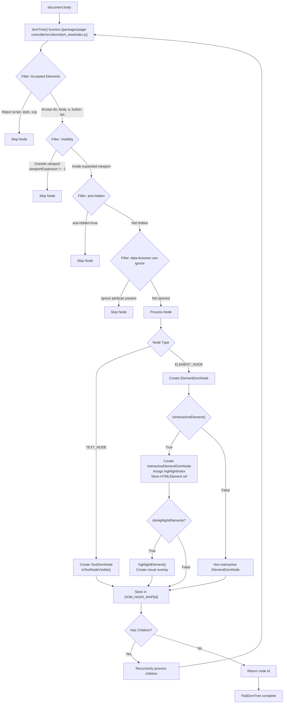
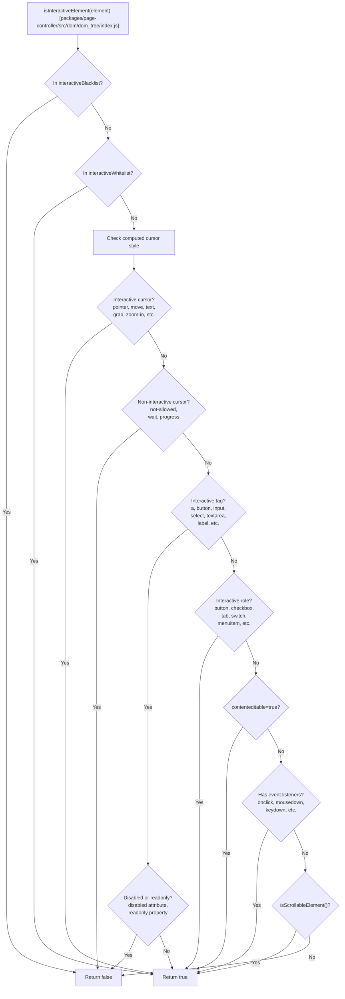
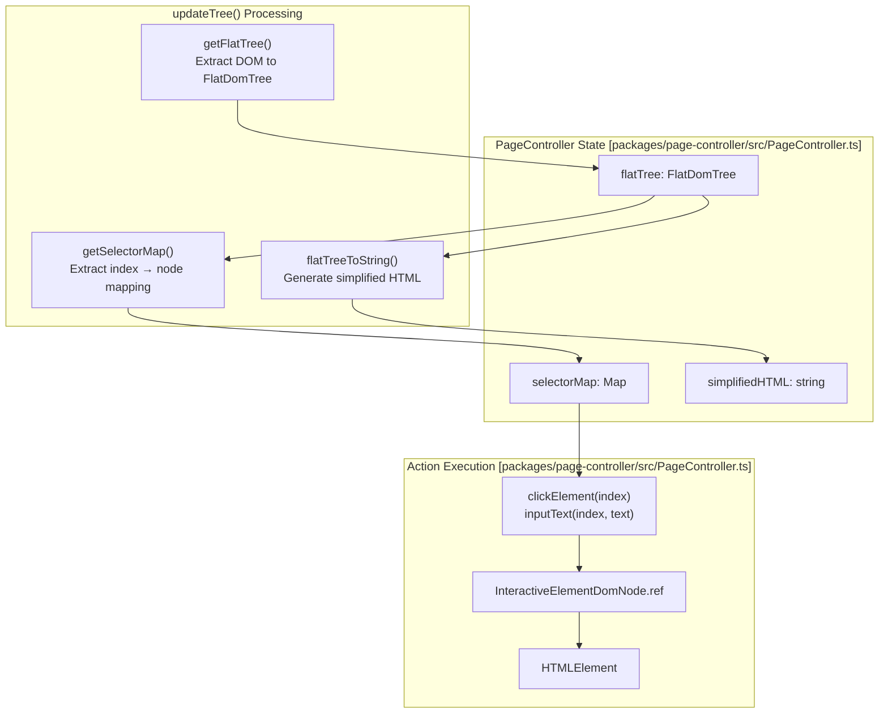

<!-- source: DeepWiki mcp.deepwiki.com · repo alibaba/page-agent · page 5.2 DOM Tree Processing · fetched 2026-10-29 -->

# DOM Tree Processing

<details>
<summary>Relevant source files</summary>

The following files were used as context for generating this wiki page:

- [packages/extension/src/agent/RemotePageController.content.ts](packages/extension/src/agent/RemotePageController.content.ts)
- [packages/page-controller/src/dom/dom_tree/index.js](packages/page-controller/src/dom/dom_tree/index.js)
- [packages/page-controller/src/dom/dom_tree/type.ts](packages/page-controller/src/dom/dom_tree/type.ts)
- [packages/page-controller/src/dom/getPageInfo.ts](packages/page-controller/src/dom/getPageInfo.ts)
- [packages/page-controller/src/dom/index.ts](packages/page-controller/src/dom/index.ts)
- [packages/page-controller/src/mask/SimulatorMask.ts](packages/page-controller/src/mask/SimulatorMask.ts)
- [packages/website/src/pages/docs/advanced/page-controller/page.tsx](packages/website/src/pages/docs/advanced/page-controller/page.tsx)

</details>


This document explains how the `PageController` extracts and processes the browser's DOM tree into a structured format suitable for LLM consumption. It details the `FlatDomTree` structure, interactive element detection heuristics, and the pipeline for generating simplified HTML.

The DOM tree processing system converts a live HTML document into a `FlatDomTree` structure, identifies interactive elements, assigns numeric indices to them, and generates simplified HTML that an LLM can use to understand page structure and select elements for interaction. [packages/page-controller/src/PageController.ts:13-18]()

## FlatDomTree Structure

The `FlatDomTree` is the internal representation of the DOM tree used by `PageController`. Unlike the browser's hierarchical DOM structure, it uses a flat hash map indexed by string IDs, with parent-child relationships maintained through ID references. [packages/page-controller/src/dom/dom_tree/type.ts:4-7]()

**FlatDomTree Data Model**

```mermaid
graph TB
    subgraph "FlatDomTree Interface [packages/page-controller/src/dom/dom_tree/type.ts]"
        FDT["FlatDomTree"]
        ROOTID["rootId: string"]
        MAP["map: Record<string, DomNode>"]
    end
    
    subgraph "DomNode Union Type"
        TEXTNODE["TextDomNode"]
        ELEMNODE["ElementDomNode"]
        INTERNODE["InteractiveElementDomNode"]
    end
    
    subgraph "TextDomNode Fields"
        TN_TYPE["type: 'TEXT_NODE'"]
        TN_TEXT["text: string"]
        TN_VIS["isVisible: boolean"]
    end
    
    subgraph "ElementDomNode Fields"
        EN_TAG["tagName: string"]
        EN_ATTRS["attributes?: Record<string, string>"]
        EN_CHILDREN["children?: string[]"]
        EN_VIS["isVisible?: boolean"]
        EN_TOP["isTopElement?: boolean"]
        EN_INTER["isInteractive?: false"]
        EN_EXTRA["extra?: Record<string, any>"]
    end
    
    subgraph "InteractiveElementDomNode Fields"
        IN_TAG["tagName: string"]
        IN_INTER["isInteractive: true"]
        IN_IDX["highlightIndex: number"]
        IN_REF["ref: HTMLElement"]
        IN_NEW["isNew?: boolean"]
    end
    
    FDT --> ROOTID
    FDT --> MAP
    MAP --> TEXTNODE
    MAP --> ELEMNODE
    MAP --> INTERNODE
    
    TEXTNODE --> TN_TYPE
    TEXTNODE --> TN_TEXT
    TEXTNODE --> TN_VIS
    
    ELEMNODE --> EN_TAG
    ELEMNODE --> EN_ATTRS
    ELEMNODE --> EN_CHILDREN
    ELEMNODE --> EN_VIS
    ELEMNODE --> EN_TOP
    ELEMNODE --> EN_INTER
    ELEMNODE --> EN_EXTRA
    
    INTERNODE --> IN_TAG
    INTERNODE --> IN_INTER
    INTERNODE --> IN_IDX
    INTERNODE --> IN_REF
    INTERNODE --> IN_NEW
```


Sources: [packages/page-controller/src/dom/dom_tree/type.ts:4-51]()

### Node Types

The system distinguishes three types of nodes within the flat map:

| Node Type | Purpose | Key Fields |
|-----------|---------|------------|
| `TextDomNode` | Visible text content | `text`, `isVisible` [packages/page-controller/src/dom/dom_tree/type.ts:11-17]() |
| `ElementDomNode` | Non-interactive HTML elements | `tagName`, `attributes`, `children`, `isTopElement` [packages/page-controller/src/dom/dom_tree/type.ts:19-33]() |
| `InteractiveElementDomNode` | Elements that can be clicked/typed/scrolled | `highlightIndex`, `ref`, `isNew` [packages/page-controller/src/dom/dom_tree/type.ts:35-51]() |

**InteractiveElementDomNode** is critical as it represents elements the agent can act upon. Each gets a unique `highlightIndex` (numeric ID) and maintains a direct reference (`ref`) to the live `HTMLElement`. [packages/page-controller/src/dom/dom_tree/type.ts:44-48]()

## DOM Tree Extraction Pipeline

The extraction process transforms the live browser DOM into a `FlatDomTree` through filtering and enrichment stages. It utilizes a caching mechanism for bounding rects and computed styles to improve performance during tree construction. [packages/page-controller/src/dom/dom_tree/index.js:61-70]()

**DOM Extraction Flow**


Sources: [packages/page-controller/src/dom/dom_tree/index.js:24-49](), [packages/page-controller/src/dom/index.ts:57-111]()

### Configuration Parameters

The extraction process is configured via `DomConfig`:

```typescript
export interface DomConfig {
	viewportExpansion?: number           // -1 = full page, 0 = viewport only
	interactiveBlacklist?: (Element | (() => Element))[]
	interactiveWhitelist?: (Element | (() => Element))[]
	includeAttributes?: string[]         // Extra attributes for simplified HTML
	highlightOpacity?: number
	highlightLabelOpacity?: number
	keepSemanticTags?: boolean           // Preserve nav, header, footer, etc.
}
```
Sources: [packages/page-controller/src/dom/index.ts:24-37]()

### Viewport Expansion

The `viewportExpansion` parameter controls the extraction boundary:
- **`-1`**: Extract the entire page (no viewport restriction). [packages/page-controller/src/dom/index.ts:10-18]()
- **`0`**: Extract only elements within the current viewport. [packages/page-controller/src/dom/index.ts:12-12]()
- **Positive value**: Expand viewport by that many pixels. [packages/page-controller/src/dom/index.ts:13-13]()

This affects `isTopElement` detection as it depends on `elementFromPoint`, which returns `null` outside the viewport. [packages/page-controller/src/dom/index.ts:15-16]()

## Interactive Element Detection

Interactive elements are those actionable by the agent. Detection combines heuristics like tag names, ARIA roles, event listeners, and computed styles. [packages/page-controller/src/dom/dom_tree/index.js:9-21]()

**Interactive Element Detection Logic**


Sources: [packages/page-controller/src/dom/dom_tree/index.js:35-37](), [packages/page-controller/src/dom/index.ts:60-76]()

### Scrollable Element Detection

Elements with scrollable overflow are considered interactive. The detection logic checks for overflow properties and ensures the element actually has scrollable content. [packages/page-controller/src/dom/dom_tree/index.js:16-16]()

## Simplified HTML Generation

`flatTreeToString()` converts the `FlatDomTree` into a human-readable format with numeric indices. [packages/page-controller/src/dom/index.ts:193-197]()

### Output Format

The output uses a specific syntax to help the LLM:
- **Indexed elements**: `[N]<tag ...>text />`. [packages/page-controller/src/dom/index.ts:173-189]()
- **New elements**: Elements detected for the first time are marked as `isNew` using a `WeakMap` cache. [packages/page-controller/src/dom/index.ts:55-56](), [packages/page-controller/src/dom/index.ts:97-108]()
- **Semantic tags**: Optional preservation of tags like `nav`, `header`, `footer`, `aside`, and `dialog` even if not interactive. [packages/page-controller/src/dom/index.ts:40-50]()

### Attribute Filtering

To reduce token usage, the system filters attributes:
1. **Default Whitelist**: Includes `title`, `type`, `checked`, `role`, `placeholder`, `aria-label`, `id`, `for`, `contenteditable`, etc. [packages/page-controller/src/dom/index.ts:198-227]()
2. **Wildcard Support**: Supports glob patterns (e.g., `aria-*`) to include related groups of attributes. [packages/page-controller/src/dom/index.ts:113-123](), [packages/page-controller/src/dom/index.ts:131-138]()

## Element Indexing and Maps

The `PageController` maintains internal state to bridge the simplified HTML indices back to live DOM elements. [packages/website/src/pages/docs/advanced/page-controller/page.tsx:160-165]()

**Element Indexing System**


Sources: [packages/website/src/pages/docs/advanced/page-controller/page.tsx:134-146](), [packages/page-controller/src/dom/dom_tree/type.ts:44-48]()

## Visual Feedback and Masking

The `SimulatorMask` provides visual feedback and prevents user interference during automation. [packages/page-controller/src/mask/SimulatorMask.ts:8-10]()

- **Event Blocking**: Captures and stops propagation of `click`, `mousedown`, `wheel`, and `keydown` events to prevent user interaction while the agent is active. [packages/page-controller/src/mask/SimulatorMask.ts:43-71]()
- **AI Cursor**: Renders a synthetic cursor that moves and performs click animations based on global events like `PageAgent::MovePointerTo` and `PageAgent::ClickPointer`. [packages/page-controller/src/mask/SimulatorMask.ts:85-102]()
- **Dark Mode Support**: Automatically detects page theme to adjust mask appearance. [packages/page-controller/src/mask/SimulatorMask.ts:32-33]()

Sources: [packages/page-controller/src/mask/SimulatorMask.ts:1-216]()

---

