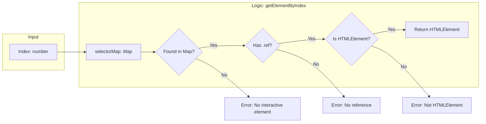

<!-- source: DeepWiki mcp.deepwiki.com · repo alibaba/page-agent · page 5.3 Action Executors · fetched 2026-10-29 -->

# Action Executors

<details>
<summary>Relevant source files</summary>

The following files were used as context for generating this wiki page:

- [packages/page-agent/src/PageAgent.ts](packages/page-agent/src/PageAgent.ts)
- [packages/page-controller/src/PageController.ts](packages/page-controller/src/PageController.ts)
- [packages/page-controller/src/actions.ts](packages/page-controller/src/actions.ts)
- [packages/page-controller/src/utils/index.ts](packages/page-controller/src/utils/index.ts)

</details>


## Purpose and Scope

Action Executors are the low-level DOM manipulation functions within the `PageController` that translate high-level agent commands into precise browser interactions. These functions simulate realistic user behavior by dispatching synthetic events in the correct sequence to ensure compatibility with modern JavaScript frameworks like React, Vue, and Angular.

This page documents the action executor functions, their implementation details, and the event sequences they generate.

## Architecture Overview

Action executors operate on DOM elements retrieved from the `selectorMap` using numeric indices provided by the LLM. Each executor function performs three key steps: element retrieval, prerequisite actions (scrolling, focusing), and synthetic event dispatch.

### Action Execution Data Flow
The following diagram maps the flow from the `PageController` public API to the internal utility functions and native DOM events.

```mermaid
graph TD
    subgraph "Code Entity Space: PageController"
        ["PageController.clickElement(index)"]
        ["PageController.inputText(index, text)"]
        ["PageController.scroll(options)"]
    end

    subgraph "Code Entity Space: actions.ts"
        ["getElementByIndex()"]
        ["clickElement(element)"]
        ["inputTextElement(element, text)"]
        ["scrollVertically()"]
        ["blurLastClickedElement()"]
    end

    subgraph "Code Entity Space: utils/index.ts"
        ["movePointerToElement()"]
        ["clickPointer()"]
        ["waitFor()"]
    end

    ["PageController.clickElement(index)"] --> ["getElementByIndex()"]
    ["PageController.inputText(index, text)"] --> ["getElementByIndex()"]
    ["PageController.clickElement(index)"] --> ["clickElement(element)"]
    ["PageController.inputText(index, text)"] --> ["inputTextElement(element, text)"]
    ["PageController.scroll(options)"] --> ["scrollVertically()"]

    ["clickElement(element)"] --> ["blurLastClickedElement()"]
    ["clickElement(element)"] --> ["movePointerToElement()"]
    ["clickElement(element)"] --> ["clickPointer()"]
    ["inputTextElement(element, text)"] --> ["clickElement(element)"]
    
    ["clickPointer()"] --> Dispatch["window.dispatchEvent<br/>('PageAgent::ClickPointer')"]
```
**Sources:** [packages/page-controller/src/actions.ts:23-42](), [packages/page-controller/src/utils/index.ts:58-81](), [packages/page-controller/src/PageController.ts:9-16]()

## Element Retrieval System

### getElementByIndex Function

The `getElementByIndex` function is the foundation of all action executors. It retrieves DOM elements from the `selectorMap` (a `Map<number, InteractiveElementDomNode>`) using the index provided by the LLM.



| Error Case | Condition | Message |
|------------|-----------|---------|
| Missing Element | `!selectorMap.get(index)` | `No interactive element found at index ${index}` |
| Missing Reference | `!interactiveNode.ref` | `Element at index ${index} does not have a reference` |
| Invalid Type | `!isHTMLElement(element)` | `Element at index ${index} is not an HTMLElement` |

**Sources:** [packages/page-controller/src/actions.ts:23-42](), [packages/page-controller/src/utils/index.ts:4-7]()

## Click Action Executor

### clickElement Function

The `clickElement` function simulates a complete mouse click interaction, including hover, focus, and the full event sequence required by modern frameworks. It follows the W3C Pointer Events and UI Events specification order.

**Event Sequence:**
1. `blurLastClickedElement()`: Clears previous focus and dispatches `pointerout`/`mouseleave` [packages/page-controller/src/actions.ts:46-55]().
2. `scrollIntoViewIfNeeded(element)`: Ensures the target is visible [packages/page-controller/src/actions.ts:69]().
3. `movePointerToElement()`: Dispatches `PageAgent::MovePointerTo` for visual feedback [packages/page-controller/src/utils/index.ts:58-68]().
4. `clickPointer()`: Dispatches `PageAgent::ClickPointer` [packages/page-controller/src/utils/index.ts:70-72]().
5. **Hover Phase**: Dispatches `pointerover` → `pointerenter` → `mouseover` → `mouseenter` [packages/page-controller/src/actions.ts:103-106]().
6. **Press Phase**: Dispatches `pointerdown` → `mousedown` [packages/page-controller/src/actions.ts:109-110]().
7. **Focus Phase**: Calls `element.focus({ preventScroll: true })` [packages/page-controller/src/actions.ts:115]().
8. **Release Phase**: Dispatches `pointerup` → `mouseup` [packages/page-controller/src/actions.ts:118-119]().
9. **Activation Phase**: Calls `target.click()` to trigger navigation or form submission [packages/page-controller/src/actions.ts:123]().

**Sources:** [packages/page-controller/src/actions.ts:64-126]()

## Input Action Executor

### inputTextElement Function

The `inputTextElement` function handles text input for three element types: `HTMLInputElement`, `HTMLTextAreaElement`, and `contenteditable` elements.

#### Contenteditable Strategy
For rich-text editors, PageAgent employs a two-plan strategy:
1. **Plan A (Synthetic Events)**: Dispatches `beforeinput` → DOM mutation (`innerText`) → `input`. This works for React and Quill [packages/page-controller/src/actions.ts:154-191]().
2. **Plan B (execCommand Fallback)**: If Plan A fails to update the text, it uses the (deprecated but widely supported) `execCommand('insertText')`. This integrates with the browser's native undo stack and works for Slate.js [packages/page-controller/src/actions.ts:196-215]().

#### Native Value Setters for Form Elements
For `<input>` and `<textarea>`, PageAgent bypasses framework-level property shadowing by using native setters obtained from the prototype via `getNativeValueSetter`. This ensures React's `onChange` listeners are correctly triggered.

```mermaid
graph TD
    subgraph "Code Entity: actions.ts"
        ["getNativeValueSetter()"]
        ["inputTextElement()"]
    end

    ["inputTextElement()"] -- "1. Click element" --> Click["clickElement()"]
    ["inputTextElement()"] -- "2. Get Native Setter" --> ["getNativeValueSetter()"]
    ["getNativeValueSetter()"] -- "3. Apply Value" --> Apply["setter.call(element, text)"]
    Apply -- "4. Dispatch Event" --> Dispatch["element.dispatchEvent(new Event('input'))"]
```

**Sources:** [packages/page-controller/src/actions.ts:131-290](), [packages/page-controller/src/utils/index.ts:39-43]()

## Scroll Executors

### Scroll Logic Hierarchy
The scroll executors implement a sophisticated algorithm that attempts to scroll the most appropriate container, traversing up the DOM tree to find scrollable parents.

| Function | Axis | Style Check | Property Check |
|----------|------|-------------|----------------|
| `scrollVertically` | Y | `overflowY` | `scrollHeight > clientHeight` |
| `scrollHorizontally` | X | `overflowX` | `scrollWidth > clientWidth` |

**Execution Flow:**
1. **Target Identification**: If an element index is provided, it checks that element and its ancestors for scrollability.
2. **Page Fallback**: If no element is provided or no scrollable container is found, it targets `document.activeElement` or `document.scrollingElement`.
3. **Smooth Execution**: Uses `element.scrollBy({ behavior: 'smooth' })`.
4. **Boundary Detection**: Compares `scrollTop` or `scrollLeft` before and after to determine if the start/end of the scroll area was reached.

**Sources:** [packages/page-controller/src/actions.ts:297-483]()

## Visual Feedback System

During execution, the executors interact with a `SimulatorMask` to provide visual cues to the user.

- **Pointer Movement**: `movePointerToElement` calculates the element's center (accounting for iframe offsets via `getIframeOffset`) and dispatches a `PageAgent::MovePointerTo` event [packages/page-controller/src/utils/index.ts:58-68]().
- **Pointer Clicking**: `clickPointer` dispatches a `PageAgent::ClickPointer` event to trigger a "click" animation on the overlay [packages/page-controller/src/utils/index.ts:70-72]().
- **Pass-Through Control**: During hit-testing in `clickElement`, `enablePassThrough` is called to temporarily make the mask non-interactive so `elementFromPoint` can reach the real DOM [packages/page-controller/src/actions.ts:87-89]().

**Sources:** [packages/page-controller/src/utils/index.ts:58-80](), [packages/page-controller/src/actions.ts:82-92]()

---

