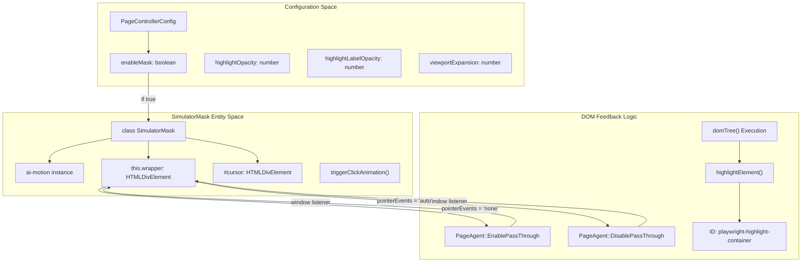
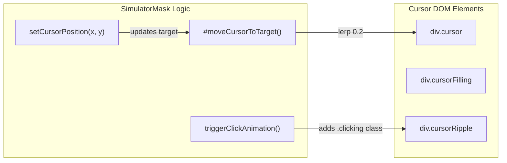

<!-- source: DeepWiki mcp.deepwiki.com · repo alibaba/page-agent · page 5.4 Visual Feedback System · fetched 2026-10-29 -->

# Visual Feedback System

Relevant source files

The following files were used as context for generating this wiki page:

- [packages/page-controller/src/dom/dom_tree/index.js](packages/page-controller/src/dom/dom_tree/index.js)
- [packages/page-controller/src/dom/dom_tree/type.ts](packages/page-controller/src/dom/dom_tree/type.ts)
- [packages/page-controller/src/dom/getPageInfo.ts](packages/page-controller/src/dom/getPageInfo.ts)
- [packages/page-controller/src/mask/SimulatorMask.module.css](packages/page-controller/src/mask/SimulatorMask.module.css)
- [packages/page-controller/src/mask/SimulatorMask.ts](packages/page-controller/src/mask/SimulatorMask.ts)
- [packages/page-controller/src/mask/checkDarkMode.ts](packages/page-controller/src/mask/checkDarkMode.ts)
- [packages/page-controller/src/mask/cursor-border.svg](packages/page-controller/src/mask/cursor-border.svg)
- [packages/page-controller/src/mask/cursor-fill.svg](packages/page-controller/src/mask/cursor-fill.svg)
- [packages/page-controller/src/mask/cursor.module.css](packages/page-controller/src/mask/cursor.module.css)

The Visual Feedback System provides visual indicators during agent execution to show which elements are being considered and to prevent user interference. This system consists of two primary components: **element highlighting** that marks interactive elements with index labels, and **SimulatorMask** that overlays the page to block user interaction during automation while providing a simulated AI cursor.

## Overview

The visual feedback system serves two primary purposes:

1.  **Visual Element Identification**: Highlights interactive elements with numeric indices that correspond to the simplified HTML representation sent to the LLM.
2.  **User Interaction Blocking**: Displays an overlay mask during agent execution to prevent accidental user clicks from interfering with automation.

Both features are optional and controlled through configuration passed to the DOM processing and mask initialization logic.

**Sources:** [packages/page-controller/src/dom/dom_tree/index.js:24-41](), [packages/page-controller/src/mask/SimulatorMask.ts:8-30]()

## System Architecture

The following diagram bridges the high-level feedback concepts to the internal code entities and event flow.

### Architecture Entity Map

**Sources:** [packages/page-controller/src/dom/dom_tree/index.js:144-167](), [packages/page-controller/src/mask/SimulatorMask.ts:85-109](), [packages/page-controller/src/mask/SimulatorMask.module.css:1-14]()

## Element Highlighting

### Highlight Creation Process

Element highlighting is performed during the DOM tree extraction phase. The `highlightElement` function is responsible for creating the visual overlays.

1.  **Container Management**: It creates or retrieves a container with ID `playwright-highlight-container` [packages/page-controller/src/dom/dom_tree/index.js:144-181]().
2.  **Z-Index Control**: The container is assigned a high z-index (`2147483640`) to ensure visibility above page content but below the `SimulatorMask` [packages/page-controller/src/dom/dom_tree/index.js:197]().
3.  **Rect Calculation**: It uses `element.getClientRects()` to handle multi-line elements accurately [packages/page-controller/src/dom/dom_tree/index.js:204]().
4.  **Color Assignment**: Colors are cycled from a predefined list of 12 hex codes based on the element's `highlightIndex` [packages/page-controller/src/dom/dom_tree/index.js:209-225]().

### Highlight Configuration

The appearance and scope of highlights are controlled by parameters passed to the DOM processing logic:

| Parameter | Default | Purpose |
| :--- | :--- | :--- |
| `highlightOpacity` | `0.1` | Opacity of the colored overlay on interactive elements [packages/page-controller/src/dom/dom_tree/index.js:38](). |
| `highlightLabelOpacity` | `0.5` | Opacity of the background behind numeric index labels [packages/page-controller/src/dom/dom_tree/index.js:39](). |
| `viewportExpansion` | `0` | Margin (in pixels) outside the viewport where elements are still considered for highlighting [packages/page-controller/src/dom/dom_tree/index.js:28](). |

**Sources:** [packages/page-controller/src/dom/dom_tree/index.js:24-41]()

## SimulatorMask Overlay

### Implementation and Interaction Blocking

The `SimulatorMask` is a component that prevents user interference. It captures and stops propagation for nearly all user input events:

*   **Mouse Events**: `click`, `mousedown`, `mouseup`, `mousemove` [packages/page-controller/src/mask/SimulatorMask.ts:44-59]().
*   **Scroll/Keyboard**: `wheel`, `keydown`, `keyup` [packages/page-controller/src/mask/SimulatorMask.ts:60-71]().

It is placed at `z-index: 2147483641`, which is one level higher than the element highlights [packages/page-controller/src/mask/SimulatorMask.module.css:4]().

### Dark Mode Detection

The mask uses a heuristic check in `isPageDark()` to determine if it should initialize the `ai-motion` background in dark or light mode [packages/page-controller/src/mask/SimulatorMask.ts:32-33]().

The detection logic checks:
1.  **CSS Classes**: Searches for `.dark`, `.night`, `.theme-dark` on `<html>` or `<body>` [packages/page-controller/src/mask/checkDarkMode.ts:24-38]().
2.  **Data Attributes**: Checks `data-theme` or `data-color-mode` [packages/page-controller/src/mask/checkDarkMode.ts:43-58]().
3.  **Color Scheme**: Inspects the `color-scheme` CSS property and meta tags [packages/page-controller/src/mask/checkDarkMode.ts:64-74]().
4.  **Luminance**: Calculates perceived luminance of the background color and text color [packages/page-controller/src/mask/checkDarkMode.ts:79-112]().

**Sources:** [packages/page-controller/src/mask/checkDarkMode.ts:5-19]()

### AI Cursor and Animations

The system provides a visual representation of the agent's focus through a simulated cursor.

### Cursor Interaction Logic

*   **Smooth Motion**: The cursor position is updated via `requestAnimationFrame` using a linear interpolation (lerp) factor of `0.2` to provide a "floaty" AI-like movement [packages/page-controller/src/mask/SimulatorMask.ts:133-160]().
*   **Visual Assets**: The cursor uses custom SVG masks (`cursor-border.svg` and `cursor-fill.svg`) and a linear gradient for its border [packages/page-controller/src/mask/cursor.module.css:10-37]().
*   **Click Feedback**: A ripple animation is triggered by adding the `.clicking` class, which scales a circular border from `0` to `2` [packages/page-controller/src/mask/cursor.module.css:57-70]().

**Sources:** [packages/page-controller/src/mask/SimulatorMask.ts:112-131](), [packages/page-controller/src/mask/cursor.module.css:1-71]()

### Event-Driven Communication

The `SimulatorMask` decouples itself from the core agent logic by listening for specific window events:

| Event Name | Action |
| :--- | :--- |
| `PageAgent::MovePointerTo` | Updates the `#targetCursorX` and `#targetCursorY` [packages/page-controller/src/mask/SimulatorMask.ts:85-88](). |
| `PageAgent::ClickPointer` | Invokes `triggerClickAnimation()` [packages/page-controller/src/mask/SimulatorMask.ts:89-91](). |
| `PageAgent::EnablePassThrough` | Sets `pointerEvents = 'none'` to allow DOM inspection [packages/page-controller/src/mask/SimulatorMask.ts:92-94](). |
| `PageAgent::DisablePassThrough` | Sets `pointerEvents = 'auto'` to resume blocking user input [packages/page-controller/src/mask/SimulatorMask.ts:95-97](). |

**Sources:** [packages/page-controller/src/mask/SimulatorMask.ts:99-102]()

## Lifecycle and Disposal

The `SimulatorMask` includes a `dispose()` method to clean up resources when the agent is stopped or the controller is destroyed.

1.  **Flagging**: Sets `#disposed = true` to stop the `requestAnimationFrame` loop [packages/page-controller/src/mask/SimulatorMask.ts:211]().
2.  **Motion Cleanup**: Calls `this.motion?.dispose()` to stop the background animation [packages/page-controller/src/mask/SimulatorMask.ts:212]().
3.  **DOM Removal**: Removes the `wrapper` element from the document body [packages/page-controller/src/mask/SimulatorMask.ts:213]().
4.  **Event Unbinding**: Removes the window-level listeners for `PageAgent::*` events [packages/page-controller/src/mask/SimulatorMask.ts:104-109]().

**Sources:** [packages/page-controller/src/mask/SimulatorMask.ts:210-216]()

---

