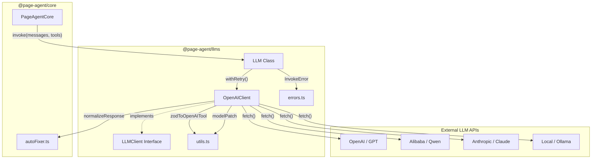
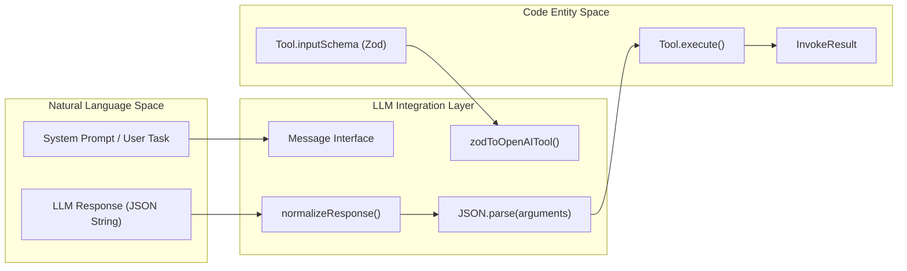

<!-- source: DeepWiki mcp.deepwiki.com · repo alibaba/page-agent · page 6 LLM Integration Layer · fetched 2026-10-29 -->

# LLM Integration Layer

Relevant source files

The following files were used as context for generating this wiki page:

- [packages/core/src/utils/autoFixer.ts](packages/core/src/utils/autoFixer.ts)
- [packages/llms/package.json](packages/llms/package.json)
- [packages/llms/src/OpenAIClient.ts](packages/llms/src/OpenAIClient.ts)
- [packages/llms/src/errors.ts](packages/llms/src/errors.ts)
- [packages/llms/src/index.ts](packages/llms/src/index.ts)
- [packages/page-agent/package.json](packages/page-agent/package.json)

## Purpose and Scope

The LLM Integration Layer manages all communication with Large Language Models. It provides a unified interface for invoking LLMs with tool schemas, handling multiple provider APIs, parsing responses, and executing tool calls. This layer is designed as a standalone module (`@page-agent/llms`) that abstracts away the complexities of different model providers and ensures type-safety through Zod integration.

This is a **PARENT** page. For detailed technical specifications, refer to the following child pages:
- [LLM Client Architecture](#6.1) — Detailed look at the `LLM` class and `OpenAIClient` implementation.
- [Multi-Provider Support](#6.2) — Documentation on supported models (Qwen, Claude, GPT, etc.) and model-specific patches.
- [Error Handling and Retry Logic](#6.3) — Explanation of the `withRetry` mechanism and `InvokeError` types.
- [Tool Call Processing](#6.4) — How Zod schemas are converted to OpenAI format and how responses are validated.

---

## Architecture Overview

The LLM module acts as a bridge between the "Natural Language Space" (Prompts/Messages) and the "Code Entity Space" (Zod Schemas/Tool Executors).

**Diagram Description**: This diagram illustrates how `PageAgentCore` utilizes the `LLM` class to communicate with various providers. The `OpenAIClient` serves as the primary implementation, utilizing utilities for schema conversion and model-specific patching. The `autoFixer` from core provides response normalization.

Sources: [packages/llms/src/index.ts:19-29](), [packages/llms/src/OpenAIClient.ts:20-27](), [packages/llms/src/index.ts:36-52](), [packages/core/src/utils/autoFixer.ts:21-30]()

---

## Core Components

### The LLM Class
The `LLM` class is the main entry point. It manages the lifecycle of an LLM request, including configuration parsing via `parseLLMConfig`, client instantiation, and retry logic. It extends `EventTarget` to emit `retry` events for UI feedback.
- **Key Method**: `invoke(messages, tools, abortSignal, options)` [packages/llms/src/index.ts:36-52]()
- **Default Client**: Instantiates `OpenAIClient` by default [packages/llms/src/index.ts:28]().

### Client Implementations
While the codebase currently focuses on an `OpenAIClient` [packages/llms/src/OpenAIClient.ts:20](), the architecture is designed around the `LLMClient` interface. This allows PageAgent to support any provider that follows the OpenAI chat completions standard.
- **Customization**: Supports `transformRequestBody` and `customFetch` for deep integration with proxy servers or specialized providers [packages/llms/src/index.ts:105-107]().

### Tool Integration
The system bridges Zod-defined tools to the LLM's expected format.
- **Schema Conversion**: `zodToOpenAITool` converts Zod objects into OpenAI-compatible JSON schemas [packages/llms/src/OpenAIClient.ts:38]().
- **Validation**: Uses `tool.inputSchema.safeParse(parsedArgs)` to ensure model output matches expected types before execution [packages/llms/src/OpenAIClient.ts:225-234]().
- **Execution**: Directly executes the tool's `execute` function and returns the `toolResult` within an `InvokeResult` object [packages/llms/src/OpenAIClient.ts:240-257]().

---

## Bridging Language and Code

The following diagram demonstrates how the LLM module maps natural language concepts to specific code entities within the PageAgent ecosystem.

**Diagram Description**: This mapping shows how a `Tool.inputSchema` (Code) becomes a tool definition for the LLM (Language), and how the LLM's string response is normalized by `normalizeResponse` and parsed back into a type-safe `InvokeResult`.

Sources: [packages/llms/src/OpenAIClient.ts:202-222](), [packages/core/src/utils/autoFixer.ts:21-121]()

---

## Error and Retry Strategy

The module distinguishes between errors that are worth retrying (like network glitches or rate limits) and those that are terminal (like authentication failures).

| Error Type | Retryable? | Description |
| :--- | :--- | :--- |
| `NETWORK_ERROR` | Yes | Network error, retry [packages/llms/src/errors.ts:7]() |
| `RATE_LIMIT` | Yes | Rate limit, retry [packages/llms/src/errors.ts:8]() |
| `SERVER_ERROR` | Yes | 5xx server error, retry [packages/llms/src/errors.ts:9]() |
| `AUTH_ERROR` | No | Authentication failed (401/403) [packages/llms/src/errors.ts:20]() |
| `CONTEXT_LENGTH` | No | Prompt too long [packages/llms/src/errors.ts:21]() |
| `INVALID_TOOL_ARGS` | Yes | Tool arguments don't match schema [packages/llms/src/errors.ts:11]() |

The `withRetry` utility handles the loop, applying a `100ms` delay between attempts and checking the `retryable` flag on `InvokeError` [packages/llms/src/index.ts:58-81]().

---

## Response Normalization

Models frequently hallucinate JSON formats or fail to trigger formal tool calls. The `normalizeResponse` utility in the core package (passed to the LLM client via options) fixes common issues:
- **JSON in Content**: Extracts JSON from `message.content` if `tool_calls` is missing [packages/core/src/utils/autoFixer.ts:44-76]().
- **Double Stringification**: Fixes arguments that are wrapped in redundant JSON strings [packages/core/src/utils/autoFixer.ts:82-86]().
- **Primitive Coercion**: Converts primitive inputs for single-field tools (e.g., `{"click_element_by_index": 2}` to `{"click_element_by_index": {"index": 2}}`) [packages/core/src/utils/autoFixer.ts:148-157]().

For details, see [Tool Call Processing](#6.4).

Sources: [packages/core/src/utils/autoFixer.ts:21-168]()

---

