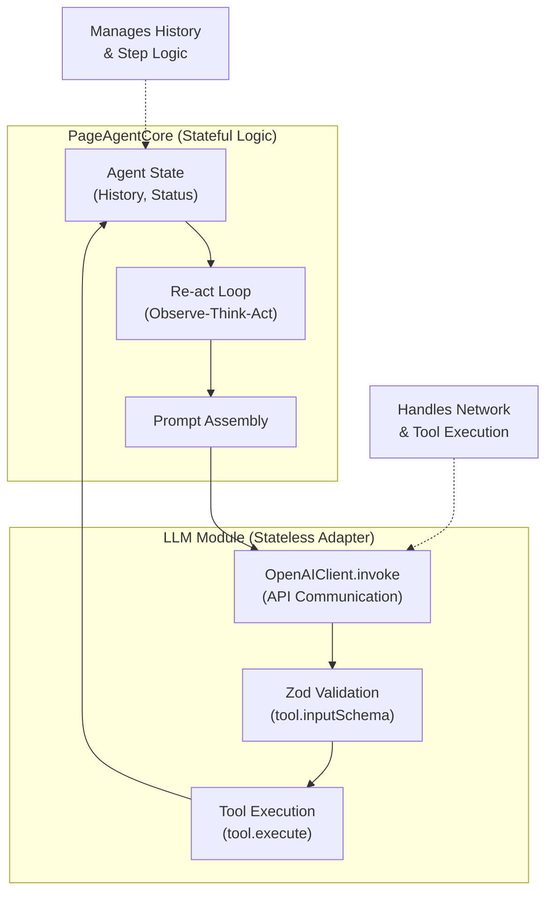
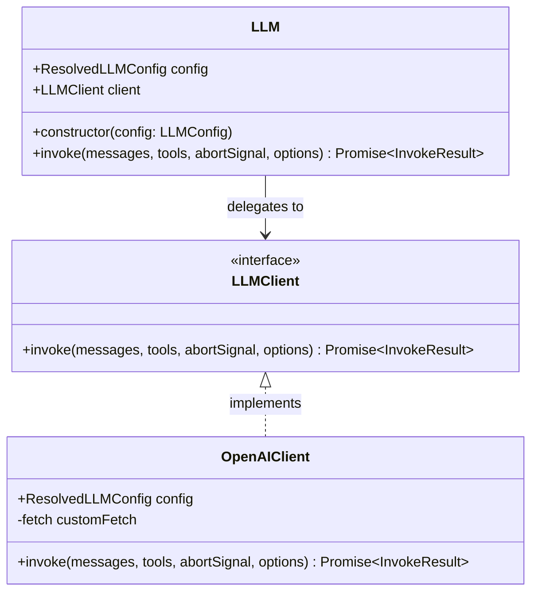
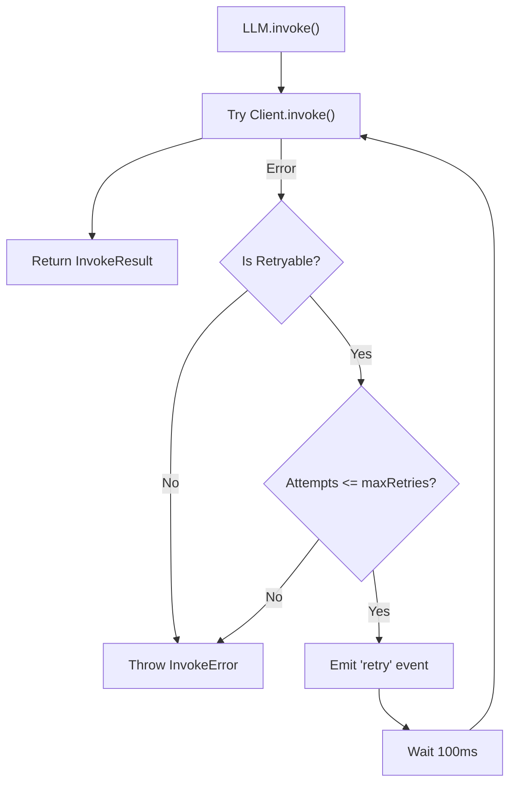
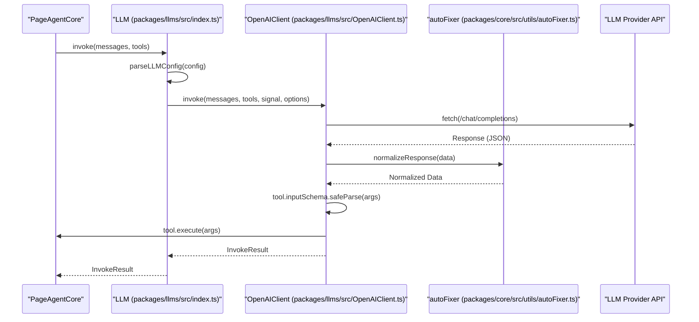

<!-- source: DeepWiki mcp.deepwiki.com · repo alibaba/page-agent · page 6.1 LLM Client Architecture · fetched 2026-10-29 -->

# LLM Client Architecture

<details>
<summary>Relevant source files</summary>

The following files were used as context for generating this wiki page:

- [packages/core/src/utils/autoFixer.ts](packages/core/src/utils/autoFixer.ts)
- [packages/llms/src/OpenAIClient.ts](packages/llms/src/OpenAIClient.ts)
- [packages/llms/src/errors.ts](packages/llms/src/errors.ts)
- [packages/llms/src/index.ts](packages/llms/src/index.ts)
- [packages/llms/src/types.ts](packages/llms/src/types.ts)

</details>


## Purpose and Scope

This document describes the architecture of the LLM integration layer in PageAgent, specifically the `LLM` class and its design philosophy. The LLM module is responsible for **single-turn invocation** of Large Language Models with tool calling capabilities, acting as a stateless adapter between the PageAgent core and various LLM providers.

The module handles the conversion of tool schemas (Zod to JSON Schema), API communication via an OpenAI-compatible interface, response validation, and automatic retry logic.

**Sources:** [packages/llms/src/index.ts:1-53](), [packages/llms/src/types.ts:1-64]()

---

## Design Philosophy

The LLM module follows a strict **separation of concerns** between LLM invocation and agent orchestration. This architectural decision addresses the inherent coupling between tool calling and LLM APIs while maintaining clean boundaries.

### Key Principles

| Principle | Description |
|-----------|-------------|
| **Stateless Design** | The LLM module maintains no state between invocations. All agent state (history, memory, goals) is managed by `PageAgentCore`. |
| **Single-Turn Only** | Each `invoke()` call handles exactly one LLM request and one tool execution. Multi-turn logic is orchestrated by the main Re-act loop. |
| **Tool Call as Output** | PageAgent enforces structured output. The LLM client validates that the model returns a valid tool call matching the provided schemas. |
| **Provider Agnostic** | The `LLM` class abstracts provider differences through the `LLMClient` interface, with `OpenAIClient` serving as the primary implementation for compatible APIs. |

### Natural Language to Code Entity Space: Architecture

The following diagram maps high-level conceptual responsibilities to the specific code entities in the `llms` package.



**Sources:** [packages/llms/src/index.ts:36-52](), [packages/llms/src/OpenAIClient.ts:29-34]()

---

## LLM Class Architecture

### Class Structure

The `LLM` class extends `EventTarget` to provide lifecycle hooks (like retries and errors) to the rest of the system. [packages/llms/src/index.ts:19-24]()



**Diagram: LLM Class Structure**

### Core Method: invoke()

The `invoke()` method is the primary entry point. It wraps the underlying client call in a `withRetry` utility to handle transient failures. [packages/llms/src/index.ts:36-52]()

```typescript
async invoke(
    messages: Message[],
    tools: Record<string, Tool>,
    abortSignal: AbortSignal,
    options?: InvokeOptions
): Promise<InvokeResult>
```

**Sources:** [packages/llms/src/index.ts:36-81]()

---

## OpenAIClient Implementation

The `OpenAIClient` is the standard implementation for interacting with OpenAI-compatible endpoints (including Qwen, DeepSeek, and local Ollama instances). [packages/llms/src/OpenAIClient.ts:20-27]()

### Execution Flow

1.  **Tool Conversion**: Converts Zod schemas in `tools` to OpenAI-compatible JSON schemas using `zodToOpenAITool`. [packages/llms/src/OpenAIClient.ts:38-38]()
2.  **Model Patching**: Applies model-specific request tweaks (e.g., fixing `tool_choice` for specific providers) via `modelPatch`. [packages/llms/src/OpenAIClient.ts:59-59]()
3.  **API Call**: Executes the request using the configured `customFetch`. [packages/llms/src/OpenAIClient.ts:76-84]()
4.  **Response Normalization**: If `options.normalizeResponse` is provided, it fixes common LLM formatting errors before parsing. This is often handled by the `normalizeResponse` utility in the core package to fix JSON wrapping or missing action fields. [packages/llms/src/OpenAIClient.ts:177-178](), [packages/core/src/utils/autoFixer.ts:21-121]()
5.  **Validation**: Validates that a tool was called and that the arguments match the Zod `inputSchema`. [packages/llms/src/OpenAIClient.ts:225-235]()
6.  **Tool Execution**: Executes the tool's `execute` function and returns the result alongside token usage data. [packages/llms/src/OpenAIClient.ts:238-250]()

### Response Auto-Fixing

The `normalizeResponse` function in `@page-agent/core` provides a robust "AutoFixer" layer that handles several common LLM failure modes:
*   **JSON in Content**: Extracts JSON from `message.content` if `tool_calls` is empty. [packages/core/src/utils/autoFixer.ts:44-76]()
*   **Double Stringification**: Unwraps arguments that have been JSON-stringified twice. [packages/core/src/utils/autoFixer.ts:82-86]()
*   **Primitive Coercion**: Converts a single primitive value (like a number) into the expected object format for single-field tools. [packages/core/src/utils/autoFixer.ts:148-157]()

**Sources:** [packages/llms/src/OpenAIClient.ts:20-262](), [packages/core/src/utils/autoFixer.ts:9-168]()

---

## Error Handling and Retry Logic

The system distinguishes between retryable and non-retryable errors using the `InvokeError` class. [packages/llms/src/errors.ts:39-56]()

### Error Categorization

| Error Type | Retryable | Description |
|-----------|-----------|-------------|
| `NETWORK_ERROR` | Yes | Network error, retry [packages/llms/src/errors.ts:7-7]() |
| `RATE_LIMIT` | Yes | HTTP 429 received [packages/llms/src/errors.ts:8-8]() |
| `SERVER_ERROR` | Yes | HTTP 5xx received [packages/llms/src/errors.ts:9-9]() |
| `INVALID_TOOL_ARGS` | Yes | LLM generated invalid JSON or failed schema validation [packages/llms/src/errors.ts:11-11]() |
| `AUTH_ERROR` | No | HTTP 401/403 (Invalid API Key) [packages/llms/src/errors.ts:20-20]() |
| `CONTEXT_LENGTH` | No | Prompt exceeded model's token limit [packages/llms/src/errors.ts:21-21]() |

**Sources:** [packages/llms/src/errors.ts:5-56]()

### Retry Mechanism

The `withRetry` function implements a loop that respects the `maxRetries` setting (defaulting to 2). It emits `retry` events that listeners (like `PageAgentCore`) can use to update UI status. [packages/llms/src/index.ts:58-81]()



**Diagram: Internal Retry Flow**

**Sources:** [packages/llms/src/index.ts:58-81](), [packages/llms/src/errors.ts:27-37]()

---

## Data Flow Summary

The following diagram bridges the high-level request to the specific code entities involved in the LLM transaction.



**Diagram: LLM Transaction Data Flow**

**Sources:** [packages/llms/src/index.ts:36-52](), [packages/llms/src/OpenAIClient.ts:29-262](), [packages/core/src/utils/autoFixer.ts:21-121]()

---

