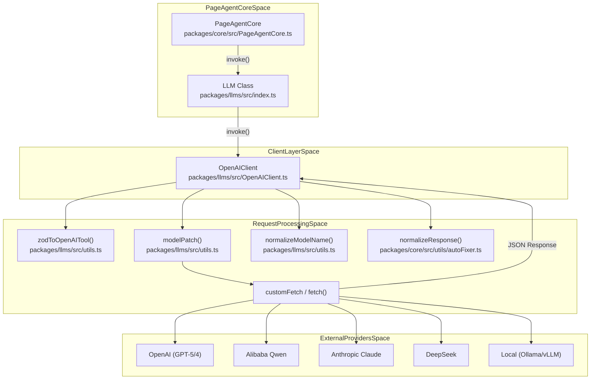
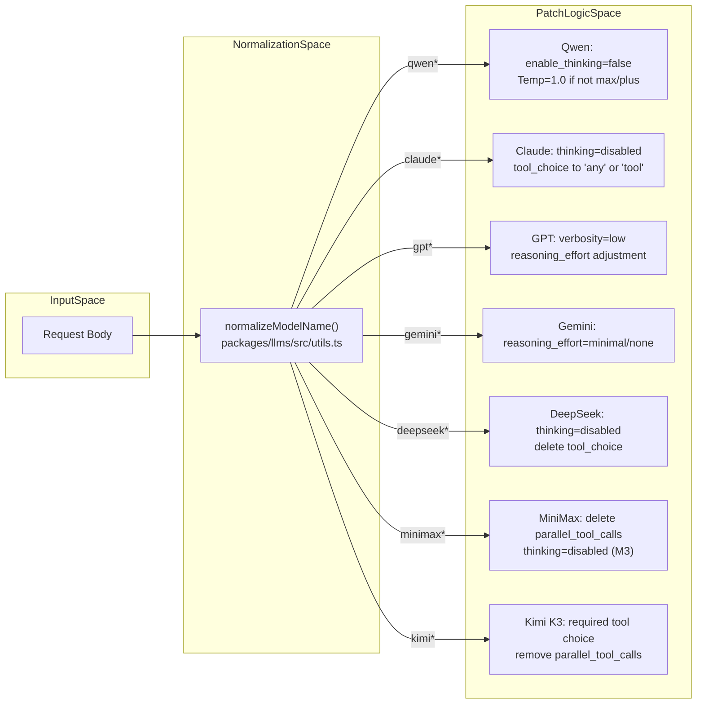

<!-- source: DeepWiki mcp.deepwiki.com · repo alibaba/page-agent · page 6.2 Multi-Provider Support · fetched 2026-10-29 -->

# Multi-Provider Support

<details>
<summary>Relevant source files</summary>

The following files were used as context for generating this wiki page:

- [packages/core/src/utils/autoFixer.ts](packages/core/src/utils/autoFixer.ts)
- [packages/llms/src/OpenAIClient.ts](packages/llms/src/OpenAIClient.ts)
- [packages/llms/src/errors.ts](packages/llms/src/errors.ts)
- [packages/llms/src/index.ts](packages/llms/src/index.ts)
- [packages/llms/src/utils.test.ts](packages/llms/src/utils.test.ts)
- [packages/llms/src/utils.ts](packages/llms/src/utils.ts)
- [packages/website/src/pages/docs/features/models/page.tsx](packages/website/src/pages/docs/features/models/page.tsx)

</details>


## Purpose and Scope

This document describes how PageAgent integrates with multiple Large Language Model (LLM) providers through an OpenAI-compatible API interface. It covers the architecture that enables provider flexibility, configuration requirements, model-specific compatibility patches, and error handling strategies.

PageAgent is designed to be model-agnostic, supporting any provider that complies with the OpenAI Chat Completions API specification and supports tool calling (Function Calling) [packages/website/src/pages/docs/features/models/page.tsx:93-98]().

## OpenAI-Compatible API Standard

PageAgent implements a single client interface, `OpenAIClient`, which communicates with any LLM provider supporting the OpenAI format. The `LLM` class acts as a high-level orchestrator that manages configuration parsing and retry logic.

Title: LLM Provider Data Flow

**Sources:** [packages/llms/src/utils.ts:15-24](), [packages/llms/src/utils.ts:39-46](), [packages/llms/src/OpenAIClient.ts:20-59](), [packages/core/src/utils/autoFixer.ts:21-30](), [packages/website/src/pages/docs/features/models/page.tsx:93-98]()

The client makes standard HTTP POST requests to `${baseURL}/chat/completions`. The `baseURL` and `model` configuration parameters determine the routing and behavior of the agent [packages/website/src/pages/docs/features/models/page.tsx:150-158]().

## Supported Providers and Models

### Tested Models
The project maintains a list of "Baseline" models (marked with ⭐) which are highly recommended due to their strong ToolCall capabilities and speed [packages/website/src/pages/docs/features/models/page.tsx:8-16]().

| Brand | Models |
| :--- | :--- |
| **Qwen** | qwen3.7-max, qwen3.7-plus, qwen3.6-max, qwen3.5-plus ⭐, qwen3.5-flash ⭐ |
| **OpenAI** | gpt-5.6-sol, gpt-5.5, gpt-5.4-mini ⭐, gpt-5.4-nano ⭐, gpt-5.1, gpt-4.1 |
| **Anthropic** | claude-sonnet-5, claude-opus-4.5, claude-sonnet-4.5, claude-haiku-4.5 ⭐ |
| **DeepSeek** | deepseek-v4-pro, deepseek-v4-flash ⭐, deepseek-3.2 |
| **Google** | gemini-3.5-flash ⭐, gemini-3.1-pro, gemini-2.5-flash |
| **xAI** | grok-4.5, grok-4.3, grok-build-0.1 |
| **MoonshotAI** | kimi-k3, kimi-k2.7-code, kimi-k2.6, kimi-k2.5 |
| **Z.AI** | glm-5.2, glm-5.1, glm-5, glm-4.7 |

**Sources:** [packages/website/src/pages/docs/features/models/page.tsx:19-73]()

### Configuration Examples

```typescript
// OpenAI-compatible services (e.g., Alibaba Bailian)
const pageAgent = new PageAgent({
  baseURL: 'https://dashscope.aliyuncs.com/compatible-mode/v1',
  apiKey: 'your-api-key',
  model: 'qwen3.5-plus'
});
```
**Sources:** [packages/website/src/pages/docs/features/models/page.tsx:150-158]()

## Model-Specific Patches

Because different providers have slight variations in their API implementations, the `modelPatch()` function in `packages/llms/src/utils.ts` performs in-place modification of the request body before it is sent. This is crucial for disabling "thinking/reasoning" tokens which can interfere with tool-calling reliability [packages/llms/src/utils.ts:27-38]().

Title: modelPatch logic flow

**Sources:** [packages/llms/src/utils.ts:39-191]()

### Key Patch Details:
*   **Normalization**: The `normalizeModelName` function strips slashes, underscores, and dots (e.g., `gpt-5.2` becomes `gpt-52`) to ensure consistent matching across providers like OpenRouter [packages/llms/src/utils.ts:208-223]().
*   **Qwen**: Sets `enable_thinking = false`. If temperature is undefined and it's a lightweight model, it raises `temperature` to `1.0` to improve recovery odds [packages/llms/src/utils.ts:47-54]().
*   **Claude**: Disables thinking. Converts `tool_choice: "required"` to `{ type: "any" }` and standardizes tool object formats unless the provider is `openrouter` [packages/llms/src/utils.ts:88-104]().
*   **GPT**: Sets `verbosity = 'low'` for GPT-5. It adjusts `reasoning_effort` based on version (e.g., `none` for 5.1/5.2, `minimal` for 5.0) or removes it entirely for `chat-latest` [packages/llms/src/utils.ts:62-86]().
*   **Gemini**: Sets `reasoning_effort` to `minimal` or `none` for Flash/Lite variants [packages/llms/src/utils.ts:116-130]().
*   **DeepSeek**: Sets `thinking = { type: 'disabled' }` and deletes `tool_choice` [packages/llms/src/utils.ts:56-60]().
*   **Kimi**: Kimi K3 models are forced to use `required` tool choice and parallel calls are disabled to ensure stability during thinking [packages/llms/src/utils.ts:153-158]().
*   **OpenRouter**: Maps `reasoning_effort` or `thinking` flags to the specific `reasoning: { enabled: boolean, effort: string }` object required by OpenRouter [packages/llms/src/utils.ts:174-188]().

## Response Normalization and Auto-Fixing

Models often fail to adhere strictly to the tool-calling schema. The `normalizeResponse` utility in `packages/core/src/utils/autoFixer.ts` handles common failures [packages/core/src/utils/autoFixer.ts:9-20]():

1.  **JSON in Content**: If the model returns JSON in the `content` field instead of `tool_calls`, the fixer extracts it [packages/core/src/utils/autoFixer.ts:44-50]().
2.  **Incorrect Tool Wrapping**: Fixes cases where the model returns the action name as the tool name instead of using the `AgentOutput` wrapper [packages/core/src/utils/autoFixer.ts:38-41]().
3.  **Primitive Coercion**: If a model provides a primitive (e.g., `2`) for a single-field tool (e.g., `click_element_by_index`), the fixer wraps it into the expected object structure `{"index": 2}` [packages/core/src/utils/autoFixer.ts:149-157]().
4.  **Double Stringification**: Handles arguments that are accidentally double-encoded as JSON strings [packages/core/src/utils/autoFixer.ts:82-86]().

## Production Authentication (Backend Proxy)

Exposing API keys in frontend code is a security risk. For production, PageAgent supports a `customFetch` parameter. This allows developers to point `baseURL` to a local backend proxy that injects the real API key and handles session-based authentication [packages/llms/src/index.ts:107-108]().

```typescript
const agent = new PageAgentCore({
  pageController: new PageController({ enableMask: true }),
  baseURL: '/api/llm-proxy',
  model: 'qwen3.5-plus',
  customFetch: (url, init) => 
    fetch(url, { ...init, credentials: 'include' })
})
```

## Error Handling and Retry Logic

The LLM integration includes a robust error handling system. The `withRetry` wrapper in `packages/llms/src/index.ts` automatically retries requests based on the `InvokeError.retryable` flag [packages/llms/src/index.ts:58-81]().

### Error Categories
*   **Retryable**: Network errors, 429 Rate Limits, 5xx Server Errors, and malformed tool arguments that might resolve with a fresh attempt [packages/llms/src/errors.ts:27-37]().
*   **Non-Retryable**: Configuration errors, 401/403 Auth errors, Context Length exceeded, and Content Filter triggers [packages/llms/src/errors.ts:18-23]().

### Tool Transformation
The `zodToOpenAITool` function ensures that tool definitions are correctly converted from Zod schemas into the OpenAI `function` format, targeting `openapi-3.0` for maximum compatibility [packages/llms/src/utils.ts:15-24]().

**Sources:** [packages/llms/src/utils.ts:1-223](), [packages/llms/src/index.ts:58-109](), [packages/llms/src/errors.ts:1-56](), [packages/core/src/utils/autoFixer.ts:1-121](), [packages/website/src/pages/docs/features/models/page.tsx:8-104]()

---

