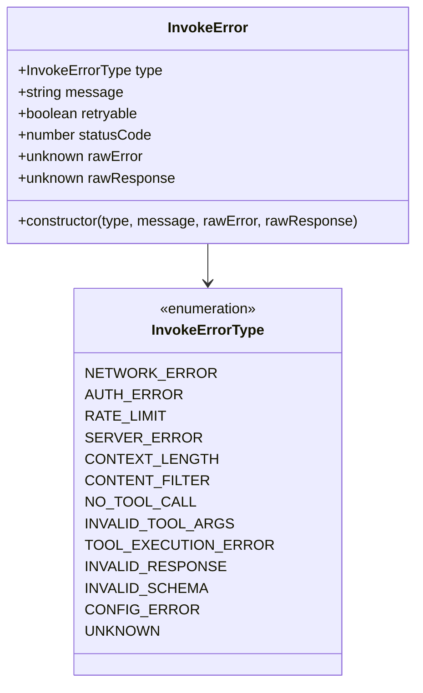
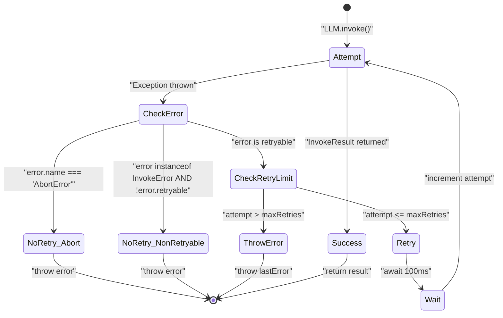
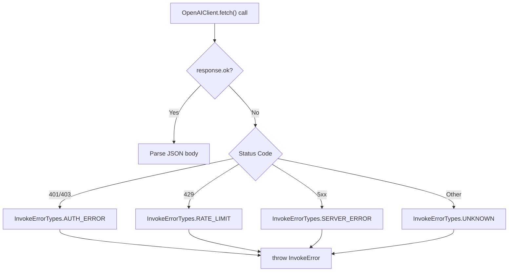

<!-- source: DeepWiki mcp.deepwiki.com · repo alibaba/page-agent · page 6.3 Error Handling and Retry Logic · fetched 2026-10-29 -->

# Error Handling and Retry Logic

Relevant source files

The following files were used as context for generating this wiki page:

- [packages/core/src/utils/autoFixer.ts](packages/core/src/utils/autoFixer.ts)
- [packages/llms/src/OpenAIClient.ts](packages/llms/src/OpenAIClient.ts)
- [packages/llms/src/errors.ts](packages/llms/src/errors.ts)
- [packages/llms/src/index.ts](packages/llms/src/index.ts)

This document describes PageAgent's error handling and retry mechanisms in the LLM integration layer. It covers the `InvokeError` type system, automatic retry logic via the `withRetry` function, and response validation strategies.

## InvokeError Type System

PageAgent uses a custom `InvokeError` class to categorize and handle different failure modes when communicating with LLM providers. Each error type determines whether the operation is retryable and how the system should respond.

### Error Type Enumeration

The following error types are defined in `packages/llms/src/errors.ts` and thrown by the LLM client implementations:

| Error Type | HTTP Status | Description | Retryable |
|------------|-------------|-------------|-----------|
| `NETWORK_ERROR` | N/A | Network request failed (DNS, timeout, connection issues) | Yes |
| `AUTH_ERROR` | 401, 403 | Authentication or authorization failure | No |
| `RATE_LIMIT` | 429 | API rate limit exceeded | Yes |
| `SERVER_ERROR` | 5xx | Provider server error | Yes |
| `CONTEXT_LENGTH` | 200 | Response truncated due to max tokens limit (`finish_reason: length`) | No |
| `CONTENT_FILTER` | 200 | Content blocked by safety system (`finish_reason: content_filter`) | No |
| `NO_TOOL_CALL` | 200 | Model did not invoke any tool in the response | Yes |
| `INVALID_TOOL_ARGS` | 200 | Tool arguments failed JSON parsing or Zod schema validation | Yes |
| `TOOL_EXECUTION_ERROR` | 200 | The `tool.execute` function threw an exception | Yes |
| `INVALID_RESPONSE` | 200 | Response body is not valid JSON | Yes |
| `INVALID_SCHEMA` | 200 | Response is valid JSON but doesn't match expected shape | Yes |
| `CONFIG_ERROR` | N/A | Local configuration error (e.g., `transformRequestBody` failed) | No |
| `UNKNOWN` | Any | Unexpected error condition or unexpected `finish_reason` | Yes |

**Sources:** [packages/llms/src/errors.ts:5-23](), [packages/llms/src/errors.ts:27-37](), [packages/llms/src/OpenAIClient.ts:85-89](), [packages/llms/src/OpenAIClient.ts:92-127](), [packages/llms/src/OpenAIClient.ts:148-174]()

### InvokeError Structure

The `InvokeError` class wraps the original error with additional metadata used by the retry logic.

**Entity Mapping: Error Classes**

The `retryable` property is calculated during construction by checking if the `type` is included in the `RETRYABLE_TYPES` array.

**Sources:** [packages/llms/src/errors.ts:27-56]()

## Retry Mechanism

The `LLM.invoke()` method wraps the underlying client call in a `withRetry` helper function. This function implements a loop that attempts the request until it succeeds, reaches the retry limit, or encounters a non-retryable error.

### Retry Flow Logic

**Process Mapping: Retry Logic**

### withRetry Implementation

The `withRetry` function in `packages/llms/src/index.ts` manages the lifecycle of a request:

1.  **Iteration**: It loops indefinitely (`while (true)`) until a result is returned or an error is thrown [packages/llms/src/index.ts:66-80]().
2.  **Abort Check**: It explicitly checks if `(error as any)?.name === 'AbortError'` to prevent retrying when a user has cancelled the task [packages/llms/src/index.ts:70]().
3.  **Non-Retryable Check**: It checks `if (error instanceof InvokeError && !error.retryable)` to terminate the loop early [packages/llms/src/index.ts:71]().
4.  **Retry Limit**: If the current `attempt` exceeds `settings.maxRetries`, the error is re-thrown [packages/llms/src/index.ts:73]().
5.  **Delay**: It performs a `setTimeout` of 100ms before retrying to provide a small backoff [packages/llms/src/index.ts:78]().
6.  **Event Dispatching**: It triggers a `retry` event on the `LLM` instance via the `onRetry` callback [packages/llms/src/index.ts:44-50]().

**Sources:** [packages/llms/src/index.ts:42-52](), [packages/llms/src/index.ts:58-81]()

## Client-Side Error Detection

The `OpenAIClient` is responsible for translating raw fetch responses and model outputs into the `InvokeError` system.

### HTTP Status Handling

When the API response is not `ok`, the client maps HTTP status codes to specific error types:

**Sources:** [packages/llms/src/OpenAIClient.ts:92-127]()

### Response Validation and Parsing

Once a successful HTTP response is received, the client validates the model's output:

1.  **JSON Parsing**: It attempts to parse the response body. Failure throws `INVALID_RESPONSE` [packages/llms/src/OpenAIClient.ts:130-140]().
2.  **Finish Reason**: It checks `choice.finish_reason`. Reasons like `length` or `content_filter` trigger specific non-retryable error types [packages/llms/src/OpenAIClient.ts:148-174]().
3.  **Tool Call Presence**: It ensures a tool call exists in the response. If missing, it throws `NO_TOOL_CALL` [packages/llms/src/OpenAIClient.ts:181-189]().
4.  **Argument Parsing**: It attempts to parse `tool_calls[0].function.arguments` as JSON. Failure throws `INVALID_TOOL_ARGS` [packages/llms/src/OpenAIClient.ts:202-222]().
5.  **Schema Validation**: It uses `tool.inputSchema.safeParse(parsedArgs)` to validate arguments against the expected Zod schema. Failure throws `INVALID_TOOL_ARGS` [packages/llms/src/OpenAIClient.ts:225-234]().
6.  **Execution**: Finally, it calls `tool.execute(toolInput)`. Any error during this call is wrapped as a `TOOL_EXECUTION_ERROR` [packages/llms/src/OpenAIClient.ts:238-249]().

**Sources:** [packages/llms/src/OpenAIClient.ts:130-140](), [packages/llms/src/OpenAIClient.ts:148-174](), [packages/llms/src/OpenAIClient.ts:181-235](), [packages/llms/src/OpenAIClient.ts:238-249]()

## Automatic Response Fixing

The `autoFixer.ts` utility provides a `normalizeResponse` function used by the agent to correct common LLM formatting errors before they reach the validation logic. This reduces the number of `INVALID_TOOL_ARGS` errors that trigger retries.

### Normalization Capabilities
- **JSON Extraction**: Extracts JSON from plain text `message.content` using `retrieveJsonFromString` if the model fails to use the `tool_calls` field [packages/core/src/utils/autoFixer.ts:44-79]().
- **Unwrapping**: Fixes cases where the model wraps the tool call in extra layers (e.g., `{"type": "function", ...}`) or returns the action name as the tool name instead of `AgentOutput` [packages/core/src/utils/autoFixer.ts:38-41](), [packages/core/src/utils/autoFixer.ts:51-60]().
- **Primitive Coercion**: If a tool expects an object with a single required key (e.g., `{"index": 2}`) but the model provides a primitive (e.g., `2`), the `validateAction` function wraps it correctly [packages/core/src/utils/autoFixer.ts:149-157]().
- **Fallback Actions**: If no action is found in the response, it defaults to a `wait` action with `seconds: 1` [packages/core/src/utils/autoFixer.ts:94-97]().

**Sources:** [packages/core/src/utils/autoFixer.ts:21-121](), [packages/core/src/utils/autoFixer.ts:130-168]()

## Configuration and Defaults

The retry behavior is configurable via the `LLMConfig` interface, processed by `parseLLMConfig`.

| Property | Default Value | Description |
|----------|---------------|-------------|
| `maxRetries` | 2 | Number of times to retry a failed request. |
| `temperature` | N/A | (Deprecated) User-provided temperature for the model. |
| `customFetch` | `globalThis.fetch` | The fetch implementation used for API calls. |

**Sources:** [packages/llms/src/index.ts:83-109]()

---

