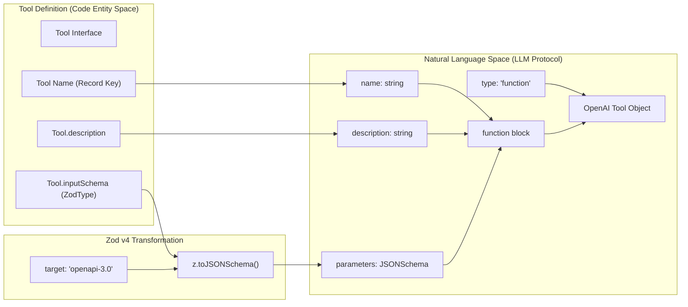
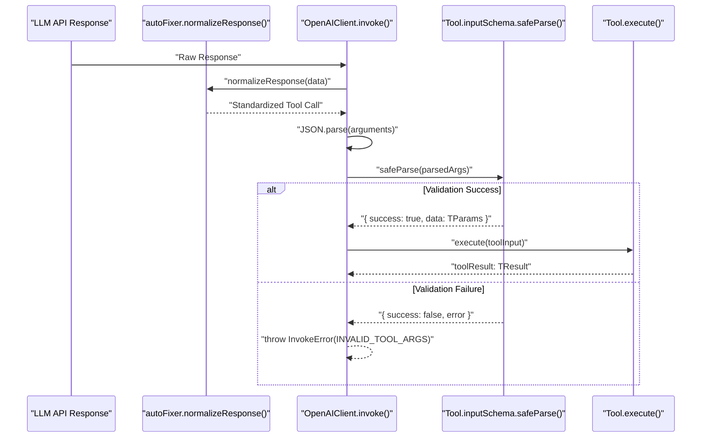

<!-- source: DeepWiki mcp.deepwiki.com · repo alibaba/page-agent · page 6.4 Tool Call Processing · fetched 2026-10-29 -->

# Tool Call Processing

<details>
<summary>Relevant source files</summary>

The following files were used as context for generating this wiki page:

- [packages/core/src/utils/autoFixer.ts](packages/core/src/utils/autoFixer.ts)
- [packages/llms/src/OpenAIClient.ts](packages/llms/src/OpenAIClient.ts)
- [packages/llms/src/errors.ts](packages/llms/src/errors.ts)
- [packages/llms/src/index.ts](packages/llms/src/index.ts)
- [packages/llms/src/utils.test.ts](packages/llms/src/utils.test.ts)
- [packages/llms/src/utils.ts](packages/llms/src/utils.ts)
- [packages/website/src/pages/docs/features/models/page.tsx](packages/website/src/pages/docs/features/models/page.tsx)

</details>


This page documents how the LLM integration layer processes tool calls, including Zod schema conversion to OpenAI tool format, model-specific patching, response parsing, automatic fixing of common model errors, and validation.

## Overview

Tool call processing is the mechanism by which the agent translates LLM responses into executable actions. The system uses **Zod v4 schemas** for type-safe tool definitions and validation, converting them to OpenAI-compatible tool formats for LLM communication.

The processing pipeline consists of five stages:

1.  **Schema Conversion**: Zod schemas → OpenAI tool format [packages/llms/src/utils.ts:15-24]().
2.  **Model Patching**: Adjusting request parameters (e.g., disabling thinking, adjusting temperature) based on the specific model name [packages/llms/src/utils.ts:39-196]().
3.  **API Invocation**: Send tools to LLM with request [packages/llms/src/OpenAIClient.ts:37-53]().
4.  **Response Normalization**: Auto-fix common LLM format issues using `autoFixer` [packages/core/src/utils/autoFixer.ts:21-121]().
5.  **Argument Validation**: Validate arguments against Zod schema [packages/llms/src/OpenAIClient.ts:225-236]().
6.  **Tool Execution**: Execute the validated tool and return results [packages/llms/src/OpenAIClient.ts:238-249]().

Sources: [packages/llms/src/OpenAIClient.ts:29-266](), [packages/llms/src/types.ts:7-14](), [packages/llms/src/utils.ts:39-196]()

## Tool Definition Structure

Tools are defined using the `Tool` interface, which requires a Zod schema for input validation and an async `execute` function:

```typescript
export interface Tool<TParams = any, TResult = any> {
	description?: string
	inputSchema: z.ZodType<TParams>
	execute: (args: TParams) => Promise<TResult>
}
```

The `inputSchema` field uses Zod's type system to define the expected input parameters. This schema serves dual purposes:
*   **Type safety**: TypeScript infers the `TParams` type from the schema.
*   **Runtime validation**: Arguments are validated before tool execution using `safeParse` [packages/llms/src/OpenAIClient.ts:225]().

Sources: [packages/llms/src/types.ts:7-14](), [packages/llms/src/OpenAIClient.ts:225-236]()

## Schema Conversion to OpenAI Format

### zodToOpenAITool Function

The `zodToOpenAITool` function converts a Zod schema to the OpenAI tool calling format. This conversion happens before each LLM API call:

```typescript
export function zodToOpenAITool(name: string, tool: Tool) {
	return {
		type: 'function' as const,
		function: {
			name,
			description: tool.description,
			parameters: z.toJSONSchema(tool.inputSchema, { target: 'openapi-3.0' }),
		},
	}
}
```

Key aspects:
*   **Zod v4 Native Support**: Uses `z.toJSONSchema()` from Zod v4, which provides native JSON Schema conversion [packages/llms/src/utils.ts:21]().
*   **OpenAPI 3.0 Target**: Generates schemas compatible with OpenAI's tool calling specification [packages/llms/src/utils.ts:21]().
*   **Tool Name Externalization**: Tool names are provided as keys in the tools object, not stored in the tool definition itself [packages/llms/src/OpenAIClient.ts:38]().

**Conversion Flow Diagram**



Sources: [packages/llms/src/utils.ts:15-24](), [packages/llms/src/OpenAIClient.ts:38]()

## Model-Specific Patching

The `modelPatch` function reconciles differences in how different LLM providers handle parameters. This ensures high success rates across diverse models like Qwen, DeepSeek, GPT, Claude, and Gemini [packages/llms/src/utils.ts:39-46]().

### Common Patching Actions
*   **Disabling Thinking**: Most models (Qwen, DeepSeek, Claude, GLM, etc.) have reasoning/thinking capabilities disabled or set to "minimal" to focus on tool execution [packages/llms/src/utils.ts:49, 58, 91, 134]().
*   **Temperature Adjustment**: Small models like Qwen-Flash may have their temperature raised to 1.0 to improve auto-recovery odds if not explicitly set by the user [packages/llms/src/utils.ts:50-54]().
*   **Tool Choice Translation**: Claude's `tool_choice` is converted from OpenAI format (`required`) to Claude-specific formats (`{ type: 'any' }`) [packages/llms/src/utils.ts:95-104]().
*   **Parallel Call Suppression**: Models like Kimi K3 or MiniMax have `parallel_tool_calls` disabled to prevent multi-tool hallucination [packages/llms/src/utils.ts:157, 168]().

Sources: [packages/llms/src/utils.ts:39-196]()

## Response Normalization and Auto-Fixing

The system includes a sophisticated `autoFixer` to handle common model hallucinations or formatting errors. This is particularly useful for smaller or non-OpenAI models that may struggle with strict tool-calling syntax.

### The normalizeResponse Logic

The `normalizeResponse` function in `@page-agent/core` acts as a middleware between the LLM and the tool executor [packages/core/src/utils/autoFixer.ts:21](). It addresses several edge cases:

*   **JSON in Content**: If a model returns JSON in `message.content` instead of `tool_calls`, the fixer extracts and moves it [packages/core/src/utils/autoFixer.ts:44-76]().
*   **Incorrect Tool Name**: If a model calls a specific action name (e.g., `click`) instead of the required `AgentOutput` wrapper, the fixer wraps the arguments into an `AgentOutput` structure [packages/core/src/utils/autoFixer.ts:38-41]().
*   **Double Stringification**: Fixes cases where the model returns arguments as a double-encoded JSON string [packages/core/src/utils/autoFixer.ts:82-86]().
*   **Primitive Coercion**: Converts primitive inputs for single-field tools (e.g., `{"click_element_by_index": 2}` → `{"click_element_by_index": {"index": 2}}`) [packages/core/src/utils/autoFixer.ts:149-157]().

Sources: [packages/core/src/utils/autoFixer.ts:21-121](), [packages/llms/src/OpenAIClient.ts:177-178]()

### Finish Reason Handling

The `OpenAIClient` validates the `finish_reason` field to ensure the response was not truncated or filtered [packages/llms/src/OpenAIClient.ts:148-174]().

| Finish Reason | Handling | Error Type |
| :--- | :--- | :--- |
| `tool_calls` | ✓ Continue processing | - |
| `function_call` | ✓ Continue (Gemini compatibility) | - |
| `stop` | ✓ Continue (some models use this) | - |
| `length` | ✗ Throw error | `CONTEXT_LENGTH` |
| `content_filter` | ✗ Throw error | `CONTENT_FILTER` |
| Other | ✗ Throw error | `INVALID_SCHEMA` |

Sources: [packages/llms/src/OpenAIClient.ts:148-174](), [packages/llms/src/errors.ts:5-23]()

## Argument Validation Pipeline

### Zod Schema Validation

After parsing and normalization, arguments are validated against the tool's Zod schema using `safeParse()`:

```typescript
const validation = tool.inputSchema.safeParse(parsedArgs)
if (!validation.success) {
    console.error(z.prettifyError(validation.error))
    throw new InvokeError(
        InvokeErrorTypes.INVALID_TOOL_ARGS,
        'Tool arguments validation failed',
        validation.error,
        data
    )
}
const toolInput = validation.data
```

Key aspects:
*   **Safe Parsing**: Uses `safeParse()` to avoid throwing exceptions and allow custom error handling [packages/llms/src/OpenAIClient.ts:225]().
*   **Pretty Error Output**: Validation errors are formatted using `z.prettifyError()` for clear debugging logs [packages/llms/src/OpenAIClient.ts:227]().
*   **Retryable Error**: `INVALID_TOOL_ARGS` errors are marked as retryable, allowing the agent to attempt self-correction [packages/llms/src/errors.ts:32]().

**Validation Flow Diagram**



Sources: [packages/llms/src/OpenAIClient.ts:177-235](), [packages/core/src/utils/autoFixer.ts:21-121]()

## Tool Execution and Result Packaging

### Execution

The tool's `execute` function is called with the validated arguments. Errors during this phase are wrapped in a `TOOL_EXECUTION_ERROR` [packages/llms/src/OpenAIClient.ts:238-249]().

### Result Packaging

The final `InvokeResult` includes metadata for debugging and token usage tracking:

```typescript
return {
    toolCall: {
        name: toolCallName,
        args: toolInput,
    },
    toolResult,
    usage: {
        promptTokens: data.usage?.prompt_tokens ?? 0,
        completionTokens: data.usage?.completion_tokens ?? 0,
        totalTokens: data.usage?.total_tokens ?? 0,
        cachedTokens: data.usage?.prompt_tokens_details?.cached_tokens,
        reasoningTokens: data.usage?.completion_tokens_details?.reasoning_tokens,
    },
    rawResponse: data,
    rawRequest: finalRequestBody,
}
```

Sources: [packages/llms/src/OpenAIClient.ts:252-266](), [packages/llms/src/types.ts:46-67]()

---

