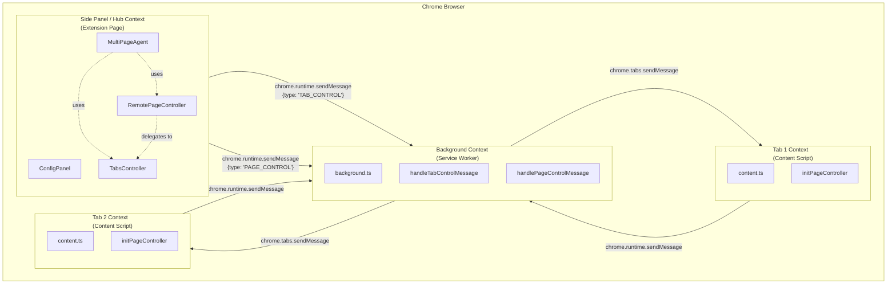
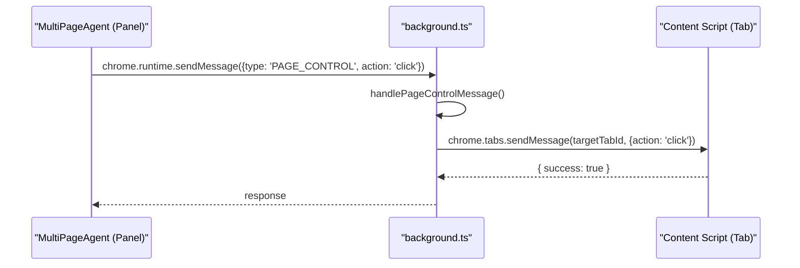

<!-- source: DeepWiki mcp.deepwiki.com · repo alibaba/page-agent · page 7 Browser Extension · fetched 2026-10-29 -->

# Browser Extension

Relevant source files

The following files were used as context for generating this wiki page:

- [packages/extension/package.json](packages/extension/package.json)
- [packages/extension/src/entrypoints/background.ts](packages/extension/src/entrypoints/background.ts)
- [packages/extension/src/entrypoints/content.ts](packages/extension/src/entrypoints/content.ts)
- [packages/extension/wxt.config.js](packages/extension/wxt.config.js)
- [packages/website/package.json](packages/website/package.json)

The Browser Extension package (`@page-agent/ext`) provides a Chrome extension implementation of PageAgent with multi-page agent capabilities. Unlike the NPM package which operates within a single page, the extension can coordinate actions across multiple browser tabs, manage tab lifecycles, and interact with Chrome APIs.

This document provides an overview of the extension's architecture and components. For detailed information about specific subsystems, see:
- Extension execution contexts and message passing: [Extension Architecture](#7.1)
- Multi-page agent implementation: [MultiPageAgent](#7.2)
- Tab lifecycle management: [Tab Management](#7.3)
- Cross-context DOM operations: [Remote Page Control](#7.4)
- Side panel UI and React hooks: [Extension UI and Configuration](#7.5)
- Security mechanisms and token system: [Authentication and Security](#7.6)
- External Control API and WebSocket Hub: [Hub and External Control API](#7.7)

For the standard single-page implementation, see [PageAgent Integration Class](#4.5). For core agent concepts, see [Core Agent System](#4).

## Extension vs NPM Package

The extension differs from the NPM package in several fundamental ways:

| Aspect | NPM Package | Browser Extension |
|--------|-------------|-------------------|
| **Execution Context** | Single in-page JavaScript context | Multiple: background, content script, side panel, hub |
| **Page Scope** | Single page, direct DOM access | Multiple tabs with cross-context communication |
| **Core Class** | `PageAgent` extends `PageAgentCore` | `MultiPageAgent` extends `PageAgentCore` |
| **Page Controller** | `PageController` (direct) | `RemotePageController` (message-passing) |
| **Initialization** | User code instantiates | Content script auto-injects or side panel starts |
| **Security** | User manages LLM credentials | Extension storage with token mechanism |

Sources: [packages/extension/package.json:41-45](), [packages/extension/src/entrypoints/background.ts:18-27]()

## Architecture Overview

The extension uses a **split-context architecture** where different components run in isolated JavaScript environments and communicate via Chrome's messaging APIs.

### Execution Contexts

**Diagram: Extension execution contexts and message routing**

The extension consists of isolated JavaScript environments:

1. **Background Service Worker** [packages/extension/src/entrypoints/background.ts:4-44](): Manages Chrome APIs, proxies messages, and handles external connections from `onMessageExternal` [packages/extension/src/entrypoints/background.ts:31-39]().
2. **Side Panel / Hub**: Hosts the `MultiPageAgent` instance and the user interface. Configured via `side_panel` in manifest [packages/extension/wxt.config.js:62-64]().
3. **Content Scripts**: Injected into each tab via `defineContentScript` [packages/extension/src/entrypoints/content.ts:7-11](), hosting the remote-controlled `PageController` logic [packages/extension/src/entrypoints/content.ts:13]().

Sources: [packages/extension/src/entrypoints/background.ts:4-44](), [packages/extension/src/entrypoints/content.ts:7-13](), [packages/extension/wxt.config.js:42-68]()

## Core Components

### MultiPageAgent

The `MultiPageAgent` class extends `PageAgentCore` and serves as the main agent orchestrator for cross-tab operations. It is designed to run in extension contexts like the Side Panel or Hub. In the content script context, it can be exposed to the page if auth tokens match [packages/extension/src/entrypoints/content.ts:16-35]().

- **Remote Control**: Uses `RemotePageController` to operate DOM across tabs.
- **Tab Coordination**: Integrates `TabsController` for tab switching and lifecycle management.
- **Event Forwarding**: When running in content scripts, it forwards `statuschange`, `activity`, and `historychange` events to the main world via `window.postMessage` [packages/extension/src/entrypoints/content.ts:87-124]().

Sources: [packages/extension/src/entrypoints/content.ts:39-164](), [packages/extension/package.json:42-45]()

### TabsController

The `TabsController` manages the browser's tab state for the agent.

- **Tab Groups**: Automatically creates and manages tab groups to isolate agent activities. The manifest explicitly requests `tabGroups` permissions [packages/extension/wxt.config.js:48]().
- **Cross-Tab Operations**: Provides methods for opening, switching, and closing tabs via `handleTabControlMessage` [packages/extension/src/entrypoints/background.ts:19-20]().

Sources: [packages/extension/src/entrypoints/background.ts:2-20](), [packages/extension/wxt.config.js:48]()

### RemotePageController

The `RemotePageController` acts as a bridge between the agent and the DOM in specific tabs.

- **Message Proxy**: Every DOM action (click, input, scroll) is sent as a `PAGE_CONTROL` message to the background script [packages/extension/src/entrypoints/background.ts:21-22]().
- **Content Script Initialization**: The `initPageController` function is called in the content script context to set up listeners for these messages [packages/extension/src/entrypoints/content.ts:1-13]().
- **Permissions**: Operates under `host_permissions` for `<all_urls>` [packages/extension/wxt.config.js:49]().

Sources: [packages/extension/src/entrypoints/background.ts:1-22](), [packages/extension/src/entrypoints/content.ts:1-13](), [packages/extension/wxt.config.js:49]()

## Message Passing Architecture

The extension uses two primary message types to coordinate operations.

### TAB_CONTROL Messages

Sent from the agent context to the background worker to invoke Chrome Tab APIs. These are handled by `handleTabControlMessage` [packages/extension/src/entrypoints/background.ts:19-20]().

### PAGE_CONTROL Messages

Proxied through the background worker to the content script of a specific target tab. These are handled by `handlePageControlMessage` [packages/extension/src/entrypoints/background.ts:21-22]().

Sources: [packages/extension/src/entrypoints/background.ts:18-27]()

## External Control and API

The extension exposes a public API to external callers, specifically `localhost` for development and local tools.

- **Authorization**: The background script generates a `PageAgentExtUserAuthToken` on startup and stores it in `chrome.storage.local` [packages/extension/src/entrypoints/background.ts:9-14]().
- **External Connections**: The `externally_connectable` manifest setting allows `http://localhost/*` to communicate with the extension [packages/extension/wxt.config.js:65-67]().
- **Hub Entrypoint**: External callers can trigger the opening of the Hub tab via the `OPEN_HUB` message, which supports passing a WebSocket port (`wsPort`) [packages/extension/src/entrypoints/background.ts:31-39]().

Sources: [packages/extension/src/entrypoints/background.ts:9-39](), [packages/extension/wxt.config.js:65-67]()

## Initialization and Persistence

- **Auth Persistence**: The user auth token is persisted in local storage to identify the session [packages/extension/src/entrypoints/background.ts:9-14]().
- **Side Panel**: The extension is configured to open the side panel automatically on action click [packages/extension/src/entrypoints/background.ts:43]().
- **Hub Management**: The `openOrFocusHubTab` function ensures only one Hub tab is active, pinned for easy access, and updates the URL with the WebSocket port [packages/extension/src/entrypoints/background.ts:46-59]().

Sources: [packages/extension/src/entrypoints/background.ts:9-59]()

---

