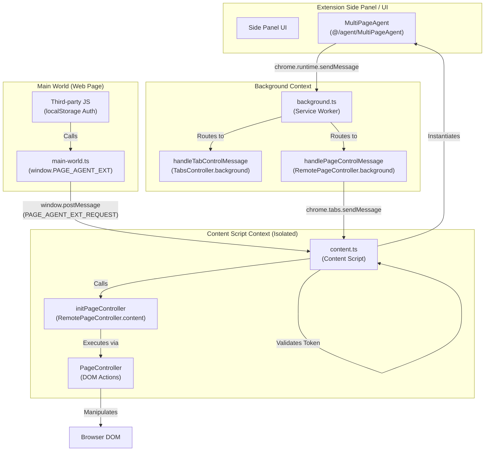

<!-- source: DeepWiki mcp.deepwiki.com · repo alibaba/page-agent · page 7.1 Extension Architecture · fetched 2026-10-29 -->

# Extension Architecture

<details>
<summary>Relevant source files</summary>

The following files were used as context for generating this wiki page:

- [packages/extension/docs/extension_api.md](packages/extension/docs/extension_api.md)
- [packages/extension/src/entrypoints/background.ts](packages/extension/src/entrypoints/background.ts)
- [packages/extension/src/entrypoints/content.ts](packages/extension/src/entrypoints/content.ts)
- [packages/extension/src/entrypoints/main-world.ts](packages/extension/src/entrypoints/main-world.ts)
- [packages/extension/wxt.config.js](packages/extension/wxt.config.js)
- [packages/website/src/pages/docs/features/chrome-extension/page.tsx](packages/website/src/pages/docs/features/chrome-extension/page.tsx)
- [tsconfig.base.json](tsconfig.base.json)

</details>


This document describes the Chrome extension's architecture, focusing on its execution contexts, message passing system, and how components are distributed across different browser environments. The extension enables multi-tab agent capabilities by coordinating between background service workers, content scripts, and extension pages.

For details on specific subsystems, see [MultiPageAgent](#7.2), [Tab Management](#7.3), [Remote Page Control](#7.4), [Extension UI and Configuration](#7.5), and [Authentication and Security](#7.6).

## Execution Contexts

Chrome extensions operate across three isolated JavaScript execution contexts, each with different capabilities and restrictions:

### Background Service Worker Context

The background service worker runs independently of any web page and has access to all Chrome extension APIs. It serves as the central message router and manages browser-level operations.

**Location:** [packages/extension/src/entrypoints/background.ts:4-44]()

**Key responsibilities:**
- Message routing between content scripts and extension pages for tab and page control via `handleTabControlMessage` and `handlePageControlMessage` ([packages/extension/src/entrypoints/background.ts:18-27]()).
- User authentication token generation and management using `chrome.storage.local` ([packages/extension/src/entrypoints/background.ts:9-14]()).
- Handling external messages (e.g., from a local launcher) via `chrome.runtime.onMessageExternal` to open or focus the Hub tab ([packages/extension/src/entrypoints/background.ts:31-39]()).
- Configuring the side panel behavior to open on action click ([packages/extension/src/entrypoints/background.ts:43-43]()).
- Accessing privileged Chrome APIs (tabs, tabGroups, sidePanel, storage) as defined in the manifest ([packages/extension/wxt.config.js:48-48]()).

### Content Script Context

Content scripts are injected into each web page matching the `<all_urls>` pattern. They run in an isolated JavaScript world with DOM access but limited Chrome API access.

**Location:** [packages/extension/src/entrypoints/content.ts:7-37]()

**Key responsibilities:**
- Initializing DOM manipulation capabilities via `initPageController` ([packages/extension/src/entrypoints/content.ts:13-13]()).
- Proxying requests from the injected "Main World" script to the `MultiPageAgent` ([packages/extension/src/entrypoints/content.ts:48-163]()).
- Authentication token validation by comparing `chrome.storage.local` with page `localStorage` ([packages/extension/src/entrypoints/content.ts:16-35]()).
- Injecting the `main-world.js` script to expose `window.PAGE_AGENT_EXT` to the web page ([packages/extension/src/entrypoints/content.ts:31-34]()).

**Injection configuration:** [packages/extension/wxt.config.js:49-49]() specifies `host_permissions: ['<all_urls>']` and the content script entry point handles `runAt: 'document_end'` ([packages/extension/src/entrypoints/content.ts:9-9]()).

### Extension Pages Context (Side Panel & Hub)

Extension pages (side panel, hub) run with full Chrome API access and can import the full agent system. The side panel serves as the primary human-in-the-loop UI.

**Configuration:** [packages/extension/wxt.config.js:62-64]() defines the side panel path as `sidepanel/index.html`. The Hub entry point is `hub.html` and is managed by `openOrFocusHubTab` ([packages/extension/src/entrypoints/background.ts:46-59]()).

**Key responsibilities:**
- User interface for agent control and configuration.
- Instantiating the `MultiPageAgent` for cross-tab tasks.
- Displaying real-time activity and history updates.

## Architecture Overview

The following diagram illustrates how the PageAgent extension bridges the gap between the user's web page and the agent's multi-page capabilities.

### System Component Map

**Sources:** [packages/extension/src/entrypoints/content.ts:48-163](), [packages/extension/src/entrypoints/main-world.ts:37-131](), [packages/extension/src/entrypoints/background.ts:18-27]()

## Message Passing Architecture

The extension uses a multi-layered message passing system to coordinate across execution boundaries.

### 1. Page-to-Extension (Window Messaging)
The `main-world.ts` script communicates with the content script via `window.postMessage`. This allows web pages to trigger the agent without having direct access to extension APIs.

*   **Request Channel:** `PAGE_AGENT_EXT_REQUEST` ([packages/extension/src/entrypoints/main-world.ts:91-91]())
*   **Response Channel:** `PAGE_AGENT_EXT_RESPONSE` ([packages/extension/src/entrypoints/main-world.ts:52-52]())

### 2. Context-to-Background (Runtime Messaging)
Components like `TabsController` and `RemotePageController` send messages to the background service worker using `chrome.runtime.sendMessage`.

*   **Action Routing:** The background listener identifies the request type (`TAB_CONTROL` or `PAGE_CONTROL`) and forwards it to the appropriate controller ([packages/extension/src/entrypoints/background.ts:18-27]()).

### 3. Background-to-Content (Tab Messaging)
When the agent needs to interact with a specific tab's DOM, the background script sends a message to that tab's content script using `chrome.tabs.sendMessage`.

## Data Flow: External Task Execution

This diagram shows the sequence when an external web page calls `window.PAGE_AGENT_EXT.execute()`.

```mermaid
sequenceDiagram
    participant WebPage as "Web Page JS"
    participant MW as "main-world.ts"
    participant CS as "content.ts"
    participant MPA as "MultiPageAgent"
    participant BG as "Background SW"

    WebPage->>WebPage: Set localStorage Auth Token
    Note over WebPage, MW: User calls window.PAGE_AGENT_EXT.execute()
    MW->>CS: window.postMessage({action: 'execute'})
    CS->>CS: Verify Auth Token (chrome.storage vs localStorage)
    
    create participant MPA
    CS->>MPA: new MultiPageAgent(config)
    CS->>MPA: multiPageAgent.execute(task)
    
    loop Agent Loop
        MPA->>BG: chrome.runtime.sendMessage({type: 'PAGE_CONTROL'})
        BG->>CS: chrome.tabs.sendMessage(targetTabId)
        CS->>CS: Execute DOM Action
        CS-->>MPA: Return BrowserState / Result
    end
    
    MPA-->>CS: Task Finished
    CS->>MW: window.postMessage({action: 'execute_result'})
    MW-->>WebPage: Resolve Promise
```
**Sources:** [packages/extension/src/entrypoints/content.ts:16-35](), [packages/extension/src/entrypoints/content.ts:128-138](), [packages/extension/src/entrypoints/main-world.ts:89-107]()

## Component Distribution

### Content Script (`content.ts`)
The content script acts as a gatekeeper and a singleton host for the `MultiPageAgent` when tasks are initiated from the page context.

*   **Auth Verification:** It compares the `PageAgentExtUserAuthToken` from `chrome.storage.local` with the one in the page's `localStorage` ([packages/extension/src/entrypoints/content.ts:16-27]()).
*   **Agent Lifecycle:** It manages a singleton instance of `MultiPageAgent`, ensuring only one task runs at a time ([packages/extension/src/entrypoints/content.ts:59-71]()).
*   **Event Forwarding:** It listens to agent events (`statuschange`, `activity`, `historychange`) and forwards them to the web page via `window.postMessage` ([packages/extension/src/entrypoints/content.ts:87-124]()).

### Main World Script (`main-world.ts`)
This script is injected into the web page's own execution context as an unlisted script ([packages/extension/src/entrypoints/main-world.ts:30-30]()).

*   **Public API:** It defines `window.PAGE_AGENT_EXT`, providing `execute` and `stop` methods ([packages/extension/src/entrypoints/main-world.ts:126-130]()).
*   **Promise Wrapping:** It converts the asynchronous `postMessage` flow into standard JavaScript Promises for the end user ([packages/extension/src/entrypoints/main-world.ts:46-87]()).

### Background Service Worker (`background.ts`)
*   **Initialization:** Sets up side panel behavior and generates initial `PageAgentExtUserAuthToken` if it doesn't exist ([packages/extension/src/entrypoints/background.ts:9-14]()).
*   **Message Hub:** Centralizes logic for tab control and remote page interaction via `handleTabControlMessage` and `handlePageControlMessage` ([packages/extension/src/entrypoints/background.ts:18-27]()).

## Security Boundaries

### Token-Based Authorization
The extension requires an explicit `PageAgentExtUserAuthToken` to be present in the page's `localStorage` ([packages/extension/src/entrypoints/content.ts:23-26]()). This ensures that only sites trusted by the user (who must copy the token from the extension side panel) can control the browser.

### Isolated Worlds
By default, the `MultiPageAgent` and `PageController` logic reside in the **Isolated World** (Content Script context). Even if a malicious script on the web page attempts to interfere, it cannot access the internal state or the Chrome APIs available to the isolated world ([packages/extension/src/entrypoints/content.ts:18-18]()).

**Sources:** [packages/extension/src/entrypoints/content.ts:16-35](), [packages/extension/src/entrypoints/main-world.ts:1-131](), [packages/extension/src/entrypoints/background.ts:9-39](), [packages/extension/wxt.config.js:42-68]()

---

