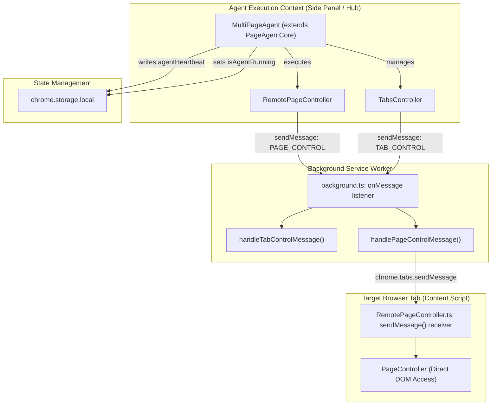
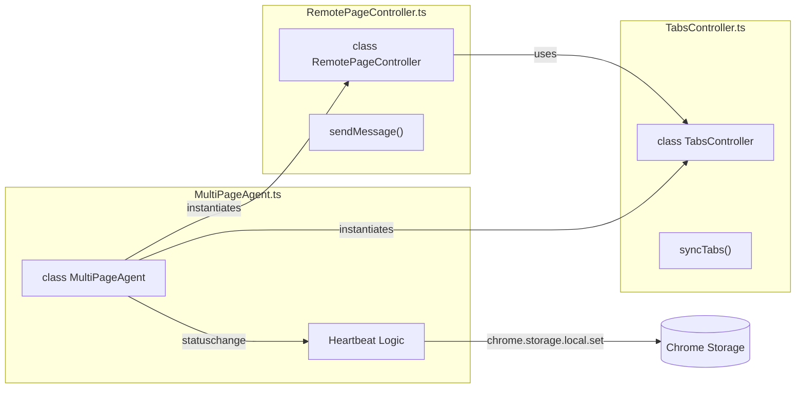

<!-- source: DeepWiki mcp.deepwiki.com · repo alibaba/page-agent · page 7.2 MultiPageAgent · fetched 2026-10-29 -->

# MultiPageAgent

Relevant source files

The following files were used as context for generating this wiki page:

- [packages/extension/src/agent/MultiPageAgent.ts](packages/extension/src/agent/MultiPageAgent.ts)
- [packages/extension/src/agent/RemotePageController.ts](packages/extension/src/agent/RemotePageController.ts)

The `MultiPageAgent` class extends `PageAgentCore` to provide multi-tab web automation capabilities within the browser extension environment. Unlike the single-page `PageAgent` used in the NPM package, `MultiPageAgent` coordinates actions across multiple browser tabs through Chrome Extension APIs, using a message-passing architecture to bridge different execution contexts.

## Purpose and Scope

`MultiPageAgent` serves as the main agent orchestrator in the browser extension, providing:

- **Cross-tab coordination** via `TabsController` for managing multiple browser tabs [[packages/extension/src/agent/MultiPageAgent.ts:27]]().
- **Remote DOM control** through `RemotePageController` using message-passing to content scripts [[packages/extension/src/agent/MultiPageAgent.ts:28]]().
- **Extension-specific tools** including tab management tools created via `createTabTools` [[packages/extension/src/agent/MultiPageAgent.ts:29]]().
- **Agent lifecycle management** with a heartbeat mechanism for tracking agent status across contexts to handle side-panel closures [[packages/extension/src/agent/MultiPageAgent.ts:43-51]]().

This class is typically instantiated within the extension's UI layer (like the side panel) or the Hub entry point.

**Sources:** [[packages/extension/src/agent/MultiPageAgent.ts:24-100]]()

## Architecture Overview

The following diagram shows how `MultiPageAgent` integrates with the extension's multi-context architecture, bridging the Natural Language Space (Tasks) to Code Entity Space (Controllers).

**Multi-Context Agent Architecture**

**Sources:** [[packages/extension/src/agent/MultiPageAgent.ts:24-100]](), [[packages/extension/src/agent/RemotePageController.ts:9-19]]()

## Key Differences from PageAgentCore

| Aspect | PageAgentCore (Standard) | MultiPageAgent (Extension) |
|--------|-----------|----------------|
| **Context** | Single execution context | Multi-context (Extension/Content Scripts) [[packages/extension/src/agent/MultiPageAgent.ts:22]]() |
| **Page Controller** | Local `PageController` | `RemotePageController` (Proxy) [[packages/extension/src/agent/MultiPageAgent.ts:28]]() |
| **Tab Capability** | Single page only | Multi-tab via `TabsController` [[packages/extension/src/agent/MultiPageAgent.ts:27]]() |
| **Lifecycle** | Standard Re-act loop | Heartbeat-backed loop for extension stability [[packages/extension/src/agent/MultiPageAgent.ts:43-51]]() |
| **JS Execution** | Supported | Disabled (AbortSignal cannot cross contexts) [[packages/extension/src/agent/MultiPageAgent.ts:57]]() |

**Sources:** [[packages/extension/src/agent/MultiPageAgent.ts:24-100]](), [[packages/extension/src/agent/RemotePageController.ts:136]]()

## Constructor and Configuration

### Configuration Options

`MultiPageAgent` extends the standard `AgentConfig` with extension-specific flags defined in `MultiPageAgentConfig` [[packages/extension/src/agent/MultiPageAgent.ts:14-17]]():

| Option | Type | Default | Description |
|--------|------|---------|-------------|
| `includeInitialTab` | `boolean` | `true` | Whether to include the active tab in the agent's initial managed set [[packages/extension/src/agent/MultiPageAgent.ts:39]](). |
| `experimentalIncludeAllTabs` | `boolean` | `false` | Whether to attempt to control all open tabs in the window [[packages/extension/src/agent/MultiPageAgent.ts:40]](). |

### Language Auto-detection
The agent automatically detects the browser language using `navigator.language` to set the `Default working language` in the system prompt [[packages/extension/src/agent/MultiPageAgent.ts:9-12]](). It replaces the placeholder in `SYSTEM_PROMPT` with either "中文" or "English" [[packages/extension/src/agent/MultiPageAgent.ts:32-37]]().

**Sources:** [[packages/extension/src/agent/MultiPageAgent.ts:9-40]]()

## Implementation Details

### Remote Page Control
`RemotePageController` acts as a proxy for the agent, delegating DOM operations to content scripts via the background service worker [[packages/extension/src/agent/RemotePageController.ts:26]]().

- **Message Routing:** Uses `chrome.runtime.sendMessage` with a `PAGE_CONTROL` type [[packages/extension/src/agent/RemotePageController.ts:9-14]]().
- **Restricted URLs:** Operations are blocked on internal browser pages (e.g., `chrome://`, `about:`) via `isContentScriptAllowed` [[packages/extension/src/agent/RemotePageController.ts:175-192]]().
- **State Assembly:** Combines the local tab summary from `TabsController` with the remote `BrowserState` from the active tab [[packages/extension/src/agent/RemotePageController.ts:58-86]]().

### Tab Management Integration
The agent leverages `TabsController` to manage the lifecycle of tabs relevant to the task [[packages/extension/src/agent/MultiPageAgent.ts:27]]().

- **Initialization:** During `onBeforeTask`, it initializes the controller with the task description to identify relevant tabs [[packages/extension/src/agent/MultiPageAgent.ts:62-64]]().
- **Step Sync:** Before every step (`onBeforeStep`), it synchronizes tab states and waits for the current tab to be fully loaded [[packages/extension/src/agent/MultiPageAgent.ts:66-72]]().

**Code Entity Mapping: MultiPageAgent Components**

**Sources:** [[packages/extension/src/agent/MultiPageAgent.ts:24-100]](), [[packages/extension/src/agent/RemotePageController.ts:26-31]]()

## Lifecycle and Heartbeat

Because the extension side-panel can be closed by the user without triggering standard `unload` events, `MultiPageAgent` implements a heartbeat mechanism [[packages/extension/src/agent/MultiPageAgent.ts:43-51]]().

1. **Heartbeat Generation:** When the agent status changes to `running`, a `setInterval` is started that writes the current timestamp to `chrome.storage.local.agentHeartbeat` every 1 second [[packages/extension/src/agent/MultiPageAgent.ts:88-91]]().
2. **Status Sync:** The agent status (`isAgentRunning`) is mirrored to `chrome.storage.local` on every status change event [[packages/extension/src/agent/MultiPageAgent.ts:85-98]]().
3. **Disposal:** During `onDispose`, the heartbeat interval is cleared and `isAgentRunning` is explicitly set to `false` [[packages/extension/src/agent/MultiPageAgent.ts:74-82]]().

**Sources:** [[packages/extension/src/agent/MultiPageAgent.ts:74-100]]()

---

