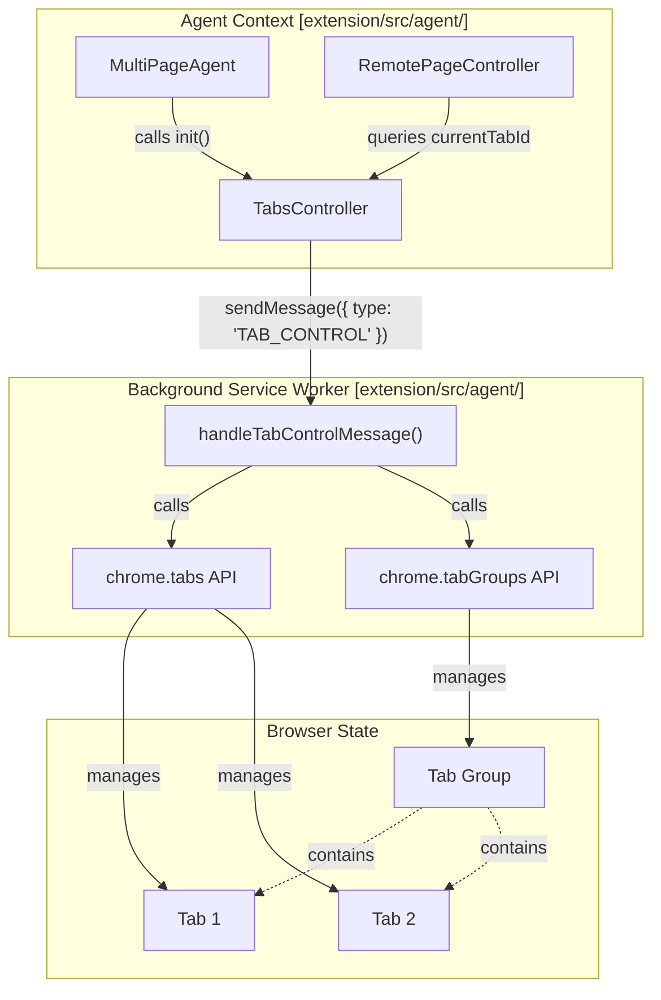
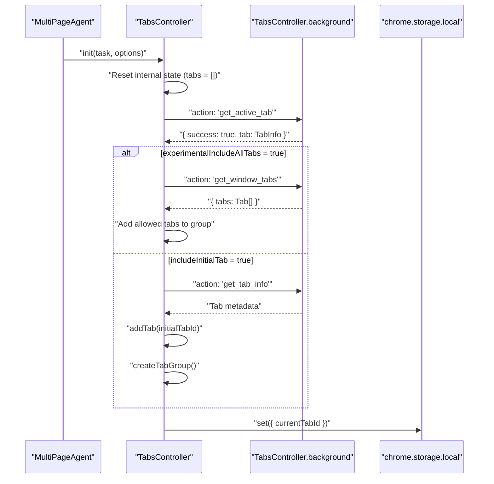
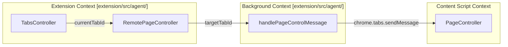

<!-- source: DeepWiki mcp.deepwiki.com · repo alibaba/page-agent · page 7.3 Tab Management · fetched 2026-10-29 -->

# Tab Management

Relevant source files

The following files were used as context for generating this wiki page:

- [packages/core/src/tools/index.ts](packages/core/src/tools/index.ts)
- [packages/extension/src/agent/RemotePageController.background.ts](packages/extension/src/agent/RemotePageController.background.ts)
- [packages/extension/src/agent/TabsController.background.ts](packages/extension/src/agent/TabsController.background.ts)
- [packages/extension/src/agent/TabsController.test.ts](packages/extension/src/agent/TabsController.test.ts)
- [packages/extension/src/agent/TabsController.ts](packages/extension/src/agent/TabsController.ts)
- [packages/extension/src/agent/tabTools.ts](packages/extension/src/agent/tabTools.ts)
- [packages/extension/vitest.config.js](packages/extension/vitest.config.js)

## Purpose and Scope

This document describes the tab management system used by the browser extension to control and coordinate browser tabs during multi-page agent operations. The `TabsController` class provides the core functionality for opening, closing, switching between tabs, organizing tabs into groups, and synchronizing tab state across extension contexts.

For information about how `TabsController` integrates with the multi-page agent, see [MultiPageAgent](packages/extension/src/agent/MultiPageAgent.ts). For details on how tab state is used for cross-context DOM operations, see [Remote Page Control](packages/extension/src/agent/RemotePageController.ts).

## Architecture Overview

The tab management system operates across multiple extension contexts. The `TabsController` resides in the agent's environment (such as the Side Panel or Hub tab) but delegates actual browser operations to the Background Service Worker.

### Code Entity Interaction Diagram

**Sources:** [packages/extension/src/agent/TabsController.ts:38-40](), [packages/extension/src/agent/TabsController.background.ts:47-52](), [packages/extension/src/agent/RemotePageController.background.ts:6-15]()

The `TabsController` maintains the local state of managed tabs while the background script `handleTabControlMessage` [packages/extension/src/agent/TabsController.background.ts:47-51]() executes Chrome API calls. State is synchronized via `chrome.storage.local` to allow other components to react to tab changes [packages/extension/src/agent/TabsController.ts:248-253]().

## TabsController Class

### Core Responsibilities

The `TabsController` class [packages/extension/src/agent/TabsController.ts:38-40]() manages the lifecycle and state of browser tabs:

| Responsibility | Implementation |
|---|---|
| **Tab Lifecycle** | Opens new tabs [packages/extension/src/agent/TabsController.ts:132](), switches focus [packages/extension/src/agent/TabsController.ts:169](), and closes tabs [packages/extension/src/agent/TabsController.ts:182](). |
| **Tab Grouping** | Automatically groups managed tabs into a named group [packages/extension/src/agent/TabsController.ts:216](). |
| **State Tracking** | Maintains an array of `TabMeta` objects and the `currentTabId` [packages/extension/src/agent/TabsController.ts:39-46](). |
| **Context Awareness** | Identifies its own window context to ensure operations happen in the correct window [packages/extension/src/agent/TabsController.ts:26-30](). |
| **Wait Condition** | Provides `waitUntilTabLoaded` to poll for tab status completion [packages/extension/src/agent/TabsController.ts:301-325](). |

### Initialization and Setup

The initialization process establishes the controller's state and identifies the starting tab.

### Initialization Sequence

**Sources:** [packages/extension/src/agent/TabsController.ts:52-130](), [packages/extension/src/agent/TabsController.background.ts:55-66]()

The `init()` method [packages/extension/src/agent/TabsController.ts:52]() determines the `windowId` and `initialTabId` by communicating with the background script. It filters tabs using `isContentScriptAllowed` [packages/extension/src/agent/TabsController.ts:93]() to ensure the agent only interacts with valid web pages.

## Tab Operations

### Opening and Grouping Tabs

When `openNewTab(url)` is called [packages/extension/src/agent/TabsController.ts:132](), the following occurs:
1. **Creation**: A message is sent to the background script to `chrome.tabs.create` with `active: false` [packages/extension/src/agent/TabsController.background.ts:82-89]().
2. **Tracking**: The new ID is added to the internal `tabs` list [packages/extension/src/agent/TabsController.ts:147-150]().
3. **Grouping**: The tab is added to the agent's tab group. If no group exists, `createTabGroup` is called [packages/extension/src/agent/TabsController.ts:154-161]().
4. **Synchronization**: The group is named `PageAgent(${this.task})` [packages/extension/src/agent/TabsController.ts:235]() and assigned a random color.

### Switching and Closing

- **`switchToTab(tabId)`**: Validates that the target tab is in the managed list [packages/extension/src/agent/TabsController.ts:172-175]() and updates the current tab ID in both local state and `chrome.storage.local` [packages/extension/src/agent/TabsController.ts:248-253]().
- **`closeTab(tabId)`**: Specifically prevents closing the `isInitial` tab to avoid terminating the user's entry point [packages/extension/src/agent/TabsController.ts:189-191](). If the closed tab was the active one, the controller automatically falls back to the last remaining tab [packages/extension/src/agent/TabsController.ts:201-208]().

**Sources:** [packages/extension/src/agent/TabsController.ts:169-214](), [packages/extension/src/agent/TabsController.background.ts:137-148]()

## Agent Tool Integration

Tab management capabilities are exposed to the LLM via `createTabTools` [packages/extension/src/agent/tabTools.ts:25](). These tools wrap `TabsController` methods into the `PageAgentTool` interface used by `PageAgentCore`.

| Tool Name | Action | Parameters |
|---|---|---|
| `open_new_tab` | Opens a URL and makes it the active target [packages/extension/src/agent/tabTools.ts:27-43](). | `url: string` |
| `switch_to_tab` | Changes the active tab context [packages/extension/src/agent/tabTools.ts:45-59](). | `tab_id: number` |
| `close_tab` | Closes a specific tab [packages/extension/src/agent/tabTools.ts:61-75](). | `tab_id: number` |

**Sources:** [packages/extension/src/agent/tabTools.ts:25-77](), [packages/core/src/tools/index.ts:21-26]()

## Cross-Context Coordination

Tab management is critical for the `RemotePageController` to know which content script should receive DOM commands.

### Tab State Flow

**Sources:** [packages/extension/src/agent/RemotePageController.background.ts:15-29](), [packages/extension/src/agent/TabsController.ts:248-253]()

1. **Targeting**: The `RemotePageController` in the agent context queries `TabsController.currentTabId` to set the `targetTabId` for messages [packages/extension/src/agent/RemotePageController.background.ts:7-15]().
2. **Persistence**: The `currentTabId` is stored in `chrome.storage.local` whenever it changes [packages/extension/src/agent/TabsController.ts:252](), allowing visual components (like highlights) to know if they are in the active agent tab.

**Sources:** [packages/extension/src/agent/TabsController.ts:248-253](), [packages/extension/src/agent/RemotePageController.background.ts:6-42]()

---

